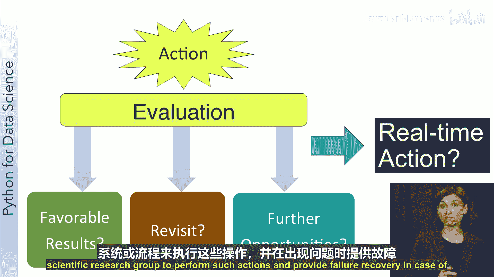

# 【加州大学圣地亚哥分校】Python数据科学-｜-Python-for-Data-Science-p07-02-03-02-视频-步骤一：数据采集--BV1jwFUzjEXu_p7-

The first step in our data science process is acquiring data。After this video。

 you will be able to list techniques and technologies to access and retrieve the data you need。😊。

And describe an example scenario that accesses data from a variety of sources using different technologies。

😊，As I said， the first step is acquire data， that means you need to obtain the source material before analyzing or acting on it。

 the first step in acquiring data is determining what data is available when it comes to finding the right data sources。

 we try to leave no stone unturned。😊，You want to identify suitable data related to your problem and make use of all data that is relevant to your problem for analysis。

😊，Sometimes leaving out even a small amount of important data can lead to incorrect conclusions。😊。

Data comes from many places， local and remote， in many varieties structured and unstructured。😊。

And in many different velocities， that refers to the streaming speed of the data。

There are many techniques and technologies to access these different types of data。

 let's discuss a few examples。😊，A lot of data exists in conventional relational databases like structured data coming from organizations。

😊，The tool of choice to access data from databases is structured query language or SQL。

 which is supported by all relational database management systems。😊，Additionally。

 most database systems come with a graphical application environment that allows you to query and explore the datas in the database data can also exist in files such as text files and Excel spreadsheets。

Scriping languages are generally used to get data from files。😊，Is scripting language like Python？😊。

Is a high level programming language that can be general purpose or specialized for specific functions。

😊，You'll see unique scripting and some Python in week two in addition。😊，Throughout this class。

 we will be using Python in all of our case studies and examples。

Next week we'll review Python and in week three you'll start learning Python libraries and functions related to text processing。

 other common scripting languages with support for processing files are JavaScript， PhP， Pearl， R。

 Octa， and MATLb to name a few， an increasingly popular way to get data is from websites。

Web pages are written using a set of standards approved by Worldwide Web Consortium or W3C。

This includes a variety of formats and services。One common format is XML or extensible Markup language or JSON。

😊，Wehich both use markup symbols and tabs to describe the contents on a web page。

Many websites also host web services which provide programmatic access to their data。😊。

There are several types of web services， the most popular one being rest since it's easy to use RE stands for representational state transfer。

😊，And it is an approach for implementing web services with performance。

 scalability and maintainability in mind。😊，Webs socket services are also becoming more popular since they allow real time notifications from the websites。

😊，No SQL storage systems are increasingly used to manage a variety of data types。😊。

These data stores are databases that do not represent data in a table format with columns or rows。

 as with conventional relational databases。Examples of these data stores include Cassandra。

 Mongodibi and HBase。No SQL data stores provide APIs to allow users to access the data。

 these APIs can be used directly or in an application that needs to access the data like a Python script。

Additionally， most NoSQL systems provide data access via a web interface such as RE。😊。

In one application from our work at the San Diego Cifer Computer Center。

We use wildfire data analysis to predict fire direction and rate of spread。

 this project requires acquiring data using several different mechanisms。

The project itself stores historical sensor data from weather stations in a relational database。

 we use SQL to retrieve this data from the database to create models to identify weather patterns associated with fire weather conditions to determine whether a particular weather station is currently experiencing fire weather conditions。

 we access realtime data using a web socket service。😊，Once we start listening to this service。

 we receive better station measurements as they occur。

This data is then processed and compared to patterns found by our models to determine if a better station is experiencing Santa Anacon or fire weather conditions。

At the same time， tweets are retrieved using hashtags related to any fires that are occurring in the region。

The tweet messages are retrieved using the Twitter Re service。

 the idea is to determine the sentiment of these tweets to see if people are expressing fear。

 anger or simply nonchaaln about the nearby fire。😊。

The combination of sensor data and tweet sentiments helps to give us a sense of the urgency of the fire situation。

To summarize。Data can come from many places。Finding and evaluating all useful data to our analytics is important before we start acquiring data。

😊，Depending on the source and structure of the data。

 there are alternative ways to access it and we'll see all about these access methods throughout。😊。

The coming weeks in Python。Next we'll talk about exploring data after this video you will be able to explain the importance of exploring data and identify methods to perform preliminary analysis of your data。

😊，After you've put together the data that you need for your application。

 you might be tempted to immediately build models to analyze the data。😊。

We must resist this temptation station。The first step after getting your data is to explore it as exploring data is a big part of the two step data preparation activity。

😊，You want to do some preliminary investigation in order to gain a better understanding of the specific characteristics of your data in this step you'll be looking for things like correlations。

 general trends， outliers。😊，And without this step， you will not be able to use the data effectively。

😊，Correlation graphs can be used to explore the dependencies between different variables。😊。

In the data。General trends show you a simple graph of how the data is progressing over time。😊。

And outliers show you the data points that are distant from other data points。

 plotting outliers will help you double check for errors in the data due to measurement。

In some cases， outliers that are not errors might make you find a rare event。😊，Additionally。

 summary statistics provide numerical values to describe your data。😊。

Summary statistics are quantities that capture various characteristics of a set of values with a single number or a small set of numbers。

😊，Some basic summary statistics that you should compute for your dataset are mean， median， mode。

 range and standard deviation。😊，Mean and median are measures of the location of a specific values。😊。

Moode is the value that occurs most frequently in your dataset。

And range and standard deviation are measures of spread in your data。

Looking at these measures will give you an idea of the nature of your data。😊。

They can tell you if there's something wrong with your data， for example。

 if the range of the values for age in your data includes negative numbers or a number much greater than 100。

 there's something suspicious in the data that needs to be examined。😊，Python gives you。

Functions and methods that we can quickly explore the data and provide these statistics we'll be hearing all about those by the end of this course。

Visualization techniques also provide quick and effective， overall。

 a very useful way to look at data in this preliminary analysis step， a heat map， for instance。

 such as the shown one shown here。😊，Can quickly give you an idea where the hotspots are。😊。

Many different types of graphs can be used。Histograms show the distribution of the data and can show schoonness or unusual dispersion。

😊，BoxPlus are another type of plot for showing data distribution。😊。

Line graphs are useful for seeing how values in your data change over time。😊。

Spikes in the data are also easy to spot。Scatterpls can show correlation between two variables Overall。

 there are many types of graphs of visualized data they are very useful in helping you understand the data you have。

😊，Looking ahead， we'll actually spend the better part of a week just focused on effective ways to visualize data。

😊，In summary， what you get by exploring data is a better understanding of the complexity of the data you have to work with。

😊，This， in turn， will guide the rest of the process。Now that we know more about。

The complexity of our data after exploring with it， we'll talk about。😊。

Preprocessing data or transforming it to make it ready for analysis。After this video。

 you will be able to identify some problems with real world data。

And describe what is needed to transform raw data to data that can be used for analysis。

The raw data that you get directly from your sources are never in the format that you need to perform analysis on。

 there are two main goals in the data preprocessing step。

The first is to clean the data to address data quality issues。

 the second is to transform the data to make it suitable for analysis。

A very important part of data preparation is to address quality issues in your data。😊。

Real world data is messy。 There are many examples of quality issues with data from real applications。

 including。Inconsistent late data。Like a customer with two different addresses recorded at two different sales locations。

 but these recordings don't agree。Or。Missing customer age in demographic studies。

Or an invalid zip code， for example， a six digit zip code。

And outliers like a sensor failure that causes values to be much higher or lower than expected for a period of time。

Since we get the data downstream， we usually have little control over how the data is collected。

Preventing data quality problems as the data is being collected is often not an option。

So we have the data that we get and we have to address quality issues by detecting and correcting them。

😊，Here are some approaches we can take to address these data quality issues。

We can remove the data records with missing values。We can merge duplicate records。

 This would require a way to determine how to resolve conflicting values。

 Perhaps it makes sense to retain the Ne value whenever there is a conflict。For invalidval values。

 a best estimate for a reasonable value can be used as a replacement。For example。

 a missing age value for an employee。Can be filled in based on a reasonable estimate on the employee's length of employment。

Outliers can also be removed if they are not important to the task。

In order to address all these data quality issues effectively。

 knowledge about the application such as how the data was collected， the user population。

 the intended uses of the application， etc are important。This domain knowledge。

Is essential to making informed decisions on how to handle incomplete or incorrect data。

You also need to be careful about the changes you make to avoid coming to incorrect conclusions and be sure to keep records of the changes you make。

😊，The second part of preparing data is to manipulate the clean data into a format needed for analysis。

😊，This step is known by many names， data manipulation， data preprocessing。

Data wrangling and probably my favorite data muing。Some operations for this data managing， wrangling。

 preprocessing include scaling， transformation， feature selection， dimensionality reduction。

 and data manipulation。Let's look at these in further detail。

Scaling involves changing range of values to be between a specified range such as from zero to1。😊。

This is done to avoid having certain features with large values from dominating the results。

 For example， in analyzing data with height and weight。

 the magnitude of the weight values is much greater than the magnitude of the height values。😊，So。

 scaling all values to be between 0 and 1 will equalize contributions from both height and weight features。

Various transformations can be performed on the data to reduce noise and variability。

One such transformation is called aggregation。Agregate data generally results in data with less variability。

 which may help with the analysis in the long term。For example。

 daily sales figures may have many spurious changes。

 aggregating values to weekly or monthly sales figures will result in smoother data。

Other filtering techniques can also be used to remove variability in the data。Of course。

 this comes at the cost of less detailed data， so these factors must be weighed for the specific application。

Feature selection can involve removing redundant or irrelevant features， combining features。😊。

And creating new features。During the exploring data step。

 you may have discovered that two features are very correlated， in that case。

 one of these features can be removed without negatively affecting the analysis results。😊。

For example， the purchase， price of a product and the amount of sales tax paid are likely to be very correlated。

Eliminating the sales tax amount then will be beneficial。

Removing redundant or irrelevant features will make the subsequent analysis simpler。In other cases。

 you may want to combine features or create new ones， for example。

 adding applicant's education level as a feature to a loan approval application would make sense。

There are also algorithms to automatically determine the most relevant features based on various mathematical properties。

Dimenssality reduction is useful when the dataset set has a large number of dimensions。

 it involves finding a smaller subset of dimensions that captures most of the variation in the data。

This reduces the dimensions of the data while eliminating irrelevant features and makes analysis simpler。

😊，A technique commonly used for dimensionality reduction is called principal component analysis。

Row data often has to be manipulated to be in the correct format for the analysis， for example。

From samples recording daily changes in stock prices。

 we may want to capture the price changes for a particular market segment， for example。

 real estate or healthcare。This was required determining which stocks belong to which market segment。

Grouping them together and perhaps computing the mean range and standard deviation for each group。😊。

In summary。Data preparation is a very important part of the data science process。 In fact。

 this is where you will spend most of your time on any data science effort。😊。

It can be a tedious process， but it is a crucial step。

 always remember when it comes to data processing， garbage in is garbage out。😊。

If you do not spend the time and effort to create good data for the analysis。

 you will not get good results， no matter how sophisticated your data analysis techniques are。

Now that we prepared our data。We finally can work on the analysis。After this video。

 you will be able to describe what is involved in applying an analysis technique to your data。😊。

And list three basic analysis techniques。Now that you have your data nicely prepared。😊。

The next step is to analyze the data data analysis involves building a model from your data。

 which is called input data。😊，The input data。Is used by the analysis technique to build a model。

What your model generates is the output data。There are different types of problems。

 and so there are different types of analysis techniques。😊。

The main categories of analysis techniques are classification， regression， clustering。

 association analysis， and graph analysis。😊，We will now describe each one。😊，In classification。😊。

The goal is to predict the category of the input data。

An example of this is predicting the weather as being sunny， rainy， windy or cloudy。

The categories to be predicted are sunny， rainy， windy and cloudy in this case。😊。

Another example is to classify a tumor。As either benign or malignant， in this case。

 the classification is referred to as binary classifications since there are only two categories。😊。

But you can have many categories as well as the weather prediction problem shown here with four different categories。

Another example is to identify handwritten digits as being one of 10 categories that is  zero to9。😊。

When your model has to predict a numeric value instead of a category。

 then the task becomes a regression problem。😊，An example of regression is to predict the price of a stock over time。

😊，The stock price is an numeric value， not a category。

 so this is a regression task instead of a classification task。😊，Other examples of regression？😊。

Are estimating the weekly sales of any new product？And predicting the score on a test。

Next is clustering。In clustering， the goal is to organize similar items into groups。

An example is grouping a company's customer base into distinct segments for more effective targeted marketing。

 like seniors， adults and teenagers， as we see here。

 other examples include identifying areas of similar topography， for example， mountains。

 desert plains for a land use application。😊，And determining different groups of weather patterns like rainy。

 cold or snowy， the goal in association analysis。Is to come up with a set of rules to capture associations between items or events。

The rules are used to determine when items or events occur together。

A common application of association analysis is known as market basket analysis。

 which is used to understand customer purchasing behavior。😊，For example。

 association analysis can reveal that banking customers who have certificate of deposit accounts。

 shortly CDs， also tend to be interested in other investment vehicles such as money market accounts。

😊，This information can be used for cross selling。If you advertise money market accounts to your customers with CDs。

 they are likely to open such an account According to data mining folklore。

 a supermarket chain used association analysis to discover a connection between two seemingly unrelated products。

They discovered that many customers who go to the supermarket late on Sunday night to buy diapers also tend to buy beer。

This information was then used to place beer and diapers close together on Sundays。😊。

And they saw a jump in sales of both items。This is the famous Diaper beer connection。

Then your data can be transformed into a graph representation with nodes and links。😊。

Then you want to use graph analytics to analyze your data。

This kind of data comes about when you have a lot of entities and connections between those entities。

 like social networks。Some examples where graph analytics can be useful are exploring the spread of a disease or epidemic by analyzing hospitals and doctor' records。

😊，Identification of security threats by monitoring social media， email and text data。😊。

And optimization of mobile communication network traffic to ensure data quality and reduce dropped calls。

😊，Modeling starts with selecting one of these techniques we listed as the appropriate analysis technique depending on the type of problem you have。

😊，Then you construct the model using the data that you've prepared。To validate the model。

 you apply it to new data samples。😊，This is to evaluate how well the model does on data that was used to construct it。

The common practice is to divide the prepared data into set of data for constructing the model and reserving some of the data for evaluating the model after it has been constructed。

😊，You can also use NEV data。Prepare the same way as the data that we used to construct the model。

Evaluating the model depends on the type of analysis technique you used。

 let's briefly look at how to evaluate each technique。😊，For classification and regression。

 you will have the correct output for each sample in your input data。😊。

Comparing the correct output and the output predicted by the model provides a way to evaluate the model。

For clustering。The groups resulting from clustering should be examined to see if they make sense for your application。

 for example。😊，Do the customer segments reflect your customer base。

 Are they helpful for use in your targeted marketing campaigns。

For association analysis and graph analysis， some investigation will be needed to see if the results are correct。

😊，For example， network traffic delays need to be investigated to see if what your model predicts is actually happening and whether the sources of the delays are where they are predicted to be in the real system。

😊，After you have evaluated your model to get a sense of its performance on your data。😊。

You will be able to determine the next steps。😊，Some questions to consider are。

 should the analysis be performed with more data in order to get better model performance？

Would using different data help， for example， in your clustering results。

 is it difficult to distinguish customers from distinct regions？

Or with adding zip code to your input data to help generate finer grain customer segments is needed。

Though the analysis results suggest a more detailed look at some aspects of the problem， for example。

 predicting sunny weather gives very good results， but rainy weather predictions are just so so。

This means you should take a closer look at your examples for rainy better。

 perhaps there are some anomalies in those samples。

 or perhaps there are some missing data that needs to be included in order to completely capture rainy better the ideal situation would be that your model platforms very well with respect to success criteria that were determined when you define the problem at the beginning of the project。

In that case， you are ready to move on to communicating and acting on the results that you obtained from your analysis。

😊，As a summary， data analysis involves selecting the appropriate technique for your problem。😊。

Building the model， then evaluating the results。😊，As there are different types of problems。

 there are also different types of analysis techniques， and we need to know about these techniques。😊。

To make sure we apply the right technique to our data set and problem。Next we'll talk about。Step 4。

 reporting insights。 After this video， you will be able to determine what to present in reporting your findings。

And identify techniques to communicate your results。😊。

The fourth step in our data science process is reporting the insights gained from our analysis。

This is a very important step to communicate your insights and make a case for what actions should follow。

😊，It can change shape based on your audience and should not be taken lightly。

So how do we get started？The first thing。Is to look at your results and decide what to present。

Part of that means determining what part of your analysis is most important to offers the biggest value to your scientific community or your company in your industry。

To your particular audience。In deciding what to present， you should ask yourself these questions。😊。

What is my punchline， in other words， what are the main results？

What value do these results provide based on the specific domain that I'm working on and the application the question led me to？

How can the model？Add to this application。In other words。

 half of the results compare to the success criteria determined at the beginning of the project for that application specific purpose？

You need to include the answers to these questions in your report or presentation。

So make those questions and answers the main topics。

 and be sure to have the data or visualizations to back them up。😊。

Keep in mind that not all of your analysis results may be rosy。

 this is often very difficult to communicate your analysis may show results that are counter to what you were hoping to find or results that are inconclusive or puzzling。

You need to show these results as well。Doomain experts that you work with may find some of these results to be puzzling。

And inconclusive findings lead to additional analysis。 Remember that。

The point of reporting your findings is to determine what the next steps should be。

All findings must be presented so that informed decisions can be made。If you think about it。😊。

The biggest danger is to make it seem like your results tell a clear story when they actually don't。

 if your conclusions are later found to be wrong， your credibility could be seriously damaged。

Better to tell a complete and true story， even if it isn't very clean。

 then to try to finesse things and make them sound more clear than they really are。

Visualization is an important tool in presenting your results。😊。

The techniques that we discuss in exploring data can be used here as well， scatter plots。

 line graphs， heat maps and other types of graphs are effective way to present your results visually。

😊，You should also have tables with details from your analysis as a backup if someone wants to take a deeper dive into the results。

There are many visualization tools that are available。

 some of the most popular open source ones are listed here。

 including R a software package for data analysis， which has powerful visualization capabilities。😊。

Python that we will see in this class is a general purpose programming language or a scripting language that allows you to use a number of packages to support data analysis and graphics。

D3 is a JavaScript library for producing interactive web based visualizations and data driven comments。

Leaflet is a lightweight mobile friendly JavaScript library to create interactive maps。Lastly。Tablo。

And Google Charts allow you to create visualizations in your profiles so you can share them or put them on a site or a blog。

And if they provide cross platform compatibility to mobile devices。

 Timeline is a JavaScript library that allows you to create timelines over these results。

We'll be using tools that connect well with Python's Jupiter notebooks and well be focusing on visualization in an upcoming week。

In summary。You want to report your findings by presenting your results and visualization tools to help you do that effectively。

Turning results into action。After this video， you will be able to explain what turning insights into action means and connect your results with your business or scientific question。

😊，Now that you have evaluated the results from your analysis and generated reports on the potential value of the results。

 the next step is to determine what action or actions should be taken based on the insights gained。

Remember why we started bringing together large data sets to analyze them in the first place。

The goal was to find actionable insights to help answer scientific or commercial questions。😊。

In business， for example。Is there something wrong in your process that should change to remove the bottlenecks。

Is there data that should be added to your application to make it more accurate。

 or should you segment your population into more well defined groups for more effective targeted marketing。

 similarly in science。Ver the benefits from a drug trials statistically significant。

 or what is the present rate of deforestation and can you predict how much forest will remain in 15 years。

Just to name another example。You can ask a question like。

 can you cluster distant planets based on telescope images？

Now that you have some insights from the data。The next step is turning that into action。

Based on what you found， it is likely now you have actions you could take to improve your business。

 better treat patients or improve the environment。Now you need to figure out how to implement the actions。

 what is necessary to add this action to your process or application。😊。

How should it be automated if it can be？The stakeholders need to be identified and become involved in this change。

 just as with any process improvement changes。😊，We need to monitor and measure the impact of the action on the process or application。

😊，Be sure to think about what data you should collect during and after the change to properly evaluate its impact。

😊，Evaluating results from the implemented action will determine your next steps。

Is there additional analysis that needs to be performed in order to yield even better results？

What data should be revisited？Are there additional opportunities that should be explored？For example。

 let's not forget what big data enables us。We could be taking real time actions based on rapidly streaming information。

In business， we need to define what part of our business needs real time action to be able to influence the operations or the interaction with the customer in public service。

 we need to know what actions to take when certain events are observed in the data。

Once we define these real time actions， we need to make sure that there are automated systems or processes in our organization or scientific research group to perform such actions and provide failure recovery in case of problems。

😊。

There's a summary。Pig data and data signs are only useful if the insights can be turned into action and actions should be carefully defined and evaluated。

We have now reached the end of our data science process description。😊，Over the next nine weeks。

 we will use Python and Jupyter notebooks to apply this process to case studies while we learn about critical Python libraries that can be used within a data science project。

😊，At the end of the 10 weeks， you can be sure that you will be able to add these skills to your resume。

😊，Hope you have as much fun with Python and data science as we do。😊。

