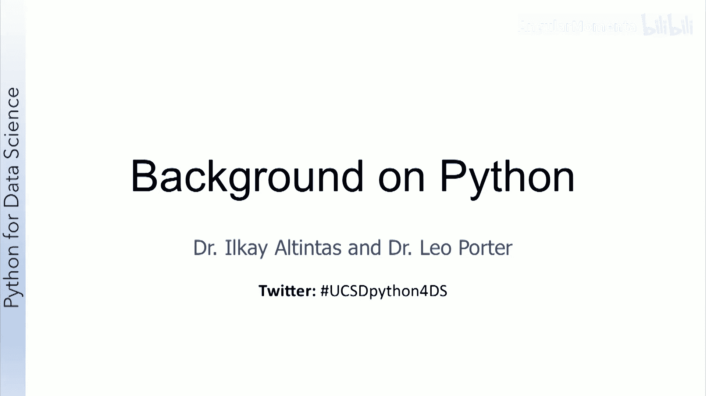

# 【加州大学圣地亚哥分校】Python数据科学-｜-Python-for-Data-Science-p08-03-01-02-视频-导论--BV1jwFUzjEXu_p8-

Welcome to the second week of our Python for data science course。

 this week is focused on the basics of Python and UniX and it's completely optional for those of you with a background in both。

The Python portion is designed for those of you who have program experience in another language and just need a quick tutorial to get up to speed on writing programs in Python。

For those of you with a bit of experience in Python， but could value some extra help。

 feel free to pick and choose which videos to watch or just jump ahead to the optional programming assignment at the end of the Python lessons。

For the UniX part we'll be introducing you to some of the tools that you may wish to use in the course again。

 if you're already familiar with UniX， feel free to jump ahead。

 you can always refer back to these resources later if you get stuck。

