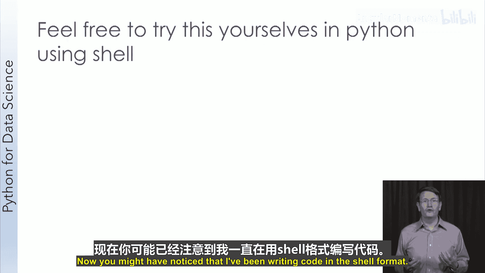
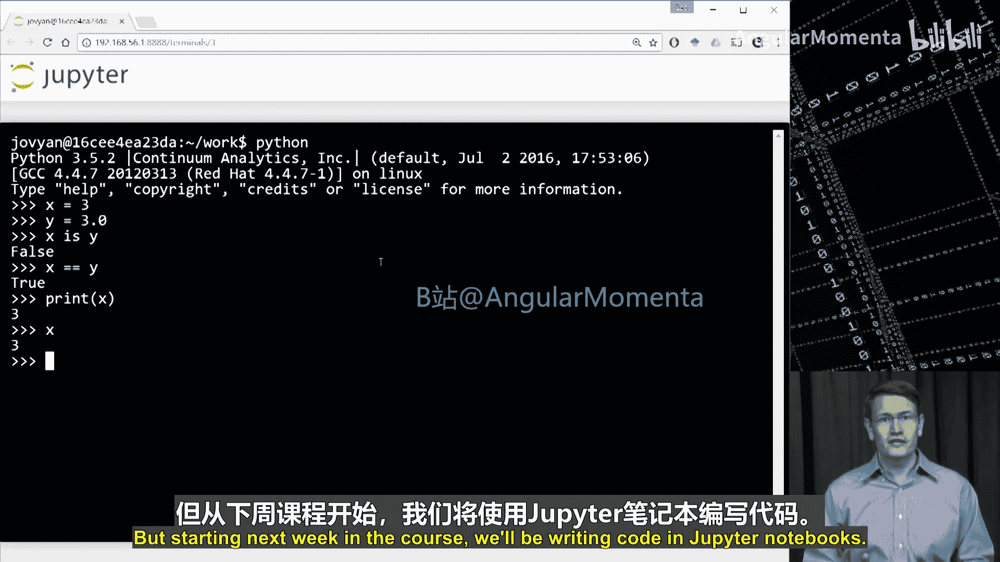
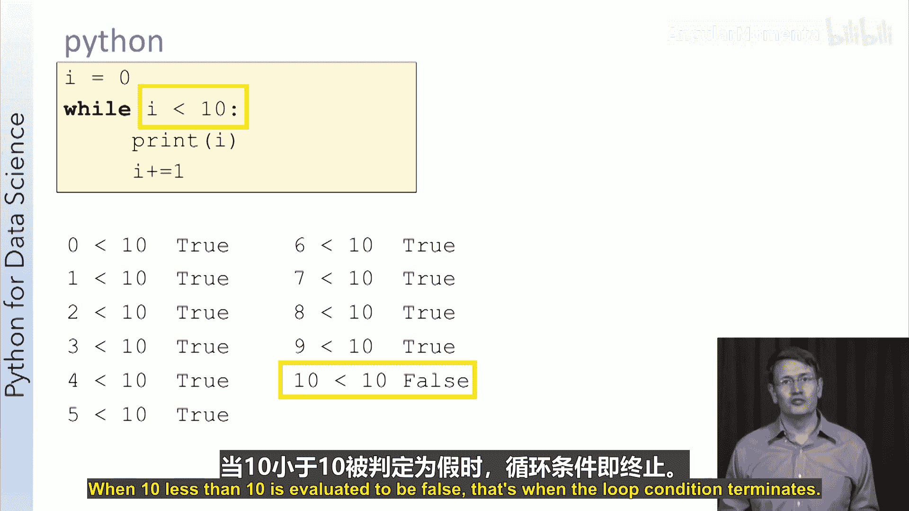
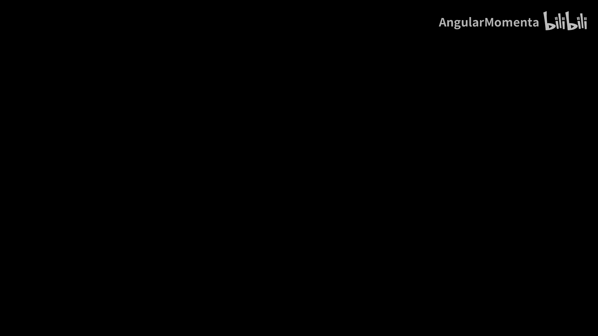
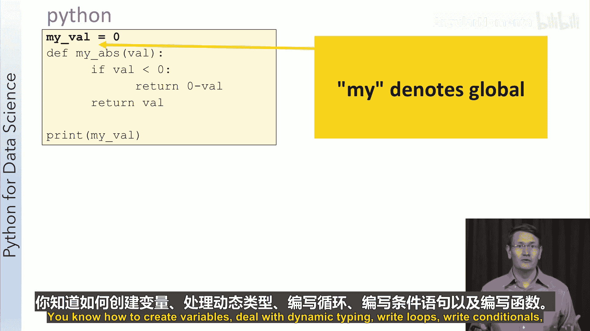

# 【加州大学圣地亚哥分校】Python数据科学-｜-Python-for-Data-Science-p09-03-02-03-视频-Python_概述--BV1jwFUzjEXu_p9-

Welcome back， let's start discussing why we're using Python in this course。

 The learning goal for this video is for you to be able to articulate the benefits and limitations of Python as a programming language。

As we already discussed last week， we'll eventually be using Jupiter。

 which is originally the combination of three languages， Julia。Python and R。These days。

 Jupiter supports over 40 programming languages。But will will see more of Jupiter next week？For now。

 we're starting in Python so that you have a strong programming basis to build upon going forward。

Also， we're starting in Pythons that you can use the NPI and Padas libraries we'll be discussing in upcoming weeks。

Those libraries are incredibly valuable for doing data science in Python。

But I'm getting ahead of myself。Python， even though it's only been around since 1991。

 is already one of the world's most popular programming languages。

 why well this is what the Python website has to say。Python is powerful。

 you'll find that you'll be able to accomplish in just a few lines of Python。

 but it might have taken three or five times as many lines in another language like Java or C++。

Pythonizing surprisingly fast for an interpreter language。

 generally interpreter languages can be slower because they run on top of an interpreter rather than being compiled directly for the machine on which they're running。

Without getting the weeds， you can think of this as having a middleman between the code and the machine。

 which isn't there for a language like C or C++。So how then is it fast？

By having some highly optimized libraries， often written C or C++。

 which will run as fast or nearly as fast as comparable native C or C++ code。

Python works well with other languages， in fact， it is often used as a glue language running in between components written in other languages。

And as you'll see when we get to Jupipyter notebooks。

 Python plays well with other languages in those notebooks as well。Python， because it's interpreted。

 can run everywhere， you just have to have a Python installing machine and any Python program will run。

Moreover， because Python is open source and free， you can install it anywhere without worrying about licenses。

Python has a number of features like dynamic typing and automatic memory management。

 which make it both easy to learn Python and also easy to read Python code we'll be diving into a number of these features this week。

And as I already said， Python's development is open source。

 so you don't need to worry about license fees and if you're interested。

 you would actually get involved in the development of Python yourself one day。Okay。

 so I hope I've sold you on why Python is a good programming language to learn for data science。

 we'll dive into the details of programming in Python in the next video。Hi， I'm Philip。

 and I'm an assistant professor of cognitive science here at UC San Diego。

 A lot of my research actually revolves around studying and building systems for online learning。

 very similar to these massive open online courses that you're taking right now。

 and today I want to tell you a story about how I use Python to perform data science on a video watching data from theseOOC。

 these massive open online courses， and this was published at a paper at the learninging of scale conference in 2014。

 which you can check out by looking at the link at the bottom of the video。😊。

But before I talk about my study I want to first go over a little bit about why you should use Python for data science so there's a lot of reasons why people say that Python is great for data science and I want to summarize a lot of what people have been saying into one phrase which is that Python has a giant ecosystem of tools for connecting and working with many sources of real-world data across lots of domains so this means that by learning Python in this class you're taking right now。

 you're actually very marketable in the job market no matter what domain you're working in because chances are there'll be some set of libraries or tools that can actually work with Python to connect to the data in your domain that you can work with and to process the data and to produce reports so as an example I want to show you a resource study I did that actually is in the domain of online learning。

😊，So what I did is that I took 862 videos from popular massive open online courses fromOOCs and I took the log data of how people how students actually watch these videos。

 So there are over 127 students in my dataset and then they had over 6。

9 million video watching session so every time a student watched a video the log recorded how long they were watching the video for which part of the video they're watching。

 etc。 So all this data was in a Mongo Db database， and I used Python with the P Mongo library to extract the data from Mongo Db。

 and I used the NPI library to analyze this data using various numerical analysis techniques I ran some statistical tests for my research paper using thesi P library。

 and then I produced graphs for my research paper using the Mapllolib library。

And I organize all of this analysis in a Jupiter notebook。 So these libraries。

 which you should definitely check out are very powerful and widely used stacked for doing data science in Python right now。

 So I want to show you some the most salient results from the analysis。

 So this graph shows various bars and each kind of column represents a group of videos by the video length。

 So the first one is videos are very short0 to three minutes， and then three to six minutes。

6 to9 minutes， etc ceter。 And the y axis shows on average。

 how much time where people watching these videos for。

 And if you actually look at kind of goes up around  six to9 minutes and then goes down again。

 which means that at 6 to9 minutes， those 6 to9 minutes videos。

 people are watching actually a fair amount。 And if you actually look at the long videos 9 to 12 minutes and 12 to 40 minutes is really long videos。

 people actually didn't watch that many minutes。 because intuitively。

 if you have a really long video， you might zone out after the first few minutes or get bored。😊。

So a second analysis shows this a bit more strikingly so this is the same graph as before。

 except the Y axis now is normalized。 So 1。0 means that somebody watched the entire length of the video and the red bars show that at about six to nine minutes。

 people are still watching most of the video but then at nine to 12 minutes or 12 to 40 minutes。

 people are watching less than half or maybe even a quarter of the video again。

 this shows really striking that the short videos0 to three minutes， three to six minutes。

 maybe six to nine minute videos are good but any longer and people are not going to watch that well so people have taken these results from this paper I did with colleagues a few years ago and applied it to their own use of creating MOCs so right now it's standard practice for people to make these videos that areOs in MOCs that are actually very short So five minutes or less just like this video right here。

 because we know the research that people actually are not going to watch long videos and if you want more help on learning Python as you're taken。

😊，This course check out this tool called Pythontudor。com。

 which is an interactive visual tool that I created to help people debug Python code and learn Python better。

 and I wish you the best of luck in your journey in learning data science in Python and I think it's a really exciting journey and I'm looking forward to what you do after you finish this class。

In this video， we'll be learning about variables in Python。

The learning goals for this video are for you to be able to write simple programs in Python and to understand how Python uses dynamic typing。

Here we have a simple program to print Hello and C。And in Java。

Notice that there's a lot of extra stuff needed beyond just printing， particularly for the Java code。

In contrast， Python only requires you to say print Ho。

This simplicity is part of the reason that Python is a language of choice both for beginners and for experts。

One thing to point out for for those of you more familiar with other languages is that Python doesn't use semicolons at the end of statements。

 that， along with the fact that Python uses indentation of code rather than brackets。

 will take some getting used to for those of you who are more accustomed to other languages。

All right， next we'll start using some variables， the code on the left likely looks familiar to those of you who know C。

 C++ or Java， or actually a number of strongly type languages。

What I mean by a strongly typed language is that each variable has a type associated with it。

In the code here， we see that both x and y are set to be integers at the time they're declared。

Let's now look at the equivalent code in Python。Again。

 we don't have the same overhead of declaring main or including standard libraries with Python。

But we can also notice that because Python is a dynamically typed language。

There are no explicit types for X and Y。Now， for those who are curious about how this works。

 realize that although you don't have to say what type of variable is。

 there are still types behind the scenes with Python。Let's take a quick look at some of these types。

Python has a number of common types， and those types are pretty much what you expect we have numeric values including integers and floats。

 lists of values， binary bys， booles and strings。We'll be working with a number of these in more detail later this week。

But going back to this notion of dynamic typing， if a variable doesn't have a type。

 how do things work？In the code on the left， what happens if you try to assign an integer variable with a float or a double value？

You get an error。For what happens in the Python code in the right， when we try to assign x to be 4。5。

X is sign 4。5 with no error， Python is actually toy content with you doing this。Why？Dynamic tapping。

In our next video， we'll see why this works when we start discussing objects in Python。

 we'll see you there。In the last video， we started seeing how variables work in Python。

 and this video will start working with objects。By the end of this video。

 you should be comfortable with the notion that everything in Python is an object。Well。

 what do we mean by objects well in programming an object is something that can hold data and often has methods associated with it？

We'll actually be working with more complex objects like lists later this week， but for now。

 just keep in mind that objects hold data。In the last video we saw how this code worked with amic typing。

 specifically X was allowed to be assigned both an integer value and a floating point value。But why。

 well to figure that out， we're going to have to understand that everything in Python is an object。

And for those of you who know C++ or Java， you'll be surprised to see that this applies to primitive types too。

In fact， the line x equals 3 on the left， is going to cause a pi int object to be created。

The pi int object is going to hold the value of the object in this case，3。

 along with other details for Python to work with under the hood。

 These features include the type of the object， the number of references to the object。

 and a bunch of others。So let's see how x equals3 might work。

 and we can do this by drawing the memory to diagram。First， when you say x equals 3。

 Python will create a pi in object with a value of 3。

 and then have your variable x point to that object。

For those of you more versed in the details of programming， x is being created on the stack。

 and the pit object with the value of3 is being created on the heap。

The stack holds your local variables and is managed by your program。

 whereas the he holds dynamically create data and is actually managed by the operating system。

But don't worry if those terms are unfamiliar to you。So what happens when we now say x equals 4。

5 first， a pi float object with a value of 4。5 will be created？

Then X will be set to point directly to that new pi float object。

For those of you familiar with C or C++， no longer having anything point to an object should be a big red flag because that's lost memory。

 but in Python that's taken care of for you。The garbage C Python will automatically free the space associated with that first piant object because nothing is pointing to it anymore。

Let's walk through another example。Here we'll create a variable x to have a value3。

The memory model for those two lines of code is below。

If you're ever curious to know if two variables are point to the same object。

 you can use the is command。In this case， if we run x is y。

 it will return true if they point to the same object and false if they do not。

Since our memory diagram has them point to different objects， we'd hope the answer is false。

And it is。X points to a pi into object and y points to a pi float object。You may be thinking。

 but wait， these both have a value of three。😡，Well， if you want to test for numeric equality。

 you'd use the equal E operator。When we test x equals equals y。

 we should get back the value true because they both have the same value。

And that's exactly what we get。Now you might have noticed that I've been writing in code in the shell format。

 if you want to play with code like I have been， just open up your Python She。

And you can start writing commands like x equals 3 y is 3。0。 we can test things like we just did。

 for example， x is y will come back as false， x equals equals y will come back as true you can print x if you want to see its value。

But you actually just type X instead。So feel free to play with your code this way as you learn Python。

 but starting next week in the course， we'll be writing code in Jupiter notebooks， but for now。

 let's continue learning about Python in our next video。

In the last video， we started seeing how variables work in Python in this video we'll continue working with objects。

Ba into this video， you should be able to create objects and call methods on those objects。

So let's start working with objects a bit more。The command here x equals hello will build an object just like we're used to。

 In this case， the object is a string and strings and Python similar to languages like Java are immutable。

 which means they can't be changed。Also， similar to other languages。

 there are built in methods that you can call on strings。

 You can always look at the reference for a full list， but here are a couple of examples。

The first of these methods returns a string with a capitalized first character。

 but not the rest capitalized。The second appears to return a copy， which is lowercase。

In both of these cases， the method returns a copy of the original， which has now been changed。

To call a method in Python， we use just a period after the variable name。

The method name in aim parameters to send to the method， like we have x dot。

 lower and in parentheses in the example here。Remember that I said that x strings weren't changeable。

 so let's look at the value in variable x after we've run this code。

Turns out it still holds original value。If we wanted to change X so it had all lowercase letters。

 we'd have to do this。First， we have to declare X like we did before。

Now we're going to say x equals x do lower。To understand this。

 we'll work this through just a little bit more step by step。When we call x dot lower。

 it returns a new string object， which is a copy of the original。

With all the letters lowercase for now， we can visualize that。

By adding this new object with a lowercase hello to our memory diagram。Next。

 let's focus on the assignment of x by saying x equals x dot lower。

 we set x to points the object created by the method lower。Like this。

So after hooking up x to point to the new object with lowercase hello。

 x should now have the value of a lowercase hello。And it does。

We'll be calling methods on objects throughout this course， so if you're a bit confused， don't worry。

 you'll see a lot more of this going forward。So whenever we have these short quizzes。

 we'll sometimes have an explanation after it。This question is a really common misconception for new programmers。

 so let's spend some time with it。Your question was， what would this code produce？

To arrive at the answer， let's trace through our memory diagram step by step。First。

 we declared x equals 7， which means that x now points to a pi int object， which stores the value 7。

When we say y equals x。This assigns y to point to the same object as x， they both are currently7。

When we set x to be3， that causes a new pit object to be created。And x is assigned the value 3。

For those of you mathematicians out there， the equal sign can be problematic in programming。

Y equals x in the second line of this code doesn't mean that y and x have a permanent relationship。

 it just means assign y to point to the same thing as x。So in exchanges。

To point to something else in line 3， it points to now this new object of the value of  three。

 why it doesn't change？Let's keep going， we now print X and Y and we get back three and seven。

If you ever get stuck with odd behavior when you program。

 I strongly encourage you to draw a memory diagram just like the one we've done here。

Loops are essential in nearly every programming language in this video you'll see the basics of loops in Python。

 So by the end of the video， you should be able to write a Python program which uses a loop。

In the top here we have some code from C， but this probably looks familiar to anyone who knows Java or C++ as well。

What's the equivalent code in Python？Overall， the syntax is pretty similar。

 but there are some differences， particularly with the for loop itself。But first。

 let's notice that our print statement here is indented。

 indenting in Python is the same as putting a block of code in brackets in C++ or Java。

If you're new to Python， the slack of brackets becomes second nature pretty quickly。Second。

 notice that we've combined the start i equals 0， and the end I is less than 10 into one part of the loop right at the end。

Let's look at how this range function works。Range returns the values between start and stop。

For the start parameter， range is inclusive， so it will start with zero。For the n parameter。

 it's exclusive， so it'll stop at one fewer than 10 or9。It will increase by the value in step。

 or it will just default to one。So as a result， this call to range will give us the values zero。

Through 9。Okay， let's see if this is making sense so far。

 What do you think the code above will print？If you guess it's going to print all the even values between0 and8。

 you're correct。By setting steps equal2， it starts at zero， increases by 2。

 and then stops before it hits 10， so it'll print  zero，2，4，6， and 8。Okay， one more。

I really want to make sure you understand how range is working， so take a second。

 pause a video and figure out what you should put in the missing part of this code for the for loop。

This one was a bit more tricky。Bravo， if you got it correct。

And there were a few answers which would produce the same result。

 so you don't necessarily have to have the exact same as I have here。In the solution above。

 we start at two， we increase by three， and then we stop at 12。

Though you could replace 12 with 13 or 14 and actually get the same result。

So why do we do these additional examples to range？

Because range can be really useful both when first learning Python and when we start diving into data analysis。

For completeness sake， I want to point out that we can do the same thing with the while loop。

Which may prove valuable in scenarios when we don't know when the condition will finish or when the increment is more complex。

The while loop has the standard component you expect。Here we have a setup。E equals 2。

The condition to test， which will cause the loop to continue as long as it remains true。

And the updating of a variable， which is part of the loop condition。

Let's make sure we're on top of loops by having a quick quiz。

Here's the explanation for the quiz that you just took。In the quiz。

 you're asked how many times I is less than 10 gets evaluated。Students commonly get this wrong。

 mainly because of confusion about the term evaluated。But let's see how this works。

I is initially zero， and the condition I is less than 10 is tested with the result being true。

I increments to 1， and we test I is less than 10 again。Getting true back， the loop continues。

I keeps incrementing， the condition continues to be evaluated true and so on。

Before the last iteration of loop executes， I is 9 and9 is still less than 10。

If you said that 10 is the answer， you are likely answering the question。

 how many times does the loop execute？That isn't what was asked。

 we asked how many times the condition I less than 10 is evaluated for that answer。

We have to evaluate the condition one final time。When 10 less than 10 is evaluated to be false。

That's when the loop condition terminates。

We've asked this question for two reasons。The first is it helps new programmers see the step by step execution of a while loop。

But the second reason is for more advanced programmers who might put a statement which has side effects like a function call into a loop condition。

It's easy to forget about that last evaluation of false， and if there's a side effect of that test。

 that can be problematic。😊，Either way， we hope this example was useful for you。

In this video， we'll learn how to use conditionals in Python。

 so by the end of this video you should be able to author Python programs which use conditionals。

Let's think back to this loop example， where we use the range function to help us print the even values between0 and nine。

Let's see how we could have done this using conditionals。

What do you think I should put here to make it print just the even values。

 take a moment and think about it。To solve this， you may need to use modo。

 which you may or may not be that familiar with。Moullo produces the remainder of a division of two integers。

Given what you know about modlo。Pause the video， take a moment to think about what you should put into this Miss line code and then resume。

I hope your answer was something like this。If you want to know if a value is even。

 you just test to see if the remainder from dividing that value by 2 is0。

Let's look now at the parts of that if statement in Python in detail。The keyword for the conditional。

 if starts the line， and that's the one in blue。I modulo 2 equals 0 in green is the condition which resolves to a boolean。

 either true or false。And the colon in orange， says to execute the statements indented after this line。

 should that condition be true。Let's try solving another question。

 Sose I want the output to be the output on the left， 0，11，2，13， and 4。 effectivelyffect。

 we're printing the even values between 0 and 4， and we're printing the odd values plus 10。

To solve this， you'll need to add an else statement， but take a moment， again， pause a video。

 think about what you want to put here， and then resume。Here's the L statement we need to add。

Notice that else is followed by a colon and everything after the else， which is indented。

 will be executed if the if condition is false。Let's do one more of these。

Now we're testing if I modo 3 is0。Notice the new if statement in blue。If Iilage modular 3 isn't zero。

 we next test to see if it's equal to 1 using Elsif。

 notice that Elif from other languages translates to ELIF in Python。

You should have the tools to use if。Elsif or else in your Python programs now。

Our next lesson is on writing Fun， we'll see you soon。In this video。

 we'll start defining functions in Python， functions of Python， like other languages。

 allow us to abstract away details from subtasks into separate code sections。

So by the end of this video， you should be able to create Python functions and recognize the implications from Python being passed by value。

Okay， on the left we have C code for an absolute value function。

Notice that it tests to see if the input value is less than zero， and if it is。

 it makes the value positive。As a result， it returns the absolute value of the function parameter v。

Here's the equivalent Python code。There are lots of similarities functionally。

 but let me point out the differences。First。Deft is a key word to denote that you're defining a function here。

The first line overall says that you're defining a function， my ABS。

 which takes an input value variable v， notice that neither the return type nor the type of the imp parameter are defined。

This has some advantages and disadvantages。The advantage is you don't need to write a my ABS function for ints。

 another for doubles， another for floats， and so on。

The disadvantage is you could try to call my ABS and pass it， say a string。

 and that could cause problems。There may also be some issues with the expected return type。

But we'll revisit this in a few minutes。For now， let's see how this runs。

So this code will print the value 7。We define the myABS function just like we did before。

 and now I'm printing the output of that function when we use minus 7 as an argument to the function。

The absolute value of minus 7 is7， so this works properly。

Now let's look at that example I mentioned before。I'll try to pass the function the string high as an argument。

In a typed compiled language like C or Java， the compiler would have caught the type mismatch。

 and we wouldn't have been allowed to pass a string to a function inspecting a numeric argument。

But in Python。This problem doesn't come up until runtime。

 When Python can't find a way to compare a string to an int。And when I try to run this Python code。

 this is the output I would get。All right， let's do another example。

Here Ive changed our function to print the absolute value of the parameter instead of returning the absolute value。

What do you think will happen when this runs？This is a bit tricky， so pause。

 take a moment to think about it and come back。You may have predicted that running the code would produce an error because we try to assign x to be the output from the function。

 and this new function doesn't return anything。But it turns out that if a function doesn't return anything。

 it effectively returns none in Python。Since we can assign a variable to none。

 this code still runs just fine。Though you may have wanted x to have had a value， not none。All right。

 one more of these。What do we think this code will do， again， pause， think about it。

 make a prediction， then we'll talk it through。The output here is 7。If you guessed eight。

 don't worry， this is a really common misconception， let's talk this through。First。

X is assigned at the value 7。This translates to a variable X being created。

 which points to an integer object with a value of 7。Next。

 we'll call the Python function increment value。Increment value is given x as an argument。

 so when we call ink v， a new variable vow is created。

Vel is going to point to the same int object as x。This is what we mean by copying the reference or copy by value。

Vul and x are not the same variable。 vowage is a copy of the pointer。

 which means it points the same thing as x。Now let's look at Val being assigned to beVal plus 1。

This operation will cause Val to be reassigned to point to a new piant object with a value of 8。

Notice x hasn't changed here at all。When the function ink valve finishes， the temporary variable vow。

 which was created just with a function， will go away。Now we're left with just x。

So when we go to print X， we're going to get back to value7。Which is just what we have expect。

If we call the function on the variable vow， rather than having reassigned with the equal sign。

 we'd have experienced different behavior。Specifically。

 if you change the object pointed to by v and x， both would appear to change since they point to the same thing。

We'll do an example like this later。For now， let's do a couple more practice problems with functions。

 and we'll get to that soon。Let's quickly discuss the answer to that last quiz。

In this last quiz you had two functions， and the question was which of these returns the absolute value？

Only function  one returns the absolute value。 There's a pretty common misconception that printing and returning a value are the same thing in programming。

 and this simply isn't true。Whoever calls function 2 won't get a value back from it to work with。

 so function 2 isn't returning the apps of value， it's just printing it。All right。

 we'll walk through this last quiz in some detail here。In this last quiz。

 we asked what is printed when we ran the code above the answer。Is6 comma 3。

Although the swap function properly swaps the values within the function。

It doesn't change what X and Y points to， just like in our video on functions。If this tripped you up。

 please go back to that video and functions and pay attention to the memory model in the last example。

If you make a similar memory model for this problem。

 you'll see why x and Y are unchanged by the swap function。In this video。

 we'll be talking about the scoping rules in Python。By the end of this video。

 you should be able to understand the scope of a variable and be able to create a global variable。

We'reusing our absolute value function from before。

 what do you think will happen with this print statement？Yep， this will cause an error。

 and this should be familiar to those of you with experience in C， C++ or Jb。

The variable vow was declared in the scope of the function， my A BS。It doesn't live outside of that。

Now， what happens after declaring vow at the start of a code？Well this code runs just fine。

 by declaring Val at the top of the file， we've made it a global variable。Be cautious， though。

 you never want to have a global variable have the same name as a function parameter。

We could fix this by naming the global variable differently。

Having my denote a global would help to reduce this problem。

But realize that some company style guidelines， for example。

 Google's style guidelines do not recommend using global variables at all。

So we've actually wrapped up all the basics in Python pretty quickly。

 you know how to create variables， deal with dynamic typing， right loops。

 right conditionals and right functions。

So we'll do a quick quiz to check your understanding and then move on to some common data structures in Python。

