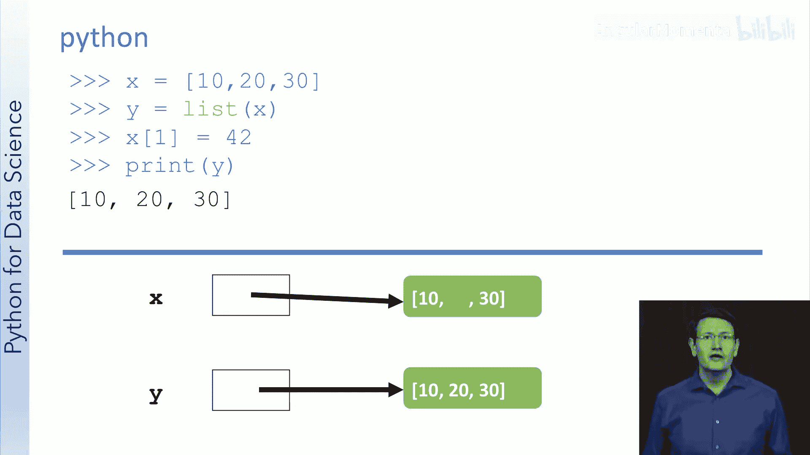
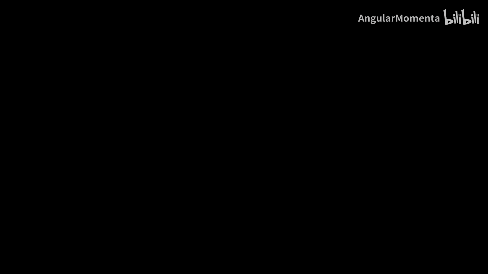
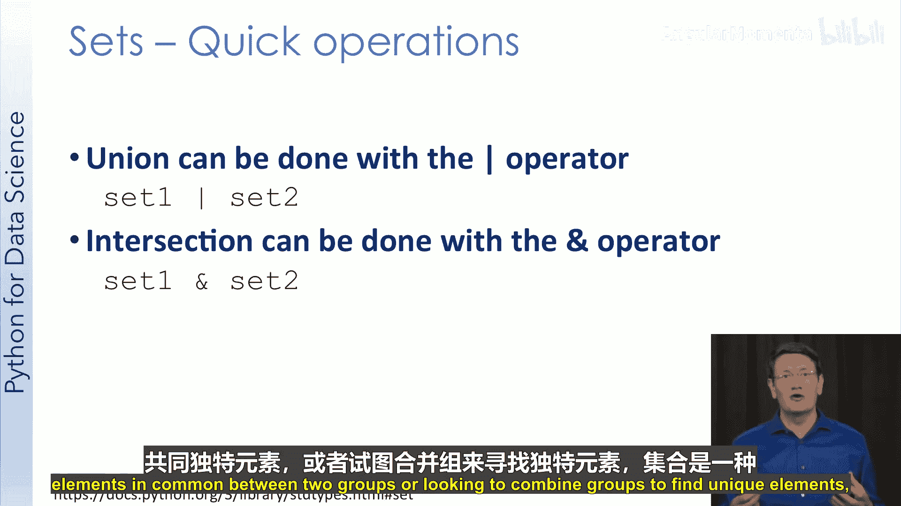

# 【加州大学圣地亚哥分校】Python数据科学-｜-Python-for-Data-Science-p10-03-03-03-视频-Python中的数据结构与基础库--BV1jwFUzjEXu_p10-

For the second lesson this week， we'll be diving into Python libraries and data structures once you have these down。

 you'll have the Python knowledge necessary to take on the rest of this course in data science。

In this video， we'll be talking about commonly used string functions in Python。

So by the end of this video， you should be able to use Python string library functions to manipulate strings。

Although we'll be talking through a lot of common string functions in this video。

 I really want to stress that there are many string functions。

So if you're trying to do something with the string， check the library documentation first。

There's probably a function already written which is almost exactly what you want。For now。

 let's check out some of these common functions。If you want to change case。

 there are two methods which can help。First， you can use the method lower， lower returns to string。

 which has all the original characters from the original string， but now in lower case。Remember。

 strings are immutable， so all the functions we'll be discussing in this video return new strings。

Just like the function lower， there is also a function upper。

 which will return all the characters from the original string， but now in upper case。

Suppose you want to stitch two strings together， you can do this with concatenation。

You'll start doing this with a plus symbol。Here we add the string one with the string two to get the string1。

2。Likewise， if we add the string high to the string there， we get high there。

Notice that the string there has a space before the T。

 which is why the result had a space between the eye and the T。

Suppposed that we'd like to have a string repeat over and over to do that， we'd use replication。

In this example， we're asking the string 1，2 to be replicated twice to form the string 1，2，1，2。

You can combine replication and concatenation like this in order to build more complex strings。

The next function strip is incredibly valuable in data science。

You'll often find you have useless white space， like spaces or new lines around values that you want to use for analysis。

To get rid of those spaces， you can use strip like in this example。Here。

 Strip gets rid of the new line and the spaces before and after the wordexs。

But you won't always be getting rid of spaces so you can use the parameter to strip to get rid of the other values。

Here we have some garbage asterisks on either side of the number 10 to get rid of those。

 we just feed in this string with the characters we want， removed as an argument to strip here。

Notice that the string past as an argument is an asterisk， which is why the strip removed asterisks。

Sometimes you have a single big string you'd like to break up into smaller substrs。

We haven't learned about lists just yet， but for now， lists hold more than one element。

In this example， we've used split to split out the words in the sentence using white space。

To do that， we gave a space。As the argument， this function split。Next。

 we see how you could do the same thing with a comma separated value。Suppose this is a movie rating。

Jane Doe raided the movie cars with five stars， and that rating is stored with commas between the fields。

Collen split with the argument as a comma。Will do this for you。

When we index into strings to get back substrs， this is called slicing。For each of the examples。

 we'll be working with the wordHo。I've broken up the characters in the word hello and labeled them with the character index starting with zero for the letter H。

If we ask for characters one through three， that means we want characters from one。

 inclusive to three exclusive。So we get back the characters E。If we ask for4 through seven。

 you might think this will cause an error。But it'll just select the strings starting at four through the end of the word。

In this last example， we'll use negative indexes， it's sometimes easier to start from the back of a word when pointing out a substream。

The indexes for that are shown here。These indices correspond to these locations because if an index is negative。

 the new index is calculated as string length plus index。So for minus1，5 plus a negative 1 is 4。

Going back to our original idea， trying to get a substr from the word。Using minus 4 to minus1。

This will give us back， E， L， L。This is the same as asking for a word one through four。

What if you want to ask to see if a string contains a word？There are two easy ways to do this。

 In the first， we'll just ask if H E both capitalize is in the word and we'll get back false。

If we ask with the proper case， a capital H in a lowercase E， if that was in the word。

 we get back true。Suppose that you want to know where in the string to find the substring。

You can use the method find。It returns either the lowest start index of the substring or minus1 if the substring is missing。

Here we ask for E and L and get by the start location of E， which is1。

This can be useful when combined with slicing because you can find the initial location of a substring。

And then pull out characters starting from there。As we'll be working with both text and numerical data in this course。

 it's worth mentioning that we can convert from strings to numbers fairly easily。

Suppose that we have the string， one， two， three， four。

We can convert that to an int by calling the int function。Likewise， if we have the string 1234。

 and we call the function floatat on it， we get back the floating point version of 1234。

On the other hand， if we have text in a string and try to convert it to an integer。Well。

 we'll get an error。Lastly， you may have a large body of text and just want to insert some strings into that larger string to do that we can use the function format。

In this first example， notice the empty brackets。Those are placeholders which will be used by the format function。

Once we call format， it substitutes the word data in for the first placeholder and the word analysis for the second。

If you want to be more specific about the placeholders， you can number them。

This means that the zero placeholder takes the first word and the one placeholder takes the second and so on。

This becomes more useful when you have input data， which is in a different order than the order you want for your string。

In this last example， we use the numbering to flip the word order when called from format。

This may not seem that useful now， but remember you may be getting strings which you pass into format from another source and you may not want to mess around with reordering the strings in that input string。

Okay， we've talked about a bunch of string functions in this video。

 remember there are even more functions to apply onto strings。

 so be sure to check the documentation when everyone manipulates strings in some particular fashion。

To be effective in any programming language， you'll need effective ways of storing data。

In this video， you'll learn about the list data structure in Python。

For those of you with experience in other programming languages。

 a list is similar to a Raylist in Java or vector in C++。

This just means it is recizable and has an array implementation underneath the hood。

So by the end of this video， you should be able to use lists to store data。

 iterate over lists using loops， and recognize some common list functions。

Let's start by creating a list of the values 11， 22 and 33。

Here we create the list and then check that is holding what we expect。Listist elements have indices。

 which， like strings， start at zero。Here's a visual representation of our list in memory。

Based on this， if I ask for the element at index 1， I should get back 22。

And that's exactly what happens。What if I try to access the array off the end like this？

There is no third element， so if we ask for this， we'll get an error。

Suppose I want to print all the elements in the list。

I likely want to iterate over the list using a loop， so let's do that。By saying forI in list。

 I'm asking for each element in the list and I can just print that value。

And here we get back the values we wanted。For those of you more familiar with C or Java。

 you could also write this loop like this。Here I'm letting I be an index en the list and letting I go from zero。

To the length of the list， which is three。Notice here that LEN， the LEN function。

 returns the length of the items in the list。As a result， the four loop will then iterate over0。

 i is 0， i is 1 and i is 2 before stopping。As it is printing the element at index 0，1 and 2。

 itll print the same values as above。For those of you with a background in other iterative languages。

 the second loop may seem more familiar depending on your programming style。

But I encourage you to use the top loop as is less error prone and more readable。Unlike strings。

 you can change the contents of the elements of a list。Here we're changing the value at index1。

To be 95。Let's check to see if that did what we'd expect。It did。

So one of the nice features of our lists is the ability to manipulate values in that list。

I said to start that lists are reizable。This means that we can append values to the end of the list。

Let's see how this works， we'll start with our usual list。Like before， this has three elements。

Using the append method， we can add an element to this list。

Here will' append an element with a value of 44。Visually。

 this translates to adding the value of 44 at index3。

Let's check the contents of this list after we've used a pen and we'll see that the element 44 was in fact added to the end。

You can add elements， but you can also remove them。First， the P method。

We create our standard list now with the four elements， if we callP on the list。

 it will return and remove the elements at that location in the list。

Here we're asking to delete the element at position2。This will return the element。33。

And remove the element from the list。You'll then shift the values in the remainder of the list。

Over by one。So our new list will have three elements， let's check。Yep。

 we effectively removed 33 from the list。In the last example。

 we used the P method to remove an element using its index。

Now let's remove an element by its value using the remove method。

 let's remove the element whose value is 33。This will remove 33。Like pop。

It will then shift the values in the remainder of the list。Over by one。

So our new list will be those same three elements as before。Depending on what you're doing。

 it'll be easier to either use pop or remove。Sometimes you want to merge too less。

If the merger simply involves adding one list to the end of the other。

 you can use the method it stands。Let's set up two lists。

Now let's call theendNs method to make it so listist2 is added to the end of list1。Great。

 this did just what we expect。Be careful not to mix up a pen in its extend。

 aend adds an element to the end of the list， extend。

 it appends all the elementsil from one list into the other。

If you accidentally use a pen with a list parameter。This is what happens。

You get a list of four elements。The first three are integers。

 and the last is a list of three integers。This is a pre common mistake， so be careful。

Often you'll be working with through two lists at the same time to do that。

 you can use the function zip。So let's create our two lists again。

Suppose I want to print the first element in each list， then the second element in each and so on。

To do that， we can do this。When we use zip， that creates a pairing of two lists。

When you ask for x comma Y in zip list list 2， you'll get back the following XY pairs。

We don't have to get into the details now， but just remember that if you want to work through multiple lists at the same time。

 the zip can be pretty useful。We've just gone over the more common methods to use with lists。

 but there are plenty more for example， did you know that you can slice lists just like you do with strings？

If you want more examples， be sure to check out the documentation next we'll do a quick quiz。

As for the previous quizzes， let's walk through the solution to this last question。Your question was。

 what would this code produce to arrive at that answer。

 let's trace through a memory diagram step by step。

We start with creating a list which holds the values 10， 20， and 30。

 and then we set up variable X to refer to that list。When we then set y to equal x。

 that simply makes y refer to the same list and memory。Here's where things get interesting。

By saying x at index 1 is 42， we are going to change the list in memory。

 remember that lists are mutable， so this change will have an effect like this。

The list at ElM at indexdex1 is now changed at the value 42。

What's interesting about this example is that y is also point to that same list。

So when we go to print the list pointed2 by y， we'll get back this change list。

If you have two references， point the same object。Permuting that object will obviously affect both references。

Suppose you want to have why be an actual copy of the list， if you want to do that。

 you'd have to make this change。Saying y equals list x causes a new list to be created。

 which is a copy of x， so when you change x in line 3， it wouldn't impact your copy of the list。

Knowing when to make copies or just use the same reference can throw off even bedroom programmers。

 but if you slow down and draw a quick memory diagram， you'll be able to spot the error quickly。

In this last video， we saw how to use lists to store a collection of data lists we saw are mutable。

 which means you can change their elements at any time。In this lesson， we'll learn about tus。

Tups are a way of grouping data， but because they're immutable。

 they are valuable in a number of situations for data analysis。

You won't need to know a lot of details about tuupples to use them effectively， however。

 so this will be a fairly short intro。By the end of this video。

 you'll know how to create tuples and perform some basic tuple operations。

Let's start by creating a tuple， usually tus are used to put together information connected in some way。

Here， let's put together information about our car。I'll put together the car's manufacturer， Honda。

 its model civic。 The fact it has four doors and the year 2017 that it was built。Visualizing this。

 we have a collection of different data types together in one tuple。 just like a list。

 I can ask for an element like this。We asked for the first element。And starting with zero indexing。

 the first is civic。Also， like a list， we can ask for its link。It has four elements。Just like a list。

 we can also iterate over the elements in Tupple by saying4I in Tupple。

Where things I verge is if you try to change a tuple here。

 I'm trying to change the year of the car to be 2018。 but if I try this。I get an error。

And while this might seem inconvenient， it's actually really important。In fact。

 if there's one thing I want you to take away from this video is that tuple immutability means that you can trust it to never change。

Immunutability is important in two key ways， the first is more general。

 as with regards to parallel computing。Pal computingut is a key facet of data science。

 which we stress heavily in the fourth course of this micromasters。In parallel computing。

 data which can change， make parallel computation harder because you have to make sure everyone working on the problem sees those changes。

But if data can't change， you can just send copies of it to compute nodes and no one has to worry about it changing on them while they're computing。

This is really just a forward pointer to a concept you'll see a bunch more of in that last course。

The second reason we care is more concrete and actually applies to our next video tuples can be used as keys into dictionaries。

Because the tuple doesn't change， the dictionary can organize based on its initial value without worries about the key getting change by somebody with a reference to it。

Now that we know about tus， we can learn about dictionaries and we'll do that in our next video。

In this video we'll be learning about dictionaries in Python Dictionaries are one of my favorite data structures and I can't wait to tell you about them。

By the end of this video， you'll know how to create and use dictionaries。

 you'll also recognize common dictionary pitfalls while understanding the inherent limitations of an unordered collection。

Dictionaries are simply one of the most useful data structures when programming in Python。

 you'll find yourself using them all the time。Dictionaries are just Python's term for a map。

 If you've worked in Java or C++， you've likely worked with a map interface and you likely did so with a hash map implementation。

A dictionary holds a combination of key value pairs here the keys are fictitious student IDs and student names This is something you might maintain for the students in a course。

You can use this data structure to ask if a student ID is in a dictionary。

And you can look up a student by their student ID number。Speaking of lookup。

 dictionaries are also super fast doing lookups， which is one of the many reasons people like using this data structure。

In this example， we have a string key and a string value。

 The only restriction on types is that the key has to be immutable。Let's look at some more examples。

Here we have a mapping of courses to the instructors who commonly teach that course at UCSD。

Notice that the value here is actually a list。You could even have a value be another dictionary。😡。

Any object is fine as a value in a key value pair， and remember everything in Python is an object。

One more example， what if we wanted to keep movies and their associated user ratings？

Well we can't just use the name of the movie as the key because different movies have the same title。

 for example， Ghostbusters was the name of a 2016 movie and a 1984 movie。

So how could I keep these in a dictionary， Well， I could use the year to help disambiguate。

 and I could do that using a tuple。Here's what this would look like。The key is a tuple。

 which is both the name of the movie and the year it was made。

 Tples can be keys because they're remutable。Those keys then mapped to the rating of the movie。

 which I borrowed from IMDV's current ratings。I could honestly spend an hour just giving you more examples of how key value pairs are useful。

 but they'd probably be overkill， so let's dive into how to create and use dictionaries in practice。

😊，Just like with the previous data structures， let's start by creating one。Here。

 I created a dictionary with just the two ghostbesters movies。And then displayed it。

 noticeice the curly braces when declaring a dictionary and the colon。

 which denotes the break between a key and a value。Next。

 let's look up a value using a key to do that， we just use the brackets and the key like an index for a list。

Lastly， we can use length or LEN to check how many elements are in the dictionary。

To add to the dictionary， we can just use a new key as an index。And then assign it a value。

So it's actually pretty easy to add to the dictionary if Cars 2006 were already a key in the dictionary。

 you just reassign it， no errors are thrown。Now let's inspect the contents。

We find that cars was indeed added properly。 but if you're wondering why cars is in the middle and not the end。

 that's what is meant by dictionaries being an unordered collection。

There is no inherent ordering of the items in the collection。

 and you can't trust its internal ordering not to change at any time。

The lack of ordering is part of the reason dictionaries offer such fast performance。

But if your problem requires preserving the order in some way。

Dictionaries may not be ideal for your problem。To get back a value for a selected key。

 you can use brackets like I've done here。But you need to be careful with using this form of bracket access。

What if you ask for value for a key not in the dictionary？That will actually cause a runtime error。

So what's a safer way of getting values from a dictionary If you aren't sure if the key is present。

 there are two approaches which can help。 The first is to use the method get to gain access to a value for a specified key here。

 when the key is in the dictionary， you give better the value， just as you'd expect。

But the key isn't in the dictionary， we get back the value none。

You can then use the test is x equal to none to see if the element was in the dictionary。Similarly。

 you can also use the keyword in to test to see if a key is in a dictionary。

Depending on your use case， you'll likely want to use either git or in to test to see if a key is in a dictionary before accessing the element in the dictionary。

The key point is be careful with using brackets to access values and dictionaries if you aren't 100% sure the values will begin in there。

We can also remove items from a dictionary。I've set the dictionary to have all three movies from a last example。

 then I use a method pop to remove from a dictionary。Here I'm removing the 2016 Gohobess movie。

Pop will return the value associated with key， which is why I return 5。4。

It'll also mutate the data structure， so there is no longer the key in the value that you just popped。

If we check。The dictionary no longer has the movie we just popped。

You can also use the DEL command to remove a key value pair if you don't care about getting the value back。

Just like a list or tu， we can also iterate over the elements in a dictionary by saying forI in dictionary。

 here I'm printing all the keys。If you want to print both key and value， youll want to do this。

The call to DicCT。ites returns a list of tus with key in value。By saying for key comma value。

 I'm asking to split each tuple into a separate key and value。

 then I print the key and value separately。I'm mainly showing this so you know how you might get either the key or the value or both。

You cannot mutate a dictionary object well iterate if you do， you'll get an error at runtime。

It's generally a bad habit in any language to mutate a data structure while it rain through it。

The reason for this is that the underlying data structure implementation may change its structure of the data when you add or remove from it。

If you ever find yourself writing an iterator for a data structure。

 something we do for in our computer science classes at UCSD。

You would see how problematic it would be if youre trying to iterate while items are being added or removed。

That said， what do you do if you say want to go through the entire data structure and find everything media criteria and then remove those items？

To do that， we'll accomplish this in two steps。 in the first step。

 I'll go through the dictionary finding keys which match a criteria。 specifically。

 I'll be looking for movies which were made before the year 2000。I'll add those items to a list。

 and then in a second step， I'll remove those movies by enteringering through the list。

Let's walk through this in detail。First， I've created an empty list called to Remove。Next。

 I'll iterate to the keys in the dictionary。Third， I'll check to see if the second element in the key tuple the year is less than 2000。

If it is， I will append the key to my two Remove list。Now in our overall step two。

 I'll just iterate back through the to remove list and remove the keys in that list from the dictionary。

When the code is done， we can check the dictionary。

And finally the movies before the year 2000 have been removed。

I should know that there are slightly fancier ways to do this。

 but I find this way to be considerably more readable。To wrap this up。

 I hope you see now why dictionaries are such a fantastic data structure in Python going forward in the course we'll be working with some data structures optimized specifically for data science。

 so you might not be using dictionaries as much as you would be if you're just programming Python alone。

But I bet you'll still find them pretty handy。In the next video。

 we'll see how to use listist and dictionary comprehension to quickly build useful data structures。

Now that we've learned about lists and dictionaries。

 we'll see that Python actually allows us to build lists and dictionaries in an easy way called comprehension。

By the end of this video， you'll be able to build lists and dictionaries using comprehension。

As I've said， comprehension is a way to build lists or dictionaries quickly。

Suppose I want to build a list of the squares from 1 to 10。

You're probably tempted to set up a loop for this if you have a background in other languages。

But it turns out we can do this really easily in Python。

This command here will build this list for us。Notice how short it is。

But there are a number of pieces here。First， let's focus on the four I in range1 through 11。

 This will provide I with the values，1 through 10， just like we're used to with four loops。Next。

 let's focus on the first part of the statement。I star star 2 means i squared。

So we're saying we want I squared for each of the values of I， which we know will be1 through 10。

The result is a list with all the squares from  one through 10， just like we wanted。Okay。

Your turn now， let's start by just making a list of the values 0 through 5。 Stop the video。

 Think about what belongs here， try write it down or test it out， and then resume。

Hopefully your answer is pretty close to this。 Let's see just a few more examples of comprehension。

If I want to have all the even values between 0 and 20。

I can just use that third parameter range to specify every other value。

If I want to have a list with 10 values in its altering 0 and1， I could just use the modlo operator。

Okay， one more what if I want a list with 10 random integers between0 and 5。

 I'll have to start by importing random， then I can use a library call for random。

 Randint0 through 510 times and I'll get back the desired list。

Hopefully you're starting to see how easy it can be to generate these lists。

We'll use these both to help create examples to learn from。

 and also to help us filters our masks when we're working with data later in the course。

Before we go through， I wanted to briefly mention that you can use these to build dictionaries as well。

The only major difference from list comprehension is now we're specifying both the key and the value。

Like we expect， the key is on the left side of the colon， and the value is on the right side。

I recommend you play with this a bit yourself。 For example。

 could you build a dictionary of letters from capital A to capital Z as values and their corresponding numeric ASI values as the key。

 you might find the CHR function useful。Okay， pause the video。

 take a minute and try to do this yourself， then resume the video， I'll show you the answer。

This actually isn't too bad with the CHR function and the ASI numbering for letters。

I hope you try to do this for yourself to get more practice in Python before you looked at the answer。

Next， we'll look briefly at one more data structure sets， I'll see you soon。

I'd like to briefly introduce you to sets and Python sets are a useful data structure because they support a number of useful math operations and because they only allow unique elements。

By the end of this video， you will be able to create sets in Python and use set operations。

Sets of three qualities， which were useful for us going forward。The first is they， like dictionaries。

 are unordered。This， again， like dictionaries， allows them to be incredibly fast for a number of key operations。

The second is that they hold unique elements， which means you cannot have duplicate values。

The third is that they support useful set operations， including union and intersection。

Let's do some examples to see why sets can be handy。We can create sets by using the keyword set。

 and then pass as an argument to set a list。Ofre the values that we want to have in the set。

Here we're passing a list of my favorite colors。 this will produce the set of colors。

Notice that the set we got back is in a different order than the list that we provided。 again。

 sets are unordered， so this is completely okay。Now let's see how to add to this set。

By calling them at the addd， we can add a new color， we can see that we've successfully added yellow。

If I try to add something which is already there， it won't change a set。

This makes sense as only unique items can be in sets。Starting with that original list。

 we can remove items by using either the remove or discard method。Looking at discard。

You simply want to pass the element you want discarded， and it will remove it。

I generally prefer to use Disccard because if you try to discard an element which isn't in the set。

 it will just do nothing。But if you try to use the remove method and the element isn't in the set。

 it will throw an error。Okay， let's create two sets Here we have my colors， which are blue。

 green and red and Ichi's colors， which I've arbitrarily made to be blue and yellow。First。

 let's see what the union does。Just like we expect。

 Union gives us items that are in either Ichi's set or my set of colors。

This can be useful if you want to know all the unique items that are in two separate sets。

Notice that blue is in both sets， but it appears only once in the result。To be honest。

 most of the time when I find myself using sets is because I want to pull out the unique items across two groups of elements。

Or define the unique items in common。To find the items in common。We use the intersect method。

Calling intersection on these two sets gives us back blue because blue is in both of the sets。

I should mention that you don't have to use the union method。 You can use the ore operator。 Likewise。

 you don't have to use the intersection method。 You can just use the Ampersand symbol。

If you're looking for more operations and sets， I recommend you check out the Python reference materials linked to the bottom。

The big takeaway I want you to have from this is if you're trying to figure out unique elements in common between two groups or are looking to combine groups to find unique elements。

 sets are a really handy data structure to help you accomplish this。

