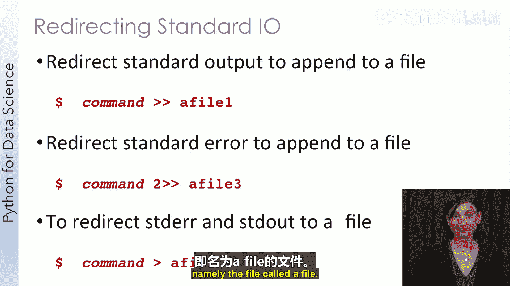
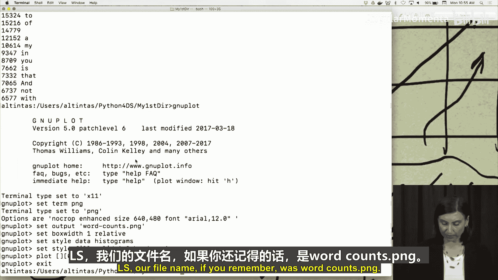

# 【加州大学圣地亚哥分校】Python数据科学-｜-Python-for-Data-Science-p11-03-04-04-视频-Unix系统导论--BV1jwFUzjEXu_p11-

For the third lesson this week， we'll be talking about the UniX operating system。😊。

The UniX command line and the utility commands it offers is one of our core tools in any data science project。

Here we give you a basic introduction to Uni based operating systems before we utilize them in the context of upcoming lectures and exercises。

😊，If you are already experienced with a Uni based command line。

 you may now skip this lesson and jump ahead。😊，For the ones who are still here at the end of this video。

 you will be able to explain what UniX is， understand files and processes。😊。

Visualize the Uni directory structure。😊，And start a Uni terminal and type your first command。😊。

Let's start with what is UniX and why it is important。😊。

You might be surprised to learn that most operating systems today are built on top of UniX。

 pretty much all the operating systems except for the ones that are based on the Windows operating system。

😊，Various Linux distributions， Mac6， iOS and Android are just a few popular ones today。

Here we see a family tree of Uni based operating systems。😊，This figure alone shows the impact of Uni。

😊，Needless to say， this makes UniX widely adapt in industry。In fact。

 the back end of many data and compute systems， including industry giants like Facebook and Google utilize Uni。

As an operating system， UniX provides a very powerful development environment built upon composibility of small utility programs that do one thing very well。

We call these programs comments。Users can build their own commentss and programs using these comments and some programming syntax or shortly scripting。

😊，Uninix is definitely an expected skill for most programming jobs but。😊。

Why is it relevant to us as data scientists？In addition to being a powerful operating system。

 UniX provides commands for data search， substing and transformation。

Effective use of these commands can help with quick manipulation and analysis of data through the command line。

 this can be very helpful， especially during exploratory analysis and data preparation。😊。

Unix even provides quick ways to chain command together as a simple pipeline in addition。😊。

Many data science tools come with the command line interface。

 which requires interaction with the command line and execute through the Uni shell。😊。

You might find it easier to engage with other command line tools and applications after having some experience with the UniX command line。

 so let's get started。😊，We'll start by looking at the three main parts of the Unix operating system。

 namely the kernel， the shell。😊，And programs。The Uni shell is the interface between the user and the kernel。

 which acts as a command line interpreter for UniX。😊，Simply。

It allows UniX Com and other user developed programs to be executed by the kernel。😊，For example。

 in this shell， LS is a UniX command for listing files。😊。

It will be interpreted by the shell and executed when the user enters returnturn the UniX shell starts automatically every time a user logs in to a Uni like system。

😊，It accepts comments and makes system calls for those comments to be executed。

It also provides a programming or shell scripting interface with the shell environment。😊。

To summarize， in UniX， commands are programs that are executed by the shellll。😊。

Each time the shell receives a command from the user， it communicates the command to the kernel。

 which in turn creates a process with a unique identifier to run it。😊。

An important feature of UniX is that everything is represented by a process or a file。

 even the hard drive volumes， this is why there is no concept of named drives like Windows。😊。

A process is an executing program identified by a unique process identifier that we will often refer to as a PID。

😊，Filees are collections of data and are organized in a directory structure。😊，Users。

And running processes create these files。Diectctoryies actually are just special files which contain other files。

😊，Fileles are organized in a hierarchical structure that looks like an upside down tree with a root。

😊，To reach and work with each file， we go through what we call paths within this three structure。😊。

Pts separate each node of the tree that we are touching by a slash character。

We can start by the root and go through each directory separated by a slash to reach each file。

 this is called an absolute path。😊，Here we see an example absolute path for F。 TxD。

 namely slash users，/ Altas/。 TxD。If I use this absolute path。

 I can reach food at TxD anywhere throughout my Uni space system。😊。

Another way to reach Fu TxD is using relative pads whenever we can。

If I'm already in my home directory。😊，My home directory is Alinita under users。

And it's represented by green here。😊，I can reach Fu Txt under this directory directly without listing other directory names。

😊，This is called a Re path， as it's relative to the directory we are operating under。😊。

We refer to the directory we are operating under as the working directory。😊。

So Altenus as the working directory represented in green， I can say。😊，F at TXD。Or。Dot/4。

txt to reach4。txt。Here。Dot refers to the working directory。

Now let's say I'm in the working directory， Python for data science。

Python  for data science is shown in yellow here。😊，And。I'm in it as the working directory。

 I'm trying to access。😊，Food at THC under Altus。I can choose to change my working directory to Altenus。

And use the relative fast that we have used before。😊，Or I can use the absolute path for food at TxD。

However， there is a simpler way to access food that TXC administration that UniX offers。😊。

We will take advantage of the dot dot directory， which refers to our parent directory。😊。

Each Uni directory。😊，Has a special utility。😊，That refers to the parent directory of that directory。

 for Python for data science， that directory is Altous。The parent rey is represented by double dots。

 and we reach Fu。 Txd from Python for data science using the parent rey by saying dot dot/。txd。😊。

So we went through absolute fats and relative fats。😊。

Now I would like to show you another important shortcut in the UniX system， the Tilde character。

Any directory under users like Altas？😊，Refers to a specific user's home directory for that user。

Till day refers to that home directory。😊，I can reach anything under my home directory using the Tilde character like Tilde sful。

thexd。😊，Or tell the Alin test。Slash food。 TXD。Here's a word of quotient when you work with relative paths。

 you need to check which directory you're in or when you use a relative paths within a running program。

 which directory that program will run in， otherwise you will have errors related to the paths。😊。

A good In command to check the directory is called PWD。 It stands for print Working directory。😊。

Let's start a Uni shell and review what we learned。😊。

So this is my Uni shell and as you see my username is Altus。😊。

And I'm in the slash user slash Al test directory， which happens to be my home directory。😊。

When I say LS under this directory， I'll see that I have a directory called Python for data science。

 why did LS work LS is a UniX command and it stands for list it lists the files and folders in any UniX directory。

😊，So。I would like to switch the reworking directory I'm in to Python for data science。

 so I'll say change directory CD。Python for data science， yet another Uni command。

Now you'll see that the directory I in changed from users Altus to users Altus Python for data science。

So if I say a less here to list the files and folders under this directory， I'll see two。😊。

Text files， one says fruits。txd， the other one says Shakespeare。txd。

Let's clear this we make use of another Uni command called clearear so we could see better。😊，So now。

Let's say。I'm in this working directory and I want to explore with it。

 but I forgot what this working directory is in my case you see it clearly because I made my command line to show you which working directory we are in。

😊，But we can take use of another UniX command， print working directory， as I mentioned in the video。

 the PWD to see what working directory we are under at the moment。😊。

So there are two text files in this directory as you remember。😊。

One Uni command to show the contents of these text files is called CAAT。Then I actually say cat。

 fruitit。txd， I'll see。The contents of fruitrus。txd， I could have done the same for Shakespeare。

 which is a larger file。It's going to go for a while。It has many lines， 12。

000 something lines that file， but you see that it was still possible to display the contents with CA let's clear this。

So how do I know about how to use these UniX command， there's a UniX utility or command。

 these are these we exchangeably use utility or command， they are called utility commands for long。😊。

I can use the man command MAN to stand for manual pages to look up。

Documentation of any of these comments so I can have man L， man， cat。Another thing is Ellis。

Actually provides me with a set of switch options so I can switch LS to display everything in this directory in long form。

 if I display the files and folders in long form， I'll see here there are two files who created them at what time。

How big those files are？And access。Writes to those files。I can also say Ls minus a。

 which will show me the hidden files and folders in this directory。

So we see that in addition to those two text files， I have。Dots。

That refers to this working directory and dot dot that refers to the directory above， as you know。

 our directory above Python for data science is Altta here， which happens to be my home directory。😊。

How do I reach anything under the home directory， I can definitely say Ls slash users。😊，Al tinus。

I can say LS。Tillday。Which is my home directory。Or I can say now pay attention how I'm using the dot dot option。

 Ls dot dot， which is our parent victory。😊，I see that。

There are other files and folders under this home directory and if I wanted to reach any of those。

 I could have just said ls。/， let's say temp or ls。/ CSc1501 and things like that。

So let's clear this。😊，And move on to our next video。😊。

Now that we have some basic knowledge of the shell。

 let's start by exploring some e commands in the Uni system。At the end of this video。

 you will be able to list files and directories in UniX， change to a directory in UniX。

 make new directory is， explain what standard in and standard out is。

 and name six simple UniX commands。😊，Probably the most fundamental commands in UniX or any other operating system is related to being able to manage your file system。

😊，We will now talk about the LS command to list files in the Uni system， Mk there。

 which is short for make directory。😊，To create directories and C command to change into a E directory。

😊，We will also talk about the star character that serves as a wild card to replace any other character within a given pattern。

 for example， if I list star。 Txt， it will list all the files with a dot TxD extension。😊。

Before we switch to the shell， I would like to also talk about the three file descriptors the shell starts when they start up。

😊，These descriptors are always ready for command to use。😊。

Standard In is the default source for the user to enter inputs。

 it is usually the user's keyboard that we can all type through。

 but it can easily be switched to be another file via a file redirection。😊。

Standard out is where the program's outputs or print。😊，They are functional or primary outputs。

 the default is the user's terminal or your shell， but it can easily be switched to another process or another file via a file redirection。

😊，Standard out should be kept for the correct outputs of a command or program for anything else we use standard error。

So standard error is the output channel for error messages or any other nonfunctional outputs coming out of your programs。

 for example， your trace print statements。The default for it is also the user's terminal window。😊。

If you're a programmer。These three files are also what the programmers use when reading， writing。

 or reporting errors。Or program diagnostics。Now let's switch to the terminal and try out some of what we learned。

😊，We are back in our unique shell。And remember。We had the PWD to see print Work directory。

 but director VRN， the LS to see the list of files and folders in this directory。😊。

And we talk about CD to change to another directory。😊，But to be able to change to another directory。

 we need to have another directory and in this。😊，Directory， at the moment。

 we only have two text files。How do I know that， And I actually list the commands in long form。

 I need to see a D here。😊，At the beginning of the line， if they are directories。

 so we don't have directories in this Python for data science yet， so let's create one。

The command to create that is called Mcader。 it stands for make directory。

So it's Mk dish and I'm making。My first directory。 My first。So if I say a now。

 I'll see my first there， my first directory is here。😊，I can。Now display。

The contents of this directory in long form， and I'll see that there's a D here。嗯。

In the beginning of the first line？Now， let's also see those hidden files。 Remember。

 if you remember from our last video， the option to see hidden files and folders was。😊。

Dash A will combine that with the long option， so we'll say dash slash。It'll say LS， dash LA。

 long and hidden form。Then we look at that。😊，We see that my first directory。Is it directory？

dot that stands for the parent directory is a directory and dot that stands for the current directory is a directory。

😊，So now I can move to any of these directories， I'll change my directory CD into my first dish。😊。

If you look inside it， there is nothing， let's clear。😊，We are in my first DIR， my first directory。

And if we。Do the long option。There's nothing。So how do we get those hidden files a less minus a？

So now if we say Els。Parent directory。For this。Dirreectctorory under Python for data science。

 we'll see everything in Python for data science。And I would like to see the contents of fruits TXD in that。

Python for data science， so we'll say cat dot dot slash。Fruit。ttxd。

 and we will see the contents of fruitru。txD。What if I would like to actually copy Fruit。

txt to the directory I'm in right now， I can simply use another Uni command， CP that stands for copy。

Cp。Dot dot slash fruit。 TX D。 and I would like to copy it to this directory。

 What's the short for this directory is dot。So I said get the fruittt txt in my parent directory slash dot/frus。

ttxt and bring it here， cp copy。😊，Source and destination。Now， if I aless under this directory。

 I'll see that I have a copy of fruits that TX here， if I aless the parent directory。

 I have a copy of fruit that TXD that because I literally copied it， I didn't move it if I wanted。😊。

To have only one copy of fruits dot TXD in my system in this directory。

 I would have just said Mo fruitrus thatt TXD。To this directory。So instead。

 we'll use the move command for Shakespeare。 TxD。 We know the parent directory has Shakespeare。 TXt。

 I can say move。😊，And we another Uni command？Dot dot slash Shakespeare。 TXT to hear。Let's clear this。

 so we use the move option， right？So now when I say ala， I'll see that there is the Shakespeare。

 Txc and fruit。 TxD here。😊，Just think for a sake。If I say Els。Dot that for the parent rectory。

 what you expect to see in there。In particular， would you expect to see Shakespeare。txd there。

 the answer is no because instead of copying Shakespeare。txD。

 we actually literally moved it using the move command。😊，In this directory。We have two text files。

If I wanted to just display all the text files I could use to make use of that wild card option。

 Remember that star character。And say L star。vxD。So whatm。

Communicating to the shell here is I would like to list anything with a dot TXD option。

 dot TXD extension。😊，So a less star。txt will give me all the text files in this directory。

So now that we reviewed our basic comments。😊，We can move to the next video。

We ended our last video talking about the standard input and output instead said。

We can indeed redirect these to other files。 In this video， we learn about。😊，Have to do just that。

At the end of this video， you will be able to name all three UniX file descriptors。😊。

Utilize the redirect operators。😊，And explain the difference between cat and more comments。😊，On Eix。

And Uni like operating System， each process started from the command line has three file descriptors associated with it。

Standard input is normally connected to the keyboard。

 standard output and standard error are normally connected to the terminal screen from which the application was launched。

 however， these file descriptors can be redirected to and connected to files， IO of other processes。

😊，And ettera。To redirect standard input to come from a text file instead of the user's keyboard。

We use the lasttan operator。So as you see here， it's command。😊，Less than operator。

Excepts from some file。To reiteratedirect standard out， we use either the greater than operator。😊。

Or we can use the file descriptor explicitly to use one greater than as operator。😊。

File descriptor or FD1 is optional as the greater than default to standard out。😊。

Here we see command redirecting to a file one and a file 2。However， to redirect standard error。

 we need to use F2 with the greater than operator， which is written as2 greater than。😊。

Here we see both standard out and standard error redirected using command2 greater than a file 4 and greater than a file 5。

😊，So that means we direct standard error to a file 4 and standard out to a file 5。Lastly。

 we see all three file descriptors redirected to different files in this case。😊，Command。

Is redirected to or we should say outputs of the command is redirected to one file using the green operator with the green file name。

The error stream coming from the command。😊，Is redirected to another file using two greater than and another file together under the blue color。

And the command accepts data instead of the standard input from yet another file。

 which is colored in that Bordeaux color to with its operator。

An interesting thing about these redirections is that they don't need to be in a particular order as long as you keep the redirection operator together with the file name。

 so that means all those colors with their operators should be together。😊，In fact。

 even the command name can come last。Please also note that。

The input redirection can be useful if you have written a program which expects input from the terminal and you want to provide it from a file。

😊，Doubling the greater than operator in standard out and in standard error redirections will append to the file instead of rewriting to the file。

So in this case， we see both command redirecting to a file one。And instead of rewriting on the file。

 it openends to a file one and commands redirecting the error using two greater than greater than to a file 3。

😊，Now we have a third command here。😊，This one shows a way to redirect both standard out and error into the same file。

The2 greater than at1 means send F2 output to the same place as the F1 output。

 namely the file called a file。

So let's review some of these concepts on our command line。😊。

Hello， in this video， I'll just review some of the standard IO redirection comments that I explained in our previous video。

Here we are， if you remember from our first Phoenixix shell， we ended up at Python for data Science。

 my first directory folder， like it's a directory we created。And I can see that by typing PWD。

 I can also a less in this directory and see the contents of it and as you might remember we had two files。

 fruits。txD and Shakespeare。txdv moved into this directory。😊。

Now I'll use the CA command to display the contents of F。txd， and I see that there's about8。

 nine lines in there。If I do the same thing through Shakespeare at DHD。

You'll notice something interesting actually here that it's not going to fit in the shell。

 so it's going to quickly go through the file， all the 12，000 something lines in this file。🤢。

And it's going to bring me back to the end of it and I'll only see the end of the file。

 How do I get around this problem， There is another comment called more in Uniix and as you might remember the man。

Command is another yet another command in UniX to look at the manual pages of all these commands。

 so if I say man more I'll see the description of the more command for example， or if I say man cat。

 I'll see the description of the cat command。So if I say man， more， I'll see that this command is。

Going to give me however much fits in my Uniix show。So I can instead of cat Shakespeare。 txD。

 I can say more Shakespeare。 txD starting from the first line that starts with this is the0 etext file blah I'll see however much fits in my shell about that Shakespeare。

 TXD， so by just pressing the，Space key in my。Keyboard。

 I can go through this file and look at all the lines in this file。

 or I can just get out of it using Q。So then there's a difference right we said Cat Shakespeare that TXit goes through the whole file。

 we can't see the beginning of the file， we can of course scroll back up using our mouse。

 but we don't want that。And we can also say more Shakespeare。

txc and see the file as much as fits in our shell。So。

Why is this useful because we want to go through the file？😊，And sometimes these longer files。

 we want to do something with it right we want to maybe sort this file or count the lines in this file。

 so let's say I want to sort。😊，The contents of fruits。Sot is a unique command。

 we can use it for quick data manipulation。I'll say sortfruits。txd， I'll see the contents offruit。

tx all。😊，All sorted in alphabetical order。So now I'll take the sorted file throughtxD。

And I'll save it to yet another file， the thing to use here is the standard out redirect greater than symbol。

 and I'll call that file fruits sorted。😊，That TXD。So I don't see anything in my standard out because I redirected the standard out to this file。

 if I cat fruitsortted。txD， of course we can just give the file name to the cat command as you've seen before。

 or cat actually cant accept。😊，The input to come from a file that's redirected to it like fruit sorted that TxC here。

 I'm doing an input redirection standard in redirection to come from fruits to sort at that TxD。

 I would see the contents of that file。😊，So it's the same with the standard output of the command that we've seen before。

 so the next thing I'll do here。🤢，Is to actually。Maniplate this file even more and。

You get only the unique lines in this file。So I can。嗯。Look at fruit sorted that TxD。

And get the unique lines in it， so here we see double apples。

 double peaches gone now we only have apples， grape，melon， oranges peaches and strawberries。

 six lines there， so there are six types of fruits， unique fruit names in this file。

If I'd like to save that to another file， I'd say unique fruit sorted that TxD and redirect the output too。

😊，嗯。Fruits。Unique TXT。So I can quickly cat the contents of fruits unique。

We see that it's the same with the standard output of the comment。

If I L now into my directory I'll see four files instead of just fruittxD and Shakespeare。

txc I'll see fruitsorted and fruitsunique。txD why would this be useful because there's a lot of Uni commands that I want to quickly save the ahoto file and maybe count in this case how would I count the number of unique fruits that would be counting the number of lines in fruits unique that TxD and if you would remember from our earlier video WC command has a dashl option to give us just a？

😊，Number of lines in that file， so I would say WC minus L or dash L and fruits。Unique that TxD。

 it's going to give me six as the number of the line。

 So there are six unique file names in the fruittt TXD in our original fruitt TXD。

 so you could see that we are already doing some data exploration using unique unique comments we have。

We had a file with a bunch of fruit names。 We wanted to see how many unique fruit names are in that。

 or we could see the sorted options of that。 So we are doing something with this。

If you treat that file as a data set， we are manipulating that data and exploring with it a little bit。

So。I could also use this command， let's say I could use the who command in UniX。

 it shows me how many or who are logged into the UniX system I logged in at that time。

 if I just say who I'll see three altin touches because I have three shell open I can just say。

Redirect the output of this command into a file called Na that TxD。And I see here that。

All these names are saved into names。txt in my shell。How would I use that。

 I might maybe go through that and email all the users logged into the users at that time。

There are lots of UniX command that take advantage of the standard in after this maybe I would say I would give these names as a standard input to another command and get those names and maybe use the mail command to send a standard message to these users。

And things like that I can actually manipulate these files and by redirecting the right outputpost to the right files。

 I can use that as to generate a data set for using in yet another operation。

But how the redirects work， another thing I want to show you is。Groups of。

Commands executing together and redirect applying to。

The command that it gets coupled with to command two strings together， I can say PwD。😊，And。

And then execute Ls minus L right after that， if I use the semicolon operator。Or character after PWD。

 it says execute PWD and right after that execute L minus L。

 it's like typing two of these comments one after another on the show。😊。

So I'll see two outputs here and I'll see。The output of PWC， PwD。

 and then I'll see the output of the LS minus L operation that we just typed。

Now let's say I want to redirect the output that I've seen from these two commands into a file called OutdopxD。

😊，Just think a second， what would you expect to see in the standard art？

What you will actually see is the output of the first command because。

This redirect operator here without that TxD only applies to the command。

 its bundle bit if you want all of these outputs to go into At TXD， both PWsD and LS minus L outputs。

🤢，We'll put them in a parentheesis。So I can say a less minus L。And then redirect that to the TxD。

And now if I cat out that TXD。I'll see all the outputs of these two commands were redirected to that TXD。

 so we are actually creating a composite command by stitching together these two commands and putting them in those parenthees。

There's one less interesting thing I'd like to show you about。😊，A construct and Uni that we use。

 we can actually suppress these redirected outputs by sending it to the null device。

 it's like slash dev slash null。So in this example， I could have just said instead of out that TXD。😊。

I could have just said send the output to dev slash dev/lash null。So they have now。

And it's not going to go anywhere， it's just going to be ignored。

 it's not going to be seen on standard out and it's not going to go to a particular text file。😊。

So there's a。Unix program was joke， if you want to ignore somebody。

 you would just tell them I'm redirecting you to Devnell and this is where this comes from。

So we just reviewed standard I and redirections， and hope you'll be able to exercise with these redirects more on your own。

And in the next video， we'll review some other interesting Uni features。

As you've seen in our live demonstration， when we are redirecting command output to a file。

 there's a lot of files being saved to transfer data from one command。😊，To the others。

Instead of that， we can actually pipe the output of my one command to another command using something else in Uni。

😊，In this video， we will explain what the UniX pipe is and review some special commands that can transform what's piped into them。

😊，Cold filters。At the end of this video， you will be able to describe what a Uni pipe is with an example。

😊，Name five filter commands。And differentiate between redirecting the output and using a Uni pipe。😊。

Simply put。😊，A Uni pipe is a way to send the output of one command。😊，So the inputs of an order。

In this example UniX Com， we pipe the output of CA Comt。😊。

To another unique command that counts the lines， words and characters in the output。Now。

 please pay attention to this figure。😊，When a command sends its output to a pipe。

 the receiving and for that output is another command， not a file in most cases。

 the receiving command will be triggered to run。😊，Without taking full advantage of the output of the previous command。

 however， in some special cases， the command does something with the input it receives through the pipe。

😊，Just like WC here to count the contents of the file given to the CAT command。😊。

We call such commands filters。So a filter is a program that takes inputs。😊。

And transforms its inputs in some way。Then the filter is placed after a Uni pipe。

 it takes the output of the command on the other side of the pipe and uses it as an input。😊，Grb。

 more， less， sort and unique， as we've just seen， are all commands in this category。

Grip will search for lines with a given string or look for a pattern in a given input stream。

More as you've seen。Will show you as much as it fits。

 as much as fits in your shell window and similar to less。

 sort will sort lines alphabetically or numerically in your input stream and unique will give you the unique lines in your input stream。

😊，But the main thing is all of these commands will transform their input in one way or another。😊。

Let's go over some of these pipes and filters now to understand what they are doing。

Ls minus LA piped into more。Sometimes when we see the output of LS。

 there are so many files and directories in that directory， it's not going to fit in your shell。

 so if you simply pipe that to more you'll see partial outputs of LS minus LA and by pushing space as we've done in our last video you could see the rest of the lines or files and directories in that directory。

😊，The next one we have CA file name piped into WC here， we'll see the lines words characters。

 the number of lines were characters in the output of CA。

 namely the content in the contents of file name。😊，The next one is。

The manual page for the cat command。Piped into a grape。File。

 what Greg does here is it's going to look for the。Occurrence of file。

In each line of the manual page for Gr， and for cat。

So you'll have the output of Mancat and be able to see。

Only the lines in that manual page that involves。The file text in it。The next one， we have the Ls。

 the output of Ls， and we are looking for。😊，TXT in that output， so each line that has TxT in it。

Will be output by grip， but we don't stop there， then that output gets piped into WC。😊。

And the number of lines in that WC output what they'll tell you。

How many text files were in that directory that V LS actually if you were trying to count the number of text files there？

😊，And our last one nicely combines。😊，Redirection。And。The pipes， so we here see。😊，H。Piped into sort。

 who will give you who is logged in your Uni system at that time。

The sort command will sort that alphabetically and write that into a file calledCurrent Use。

An interesting thing is you can string together multiple pipes。

 just like we've done on that fourth line and create a small script。😊。

So these double pipes here were used for that purpose。In the next video。

We'll execute some of these pipes。And filters and look。😊，Explore some data sets。

 using these comments。So here we are at my shell again， we have our terminal open。😊。

Let's start our Pis and Fs live coding session by remembering what we have done last time。Remember。

 we had the file Frustock TXD。In this directory， we wanted to count。

The number of unique fruit names in it。We said。Unique。Fruits。S we at that TxD。And we piped it into。

Fruits。Unique that PxD。Just like this， so we redirected the unique fruit names in the output of the unique command to a text file called fruitruunique。

txD we then use this text file with the Wc command word count command with the minus L option to count the number of lines in the E file。

Why， because number of lines will give us the number of fruits as each line is a unique fruit name if I actually show the contents of this file。

We see that each line is a unique fruit name， I can say WC minus L fruits。Youique that TxT。

 or actually， it's fruits unique that TXT， not fruits。

We can see that six is the number of unique fruit names in it。

What you probably have noticed about this command is that we had to save the results of the unique command to an extra file just to count the fruits。

Could we do better， the answer is yes， if we take advantage of the pipes and filters that we just talked about。

We could have just used unique food sorted TxD and piped it into WC minus L， let's try that unique。

Fruits。sortr it that TxD and I pipe it into it， the second command we wanted to get WC minus L and we get that six beautifully as the number of fruits in it。

😊，Actually， we could have done even better。 we didn't even need to have fruit sorted that TxD。

 we could have just typed， remember that original fruits file let cat that。Fruitt TxD。

 it had all these names of fruits in it。We could have just said sword。Fruits dot TXD。

And pipe that into。Unique as a command that unique will take the output of sort fruits that TxD。

 but will that output will be， it will be this right sorted names and it the unique will pick the unique attributes in it so we can pipe that into unique。

😊，And it's going to give us the number of unique roots。

 then we can take that and pipe it into WC minus L。And notice we get that same answer。

 we get that same result faster and more efficiently。

And do you notice how short this one command is compared to all other commands I type to get to the same result？

This is one of the features that makes Uniix so powerful， as we described in our first Uniix video。

Now let's look into one more filter command using man and Gr command， as I mentioned。

 man is the manual page command in UniX if I say man catt。I'm going to get the manual page。

For the cat command。If you look at this manual page。

 you'll notice that file is one of the words that are used many times。

 but exactly how many times we are trying to count it in this example。😊，I can actually say man cat。

And use grip。To look for that pattern for the file word file in it for a string。

So I can pipe it into grip and find every line。In that manual page。That has the word file in it。

So here we see。Quite a few lines that has the world file mentioned within that manual page。

Now I can take that。And pipe it into。RWC command word can't command with the only lines option and I'll see that 10 lines in that manual page mention the word file。

So let's move on， let's clear this， lastly， let's look at a pipe and filter that shows what processes are running in my Uni system。

A command that we haven't done before PS is a command for reporting process status that stands for process statustus P in UniX。

🤢，We will use PS to show all processes associated with all the terminals。😊，So to do that。

 I actually use some of the PS options， so if I say just PS。😊。

I'll see I have just a few command running through here， but if I say PS minus AEF， I get like every。

Every process associated to all the terminals and running my system， my Uni space system， actually。

 we see that the output is quite a bit， there's a lot of processes。

 it doesn't even fit in my terminal window。🤢，Now let's add the more comment to it。😊。

To see what's going on here a little better。To do that， I'm going to actually。😊。

Maybe reduce my phone size a little bit。To show you more of what's there。Let's do。PS minus AEF more。

So I can make this a little bit more。Now I'll see all these processes， as you see on top。😊。

There's UID， PID， PPID， these are different identifiers associated to processes。

 some of them are the parent process， some of them are a unique ID for the current process at running in the UniIX system。

 some of them are actually there to actually launch our terminal and some of our UniIX core functionality。

That belongs to the system and our kernel。But if you go through this。You'll notice that。

That first line。On the UIDs is not really sorted， and we may want to sort that。🤢。

Using our short comment， right？Let's make a pipe to sort the result of the PS command。

 but this time we'll add a redirection to save the results of our sorting filter command if I just said。

PSA F sortt。And maybe I'm going to pipe that into more so I could see now that they're all sorted。

You see here， including that first header line。嗯。It's still in my terminal and maybe I want to process that file later to understand some of these comments so I can instead of more。

 I can just say。Redirect this into out that TxD。Now， at TXD。We'll have the data in a form。

 I would like to use it。I was able to in a way quickly prepare data for further analysis。嗯。

One thing I'd like to mention here is we have the pipe into the sort command as you've seen。

And we have the filter。呃。As the sort command， that processes and does something with this output of the PS command。

So PS command piped into a filter， this happens to be the sort command， but there's a redirect dash。

Remember。five into commands， some of them are filter command。

 some of them are just regular command that don't do anything with this input。

 and we redirect into files like out that TXD is a file and we redirect the output of sort that would normally go into standard out into a file called out that TXD。

After this quick introduction to pipes and filters in the next video。

 let's focus on some filter commands and other Uni utilities we can leverage for a quick exploratory data analysis。

 just like we started here by converting the results of PS and saving it into a file out that TXD。

 the sorted version of those for further data analysis。😊，In our pipes and filter demo。

 we saw how UniX commands， when chained together， facilitate complex data manipulations。😊。

Filter commands in general give data analysts a quick way to inspect and transform data。

Now we will review a few more of these comments and provide some more examples。

At the end of this video， you will be able to sort， clean， cut， and explore text data using Uni Coms。

😊，Plot data on the Uni shell。😊，And use pipes and filters for quick data exploration in UniX。

When we work with text files。😮，Or outputs of Uni commands。

 we mainly do text data manipulation and searches。Some useful comments that help with these goals are grip。

😊，Cat， word count or WC， sort and unique。And head， tail， cut， sitd， and find。

While we talked about the first five of these commands in our earlier coding sessions。

 we haven't yet seen the second set of commands listed here。😊。

The head command is used for listing the first end lines of a text file or an input stream。

 whereas the tail command lists the last end lines。

The cut command is a very powerful command that gives us a way to cut a portion of each line of a file。

😊，SD or C is a stream editor that is used to perform basic text transformations on an input stream like a file or input from a pipeline。

😊，Find will enable us to do quick searches in our file system or hierarchy。😊。

These command are best learned through examples， so let's look at the two questions we can solve in UniX using such comments。

Thinking of the text file we had of Shakespeare's works。

 I can try to find out the top words used in all his works and maybe even create a plot of the top 15 words。

I can also focus on my UniX based system and look for the top three user IDs that run the most processes in my system。

😊，I can also just transform one of the files like fruits that TxtV had to have all capital letters of the same text。

😊，We will focus on these three questions in our upcoming live coding session。

 but let me describe the pipe and filter statement for the first question。In the first command。

 we redirect standard input to come from Shakespeare。txD。Since this file has many words on one line。

 we first focus on the set command to convert each space between words into an e line。😊。

After this command， we should have a standard outstream of one word per line and some blank lines that existed prior to running this command。

 we then sort this output。😊，And remove the remaining blank lines the order of these last commands for sorting and removing the remaining blank lines does not matter since they prepare the output stream for the upcoming unique command。

Now we need to find the number of unique words in the file minus C option for the unique command gives us the counts together with the individual words the counts belong to。

😊，Now we have the count for each word， we need to do a numerical sort with the minus NR option for the sort command。

😊，Finally， we use the head command to get the top 15 lines in the output of the sort command。

And write the output into a file。😊，Clled count versus words。

This long but effective online command helps us to do a quick data exploration on the shell without having to write a big program。

 think of how many lines of Java or C code you would have used to perform the same operation otherwise。

😊，Please note that in a Uni space system other than the macro X， the said。😊。

Regular expression might look like this， which is a lot simpler than the than mine here。

It simply says。Replace every backslash S character for space with a backslash and character for an Eline。

う。Next， we see a similar usage of these comments for our second question。

 we will focus on this one more in our live coding session。😊，Lastly， we will use a new command。

 the TR command to convert the contents of Fstt TxD into all capital letters。Next。

 we will visualize our findings to complete our exploratory analysis。😊。

A simple tool in UniX for plotting is called newplot。

Although we will use Maplot Live and other more advanced packages in Python for visualization in this class。

 I would like to show you one Gluplot example to demonstrate what you can do through the shell using Gplot。

😊，Now that we reviewed all our comments。Let's get started with our live coding session in UniX on the Uniix show。

😊，So we are back on the shell。Here's my Python for data science。

 my first directory working directory， so we have the PWD here， we can see where we are。😊。

And let's do NLS， that was in this directory， right， we had the fruits at TXC。

 we had the Shakespeare that TXC， we explored with them。😊。

Let's keep exploring a little bit more simply with head and tail comments and some pipes and filters。

😊，I can first start by looking at the first five lines of fruitrust TxD， if you remember Fs that Txt。

😊，It has some fruit names in it， right， I'll get the first five using head minus5。😊，Fruits。

txd and I see that I got the top five lines。Then maybe it's good to see the first five lines of all fruit files that I have。

In this case， remember that asterisks are wild card operator， we'll use that one。

 so if I simply say head minus5， you see all those fruit files there， right？😊，Fruits。Star。

I'll see here。Fruit sorted with the first five lines， apples are nicely sorted， fruit's unique。

 we don't have anything that。Anything that has double names here because they're all unique names and then we have the fruits start TxD。

 so we did this in our last session。I can also pipe the output to a CA command。

 but it will show me the input it receives anyway， but just for completeness， let's clear our screen。

😊，And say， hit-5。FruFru star， it's the all three， and then we do pipe that into a cat so we see the same output。

Let's look at the last three lines in all the fruits files using the same logic。Stop for a second。

 think how you would use the tail command to get the last three lines。

We will just switch the head command with the tail command here so we can say tail minus3。😊，Fruits。

Star， and then we'll just that into pipe that into a cat。

Here we see the last three lines of all three files。Let's clear our screen and。

Imagine we want to now see the first and last two lines in a file， let's say fruit sorted that TxD。

 how would they do that？😊，Remember that parentisees and we use that as a composite two comments together and stitch them with a semi columnlon in one of our earlier videos。

 we'll use the same logic。And we can say head minus2。Tale minus2。

And we'll redirect the input to come from that file we wanted， fruit sorted， that TxD。

Here we see the first two lines and the last two lines of that fruit sorted。

We can also use another Uni command and this is an E one。😊。

The paste command to merge all fruit files into one file。So we'll use the wild card with fruit star。

 but they'll say paste。Fruits， star。And then I'll name a file called all。Fruits。That TXD。

It's going to put all the outputs together for all the。

Contents of the fruits file together into a file called allFrus。txD。If we cut into this file。😊。

They'll see that。Paste， put the output side by side from each line。

So this past command in this way can be pretty powerful when creating Tr data from multiple files。

 and it's a pretty useful command for data science， for that purpose。😊，So now。

We know how we can do simplify file manipulation using head and tail comments。

 let's switch to our first question。Our first question was what are the top 15 words used in Shakespeare's words。

 it's this file， let's say catshkespeare。txt。😊，Worth countshkespeare。xD。

 want to quickly know about this file right we see that there's 124。

000 lines and many words and characters in this file， so it's a longish file。😊，嗯。And。

There are also when I look at this output there are a bunch of blank lines right so that definitely is adding to our line count。

 but it's complete。If you wanted to see the top of it， which is generally useful。😊。

I would pipe this into a more command and I would see the file just to explore with the file from the top to bottom if I want。

 I can get out using Q。Now let's apply our said regular expression。To turn each word into a line。

 so we see that every line here has a bunch of words。😊，Separated by spaces。

So we need to find that said expression like we had in our introductory video。😊。

That takes those spaces。And replace them with new liness。🤢。

So we'll start with an S slash in our regular expression and with a slash G for globally doing this through the file。

😊，In my Mac， the set expression is kind of complicated， so I'll just switch back。

Not to just type it wrong。This is the。Said expression。

For Mac so now what I'm doing here is I have said minus e and started with s slash and ended b slash G and in between I have two slash characters。

 the first part of the slash is just a space because remember I'm trying to replace the spaces，😊。

Characters in between the second and third slash in my regular expression。

I really to get around some special characters in Mac in another unique shell。

 you could have just said backslash an and it should have worked。😊，So let's try this。

 remember the top of my screen now shows。The contents of Shakespeare。 TXT I'm piping that file as in。

Inputs to said as EDR stream editor to replace those characters。

 just think for a second what you would expect to see。😊。

Exactly we will see hopefully you were able to guess it right。

 we see each word in our input file on a separate line。😊。

So we now have all the words on separate lines， we want to pipe it into a sort to sort those words。😊。

So I have pipe sort。Let's see the output of sort。😊。

It's going to take a little bit more time because remember we are going through each word。😊。

Twice now。哎。So we'll have to wait for a second， depending on your computer。

 this might take a little while。But now here what we are seeing is we see all the words nicely sorted。

😊，We sorted the words， but if I go back actually to the beginning of this I would see all those blank ones also we want to remove those blank lines now。

😊，So to this pipe I'm adding now， I'm piping the output of sort to another SCD command。And。

It's going to get rid of those blank lines and after those weve now prepared our outputpo stream from the pipe。

😊，For the unique command。We got rid of the blanks， they sorted it。

So let's just also run the unique command with the。Minus C option and see what the output is。

The bigger the file， the longer it takes， and which is one reason。😊，For us to learn Python。

Here we are seeing。😊，Allwards。Now we got our output。And the count of those words。

 remember those words we sortted。Now we are seeing each word。Or a set of characters。

 some of them like you has multiple characters associated with next to each other。

 they're counted separately， we could have processed our input further to actually make sure the U as u u dot u semi columnn U column they're all counted one。

 what we didn't go that far so we count all of those separately。

 but what we are seeing in the Uni output now theres the count for each word。😊。

How many times that each word occurred in our input stream？

But it's not sorted right there's all the words are sorted but the numbers are't。

 so we want to now sort that numerically， so if I say sort and R，😊，I'll actually sort that same。

Output。To list。嗯。The counts in a sorted way for each word。So here we see。

 you know the last ones it's in an ascending way， right， maybe we should。Sort this into。

Pype this into more so we could see。The output stream a little better because we want to see the top five。

 we'll get that top five next。See that the sort is being done。🤢，Here。Do the worth the。Occurred 22。

000 something times and the next one is 19，000 and it goes down from there。

 let's remember that last couple in the end was used one time only。I'm just going to go quickly。

 it goes down pretty dramatically after a while， but remember our question was。

 take the top 15 counts so instead of more。😊，<|OTHER|>I should just use the head。And head 15。

 so we want that top 15 counts from this output。🤢，And once we get this output。

 we will redirect the output into a file that we call count versus words and later on we'll use actually that file to redirect。

Those top 15 into a plot using gluepl。We got the output of our whole pipe here。As you see。

 we have that top 15 starting with the I and and it goes down to width here。So I'm going to quickly。

Do the same thing。But I'll pipe it into count versus。

Words just like we had in our example on our slides。

So while it's processing and writing all the outputs into that file。I started saying a while back。

 this is why we also want to learn Python because the longer or the bigger the data size gets。

 the slower doing it just on the UniX shell will be or sometimes even the parallellyzed thing used scalable execution Python really gives us those libraries to do those things really more efficiently。

 data manipulation， visualization analysis and。嗯。In general， every step our data science process。

Now we have it， if we just have， say cat count versus words， they'll see those same。15 lines。

 nicely sitting in our cons versus Word file。Let's sheld up for a while and clear our screen。

And focus on our second question from our slides。😊，The question there was。😊。

Wech users run the most processes on my Uni system。

We haven't gone through it in detail on our slides and I said in the live demo we' will go through this。

Let's。Start thinking， I'm talking about the processes on my Uni system。And。I need to know about。

 first of all， what processes are running on my Uni system。

 we'll use the PS command for that with some special options。

 and as we are using the PS command I'll explain you which column is the user's。

 what's the process and things like that。So。As I mentioned。

 I'll first have to list all processes by all the users and terminals。

And I said I'm going to use some special options for the PS command。

 if you just say PS minus AEF I'll have this long input stream。😊，Output stream， right。

 let's actually pipe that into more so we can see the top of it。😊。

Here we see that the first line of the output is。😊，The column names for these， right？

And the first command in there。FirstAnd the first column in there， excuse me， is the UID。

 it's for unique unique user identifiers。😊，I see for example。

 zero for the system or the kernel and 501， if I go more on this。

 I'll see 501 running some UID that first line here。541 for example。

 for the identifier of the first user account created in my Mac sex system that happens to be me。

 right？😊，It's a list of。To list all the users， how do I know you know which ID belongs to which user right。

 we can use another Uni command。And we can say list。嗯哦。In the users。呃。Directctory。

 with a unique identifier。So here。😊，We see those unique identifiers for different users。

Remember I said zero was for the kernel， let's find zero。The first one is the root。Here。

And p 01 was for Altenta assist me and 201 is the guest and there are some special users that are running things in my system actually for me in the background。

Okay， so let's go back to our。PSAEF more。We want to cut those user identifiers from each process。

 so we will use the cut command for that。嗯。Because our question said， which users are running？

The most comments。 so we'll first find。Those user identifiers and output those。

And then we'll sort each line and you know though they unique just like we did before。

So let's add to our。Pippe， instead of more， I'll say cut。嗯。inus c3， minus 5。

 this says cut the section from character 3 to character5， which is roughly our user identifier。

If I go through this output in a text file， that's what I would see， then let's pipe it into more。

So what they are seeing here is only the user identifiers， right？😊。

From all those processes that I running， I cut those user identifiers。

And we see 541 and0 happen a number of times。So we want to cut how many unique user identifiers there are and how many times they occur in my system。

 we use this exact same logic for our Shakespeare example before。

What they've done is we sort of each line。And found out how many processes each user ID is running。

Using the unique command。So if I just say this。I'll see。For example。

User ID 0 is running 115 comments and user ID 541 is running 220 UID。Since we didn't do a lot of。

Text cleaning， that first line UID line is still in my output， that makes sense。

 so we are sort of going to ignore that for this example。So now that we have the unique number。

 let's force them numerically because。Which users are running the most？🤢，Processes was the question。

 so we've done the same exact numerical sort a few minutes ago， so we'll use the same one。

 so we now know 501， which is my account is running the most amount of processes。

Now that we sorted each。User and the number of processes will finally use head to get the top three users in terms of how many processes they are running。

We'll just pipe the whole output put into head。inus3。

 iss going to give us the top three lines because our original question。

Was that a side question we can answer is how many processes I am running。

 so I don't have to sort the whole thing。 I know my user I。Is Altus。

And the number unique identifier for that user ID is 501， we just went through that。

Instead of counting all the output of sort with unique。😊，嗯。We can go back to this sort step。And。

We can use the Gr command so and then after finding all the lines using GrP that has the UID 501 in it。

 we can use the word count with the minus L option and we can find that same number for the processes I'm running。

So I'm going to change this to grip 501， so it's going to look for that 501 pattern in the input stream for grip and then we'll pipe that into。

That would you see minus L。It's going to give me that first number here， which is 221。There we go。

I'm running 221 processes right now on the scic system。We've seen something different here， right。

In this output， we got me running 221 processes。And in this one that we did the head command at that moment。

 I was running 222 processes。So a process was probably active and it finished。

 so my process count went downta 221， so you see that UniX is an active system。

 a lot of things are being taken care of for you in the background。

 so we see an example of that here。😊，So let's do another side note here because we use the process command PS。

And let's check the output of it one more time。Let's just do this PS minus AF。

I'll first clear my screen for this one for clarity， and I'll say PS minus AEF。

And let's pipe it into more so we can see the top of that。Okay， there we are。

So we see here things like PID， PID， let's spend just a few seconds on what these mean right in every Uni space system there is a process with PID1 and you see that here Ruth runs that PID process one。

And it becomes a parent process， PPID for many other processes。

This process is called actually the grandparent of all the processes in the Uni system and depending on your Uni system。

It's either lounge H or in it， its name changes， but it is really the first process the grandparent of all the processes。

 and the kernel， the root itself has a PID of zero。Okay。In addition to a unique PID。

Each process also have this PPID parent Pro ID that tells which process started it。

The PPID is the PID of the processes parent and the parent processes start new processes as subprosses。

So after this quick process overview， let's go back to our first question again and try to plot the results of the pipe。

Remember， let's clear our screen。Remember， we used count versus words。

 the file to save those results， the counts of each word top 15 words。🤢，Right。

So this was our pipe and we got the outputs now。We will use Goo plot。To， actually。

Pt these numbers on something like。For chart。So when I entered Goo plot。

 I had to install it on my Mac。😊，I see my Gnu plot interface。

So I'm going to save actually the plot into a PNG file， so I'll just say set term to PNG。

 so save the output， the image that comes out of the graph。Into a file with a PNG extension。

And now I'll say output file will be。😊，嗯。Something like。Word。Count do Png。

I'm just coming up with any file name here。And I could do a number of things to set。

The parameters of， let's say， the width of the bars in my chart。I can set style to a histogram style。

And I can choose to do a solid fill so I can actually keep improving my style here。🤢，Fill solid。1。

0 with some border extensions。 So don't worry about these lines yet， because we are not。

Using Googlenu Pla， I'm just showing this as an example， but hopefully if you're interested。

 you can go explore further。So now what we you're going to do is。😊，Start puttingting。Death。

Counts versus words file that we created。 So we'll say。Plos。And。Getting some。But here。

 we were going to use our。Counts versus。Words。Where is our input file？And。You know， using。嗯。

Some labels。So now actually when I go back to this directory， let's exit our glue plot。😊。

Alless our file name， if you remember was word counts。pNng， I'll see word counts。pNng file here。

I need to go back to my。呃。Our directory Python for data science， my first directory。

And here we have word counts。png。C see。And here we have the DI and all the rest of the words。

 remember the was 22，000， something times and it went down to 19，000 and onwards。

 so we do a quick data plot to see how it's progressing in terms of word counts for the first 50。

Here we see in essence that bar chart that we just created very simple and definitely need some improvements。

 this example， but we see how we can use UniX command and how powerful and quick it can be once we master have to use the pipe and filters。

🤢，With some comments and data and text manipulation。

This is the end of our UniX overview Next we will review how we can interact with these comments from Jupyter notebooks after a quick review of the notebooks and their ability to ingest and interact with various programming languages。

 one of which happens to be UniX。😊。

