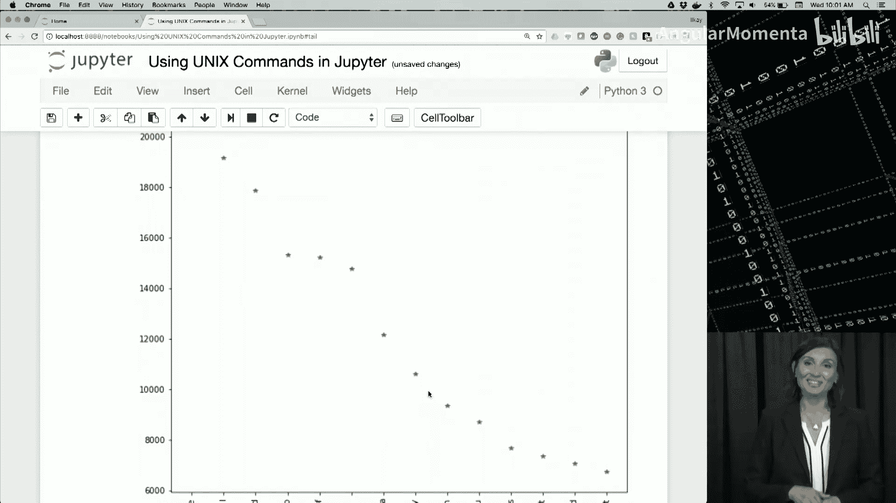

# 【加州大学圣地亚哥分校】Python数据科学-｜-Python-for-Data-Science-p12-04-01-03-视频-为何使用Jupyter笔记本--BV1jwFUzjEXu_p12-

This week we'll kick things off with an introduction to working with Jupiter notebooks you've already seen Jupiter notebooks earlier in the course when we showed you the example S Analysis notebook。

😊，This week， we'll start building these notebooks together and working with them in more depth。

 but first we'll be discussing why we are using Jupyter notebooks。😊，By the end of this video。

 you should be able to describe the features of Jupyter notebooks which have led to it rapidly gaining broad acceptance within the data science community。

😊，Jupyter offers a number of features and we've already mentioned a number of them but let's review them the data science process involves the steps we learned about earlier in the course。

😊，Jupyter notebooks allow us to document that process by combining notes， code， and graphics。

Most importantly， combining these features allows others to read the notebooks and understand the motives behind each step and why decisions were made。

 so it's simply good collaboration。😊，Going along with the importance of the documentation and collaboration。

 this is also simply good science。😊，If someone else wants to examine your results or build on your findings。

 they can see exactly how you conducted the research。

Now replication and inspection of others methods has been a core element of the scientific process for centuries。

 but the advent of computational tools has caused discussion about how to best ensure such practices then conducting science using computing。

 and Jupyter notebooks aims to do just that。😊，Jupyter notebooks don't just contain your notes and process。

 they contain your results as well。You can easily share the notebook in a variety of ways with cos and present your results alongside the process。

😊，And lastly。As we mentioned before， Jupiter supports Julia， Python R。

Three of the most popular programming languages for conducting data science today。

 along with other languages。😊，I personally moved to Jupiters as soon as I saw what they had to offer and many of my colleagues had made the same switch。

 so this lesson is all about getting you up and running with the notebooks。😊，To get you started。

 we'll be working with the real basics of Jupyter notebooks so that by the end of this video。

 you'll be able to create a Jupyter notebook and run Python code in that notebook。😊。

Let's go straight to the notebooks to get started。

Now that you finalize your Jupiter notebook setup and we reviewed some background on Jupiter。

 let's get started with the notebook environment。😊，The first page via are at is called a dashboard。

 it basically lists the contents of the folder you launch Jupyter notebook from。

 you can navigate around your file system through this dashboard。

 just like any other file Explorer interface。😊，A note here is that this file system is where the Jupyter notebook server is running。

 it could even be on another machine。If you don't use the local host as a server in your laptop locally。

 you'll simply see another interface。At this point。

I would like to remind you to follow along if you haven't already started doing it。

We know one of the biggest obstacles to success in online classes is getting started working with the infrastructure and your learning environment。

So I really want you to do this with me。We are just going to get our first notebook started。

 run some initial code， and add some documentation， it shouldn't take you much time。

 but it will get you up and running。😊，If you get set up now， for the rest of the course。

 you'll be able to follow along in notebooks with the material we present and play around with the code yourself。

😊，Okay。Now let's create a new notebook with the Ne button。😊，On this upper right corner。

Here we will select Python 3 as our Python version。😊，Now I have an E notebook。😮。

And I click on untitled on top to name it。 I'll just name it to be。In through a notebook here。

So we renamed our notebook。Now if we go back to our dashboard。

 we will see that there's an Eve notebook， a file called Intro notebookbook。 IPY and B。

 that's the EEV notebook we just created and renamed。In the beginning。

 there's sometimes some confusion as both the notebook application。😊。

And the notebook are cold notebook， but they are separate。The notebook application。😊。

Is a web application that creates the interface in the browser and executes Python and other languages code。

😊，The notebook file is a file format。😊，With the IPYNB extension that saves code， images。

 and text in a single document is enough to be shared。As we said before。

 this feature has gained lots of popularity in data science。😊，You probably realize this。

 but the Intro notebook notebook is in a different browser tab。😮，In your browser。

Any name notebook that I open， therell be a E tab like this and you can have many open at the same time。

Now let's get started with coding using the code cells。Hopefully you're following along。

 but please feel free to post the video and try each step I show you if you fall behind。😊。

It is normal to take some time in the beginning， so don't worry if it's causing some confusion at times。

I will now click on the first cell。It's just simply click with the mouse in the rectangular cell in the notebook and type Python code。

 like I can say， print。Hello world， which is our traditional greeting in any computer science programming course。

So I can run this code in a few different ways， one is I can go to the toolbar on top and push the run button。

 I should just get the result as we see here how the world was printed or I can reclick on that cell。

And enter， shift。Enter simultaneously， it should run the same cell。

Note that this is executing code in a Python process called the kernel。

So there is a kernel running in the background for each open notebook or browser tab basically。

The Jupyter notebook application talks to the kernel to have it load data and execute code。

Shift Enter or that play button creates another cell just below the first one while we are executing it or while the kernel is executing it。

So this one here is the second cell we have。😊，So we can say that a Jupyter notebook is a collection of cells。

 some including code like we just did。Now that we have learned working with cells。

 let's execute more code， for instance。😊，You can use the notebook as a calculator。

 A question we can ask here is， how many seconds are in a year。 So we need to。

Count the number of days， times 24 for hours， times 64 minutes and 64 seconds。Remember。

 we run it either via a run button on our toolbar here or shift enter。😊。

So I run it by saying shift enter。And I got that big number in the。Outputs here。

So you might have noticed then I print something， it shows up as a text right under my code cell。

And if I just run a calculation without an assignment or a print statement like I did here。

 it comes up as an output line here we have the odd three line for that number。

 so that number is kind of difficult to read， it's a large number， so let's convert it to millions。

To do that in the next cell， I'll type underscore。😊，Divided by。1， E6。And I say shift run。

We see that the output is turned into a number in millions。So here let's explain what I've done。

 underscore refers to the output of the last cell executed。

 so since we executed that in tree line before，We are using the shorthand scientific notation for 10 to the power six to convert it to a number in millions。

 so then we run it and it's like 31。536 million seconds。

 so this is a little better and easier to read。So now I'm thinking， what about a leap here？

Because leap years have 366 days。The good thing about a Jupyter notebook is that you can go back to Excel and update it and run it again。

 so what I'll do to look for a leap here is I'll simply say go to that entry line。😊。

And it shows those numbers show the order of execution。

 and I'll go and update that line instead of 366 to be 65 to be 366。😊，So after we modify the cell。

 we will calculate the seconds with the new question on how many seconds are there in a leap here in this case。

 so I go say shift enter and we see that number has changed。😊。

But since we haven't executed the next cell。The number in that hasn't changed yet。

But the environment put us in the next cell so we can rerun that same cell again。

 so we have that in four line and we know that in five was executed after that because the number in there is sequentially larger。

 so I'm going to say shift enter in that in four line now it's in six and we know that that number has been updated。

So good。But maybe we'd like to have both of them inside our notebook。

 I want to have the question for how many days are there in a leap year and I also want to have regular years。

Then what do we do？Here we can just copy and paste the code cell to have separate cells for the code related to both question。

😊，Instead of updating the cell completely。To do this。

 I'll use the cut and paste buttons on the toolbar。

So I'm going to go to that cell and I'll click on that in five line。

 the cell that associates to that， and here I'll have cut and paste， I'll simply copy。

And I'll push paste。Right next to the copy button， so now I have two cells。In the second cell。

I can say 35，65 times 24 times 60 times 60， and I'll rerun that。I'll have。

The answers to both questions on how many seconds are there in a year。

 in a regular year and a leap year？Of course I need to do the same done for。

The million conversion one， so I can go and say paste here。

I need to click on the cell above where I want to paste it。

So if I go now in five and go through as shift enter to run that， shift enter to run the next one。

 shift enter to run in7， now it turned to be in 10 and shift enter to run the last line。

 we have everything nicely executed in a sequence。So until now。

 we used code cells with only one line。But。Actually。

 the code in that code cell doesn't have to be one liners as we have done in our quick examples。

 you can do any type of Python code in the notebook。

 sometimes it could be as simple as importing a module。

 sometimes it could be printing a variable or creating sophisticated analysis or graphs。

But let's go with a tool liner now And if you run in there， any Python code。

 I am now clicking in that last cell。If I simply say that， x equals。😊，4 plus。3。😊，Okay。

And in the next line， print。😊，X。Now when I run it by shift enter。

The environment will run that block of code。So something you'll notice when I click on this if I go with。

My up and down arrows。I can move between different lines of code。And once I come to the top line。

I can go to the。Sellbo。But this could be a bit of a challenge when I have too many lines and you want to quickly。

Switch between different code cells。Maybe you want to move around a few cells up and down quickly without using your mouse just through your keyboard。

For that purpose， the notebook interface is implemented to be modal。

 that means if you do escape in the cell border just like I'm going to do here。

Escape the in 12 cell that we have there。You can now use the up and down arrows on your keyboards to change cells。

By cursor before Ive done this was in that print X line。

 so if I wasn't in that escape mode where my cell is highlighted as blue， if I push the up arrow。

 I would go into that x equals 4 plus3 line， now I can just push the up arrow and move between the cells。

🤢，So it's a very useful feature， I can go and execute these and it's still in that model mode。😊。

So now how do we get rid of some of these cells right， let's click on our code cell in the bottom。

 it turned green。😊，For us to type。I'll say print。And I'll call that string temp。Okay。

 because I cute this。Now， maybe I wanted to do a quick check of something and I don't want that permanently in my notebook。

 I can just click on it。And。Simply here， say cut in the upper toolbar。🤢。

And it's going to get deleted Let's end our code cell introduction here。

 so you'll see more of it as we go through the weeks and next we will actually look at some special cells called markdown cells in a notebook。

We just so have to run code in a notebook， but we haven't used the feature of documenting our analysis yet。

😊，We learn how to do just that in this video。😊，By the end of this video。

 you should be able to add and format text in Jupyter notebooks。😊。

We will now continue from where we left last video by working with yet another cell type called markdown cells。

Let's open a new cell， and this time we will use the plus toolbar button。Here I push plus。

And I'll see a new。Cell being inserted right below the cell that was highlighted。

We can now click on the cell and change the purpose of the cell from cell to a markdown by choosing markdown from the drop down menu on the upper right corner of this notebook。

 so we go here， push in this click on this code markdown and instead of code， we pick markdown。

So now this cell， when I click on it， it's a markdown cell。

And it means we can write text in it instead of code。

This is great for documenting your data analysis pipeline， so I can just say hi。😊。

And run this and I'll see there's a texture， so I can actually go on that。

Sell again on the text and click on it。😊，And get back to that markdown cell mode。

Although Markdown cellll is a simple test markup designed with simplicity like a word editor。

 you can do quite a bit of formatting and beautification as well as scientific editing using these markdown cells。

😊，The markdown cellss have support for HTML and other text formatting languages like lateEek if you heard of that。

😊，For example， we can create bullet list。😊，Then me actually say here instead of hi。

Let's actually do it a little nicer。嗯。And then I'll go to the next line and I'll say star。Space。

 everything I put after this sparse space is rendered into a bulleted list， so I can say。One fish。

2 fish。Red fish。Blue fish。To code Dr。 Seuss， this， when I run this and I say shift enter。

 it's going to create， what I just typed into a bulleted list。So we can， instead of running code。

 we are now rendering HTML through this text markup cell。😊。

You can make many things with it right we could also create， for example。

 titles or headings for that we will use。😊，The hashtag symbol， so if we say hashtag。

 it already shows you this is heading one。This is it。Mark down。So。And。Here， if we say two hashtags。

 it's going to make it a little smaller。 So it's like a heading two inward。 it would be。😊，This is。

Hading two。And if we go on and on like that。嗯。Three of them will be putting three and onwards。

So when I say shift enter now。I'll see these being rendered as I wanted， which is a title headings。

 bullet list and text。 so we can also do a bold text， bold face text。 So I'll just say star star。

Example text here。And if I say shift enter， it's going to format it as bold。

 I can make things italics or emphasize things by using an italic font， I can say example text here。

😊，It already started editing it as italics。Or italics。And I see that it's emphasized that last line。

Links like gogle。com， how do we do that if you actually just put an HTTP？😊，Google。com here。

 it's going to already render it as an automatic link to Google。com。

So there are so many ways to render text， of course and if you'd like to learn more。

There's a marked down guide we give you in a follow up reading。Also as a side note。

Most think of markdowns as code commenting or documenting your code。

 but I think of it more like writing a scientific paper or a white paper。

 you can create very sophisticated editing with markdowns， for example。

 you can create equations using latex equations。😊，Lic is a document editing language which has a syntax for many text components for scientific writing。

 including writing it。😊，Equations。So let's go to that next cell。Maybe here I can show you。

 I'll switch that again from that mark code cell to a markdown cell。Like this？

And I'll enter there a latex equation。😊，So。To write an equation in latex。

 I need to write them between two dollar symbols， just like this。And there I can just。

Write my latex equation。Which will， then we'll see how it gets rendered。Into。An equation。

 nicely formatted。Okay， let's render this line。As you see in the cell。

 we entered a nice little latethic equation code。Even if it's a mark down cell， it's not a code cell。

 it knows how to render that into this beautiful equation。😊，So here I can add more text right。

 this is a bold。Laay thick。Equation。And I can enter it now when I say shift enter。

 I'll see that it's nicely formatted， almost like you would see in a scientific paper。😊。

This is great when for example you're implementing code from a scientific paper or a data science algorithm that you'd like to try out there's a lot of math involved in there you can of course first write an elegant equation in latex easier to read for humans then you can implement that in a Python function in a code cell right after that it makes it a little easier to understand for your collaborators or readers next we'll talk about how to use code cells for imaging in a notebook。

😊，You're now in pretty good shape to work with notebooks already。

 but let me walk through a few more useful practices。😊，By the end of this video。

 you should be able to manage Jupyter notebook files and share notebooks with your team。😊。

So in this video， we'll talk a little bit more about how to format and comment out our notebook better and use some imagery and markdowns around that imagery。

We will learn about flooding and Python later。😊，In this class on week5。

 but if you bear with me here and please do not worry if you don't understand the code。

 I would like to show you how an image is generated inside the notebook in a code cell and how we can use markdowns around it to explain that cell。

😊，So I'll go to my notebook， you see that last line if you click on it and if you're not sure if it's a markdown or a code。

 you already see in here indicating it's a code， but you can also check it simply through this markdown dropdown in your toolbar。

😊，So here I'm just going to use a simple mat plotlib function called plot。

 I need to import some of that。😊，And it says basically import pie plot and。Ploot function。

 and we'll use to。That plot function to just plot out a vector， 01014 values isn't it。

 if I say shift run here， I'll see the graph being generated。🤢，So again， we had four values 0101。

 we just plotted it out using a simple matplotlib function。

 we'll see more of that to how we use a MAplotLi to create visualizations and things like that later in this course。

So now maybe I want to explain this graph， how would I do that？😊，I'll go to the click on the cell。

 the code cell under it， and I'll convert that to a markdown。I can simply write， this is a plot。

Using。Mapl Lib。嗯。Of a vector。That's it， I'll just run this one so I can see that my text actually is right under that graph and explaining that graph further。

😊，Let's go a little bit。Up in our notebook again， to do that， I'll just use escapescape。

And I'll use my up and down arrows to move between cells。

 I want to go back to that first question we calculated how many seconds are there in a leap here？😊。

This is just code。And above it， I'd like to add a line of text using markdowns to explain what that code was for or what I'm trying to do there。

😊，So I'll go to the cell about that cell， which says in8 here， I'll go to that in2 cell。

And I'll go to my toolbar and click add。😊，Here I can click on the new cell that I added。

 convert that to a markdown and say。Below is。Hary。Calculate。The number of seconds。In。Eite here。

So if we run this， we could see that we are nicely documenting and I'll just I haven't changed much。

 but I'll just keep running through the notebook to see how we can run everything in it using shift Enter one by one。

 it puts us to the next line at each time。So now we are done with our notebook。😊，嗯。

We need to save it。 of course， the notebook actually application。Saves checkpoints as you're typing。

 but if you want to make sure you can also just say save or use that save button。

And you'll see that a checkpoint was created here when I use the checkpointing。

 so if I want to go to that version of the notebook at that check checkpoint。

 I can go and click on that later on。So let's now close our。Browser tab。

 we are done with our notebook， we saved it and let's now close the browser tab and go to our dashboard。

On our dashboards？We see that。Green notebook right next to our notebook file。

 and it says it's running， so although we closed it。

 the kernel that's running the notebook is still running。🤢，So since it's running， we can just click。

😊，And open it easily。So now if you want to。Make sure the kernel is not running once we close our notebook。

Maybe we won't be working with it in the near term and we want to make sure everything is nicely saved and closed。

 we can go to file。And there。We can say close and halt。

So when we go back to our dashboard now after closing it。

 we'll see that green notebook turned to some grayish color and the notebook is not running anymore。

😊，Of course， to run it， we just need to reopen the notebook。😊，And remember， the kernel was closed。

But then when I look at this notebook overall， everything that I've done before persisted。

 so once it's run， it persists until I go and rerun the notebook。

 so if I share this with a collaborator， they'll be able to see my outputs。

But then they can change it and reexec it， or they can reexecute the same one by doing shift enter。

 they can even do something like restart and run all under the kernel。

So there are different run options for this kernel。

Another thing I'd like to talk about is let's say you did your analysis and you'd like to send it to your colleague。

 they can of course view your analysis as if it were a report。

 but also they can rerun it on their machine or modify a notebook easily。😊。

What if you really would like to save？And none。Executable version of the notebook。

And keep it in your archives。We can do that by going to file menu option here and you can download the notebook as a number of different formats in this one I'll do an HTML。

😊，So when I download this notebook that we just created as an HTML file。😊。

You'll see that the notebook looks like we would see it in the notebook application。😊。

But it's an HTML file without any name on top and a toolbar on top which is not editable。

 so we have a version of the notebook that can be archived the way it is with your outputs when you lost ran that notebook。

 so it makes it also easier to keep a record of the results and per system over time or if you have collaborators who would just like to see not executable results。

 you can share HTML files or PDFs through the notebook interface。😊，With this。

 we'll end our Jupiter introduction。😊，And in the rest of the course。

 we'll show you some other notebook features as we go through more sophisticated Python modules for data science。

Hope you'll enjoy the notebooks as much as we do。😊。

And follow along in all the notebooks we show you for different applications。

After this brief overview of Jupipyter Notes， we will now start with the notebooks further。😊。

Before we show you the great Python libraries， I would like to quickly overview how to use Uni Com through a Jupyter notebook。

😊，Although the Python language itself provides ways to use Uniix shell commands。😊。

Jupipyter notebooks provides an easier and more interactive way to use InX commentsement。😊。

We simply put an exclamation mark before the commence to execute them like we execute them on a Uniix show on a side note。

😊，Jupiter will use your default She to execute these command。

 so any adjustment needed to execute these command should be based on the operating system your Jupiter environment is set up on。

Let's now switch to our notebook to execute some of the commentss we reviewed as useful command for data scientists。

😊，Let's start with El。To display the contents of the data directory called UniX in the same directory with this notebook。

 we use the exclamation mark LS Comt。😊，So in my notebook environment and in your week3 folder。

 you have a cold folder called dot Uni。😊，So here we'll go and execute that particular shell。

 it says there's a Shakespeare。thexc a data file limit。😊，To store the name of this data file。

 I'll use a local variable in the notebook。😮，The wave we would normally use in Python script。

So here we say file name。unix， Shakespeare。txD。To display this variable， we can use the Uni way。

And use the echo command in Uni with an exclamation mark in front of it to display the values stored by the file name variable。

🤢，Or。Simply use the print function in Python， then we don't need the Uni like dollar sign。

 we just use it as a Python variable。So here， and we execute it with shift En。

 we see that both Echo and print execute the same。Ill put the same。Line。Next。

 let's display the first and last few lines of the file to get a basic understanding of the file header and footer。

For this， we'll use the head command。😊，So。I can quickly execute head with an exclamation mark。

Minus n。Three for the top three lines and dollar file name for that Uni variable resolution and when I say shift enter。

We'll see that。The top three lines are displayed， I can display top 30 lines if I wanted if I change that the 30。

 the number of lines， I'll see the top 30 lines of that data file。

 which is some disclaimer on the copyrights of the Shakespeare's works。

Same for the bottom set of lines， it's important to view the top and bottom of the line bottom of the file because then it gives us some understanding for that we use the exclamation mark tail command so when I say shift enter and execute that I'll see that bottom 10 lines let's change that number to something bigish like 4D so we could see actually there's something about that about Shakespeare so we see that at the end of one of his works。

So that should tell us already it looks like a big file。

 it's all of Shakespeare's works and in the top and bottom we can't even see the data yet。

 we just see those disclaimers。嗯。How big it is？How big is it we can use the word count to display the number of words load lines character to figure that out。

 so here I'll say exclamation my WC dollar file name when I do that I get about 124000 lines words and characters following that number。

😊，To get just a number of lines， we use WC with the minus L option here。🤢，Which will be。

In the next in eight output。We can also use pipes and filters to do the same thing to work with the CA command and the WWC command。

Now let's look for an occurrence of the word parchment in the file。As you might remember。

 the comment they'll use for this is Gr。Using the Gr command。

 they'll display all the lines that have the word parchment in。🤢，In it at least once。

So here we say exclamation mark grip， minus I parchment， dollar file name。

 so this should give us all the lines when I say shift enter。嗯。In that line。

 so basically each of these lines have the word。Pchments somewhere in there。

But exactly how many lines we can take advantage of the pipes and filters here again。😊，This time。

 let's look for the world's liberty instead of parchment just for a change。What they'll do is。

Vocat the file name。🤢，Through a pipe。Into grip。And looks for liberty。In the output。And count。

The number of lines at the output of grip， which should be something like this。

<|OTHER|>So if we did not have WC minus L， let's click that for a sec。

 we would have just a liberty word because we use the minus O option。And if I cut that into WC。

 the one that we just removed， we'll see that there's 71 of those lines。

Since I used Sc with the minus0 option， I didn't see the full line， I just saw liberty as the word。

Now let's use the said stream editor to replace all occurrences of the word parchment with the word manuscript。

And write the results to a new file called T。pxd。We can do that and then search for the word manuscript in the new T at TXD file。

So we'll use the SCD command for said。And here we say find search for parchment。

 replaced it by manuscript globally， and input is our file name and they'll write that through a redirect to temp that TxD。

I quickly execute that now I should have Ta TxD， you should all have Tma TxD in your week three directory that you opened your notebook from。

So then。We will go and count or find the number of occurrences of manuscript in this T at TXD。

So we see that the same lines that were listed for parchment before， they are listed。

 but instead of that parchment was replaced by manuscript。

 this could be useful when you're quickly replacing a set of data values with some other data values。

Now let's look at how we use the sort command together with the head command in a pipe and filter。

Head gives us the first five lines here。嗯。As you have seen before。😔，P the file name。

If we sort those five lines。The sort will put those lines in ascending character order。

 LTIO in the character order based on the ASI numbers。

We can use different sort options if we now past this output。😊，To source， draw a pipe。

We will put the lines in ascending character orders。Just like this。We use different sort options。

 sometimes here we see that library this is often is an asc character order。

 meaning based on their asking numbers。But what if we wanted to sort on the second？

Set of words so off is presented and releases how do we do that often the data files we work with are space separated or comma separated so we turn those as into a column in our dataset and being maybe want to source based on that second column。

🤢，So。For that we can take advantage of the sort comments options。

 FSK is insensitive and we are saying now sort on column number two with the rest of the comments。

And I'll go ahead and run this。😊，We see that is of presented and releases are in the right order now。

Next， we'll source and find a number of unique lines。Remember， we had。124，000 ish files。In our。

Data file， Shakespeare。xD。嗯。Now， let's。Find out how many unique lines will source and pass that to the unique command and count the number of lines。

 and we see that。Here we have less number of lines， some lines where repeated。

 looks like we have about 110，000 lines there。To bring it all together。😊。

We will count the most frequent words in our data file。As you would remember in our UniX exercises。

 we used a set stream editor command to do some processing to replace the spaces with a Neline character。

 we will start by doing the same thing here。At the end of the sequence of unique character count in sorting them。

 we will retrieve the top 15 using the head command。😊。

So that was the exact same pipe filter we ran before。

 we only need the exclamation mark in the beginning for PS filters as you see here。

 and then if you run this，We will， it's still processing， as you see the star is there。

 it didn't update that run number in the input。We'll see that the first 15 are displayed。🤢。

So sending hand sort command is right sending the last two errors。

 but it's because head stops after 15 lines。So how do we write this output to a file。

 we'll see this you know here。If you run this， we can write to。

Count versus words here with this comment， shift enter。

 it's still running as you see there is a star there。

We'll have to wait a little bit for it to run and finish。

And the standard output from the command will be written to count versus words。

And remember sort gave us an error， that's the standard error coming out of the command。

 we'll see that still on the notebook interface like here。

 so that's why we left that error in the command。😊，So let's count。Or cat。

 so display the contents of count versus words。嗯。It's the top 15。We didn't remove the spaces。

 so some of them show up as that。Now。We will take advantage of Python Mattplot Library to plot the top 15 words in Shakespeare's works。

🤢，So here again， in week five， we'll learn more about Matpl lib， but here we see a。

Small script using MattplL。So do just that and it's displaying that the eye and space。

 all of that plotted nicely on a graph。As I mentioned before。

 we will learn more about Matplub Live in week five next we will discuss the nonPI Library in Python that should be fun。

😊。

