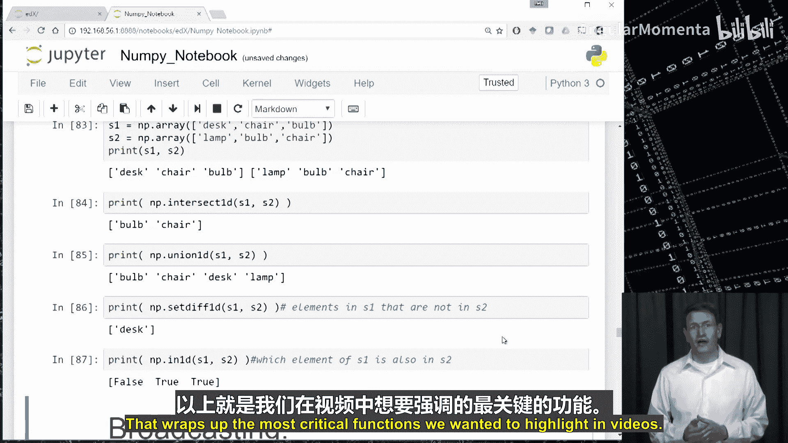
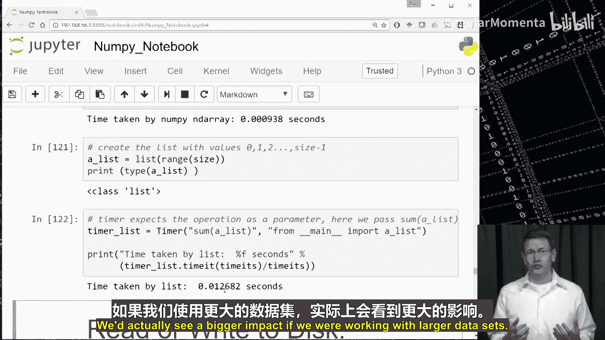

# 【加州大学圣地亚哥分校】Python数据科学-｜-Python-for-Data-Science-p13-04-02-03-视频-为何选择NumPy--BV1jwFUzjEXu_p13-

In this lesson， we'll be focused on the value of NMI， the primary package for scientific computing。

But in this video， you should be able to recognize the value of nu P for data science。

NempI offers a number of key features for scientific computing。

The key feature of NmpI is support for multidimensional arrays。

 this is useful for representing vectors and matrices。

 and when doing data science we'll be working with matrices nearly all the time。

NempI also gives us a number of operations which we can perform on matrices。

 This includes obvious things from linear algebra like adding multiplying。

 subtracting of matrices and vectors， but also includes optimized statistical operations。

 fast fo your transforms among others。One of the trickier things to manage when working with matrices and vectors is making sure their dimensions align properly。

 NmpI actually takes a lot of that work out of the process by supporting something called broadcasting。

 which makes the process easier and the code easier to read。Lastly。

 NumpI is often fast enough for production code， so you don't need to optimize further。

But if you need to， it gives you the ability to work with optimized compiled code from libraries from Fortranran。

 C， and C++。This functionality I just mentioned is really useful。

 but there are really three reasons data science are working with Python using nuPI all the time。

The first is that it gets fast。 In fact， using numpy's arrays can often be 10 times faster than Python's list。

To enable the speed， nuy arrays are fixed in size， unlike this， which can change in size。

 and elements of numpy arrays must all be the same type。 so all ints or floats。

Res list can hold any type。By restricting India arrays in this way。

 it makes India arrays both much more space efficient than this。

But also opens up a range of memory and computational optimizations。

The second reason we use numI is because its functionality。

 Those operations I mentioned are really useful。 Want to get the average of a vector in the matrix。

 you got it， want to multiply matrices， you got it。

 want to select a subset of the matrix based on idds or values。 you got it。

Even when we move into pans， you'll be finding yourself using many of these functions。Lastly。

 we love nuumpy because many of our favorite packages in Python rely on Numpy。 In fact， pandas。

 which we'll be doing soon， are built on top of Numpy。

And I should note that while pandas provides higher level functionality than NumpI。

 you'll still be using some of NumpPI's functionality at times。

So let's dive into how you use NmpyI by going through our Jupyter notebook in the next videos。

In this lesson， we'll get started with the basics of working with N arrays。By the end of this video。

 you should be able to create both rank one and rank two in the arrays。

You should be able to access elements in ND arrays using basic indexing and use built in functions to create ND arrays with different shapes and initial values。

Just like our basic data structures from Python， we'll get started working with ND arrayray by creating ND arrays and accessing their elements。

First， we'll start by creating a rank one in the array， but before we can create the array。

 we'll need to import the Ny package。 Typ we import it as NP and then use NP to access the functions from that package。

Now let's create our first ND array called an array rank1 nD arrays are simply a single dimensional array or a vector here I'm giving you the values 333 and 333 in order to create this as an ND array。

 I had to call the function in nuy called array。Which returns the Nd array object。

Let's look at the type of the an array object to see what class it is。We find the result is a nuy。

 in array object， and that's exactly what we expect。Next。

 let's see what the shape is of that object we just created by using the shape function。

We find that it has only one dimension， and in the dimension we have three elements。Next。

 let's access those elements using bracket， just like we might do with a list。

 if I ask for an array at index 0， I should go back 3 and so on here I'm printing the elements 0。

1 and 2 and what I get back is。Exactly what I'd expect。In the arrays are mutable。

 which means that we can switch their elements to do this， we can use an assignment。

Here we're changing the contents of the first element to be 888， and then we're printing the result。

The first element is now 888。Remember that these arrays are tight and we'll see more of this later。

 but if I try to assign it to be a string。Like this。I'm going to get an error。

You can't assign an integer to be a string， and for those of you with a background strongly type languages like C or C++ or Java。

 this will be pretty familiar to you， but for those of you with a background primarily in Python。

 you'll need to keep this in mind when you're working with N arrays。

So let me fix that code real quickly。All right。Next we'll create a rank2 array。

 a rank2 array is a two dimensional array， which is effectively a matrix。

Because we're creating a 2D array， notice how I have nested brackets。

The first row will have the elements 11， 12 and 13， and our second row will have 21， 22 and 23。

 so let's see how this code works。When I printed the array， I got back its elements。

I then tested shape， and I got back there as a two by three matrix with two rows and three columns。

Lastly， we accessed the elements of the array at position 00。

01 and 10 and got back the elements at those locations。When specs find the two values。

 we're asking for the row first and then the column， that's why0， comma 1 corresponded to 12。

 and 1 comma 0 corresponds to 21。One of the nicest features to NI is the variety of library functions available to create arrays of varying sizes with different prefil values。

 for example， in this segmentma code。We're asking for a two by two array of zeros。

Using the function zeros， and that's what we'll get back。Next。

 if I want an array to be prefi with the same value， I can do that by using the function full。

 specify find the dimensions I want here。Here I'm asking for a two by two matrix。

And then I have to specify the initial value by giving it 9。0。

 what I should give back is a 2 by2 array full of the value 9。0。And I do。

What if you want to create an n by N matrix where the diagonals are all one and all the other values is0。

 the I function can do this for you like this。If you want it to be all ones。

 you can use the ones function。Notice that I just created a one by two matrix。

This is different than a rank1 matrix in that it's still rank2。

 and I can see that by testing its shape。I find that shape is one by two， in order to index。

 I have to use two dimensions。There are more functions for building arrays。

 but the last one I want to point you to is pre useful。

You give yourself a random array pretty easily by calling the random function in NP random by specifying size you get back a matrix filled with random values。

 This is particularly useful for algorithms which need a random state in order to get kickstared。

So by now you should feel fairly comfortable creating N arrays and accessing the elements in the next video we'll start looking at more advanced indexing features。

In this video， we'll look at different approaches for accessing and permuting data in ND arrays。

So by the end of this video， you should be able to use slice indexing to access subsets of an ND array and recognize that using such indexing creates a second reference to the same underlying data。

From strings and lists， we learned that we could use slice indexing to get subsets of those data structures。

We can use similar indexing to plot subregions from India arrays。Again。

 we'll import Numps NP and we'll create the same 3 by4 ND array to work with for a few of our examples。

Notice that to help us show you how these work， we filled in the values in the matrix with numbers corresponding to the row and column。

 for example， row 1 column 1 is 11。This should help us keep track of which values correspond to what。

We'll next use slice indexing to pull out the first two rows。

Row0 and1 and then when you grab the middle columns one and two When I run this。

 I expect to get back a two by two matrix。Let's take a deeper look at how that just worked。

Here is the composition of an array， we've got three rows and four columns。

Now we ask for a slice of that array。For the rows， we ask for all the rows before row2。

 which gives us back0 and1。For the columns， we ask for columns1 through3 with one inclusive and three exclusive。

 This corresponds to columns 1 and 2。So when we print the contents of a slice， we get back。

Just the region in yellow here。 A slice， a slice is pointing to the same elements in memory as anna array。

 which is why I'm referring to a slice as part of anar array。Zooming in a bit。

This is part of anna array point to by this a slice。

What's both convenient and also sometimes confusing is that a slice has its own indices and these indices。

Are different than the indices in an。This becomes clear when we try to access an element in a slice。

If I ask for a slice 00， that's the element with the value 12。

 it's the same element as 01 in an array。This might seem a bit confusing that you'd access the slice based on its own two by two indices。

But that's actually exactly what you want。You want to be able to treat a slice as a two by two matrix without any worries about where in some larger data structure those elements might be。

Next， let's go back to the notebook and see how changing element 12 using a slice actually changes the contents of both a slice and an array here I'll print anar 01。

 which is the element 12 that we just showed in the diagram。

 then I'll change the corresponding element in a slice， which is at 00 to 1000。

When I look at an array01， we should see that it has been changed as well。It has。

The reason I spend so much time pointing this out is it's really easy to forget that slices are just references to the same underlying data as the original array。

If you want to have a slice be a copy， you have to make these changes first let me run this again。

And then instead of just asking for the slice of an array， I have to essentially make a copy。

 and to do that， I'm going to type NP。 array。And then feed in the slice。

That will create a copy of that portion of NP and give that to a slice。

 So now when I run this next block， we're going to find。That even though I changed a slice。

 I didn't actually change the underlying code。And this was because I made a slice to be a copy。

So let's see a few more examples of slicing。But I'll move a bit more quickly now that we've done one example in detail。

First， I'll create that same array and array。I'll hit run。Now I'll use an index， just a single index。

For the row and a slice for the column。By putting a colon， it means all columns。

 so here I'm asking for all columns of row 1， and I should get back 21， 22， 23， and 24。

The interesting part here is looking at the shape。Because I've used a single index to access the row。

I actually get back a rank one array， which I could index with a single number。

Using the single index is a special case because if I use slices to produce a 1 by four array。

 it will still be rank 2， Let's do that。Row rank 2 is being assigned just row 1 using slicing in all the columns when I ask for that array ants rank。

I'm going to get back there as a 2D array， notice the double brackets at the start in the end。

And this is shown by the fact that this is a  one by four rank2 matrix， not rank one。

He will do the same thing for the columns of the array。We'll grab column 1， which has elements 12。

 22， and 32 using the index for column rank 1。We get back a rank1 array with those values。

 but using the slice indexing with call rank 2 gives us back a3 by one rank 2 array。

Sometimes we like to use arrays of indexes to access or permute our larger matrix。

 let's do this in the following example。First， I'll create a 4 by3 array。Next， I'm going to create。

An array of indices。With the values 0，1，2， and0。I'll also use the MP range function to create an inD array with the values 0。

1， 2， and 3。Let's quickly examine how these values might pair up if I use them。

As row and column indices。I'll do that with a quick for loop and the zip function。

We get back that the correspondingbin 2D indices would be 0，0，11，22， and 30。

If you were curious about how that zip function works。

 you can always go back to our earlier lessons on Python。Okay。

 now let's inspect the contents at those pairs of indices and we'll get back the values。11， 22， 33。

 and 41。This is pretty useful。 we can access elements using arrays as indices。

 we can also change elements in the array the same way here I'm going to add 100。

000 to an array for our row and column indices。After inspecting the array。We see that 00，11，22。

 and 30 have all been in。Keep this trick in mind for later in the course when we start doing data cleaning。

Slice and array indexing is at the heart of nuumpy and is both really convenient and extremely fast。

There's one other form of indexing which we need to learn。

 and that requires us using conditionals based on the values in the NDRA。

We'll do that in our next video。In our previous video。

 we used various approaches to index into endD arrays based on the locations in the array。

In data science， we often find ourselves carryinging a great deal about the values in the array。

For example， what if we wanted to find all ages less than  zero or greater than 100 and then do something with those values？

To do that kind of data clean， we need Boolean indexing。By the end of this video。

 you should be able to use conditional indexing to access and permute relevant data in ND arrays。

To get started， let's create another basic sample array with three rows and two columns。

What we'll do next is use conditionals combined with any arrays， skip back Booleing arrays。

Here I'm asking for a filter which will be true for every element greater than 15 and fall for every element less than 15。

The filter we've just created is the same size and shape as the original in array and for each element。

 it has either true or false value。We can now use that filter as indices to the larger array。

 asking for those values for which the filter is true。

 What we'll get back is all the values greater than 15。To be honest， this is pretty slick in itself。

 what a great way to pull out values matching a particular criteria。

But we can actually express this in a single step。Here Im asking for all the values in an array。

 where an array is greater than 15。 This creates a balloonolean filter and then applies it all in one step like this。

We cant have even more complex logic here。Let's try get all the values between 20 and 30 to do that。

We'm going to make these changes。 So first I'm going to say an array。It's greater than 20。And。

An array。Is less than 30。Or we can even ask for even value just using the modo symbol so I can do that like this。

They same enter rate， modulo 2 equals equals0。Let's use that same conditional。

 but now let's actually change the elements based on the condition。So this line here。

We'll select all the elements in an array where the anna array value is even。

 and we'll add 100 to it。That's exactly what happens。

Filters are useful in many data science operations and other computer science algorithms involving matrices。

 for example， green screening of images takes advantage of filter functions to replace green pixels in the background with another image of your choice。

We'll see more of this as we go through the course， primarily when we're trying to clean up our data。

As you might expect from our introductory video on NumpI， each ND array has its own data type。

We'll quickly look how to set and inspect that type。Moreover。

 we'll look at a wide range of ND operations。So by the end of this video。

 you should be able to examine and set the data type of an enddie array。 You should really use。

Common in array functions。As we showed you previously， data types matter。

If you try to assign an element in an integer array to a floating point value， you'll get an error。

Let's start by just doing some basics with these。We'll start by creating an array and giving it two ins。

 the type of the array is unsurprisingly going to be an in。Similarly， if we give it floats。

 we're going to get back a float array。We can also explicitly say the type we want by creating the array。

Here we're saying that we want the type to be integer。

Where this gets useful is when you want to force a different type than the input here I'm providing two floats to the constructor。

 but I'm telling it to make the type integer。Mempie will do this。

It just forces the floats to drop their decimal， effectively doing the flow function。Similarly。

 we could force ints to be floats。This is less problematic because we're not losing any information。

The reason you might want to do this is if you presently have integer data。

 but expect for the values to change be floats in the future。

You don't want Python to pick in data types here only to run into problems later。

Just keep in mind that data types matter for ND arrays。Next。

 let's look at some of the common operations on any arrays。

Most of the arithmetic operations you might inspect are here。

Let's start by creating a couple of arrays。Notice that the first is integer and the second is floating point。

For most of our arithmetic operations， the results will be upcast to floating point to avoid losing precision。

Also notice that these arrays have the same dimensions， for many of these operations to work。

 there needs to be an aligning of dimensions。In this case， the dimensions are the same。

 so we'll be fine。But later， we'll see that there is some flexibility about this constraint when we learn about broadcasting。

So let's get started by adding we can do this either by using the plus sign or using the NP function ad that both produces the same result。

 and the plus sign is better for code readability。With add， this does exactly what you expect。

 Elmond 0，0 x is added to 0，0 y to produce the new 0，0 value and so forth。 As I mentioned。

 the results here floats to avoid losing precision。We know to subtractor raise。Multiply arrays。

Dividder is。We could perform a square root on all the elements of array。

And we can also do e to the x for all of the elements using the exponent function。Next。

 we'll look at some other common functions in NumpI， including those for basic statistics， sorting。

 and set operations。We've seen some basic operations on matrices including add， subtract， multiply。

 and others Next we'll dive into some of the more useful functions that you'll be using throughout the course。

So by the end of this video， you should be able to use common ND array functions for doing data analysis。

 including statistical， sorting and set operations。As this is a data science course。

 you'll be using basic statistical operations fairly frequently。

Let's look at some of the common feed functions you'll use First。

 we'll create a 2 by4 array filled with randoms。Next。

 let's compute the mean for the elements in the array。Suppose you want to get the mean for each row。

 where you can do this by specifying axis equals1 where we get back。

Is the two element array contain a means for each row？Similarly。

 we can compute the means for each column by giving access equals0。Here are the means for each call。

There are other methods like some， which can be useful。As well and function in a similar way to mean。

Just to tie this all together， let's say that we want to get the medians by row。Well。

 let's start by creating a new cell。This will be similar to the code for computing the means by row。

 so I'm going to copy the code over from computing the means。

We need to call median from the Ny package and pass it the array。

 so I'm going to change this to save print。NP dot median。I'm going to pass it the array。

 and I'm going to set the axis。21。Compute the median。Binggo， we have the media values for each row。

Next， let's look at the built in functions for sorting to get started。

 we'll create an a array of 10 random elements。Sometimes we'll want to avoid changing array values themselves and just get back a copy of the array which is sorted。

To do that， we'll want to create a copy of it first。

 then sort that copy with the method sort when we run this。We'll find the copy。

Finally the copy is sorted， but the original is untouched。

If you had just wanted to sort the original array， you could have just done that calling the sort method and that would sort it in place。

Before diving into set operations， I want to quickly mention the function unique。

If you have an array of values like I have here， you can use the numpie method unique to pull out just those which are unique。

Notice that my original array had a number of duplicate ones， twos， and fours。

 the output is just one，2， and 4。We can actually use set operations and ND arrays。

Let's create two any arrays with string elements。The first has a desk， chair and a bulb。

 the second has a lamp bulb and chair。The method intersect will give us those elements which are common to both arrays。

Notice that we're using intersect 1D because intersect expects 1D arrays。

The results are bulb and chair。The methodthod union will give us all the unique elements across both arrays。

Which is bulb， chair， desk and lamp。We can use difference to check for elements in one set。

 but not in the other。Dask is the only element in set 1， which is not also in set 2。Similarly。

 you can get back an array of Booles for whether each element is in the array or not。Dek is not。

 but chair and ballar。So we get back false， true， and true。

That wraps up the most critical functions we wanted to highlight in videos。

 but we'll be diving into broadcasting in the next video。

Before we do， I want to point out that there are a myriad of useful functions on in arrays and we could spend hours just talking through more of them。

But rather than us walking through line by line， we encourage you to go through these on your own。

You'll find these functions at the bottom of this notebook that we provided。

Including these functions is how to perform dots and inner product on matrices and vectors。

 how to sum elements in an MDD array， how to use elementwise functions and get the transpose of a matrix。

 how to use random number generation， and how to merge data sets。

How to use the where function and more。As with our other notebooks。

 you'll often find we add extra examples and resources beyond those we discuss in the videos。Okay。

 off to broadcasting in our next video。

In this video， we'll be talking about broadcasting。

Broadcasting is one of the more advanced features in Ny。

 and it can help make your array operations more convenient。So by the end of this video。

 you should be able to employ broadcasting to perform operations on different size in the arrays。

Suppose you have a multidimensional array A， and you want to add the elements in array B to each row of A。

You've got a mismatch in the sizes of the arrays。To solve this。

 you will likely find yourself trying to figure out how to replicate B three times so you can do the computation that you want。

This mismatch in sizes is the exact problem broadcasting aims to solve。

Let's put some values in the matrix and in the array。And you just add A to B。😡。

Broadcasting will try to figure out which dimensions you want to add and we'll automatically see that because of your number of columns and A matches the number of columns in B。

 it will effectively perform the computation you likely wanted。So A plus B。

We'll add B to each the rows of A， producing this result。

I will note that this is only for illustration purposes。B actually retains its original shape。

 and that's part of the beauty of broadcasting because B retains its original shape。

 no copy is involved。This is actually a very memory and computationally efficient operation。

So before diving into the notebooks， let's go over the rules regarding broadcasting。

These are the rules directly from the NMI documentation； the rules likely follow your intuition。

Between the two India arrays， the dimensions either need to match or it needs to be a scalar。

And it begins with the matching of matching the trailing dimension and then works forwards。

A scalar value also applies， as a scalar value has one row and one column。

 so adding a scalar effectively uses broadcasting as well。

So let's dive back into notebooks and see some examples。

Now that we've seen broadcasting in principle， let's work through a few more examples。First。

 we'll create a 4 by3 in the array and we'll fill it with zeros。

Now we'll create a3 by one array with the values 1，0， and 2。And now we'll do the broadcasting。

We'll add the 3 by one array to our 4 by3 array， and we'll add the array。

 add rows to each row of the start。Because start was prefilled with all zeros。

 each row start now contains the values in at rows。

Let's do the same thing except willll add to each column this time to do that。

I'll need a 4 by one array， which I'll build as a1 by4 array and then just use a transpose on it denoted by T。

Now I'll add this4 by one array to get。To start。 And because I'm using broadcasting。

 I should get back。The result which has the values from add calls in each column of start。

It's worth showing that our addition of a scalar value like  one to start works fine。

 as it will broadcast in both directions。Broadcasting takes some practice and some patience。

 and helps to draw out the matrices when you work。I have the example from the video in the notebook below。

 and it might be a helpful place to start。We said at the very start of this lesson that NumpI is valued for its speed and its functionality。

So far we've been focused on showing you。The many operations and built in functions in NumpI。

But I want to take a moment and just show you a basic speed test between nuy and L。

So for the end of this video， you should be able to describe the speed benefits of India arrays over list。

Although I can talk about the benefits of ND arrays。

 particularly with them being more space efficient and memory optimized。

 I think seeing the speed difference goes a long way。To do this test。

 we'll be using time it to measure the execution time of our code。

We'll plan on using arrays or lists with 1 million elements。

 and we'll plan on repeating an operation of summing all those elements 1，000 times。

We'll set up the N array to have the values from 0 to sismma-1。And again， this is class and E。

And now we'll do the timing， let's see how long this takes。So this took about one millisecond。

 remember that this is running a sum operation IRA with 1 million elements。

Let's see how that compares with using a list for the same computation。

We've created a list of the same values。It has a class list。

And now we'll see how long it takes to run。Feels like it's taking a little bit longer， doesn't it？

In fact， this took an order of magnitude longer than it did with the ND arrays。

So for nuy that was about one millisecond and for the list， it was roughly 13 milliseconds。

 so that's an order of magnitude and an order of magnitude is a big deal。

And this was for a pretty small array， we'd actually see a bigger impact if we were working with larger data sets。

So hopefully the videos and the notebooks in this lesson have highlighted the value of NmpI。

 both for its speed and for its functionality。