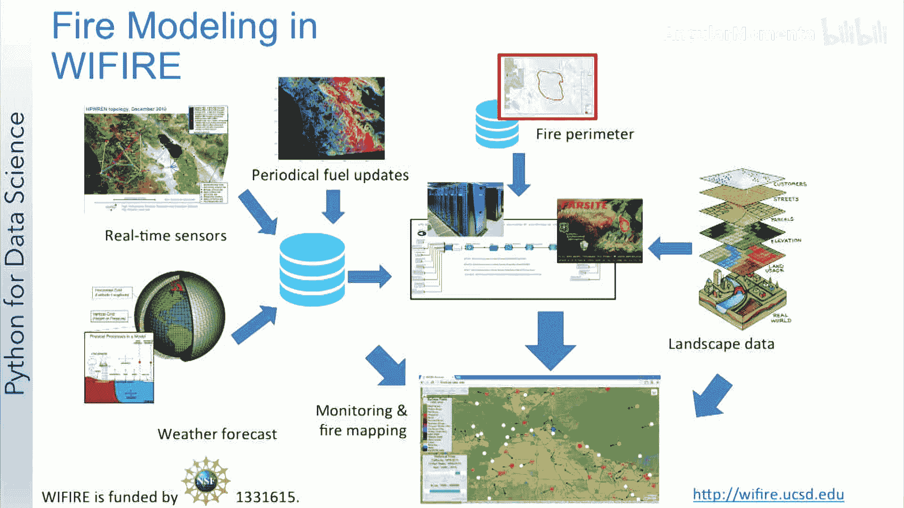
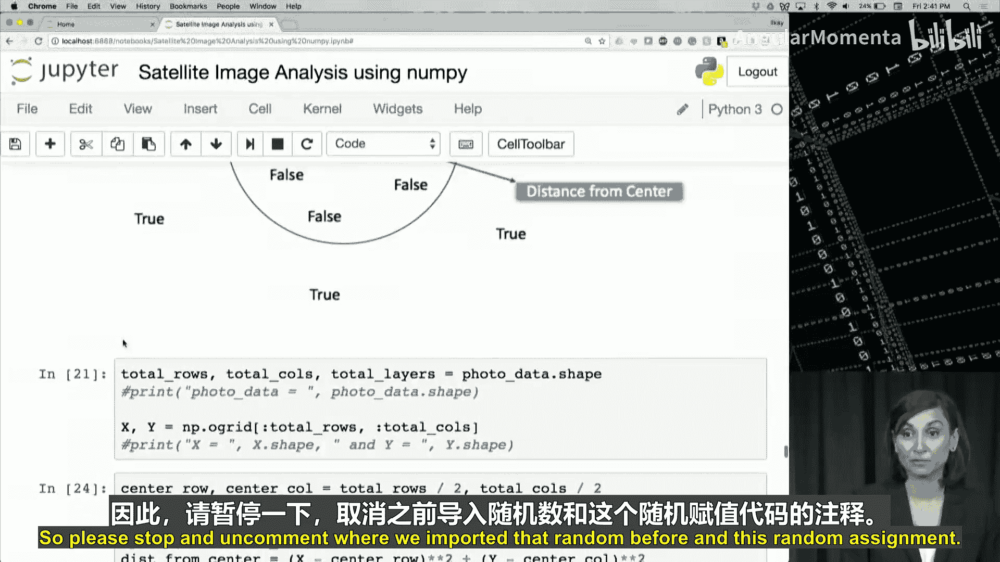

# 【加州大学圣地亚哥分校】Python数据科学-｜-Python-for-Data-Science-p14-04-03-02-视频-卫星图像示例--BV1jwFUzjEXu_p14-

In this lesson， we will analyze a sample satellite image data set from one of our research projects called WiFIR。

 and we'll use the NI Library in this analysis。😊，WF is an integrated system for wildfire analysis which is capable of handling changing urban dynamics and climate。

😊，The system integrates networked observations from a variety of sources。

 including heterogeneous satellite data and real time remote sensor data。😊。

It then processes all these data using computational techniques in signal processing， visualization。

 predictive fire modeling， and data assimation in a scalable way。😊。

The result is a system capable of monitoring weather patterns and other factors to help predict a wildfire's rate of spread。

😊，You can read more about wfireR at wfire。ucsd。edu。By the end of this video。

 you should be able to describe what satellite image data is and how it helps fighting wildfires and apply basic methods in NMI for image processing。

In this lesson， we'll go over a notebook that uses a satellite image from Landfirere。

gov that can be used for analysis of the Earth's surface。

It is very common for any Earth science application to include an analysis of visual graphs in the form of maps。

 photos or satellite imagery as seen in this image。😊。

Many other data science applications will also involve a form of image processing。

 we need to have a basic knowledge of image formats and have to work with images in Python to get started in this vast field。

😊，So before we switch to our notebook for further practice。😊。

Let's review a few key points on image processing and earth science applications。😊，Simply speaking。😊。

We can say computers stored images as a mosaic of tiny squares。😊。

This is like the ancient art form of T mosaics。😊，Or the melting bead kits。Kids play with today。

If these square tiles are too big， it's hard to make smooth edges and curves。

The more and smaller tiles you use， the smoother， or as we say， less pixelated， the image will be。😊。

This sometimes gets referred to as resolution of the image。😊。

Please note that vector graphics are a somewhat different method of storing images that aims to avoid pixel related issues。

😊，But we'll set those aside for now， even vector images in the end are displayed as a mosaic of pixels。

😊，Each of these squares is called a pixel。Each pixel is only one color defined by a set of numbers。😊。

A simple way to describe each pixel is using a combination of three colors， namely red。

 green and blue。😊，This is what we call an RGB image in an RGB image。

 each pixel is represented by three8 bit numbers associated to the values for red。

 green and blue respectively。😊，The combination of these three will in turn give us a specific shade of the pixel color。

Since each number is an8 bit number， the values range from 0 to 255。For example。

 a yellow value can be identified by 255， 255 and0 for RGB as we see in this diagram。

If all three values are at full intensity， that means they are 255， it shows as white。

 if all three colors are muted or has the value of0，😊，The color shows as black。

Since each value can have 256 different intensity or brightness value， it makes 16。

8 million total shades。In Python。RGB images are ND arrays of shape。

 height times width times3 for each RGB layer。Now that you have a basic background in how color images are stored in Python。

We can look at Wifi data in more depth。Over the next video。

We will go through a notebook in which we start by importing a high resolution image from the NASA satelliteate Landsat。

We will mainly use nonp functions。😊，Filtering techniques。😊。

And some domain Earth science knowledge to analyze this image。

So how do we use the results of this analysis and predictive fire modeling in the end？

We will make this fuel data set， one of the many other data sets we use for fire modeling。😊。

We see in this diagram how we can make many real time analysis results a part of the fire modeling。😊。

Once integrated with other sources of information， such better and automated fuel models can lead to more accurate results。

😊。

We provide you a short video that further explains how all these data sets are integrated and analyzed using data science as the next video in this lesson before we start with our notebook。

😊，Please feel free to skip it if you would like to jump ahead to the notebook。😊。

Here we provide you a Numpy notebook to do a basic image processing using Numpy。😊。

If you're looking for the notebook to locate it， you need to go in your week3 folder and find the satellite image analysis notebook and please locate the WiF folder with the data in there as well。

So we picked satellite imagery because satellite imagery is a very interesting image data to exercise this。

😊，Okay， you can go and read about all the image， the data source where it comes from the WiFIR system here。

🤢，I'll go to the next line here where we gather our tools together， like our other notebooks。

 we'll start by importing NmpPI as NP and scipi and Matpl Lib in this particular case。

 so I go ahead and run that using shift Enter。😊，Next。

 we will read our satellite image as an ND array using the IM read function。

 so this function is provided to us by Python。嗯。Here， we say。

We import the data package and we'll use the IM read function and that's the Wifi folder with the three layer image we'll be working with that you have there。

And if we look at the type of this data。😊，We'll see that it's an NDRA。As we talked about before。

This is an RGB image and the type is an NDA because it will be turned into an NDA with three dimensions。

😊，We use the type function to display that type， but it just shows us N array， of course。😊。

Let's now plot the image in our notebook to see it before we do anything with it。

 we first set up a frame size of 15， 15， you can change that frame size the way you like if your notebook is higher resolution and things like that。

😊，And we'll use the IM show function in a scaleR image to display it。🤢，So let's run this。😊。

We see that image shows up， that's great， we see our colorful satellite image now。😊。

But what are the dimensions of the NDRA， right， I said it a three dimensional one。

 and we need to use the shape function type function won't be enough for that。Let's run photo data。

 which is the name we gave to this array and shape as a function。We see that 37， 25， 300。

 725 is the height and width is 4797 and it has three layers for RGB， those are our three layers。😊。

There's something interesting about this image。Like many other visualizations， the colors。😊。

In each RGB layer means something。For example， the intensity of the red will be an indication of altitude of the geographical data point in the pixel。

😊，The intensity of blue will indicate a measure of aspect and the green will indicate slope。😊。

To a train eye， to a geoscientist。😊，Or a field modeler。

 these colors will help to communicate this information in a quicker and more effective way rather than showing numbers。

😊，So if we had to show the numbers， for example。😊，Let's go to the in four line and un that print function。

We would see a bunch of numbers。 it really doesn't indicate much if we didn't have to。🤢，Use that。

If we had to just interpret those numbers， it would be difficult。😊。

There is by just looking at this colorful image， a trained eye can tell already what the altitude what's the slope。

 what's the aspect， so that's the idea of loading some more meaning to these colors to indicate something more scientific。

😊，Okay， once we load the image， we can start exploring with it， let's check its size。

 we'll use the size function of the NDRA for that。😊，And like many other things we do。

 we'll check the maximum and minimum of the data values and maybe the average pixel value。🤢。

Here we use ND arrays minimum function and maximum function。

These values are important to verify since the8 bit color intensities cannot be outside of the  zero to 255 range。

Using the NDRA or the image， the photo datata variable。

 we can check the RGB values for a pixel in the image as well。😊，For example。

We'll check here the row 150 and column 250。 What are the RGB values at this column。

 I'll use photo data， you know，150 to 50 here。And we'll see that the values are 17 for R 35 for G。🤢。

255 for B， so its this particular pixel has a lot of blue in it。🤢。

We could have also selected one of these values， like if we want to select the green。Photo data 150。

 250 1，01 to the indexes， remember， so this gives us the second one index 1 will give us G。

 the green value， so if I run that we'll see that green value is 35。😊，That's great。

 so these are typical and the array functions in NI to work with the data。😊，Similarly。

 we can change individual values of each pixel by assigning specific values to pixels。😊。

Here in this line。😊，I'll go and set that pixel that we just worked with。

 row to 150 column 250 to be0。In this line， photo data 15250 equals0。😊，嗯。We just。

Set all three layers to be zero， so this image to be particularly。Black， of course。

 we can display this image now。😊，Using， again， the figure plotting and IM show。

But it won't change much and be visible because we only changed a single pixel。

 which was this 150 to 250 was somewhere around this。🤢，We can also try to change a range of pixel。

Let's try to。Do something bigger and set the values of the green layer to full intensity for all columns within the low range of 200。

To 800。 so row。2002。800 so it's like it should show horizontally。嗯。Something like this well set。

Every。Value。From row 200 to 800 in all the columns as we see in this range query to 255。

 and only the second， the green layer， RGB1 associateds with green。So just pause a second and think。

 what would you expect to see？🤢，We significantly increased the green value in these pixels。And it's。

 again， from row 200 to 800。For all the columns。 so you would expect， I hope to see that horizontal。

Range or a big bar that looks greenish than the rest of the pixels around it。So let's run this。

And we'll indeed see from row 200 to 800 for all the columns， we have a higher green intensity。

So our range assignment worked there。Similarly， we could have set the range。

 I'll reload in this first line， I'll reload the image because we just changed the image。

 I want to set it back to its original， so I reloaded it using I am Read to photo data again。

And here what we are doing is。😊，嗯。We are sitting all the columns。And all the layers。

 I didn't particularly give another one of the01 to one of the three layers here。

All the columns in the range 200 to 800 for the rows to be of full intensity。

What would you expect to see？I hope it's white because all three colors are fully intensified。

 so that shows up as white。😊，If we run this。Indeed， we see that white bar。

Of course we could have done。Black by setting instead of 255 to all three layers to be zero。

So we are muting down all the colors。Please now stop the video and play with the range and RGV values to make yourself comfortable with this notation。

🤢，We will be using this notation quite a bit for the rest of this notebook。

 so it's important that you understood everything up to this point。Okay。Now。

 let's go to our next slide。😊，And we'll start creating a Boolean and the array in the same size by using a logical operator。

 so we'll check the values of these pixels。Like I've done before， I'll first reload。

The image to the photo data， since we changed it a bit again。

And I would like to use the original image for the rest of the notebook。Let's print the shape of it。

 I'll say shape of photo data and its shape。😊，And here in line three。We use a comparison。

To select all values that are less than 50。This will create a boolean and the array of the same shape with our original array。

Now that we have it， we can use this new andD array like we did before to filter out pixels with low intensity。

 or I can call them points of less interest， so let's run this filter。😊。

We see that shape of the photo data is equal to the shape of the low value filter。

 and we generated that low value filter using a global comparison operator for all the values less than 50。

😊，Right。So how do we do filtering using this N low value filter area？🤢。

Maybe we'll now use this array as an index to set those low values to zero。🤢，So here。

What we do is we have our original data， right？😊，We'll show that first。

 then we'll apply this filter of low value filter in our for line here。To be 0。Actually。

 we are not using the random here so we can get rid of it， but if you'd like to add a random。

 please un that later。And then after we apply the filter。

 we'll plot the image again and see if there's any difference。😊，This is our first image。

 the original image， and the next one we apply that filter。😊，Although it's not very visible。🤢。

At least to our bare eye， there is a little intensity to change in this figure。

But let's go back to the filter and set it to 200 and do the same thing。

 We'll see that the image will really change。 so instead of。Less than 50。Let's set these to be 200。🤢。

Okay。So now our low value filter is not quite a low value filter because we have quite high values that we are filtering there。

 anything less than 200， there's only 255。So we have that knee filter and we are running the exact same thing we are applying this filter to photo data。

 this was our original image and we see that the next image filtered out a lot of those。😊。

Pixels with。Low values for RGB or value is less than 200 in this case。Okay。

 now let's do some more operations using the row and column indices。Here， what they'll do is。

We'll create。Rangnge arrays， so it's going to be two of them。One of them will be for rows。

 so we'll get the length of the photo data。And they'll use the EA range function to create these two arrays。

And they'll be off class， numppy and D array。🤢，Create a range array called rows underscore range in the first line。

 we assign that same array to array called columns underscore range and these arrays in the next cell。

We use these range arrays to set the values of the pixels associated them to have full intensity in all colors。

Which means to make the color of these pixels white。Now if we plot this image。

 let's go back to our notebook。We'll have photo data here we are using rows range and columns range。

😊，We are using these two range arrays。And setting all the values in those pixels to 255。Now。

Let's show our image。We'll see。A diagonal line。White line。

 because those are the values we set going through a virtual square in the left part of the image here we see。

That's exactly what we've done right we had a range array for the rows and a range array for the columns and we set those as indices to this matrix and said right here。

 we said assign sign。Those particular pixels， 00，010，01122 to be 255。

And we see that as a diagonal line， a white line from zero to。About that 3。

700 range that we had in the image。Now we will do something even more interesting。

 Let's try to cut out a circle with the radius of half of the total row index。 What I mean here is。

As you see in this image。We will cut out。This circle here。

 and we'll see how we'll calculate the Euclidean distance of all the points。🤢。

AndWithin a radius from the center。So to do this to summarize， we'll need to calculate。😊。

The Euclidean distance of all points from the center。And if you have a triangle like this。

 which is the long edge of the triangle from point x1 v1 of x1 y1 to the center X Y。🤢。

The radius of the circle。Will be the Euclidean distance of any point。

 so x square y square should be less than r square so how do we do this right so you have a nice image here in your notebook。

Let's see how we convert what they mean and try to。Create a filter for all the points。Beyond。

That radius line， that circle， to be true， and all the points within that circle to be false。

In these first two lines。In the next code block。🤢，We create two mesh grids。

 they will be called X and Y。But before that， we'll get the shape。😊，Of our photo data。

 which is our ND array， which is three layer image， right？

And we'll assign the number of rows to total rows， number of columns， to total columns。

And the three layers， RGB the total layers， so if we actually go ahead and print this。

 we'll see that the shape is still that original shape of the image it's commented up。

Next now we'll use the all grid function。To help us vectorize。The distance from the center。😔。

Which will be a function of the two variables。Ogri returns as an endD。

So what will all grade return will give the range of total rows and range of total columns。

 and it's going to give us。 let's comment this line with the print。 It's going to give us。

Two vectors， x and Y。Which will have the x will have the total number of rows。

 like the one that we give here and y will have the total number of columns。🤢。

So Ogrid is a compact method of creating a multidimensional NDRA operations in single lines。🤢。

As we uncommented the two print statements here， we saw that x and y are vectors that match the number of rows and columns in our original image respectively。

Okay， I'll comment that out again。To make our notebook compact。Next。

 we will now calculate the center point X。And why and call them。Center row and center column。

 so total number of rows divided by two， total number of columns divided by two。

We will use our two vectors， x and y to calculate the points that are further than the distance。

Of this radius。Of the circle we are trying to create here。It could be confusing。

 so please again feel free to stop the video and un all these print statements that we have here。

To explore data in these vectors and the distance from the center matrix perter。

So here we have the distance from the center， we are using our center row and the x vector to create the distance from the center。

呃。Matrix。And we are going to make sure all of these values。The or。Each value in this matrix that is。

Greater than the radius is true， like here。We are trying to set all these circular values outside of the circle to be true in our circular mask。

And we'll assign that to the circular mask。So actually。😊，Let's go ahead and run this。And if we print。

The circular mask will only see the edges。 right。 We'll see that those edges。And the。

Matrixs are indeed true。But if we go and provide a range query。Towards the center of the figure。

Which is the range selection in our second print here， row 1500 to 1700 and column 202200。

If we run this again， we'll see that。Those。Points or those pixels。Are indeed， false。

So we were able to identify what's inside the circle and what's outside the circle。Okay。

 now we have our circular mask ready here。😊，We will go ahead and filter the image。

 I reload that original image again。😊，And use that photo data and filter it using the circular mask we generated。

😊，And assign all those values to be0， to be black。So just think for a second what you would expect to see in our original image。

 when we plot this image， we are using the same plotting IM show function to plot this。😊。

We'll see that。We have this。呃。Our image nicely cut out as a circle， so nice work。

 hope you were able to follow this， if not， please review what you've done until now before we move on。

Okay。Now let's combine this。Circular mask with another one that masks out now the bottom half of the image。

🤢，So it's below any point below that。Center row point we had in this image， right this is the center。

And we assign that to a variable called center row， the x for that point。

We'll now use that as a mask， we'll use the same technique to create a mask here。In x， are vectors。

Any point or any row below the center point of the image will be filtered so any x。🤢。

That's less than cent row。That's the upper health。Will be through。So。

We'll call that filter health upperpper， okay？Then we'll use the logical end function from NI to combine these two filters。

I'll call this filter Health upper mask， I think we should have maybe called it Health upper circular mask actually。

And we'll provide the health upper and circular mask as the two filters。To this knee mask。

 so we are ending all the true false values in those per row column index。🤢，嗯。

We should have a filter that gives us the true values for upper。And。Around the circle。嗯。Now。

 if we assign。This health upper mask。To this filter。😊，Assigned a value of 255。

To the points that are true in that filter。Those parts should be visible as white in the resulting image。

So let's apply our mask and plot our image。I'm sorry， I didn't run the okay。

 and let's apply our image。We see that。Anything around the circle that's in the upper half。Is。Right。

We could have used the random for that we'll have to import random。🤢。

So please stop and on that where we imported that random before。

And。This random and。Assignment。You should see the effect。In the intensity values。

We still select here when we use the random integer。An intensity value of high between 200 and 255。😊。

But the color will randomly change， it's not going to be pure white。

 it's going to have a shade of white。🤢，So please stop the video and try that line and make sure you understand that part okay。

Now let's remember the meaning of each of these RGB layers in this image。

 remember red was for altitude or height of that geographical point。

And now we know how to create masks， we'll create one by selecting the red layer。

 which is layer zero in our three layer matrix。😊，And maybe we'll select anything of intensity higher than 150。

So。What I'm doing here is。I reload the image。And I'll start creating the red mask。

Here I'm taking the photo data and selecting row all rows and columns for layer zero。

 which is our red layer。😊，And the red mask will have true。For all the values in that photo data。

With the red layer of 150。So。All the red values that are less than 150。

The row and column index for those will be true in our red mask。嗯。

Let's use this mask to assign zero to all those points。🤢。

So I'm going to run this and we see that the image will be ploted。

And we only display the high elevation areas， our image changed quite a bit actually。

 because we only show the points in the image that had that red intensity of 150 or higher。😊。

Next in the notebook， we do the same to find the high aspect and high slope。

 the only thing we change here is we change the green。And blue layers。Please run those two。

Code cells and observe how your image changes。 It shouldn't be the same image。 It should have。

Differences based on elevation， slope and aspect。So we are almost at the end here。😊。

I hope you're still having fun with me。Lastly， let's create a composite mask for a point with high elevation。

 high aspect and low slope using the logical end like we did for our circular and upper health。😊。

We are doing the red mask， as we did before， green mask。For points。

Larger than 100 and blue a mask for points greater than 100。A sort smaller than a less than 100。

And our final mask will have these three。Combined using the logical end function。

<|OTHER|>And if you plot the image here。You'll see that those values。

 the image changed a bit again from the original one。

And we filtered out the points with these three conditions。🤢，Hope you enjoyed this notebook。

As an exercise， I suggest you to use a photo of yourself。😊。

And create some interesting filters to create your own Instagram。😊。

