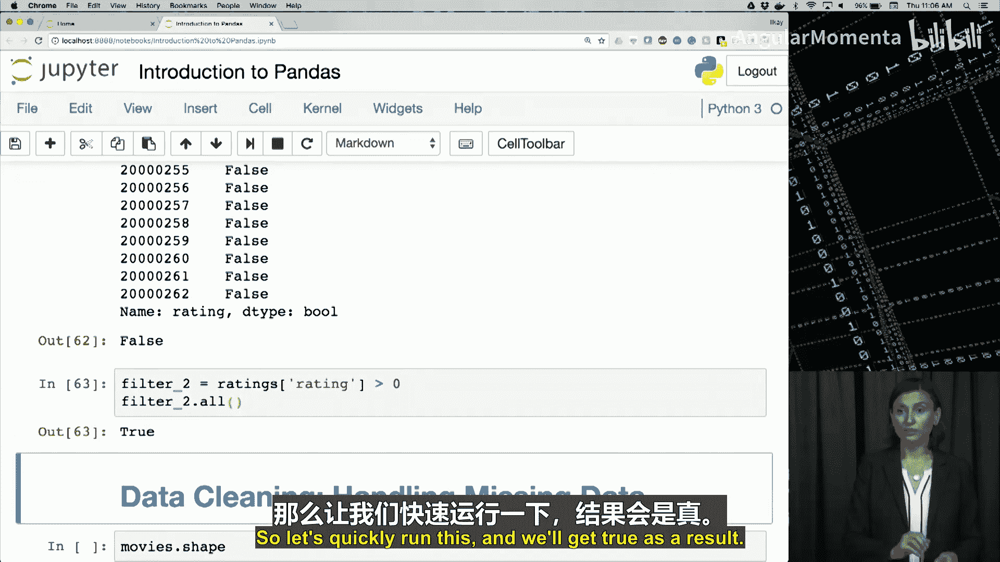

# 【加州大学圣地亚哥分校】Python数据科学-｜-Python-for-Data-Science-p15-05-01-03-视频-为何选择熊猫--BV1jwFUzjEXu_p15-

In this lesson， we'll be focused on the value of panndas。

 the primary data analysis library in Python。By the end of this video。😊。

You should be able to describe the valley of pandas to data science and Python。😊。

Highlight the key data structures of pandas。😊，And discuss the capabilities of Pas that has resulted in its widespread adoption as a tool for analytics。

😊，Fandndas Library provides a number of data analysis friendly features。

 which made it one of the most popular data science tools。Fendas builds upon Nmpy。

 so most of the Nmi advantages still hold true。However。

 it uniquely enables ingestion and manipulation of heterogeneous data types in an intuitive fashion。

😊，Pands also enables combining large dataset using merge and Joant。

And it provides a very efficient library for breaking data set， transforming and recombining。😊。

Another great feature Pandas provides is its visualizations。😊。

Plottting data has been simplified by inbuilt functions that come with data frame。😊。

And descriptive statistics by using simple function is another good part of pandas This capability really simplifies the exploratory data analysis as well as communication of results。

😊，Additionally， Panda's Library handles time series data effectively via native method that provides to ingest。

 transform， and analyze time series data。😊，Other benefits to using pandas are the ability to take advantage of native methods to handle missing data and data pivoting。

 easy data sorting and description capability is。😊。

Fast generation of data plots and Boolean indexing for fast image processing and other masking operations just to name a few。

😊，Pands achieves this。Thanks to two data structures， namely Pada seriesius and Panda data frame。

A series is a one dimensional array like object that provides us with many ways to index data。😊。

Serius acts like an ND array， but it supports many data types， integer， strings。

 floating point numbers， Python objects， etc。😊，As a part of the array。

It is a valid argument to most nonp methods because of its similarity to erase。

The axis labels are collectively referred to as the index and we can get and set values by these index labels。

😊，So a series is like a fixed size dictionary in this regard。😊，But it's very flexible。😊。

Although series is a flexible data structure， the data structure that gets used even more is Panda's data frame。

😊，A data frame is a 2D elastic data structure that supports heterogeneous data with labeled axis for rows and columns。

Arithmetic operations can occur on both row and column labels。😊。

We can think of it as a container for serious objects where each row is a series。😊。

If you are looking for a functionality to perform some data transformation。Chances are。

 pandas already has it。It provides almost all major data wrangling capabilities that data scientists need。

 it is actively supported by a developer community and constantly increasing in functionality。😊。

We think panndas will continue to play even a larger role in data science process in the coming decade we have just reviewed why the Pandas Library in Python is very useful and talked about the two data structures in it let's get started with our panndas notebook to review these data structures。

We have just reviewed why the Padas Library in Python is very useful and talked about the two main data structures in it。

😊，Let's get started with our panda notebook to review these data structures。To follow along。

 please open introduction to Panda's notebook in your folder for week four。If you're ready。

 let's now try importing the pandas module as a part of our notebook。So you'll see here in this line。

 it says importm Padas， SPD。We'll run that now our notebook is ready to use pandas functions。😊。

Before we dive into the details of those pandas functions。

 let's review our two main data structures we just talked about。😊，The first one is panda Sirius。😊。

Here。We create a serious object called SEER， SA， I'll refer to。Yes。Which is like a nupy array。😊。

But we can define the index labels， as you see here， together with the data。😊。

So I say SE or s equals。Pandnda seriousius in parentisees， data equals。An array。Coma index equals。

 and we can name our indices anything we want there。 we can actually。

Go through and we see that all of them are names when I run this。

The SCR will be created and when we output the SCR。We'll see。嗯。

The data array indexed by those names we put in our data structure。

So instead of indices being0 through4， we have a five element series with indexes defined as Tom。

 Bob， Nancy， etc。Although I defined the data and index using a clear format in this example。😊。

We could have skipped data and index equals， so I could have just done。Get rid of index。

And get rid of data。And the output would have been the same because pandas knows how to resolve those two arrays into a serious data structure。

Another thing to recognize about the series compared to NmpI array is that the data types can be heterogeneous。

😊，So if I switch some of the data with strings， like I'll say here。Maybe fo os。

And then I'll go change another one of these， too。嗯。Maybe bird。嗯。I'll see that。

Those values will change。If any at any point you get confused about the indices。

 you can display the index like we have here， SEer， sir。 indexdex。

 and it's going to give you the list of all the indices。😊。

We can use any of the indices by using it within rectangular brackets to access data at that location。

 so I'll say SER and I'll use Nancy as the index and when we look at our data here the Nancy index points to。

😊，Value 300。 So if you run this we indeed get 300 as the output。Alternatively。

 we could have used a lock function。Of the serious object to get the value out of a location。

 So instead of S ER in brackets， Nancy， if I said。Lock， Nancy， I'm saying， give me the location。

The value at the location index by Nancy， and we see that the output would be the same。Now。

 if we wanted to access multiple locations， we can type。Let's say SER。

 we pass it an array of Nancy and Bob。Ass the indexes？And if we run this。

 it's going to give us the two data values indexed by Nancy and Bob。

Another way to access data at a serious location is to use the numeric indices here we access elements4。

3 and 1 in SER。A reminder that， like all other array indices， serious indices also start by zero。

So let's go ahead and run this， we'll see that locations for index by Eric。😊，Three index by then。

And one index by Bob。Are displayed。We can also use the IL function to achieve the same thing by typing。

 let's copy and paste this just to we。Clear by typing。Index location。2。

And it should give us the value in the second。呃。0，1，2， second index pointed by Nancy。

Next in this notebook。You see。Usage of an index and checking if an index exists in a series。

So you can check quickly if a data value indexed by Bob exists in SER object。

 so I'll just say Bob in SER and you'll see that it's going to evaluate through because we have Bob as one of our indices in this object。

We can also use Python operations on a series， just like we did in Ny here we multiply the whole series by 2。

So let's run this。So if we see that， actually， let's before that。

Copy and paste and first display series。Do you see the values in that？And here I'm multiplying。

Those values。By two。If you notice something interesting related to strings， you're in the right path。

😊，When I multiplied， the string values is to be。诶。By two， they'll get repeated two times。

We can also do。A calculation on squares of the serious data elements， let's do that。

 and in this case we'll have an error。Because it doesn't know how to evaluate the squares of。

Strengths。So instead， let's get the locations。Don't numeric one。Nancy。And Eric。

And repeat the same operation， you'll see that。On the part of the series that we took out of our series object。

 SER object， we can calculate those squares。Next， we will talk about panda data frames。

There are many ways to create data frames。We often just read and ingest data into a data frame。

 but before we do that， let's create data frames manually and review some simple ways to work with those data frames。

😊，Let's start by creating a data frame out of a dictionary of series of objects。

 remember we are adding another dimension to our data structure。

 so we need to label each series object， so let's just go ahead and create a dictionary right D equals。

😊，And in the first label one， we have a seriesius with some values and indice's Apple bowl clock。

And in the second one， we name it too。And we have a series with 111 and some things with numbers and。

And indices for indices associated to those。 so I'll go ahead and run this。

Now that we have a dictionary。We can load this data into a data frame called Df。Fal type Df equals。P。

 D， do data frame。And parenthees will give it as an input the dictionary that we just created。

And we'll just display the contents of thef。So if I run this。I'll see that。

Two columns for the data are generated。And the series in the dictionary are merged in the data frame。

Notice that index labels are merged as well。Which results are in？Heav indices， apple， cereal clock。

And Nancy。As serious labels， row labels， in this case。嗯。And one and two is the column labels。

And we see that。Actually， the first column， the series one that was labeled by one。

 didn't have some of those indices。Like it didn't have Cyril and dancing， like the second one does。

There， those values will show up as NAN， at means not a number to indicate there was no value for that or that value was indefined for that index in that series。

So then we say the F， the output is shown in a clear tabular format。😊。

But we could have also printed DF， which changes the formatting a little bit。

So let's actually go ahead and say here， retype print。D F in that in 25 line， instead of the F。

 I turn the second line into print the F if I run this again。

I'll see that it's printed in a little bit of different way， same tableular format。

 but the formatting changed。😊，嗯。If you're again confused of these， what the column and index。

Labels are， you can print them out by saying Df index and let's run that and Df columns so and it shows you also those are type object we could have also selected some of the index numbers and columns。

Right， now I will use some of these here in this line in。In 36， as it points out now。

If you say PD that data frame and give dictionary as the input to it。And we only pick indices。Dancy。

 ball and Apple for column indexes from the series that we have。In the Dictionary day。

So if I run this， I'll see that row labels are Danciable apple。

 only a subset of the data that was in the dictionary got turned into a data frame。

Now we can select the column label that doesn't exist。嗯。Just like we do here。

 we are creating a data frame with that dictionary。😊。

Just like we did in in 29 and this now I'm on line in 37 according to this notebook。

 I pick the raw labels， Dan bowl apple just like I did in the line above。

 but I'm adding new columns to it， remember my dictionary head one and two as columns instead I'm asking give me columns two and five。

When we do that， we selected a label that doesn't exist five。

 so all of the values in that column as we see here， will show up as NAN for undefined。😊。

We can also create data frames from regular Python dictionaries rather than a set of series objects here we have a data array of two dictionaries。

 AlexX 1， Joe1 is in1， and the second one as you see there im Dora。

 Alex pointing out to some nu values。😊，We can load it into a data frame using PD that data frame。

 the data frame creation function for creating an object， a data frame object。

And load data directly into it。 So if I run this， we'll see that Alex， El Dora， immajo。

 the labels here got。😊，Created as columns and the row labels are 0 and 1。

Because we didn't provide index labels we will use as row indices。

 so it's like a race starting with zero n1 that you numerically get indexed I can provide。

An index label array to this data frame。So if I say PD， that data frame， and I give the data。

And provide index， orange and red as index labels。The same。Data frame will be created。

 but instead of0 and1， I'll have orange and red as different row labels。Just like we did before。

 we can select some of the elements from the dictionary as columns to constrain the data set we work with。

😊，So here。😊，We do PDD， that data frame。And。Data and we give the columns， Joe Dora Aliceli。

 when we create this data frame。We will have rows again indexed by0 and1 and we'll have only the columns we selected from the original data sets。

 data dictionaries。Now how do we get data out of a data frame and how do we use those basic data frame operations。

 let's go back to our original data frame DF， if I display that you will remember that one and two were column labels and Appleable serial clockdown silver row labels in that。

😊，We can use the label for columns to select a column out of the frame。So when we say Df。

Andscribe brackets。One as the index。We receive a serious object。In return。Indexed by again。

 Apple ball， willll have the row indices， but they'll have one of these columns displayed。

Using these columns， we can actually create new columns and add or insert them to the data frame on the fly。

So here I'll create a third column in my。Data frame Df， we'll call it Df3。

 and it will be the multiplication of the values in Df1 and Df2。😊。

Here we see that the third column was created that's run that。As a function of columns one and two。

In the next one we have a logical operation， I want to add another column called flag。

 which rather than a numerical operation like multiplication。

 I'll use a logical operation which results in a boolean value being generated。

And we'll use Df flag and equals Df1 greater than 250。

It's going to give us true for the values that are greater than 250 in column 1。

So when you look at it， it holds true 100200 are false， NAN should be false by nature。

 but 300 is a number that's greater than to 50 like we specified。

 so it's going to evaluate the through and NAN again we can't compare that to any number so it's false。

So we have that fourth column there called flag。So now how do we？

Remove or delete data from data frames， right？The F pop is used to return the column。

It's provided with its ID。And delete or drop that column from the frame。 so if we say here three。

 the value3 a variable name is。The column 3。Out of this D F data frame。Let's see that。3 was returned。

 columnn 3 was returned as a series object。嗯。And when I displayed a Df again。

We'll see that third column is gone， so we popped it out， assign it to a variable。

And it permanently removes column 3 from our data frame。So that column is gone。

We could have also used。The Dell function to delete columns。So here we see。😔，Dell， the F。

 and as an index 2 is provided。If we run that and display the F。

You'll see that the second column column index by 2 is gone and deleted out of RDF permanently。

However， in this case， we didn't get the output。Display。Unlike the pop operation。

This last example is interesting。As it creates a new column by selecting the first two rows of another column。

We do here Df insert， so we are inserting something into Df， our data frame。嗯。And。

We will name that the label。Copy of one。嗯。And it's going to exactly copy that one into that second column。

 So it's going to add to the end of this data frame。A column that looks exactly like column one。

 but it's indexed， column indexed。Our label is copy of one。嗯。Here。

We are actually changing things a little bit， right？😊，We are saying。Get the first。

Two values in data frame， column 1。And assign it to a data frame column called one upper health。

So when we do that。I'm drawn this， we'll see that。Will have。

Any column here with the first two values in column one。And the rest of the columns。

The rows in this column show up as undefined。Through the rest of this lesson。

 we'll be using a movie data set analysis as a case study。In the upcoming videos。

 we will provide you with some examples of using the pandas for data ingestion。

 generating descriptive statistics on data， data cleaning， subting， filtering， insertion。

 deleashing and aggregation， as well as introduce you to the basics of working with timets。

In this lesson， we'll be focused on importing data into Python。By the end of this video。

 you should be able to describe efficient and easy to use methods that Padas provides for importing data into memory。

😊，Identify functions such as Read CSV for reading a CSV comma separated values file into a data frame。

😊，And discuss about other data resources that pandas can directly import from。

One of the biggest advantages of using panndas is its ability to ingest data from a variety of sources in a variety of data types and formats。

 we can simply say that pans has simplified the data ingestion for all of us。😊。

Let's look at a few of these data formats and functions that make it possible。😊。

One of the most popular data formats is comma separated values， or shortly CSV。😊。

CSV is a simple file format used to store Tular data， such as a spreadsheet or a database。😊。

Fileles in the CSV format can be ingested into Python as data frames using the pandas Read CSV function。

JSON or JavaScript objectject notation is a format for structuring data and it's commonly used for communication within web applications。

😊，Using the RE JSON function in Python panndas， we can ingest the structure and contents of a JSON file as a panda data frame or a serious data structure。

😊，HtML is a hypertext markup language。😊，And it's a file format。😊，Used as the basis of every web page。

 the data in an HTML document gets stored as a list of panda data frames using the RET HTML function。

SQL。Or SQL stands for Strd query language。SQL is used to communicate with a database using queries to insert。

 delete， and select data of interest。😊，The RESQL query function in Pa provides us a way to subset and load data from a relational database to Python。

😊，Similarly， we can load a whole relational table using the pandas Read SQL table function。😊。

Then it will simply show in Tular format as a pans data frames data structure。As a summary。

 ingestion of data into Python was not always easy。😊，Pands made it an intuitive process。

And it has enabled data scientists with tools to manipulate the data ingested and key data structures to allow for a vast variety of these data formats。

😊，We listed just a few of the source types that we can ingest into Python。

 but there are many more examples if you follow the link provided in this summary slide。

We are now in the live coding session on data ingestion that we just reviewed。

For the rest of this notebook， we will use a movie data set from the movieL website。

The data set we use should be in your folder for week four under directory called Mo lens。😊。

Please make sure you locate it before we get started。😊，So I hope you're ready。

Let's view the contents of that movie lens directory。😊。

Here we will use exclamation mark Ls and we'll say the movie lens in this directory dot/movieL Alronnda。

😊，And I see that I have。The read me at TXT。Genome tagags。csv， movies。

csv and some other CSv files in that directory。So let's actually view the contents of some of the files in this one。

 we'll use the CA command。😊，Here， Ill run。The cat comment and give movies that CSV has the input to it。

🤢，This will take a while。😊，You'll know that it's running if you see the star here right next to in。

 that means your kernel， the Jupiter kernel in the background is processing the command that you've written。

😊，We are already seeing some partial output， we see that there are some comma separated files。😊，嗯嗯。

In that directory， and we are running CA to display the contents of movies thatcsv filele and we will see that in there that there are many lines that are similar in format。

 they have the values for Mo ID。😊，Tital？And genre separated by commas。

 this is what they mean when we say comma separated value， these three values eight， for example。

 and Tom and Hawk， 1995， an adventure by children are separated by commas and they'll be turned into columns in our data frame when we go to load that。

Let's go and check the first line in this。Oops。In this output。

 we see that the first line is movie ID， title， and genre。嗯。

These are the labels for the data columns that data frame will use。If they're not there。

 it's going to be simply indexed numerically。Now let's find out how many movies exactly by piping the output of this command。

😊，Into the WC comment。With the。Minus L option。We see that there's about 27。

000 something movies in this movie database。We can do the same thing to CA and see the number of data values or rows in there for tags that CSV and ratings that CSV as well。

 to make sure that the data is there and we understand the formatting of it。

The fastest way of doing it would they have been。Actually saying。Head。

-5 just to display the top five elements in that movie lens。Data file。Movies。That C SV。if I run this。

 I see that quickly， I'll see that the first line is movie ID titled genres and we have one toy story。

 the first four lines， it gives us an idea about the elements in this。😊，Data file。

 I can do the same for tags we see that。Column labels will be for the tags that CSC when I loaded it。

 user ID， movie ID tag and timestamp， and the other file that we are interested in this notebook is called ratings let's also。

Display the first five elements of that， we see that the columns are user ID， movie ID。

 rating and time step。嗯。So now。We will use pandas。To read the dataset and load it。Into a data frame。

 Now we know the data set is good。 we understand the labels。

 we will start by loading the data into three data frames。😊。

Let's start by movies here we will take advantage of the RET CSV function。😊。

We need to specify the separator for the data as a comma。

 but simply we sayMovie is my data frame object。PD。readcsv， we give the data file and the separator。

And。Let's display。The type of the movie is to see that it's a data frame。

And we'll also see the top five elements in that data frame by using the head function。🤢。

Here I displayed a type to show that the type 4 movie is data frame object we created is of class data frame。

And we use the head function of data frame to display the first five rows， which is the default。😊。

For the head function。But we could have specified the number of rows if I wanted to see more。

 I could have just said hit 15， I'm changing that third line in that in 15 in my notebook。

And if I rerun that， I'll see I can display that first 15 rows in the data frame now let's go ahead and load the other two CSV files in a similar way into a new data frame。

Into two new data frame objects called tags and ratings， we do the same the tags here that we have。

 we are reading the movie lens tags that CSC that we checked and separating them with the movie with the commas and we see the first five rows in there using the head function。

😊，Same for。Rings。And we see that it's executing。In the kernel and the in will get updated to probably to be 56 according to this notebook as the next sequential value numerically once it finishes execution。

😊，So here we do something special about parsing the dates。😊，For the ratings。

 we'll come to that then we talk about timests and how to work with those timests towards the end of this lesson。

Here we see that actual ratings has finished and in was updated to 56 and we see the first five values as well。

😊，嗯。For current analysis， as I mentioned， the timestamps will come later。

 we will remove the timestamp column and we'll come back to it later on so as you remember from our data frames discussion。

嗯。We can use Dell ratings timet， give the index or label for that column。

 and drop it or delete it from the data frame。So rate things and tags won't have time stops anymore。

Okay。So we have three data frames。 now let's review how we can interact with the object using series and data frame functions。

 Let's first extract the first row。😊，In tags。It's space。Oh sorry。

The type of that first row we see is a serious and if we print that first row。

 you'll see that the user ID movie ID and tag are indexes for the values that we have for。

 for example， user ID 18。😊，And if you are confused about these indexes。

 the same rule about the series applies， you can say row underscore0。

 which is our variable name for that series object index， and it gives us the。Index values。

And you can use those in nexus。To get the value indexed by that label。

You can also do some poololeying operations， you can say iss rating in row zero。

 can I get the rating out of it as you see the index has user ID ID and tag。

 so there's no rating there so it will evaluate to being false。😊。

Now let's use some data frame functions to work with the data frame we've already seen head。An index。

And column。To extract a series of rows， we need to provide an array of indices。

 so I'll go to tags and I'll give the indices。🤢，With I lock， because remember。

 there are so many different rows in this one until however， many tags we had before。

 So tags at I lock and we'll give it a。An array with the indices 0 11 and 200 for the names of those rows。

 so if we do that we'll see that we can extract just those values and select technically those values out of that data frame。

So let's stop here and review some of the descriptive statistics in the next video before we go on with that live coding session。

😊，哎，晚上。In this lecture。We'll be focused on some of the useful functions in pandas to generate descriptive data statistics。

By the end of this video， you should recognize the value of pans to data science in Python。😊。

Describe the capabilities of PEs for performing statistical analysis on data。😊。

And leverage frequently used functions such as describe。😊。

We'll also explore other statistical functions in pandas， which is constantly evolving。

Summary statistics。Are quantities that capture various characteristics of a data set。😊。

And the values in it with a single number or a small set of numbers。😊。

Some basic summary statistics that you should compute for your data set are mean and standard deviation。

Pas does these automatically through the Describe function。😊。

Looking at these measures will give you an idea of the nature of your data。😊。

And they can tell you if there's something wrong with your data。😊，For example。

 mean and max values that are out of the range of0 to5 can point to a poor data set in our ratings database。

Correlation or core CORR function for computing， peers and coefficient can be used to explore the dependencies between different variables in the data。

Some other correlation coefficients are available like Kendall and spearman correlations。

And pandas can offer support for those as well， as a side note。

 a negative correlation score means if x becomes larger。

 then y becomes smaller and positive correlation means that the two variables are correlated。😊。

We will use the core or CORR function。As it is， and wait until the next class on statistics to explore correlation measurements further。

😊，Paands also offers a number of statistical functions you can perform over the whole data frame。

A part of the data frame or individual columns。We refer to all these functions as funk on this slide。

 or F UNC。😊，Just replace your favorite statistical operation with it like Max， Min mode and median。

And you'll find that function in pandas。In this slide。

 we provide you with some basic information to refer to on inputs and outputs of mean and standard deviation。

 in addition to the ones me mentioned before。😊，Pands also provides capabilities for checking a condition over a whole data frame or columns with it。

😊，Any and all functions then apply to the resulting objects from the comparison。Respectively。

 tell us if any of the comparison results are true or if all of them are true。As a summary。

PaandDndas provides an extensive array of functions for performing statistical analysis。

Although we scratch the surface by reviewing a few here。

 I recommend that you spend some time exploring other functions given at the link we provide on this slide。

😊，Now let's spend some time in our notebook to review what we discussed。😊，Okay。

 let's get started looking at the simple descriptive statistics of our dataset。😊。

We acknowledge that you might now have a statistics background so we will focus on a very lightweight overview of these functions your next class on statistics in this Micromasters program will provide you with the right background to do more with the statistical operations in pandas。

😊，Let's focus now on the rating column stored in the ratings data frame for the rest of this video。😊。

As you might remember， we explored with this data set and ratings are in a data frame。Cold ratings。

 just like you see here， the top five rows are indices in that data frame。

So let's go back to the descriptive statistics part of our notebook。

We will first describe the values in this column using the describe function remember describe function will give us some statistics overdose and we see that that part is running and we get。

Account。It means standard deviation and all of those here。

Account of the defined or useful values in this column shows that there are more than 2 million ratings recorded with a mean of 3。

53， or I rounded that the 3。53。Standard deviation is a measure of spread or variability in your data A smaller deviation is good when it comes to errors。

 however。If your data naturally contains a lot of variability。

 it is a property of your observation about that data。So， if。We then have the。Percentiles。

 if 50% is 3。5， that means more than half of the ratings are 3。5 or less。Similarly here。

 75 of the ratings are below 4。0。😊，And that's sort of given in that 75% tile。靠了。

So row note that we could have provided the whole data frame to describe here we just provided the ratings。

 but I can copy and paste this quickly。And instead of rating， I'll describe。嗯。The whole data frame。

Although this is often very useful in our data， user ID and Mo ID are columns that only store identifiers rather than measurements so we can safely leave。

Their statistics are。 That's why we opted to choose only the ratings column next I'll。

Calculate the mean of ratings just like we've done with describe。

 but in this case it's only going to give us that mean value。

 so if you're only interested in knowing the mean it like you would see here for that rating column you would call the mean function rather than calling this wholebl。

🤢，This describescribe function we could have done the mean again across global data frame。

 So if we've done that， we would have the mean of each column。As a role。Or in the table。

 user ID mean movie ID mean and ratings mean， just like these three values would be printed one after the other。

Okay， next， we will look at the value of the rating thingss， minimum and maximum rating thingss。

Shortly。Let's run these two。😊，We are saying ratings and we are selecting from the ratings that rating column and we say dot min。

I'll run the minimum and maximum。Okay， minimum is 0。5 and maximum is 5。0。

 so they're both in the range of possible good value。

 so the rating should be between 0 and5 and we see minimum and maximum are in that range。🤢。

We can now use a standard deviation between ratings that's again， as a reminder。

 how spread out they are from the average。So it gives us the。

Measure of the variability or the variance in these ratings。

So we'll just use the standard deviation function。Knowing the most frequent rating value might also be interesting。

The mode function will give us this information， so let's run the mode function on that ratings column。

It counts every value and finds the most frequent one， so in this case。4。

0 is the most frequent rating， so movies were rated at 4。0 most of the time。At this point。

 I would normally look at the correlation between columns with measurable variables。🤢。

In our data set， since we only have one column of this type， the rating。

Running the correlation function over the data frame won't give us much information， unfortunately。

But let's do it just to show how correlation function formats its output。

So here we just say over to the whole data frame， ratings。coRR for correlation。And if you run that。

You'll see that we have a table with rows and columns with the column labels in our data frame。

 so those are ideally each measurable variables。And。

The table shows the correlation score of each variable against another。So as you would remember。

 a negative correlation score here means those features in our data sets are inversely correlated。

 so one goes up， one goes down and increasing one means a decrease in other in that sense， however。

 as I mentioned before， we won't take this result into consideration for analysis as we know these variables can't be related so that also shows you to understand correlations we really need to have more do formation as we go along in other notebooks we will be able to see the correlation scores with more conclusive outcomes I hope。

In the next line。I will check if there is any rating above zero。

So we can do a global logical comparison over the whole column resulting in a serious object with Boolean values for each role of our data frame。

🤢，So we can do that by saying， select the ratings from rating and compare it if it's larger or greater than five。

And it's going to give us that serious object with Boolean values in it。🤢。

So if in value is greater than five， it's going to have through in that row。

 if a value in a row in that rating column is。😊，嗯。Less than five， we are going to have a false。

So let's run this。Filter that any here will tell us if any of those values in that filter one series。

🤢，Is。True， in this case， we get the false as output because。

There's no rating in the data set that's more than or greater than five。

So just to have an understanding of how that filter looks like。Let's print the series object。

 filter one， I can actually first print a type of it so we know that it's a serious object。

Let's get rid of this any for a sec。And we know it's a serious object， right？So let's go back and。

Instead of the type， let's print。The filter object。So when I do that， we see that that object。

 that series。Object is a column。That compares that rating to five， and we go from zero， false， false。

 false， false to。Something that spends all the rows， right we have。About 2 million。

Rs here or more than that， and they're all false， so that's our ratings in the data in the ratings database。

And from the little of it see we see that they are indeed no true values。

We could have also done the opposite using the O function。

then we are checking if all of the values in that column is true。

A conditiond that requires us to do would be we want to make sure all of the values。

 all of the rating values are above zero and we already looked at the minimum we know that's the case。

 so we'll run a condition here ratings that rating greater than zero and the resulting series objects will assign to filter2。

😊，And I will check。All of the values in that filter2 Boolean series is true。

So let's quickly run this and we'll get through as a result。😊。

Okay， now we explored with some statistics on the data set。

 let's move on to data cleaning and we'll first review of the data cleaning functions in pans for that。

