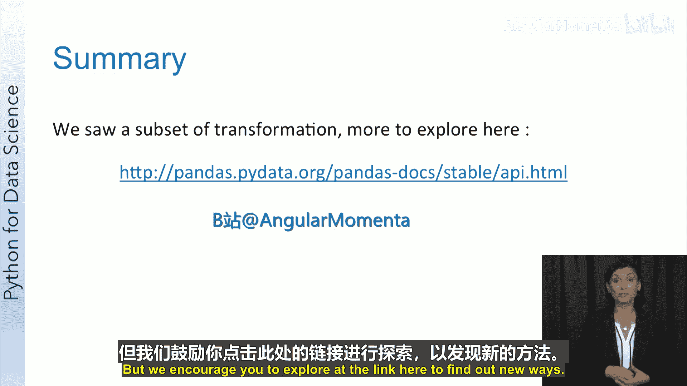
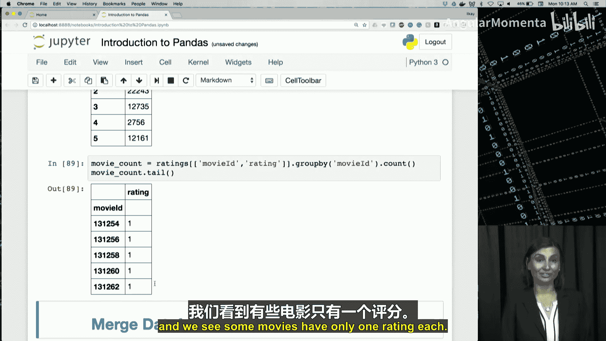

# 【加州大学圣地亚哥分校】Python数据科学-｜-Python-for-Data-Science-p16-05-02-02-视频-Pandas_数据清洗--BV1jwFUzjEXu_p16-

We will now review some of the important and most used data cleaning functions in pandas。

By the end of this video， you should be able to explain why there is a need to clean data。😊。

Describe data cleaning as an activity。😊，And leverage key methods Pandas provides for data cleaning。

As you mentioned before during our data science overview， real world data is messy。😊。

It can have problems related to missing mal use， outliers in the data。😊，And invalid data。

 for instance， negative values for age。😊，And in Python。

 we can also have records within data frames as。😊，NAN or non values。Since we get the data downstream。

 we usually have no or little control over how the data is collected。

 so we have the data we get and we have to address quality issues by detecting and correcting them。😊。

All of these are related to making the data really ready for analysis in the end。So how do we clean。

 here are some approaches in pans that we can take advantage of to address these data quality issues we can replace invalid Val or NAN values with more appropriate values。

😊，For invalid values again， or gaps， we can also try to fill in the data。😊，Instead of removing them。

Here a best estimate for a reasonable value can be used as a replacement。

 there can be different techniques to find the best estimate and often domain knowledge is required to understand what would be that best estimate。

🤢，For example。😊，For a missing age value of an employee。

 a reasonable value can be estimated based on the employee's length of employment。😊。

An interpolation of the data values can also be applied to generate estimations of those missing values。

Based on how the exploratory and statistical analysis of the data set goes， we can also。

Think of dropping some of the fields and values that are not important to the task。Outliers。

 for example， might be dropped depending on the situation。

Let's quickly look at some of the functions in pandas。Before we review them in the notebook。

Using the replace function， we can globally change values in a data frame。

The screenshot shown here shows how we can replace every 9999 with a zero instead。

Fill andA method will replace missing values with the last known value forward and backward。

 meaning going up and going down in the column。If you look at the values in the first data frame shown here。

The row one， row index one and column one。You will notice that the forward fill replaces the NN value in that column with the value。

Of row zero column1 in the forward fill case， so if you look at the second data frame， row 1。

 column0， there will no longer be NAN， it's going to be the value stored in rowve  zero column 0。

In the backward fill， the same row gets replaced by the value in row 2 column1。

 so it's going upwards in the data frame。😊，Another function that we'll use a lot is called drop andA。

To drop the fields with missing value， so a drop in a function will drop any row or column with a missing value in the data frame。

With the axis zero option， which is also the default for DN。

 any rows with missing values will be eliminated or it's going to be taken out of the data frame。

 so if you look at here rows 0，1，5 and 6 are no longer in the data frame after executing the DN function with axis zero。

With the x is one option。😮，Any columns with missing values will be illuminated in this case。

 since both column 0 and 1 has NN values in them， we are left with only column two in the resulting data frame。

You can also interpolate values in both series and data frame objects。

The default for interpolate function is linear interpolation。

 meaning the method tries to fit the values to occur over line using linear polynomials like the point Xy in the graphic on this slide。

There are other interpolation methods to pick from as well。

 but we'll leave it at linear interpolation in this introduction class。As a summary。

 there are many ways to deal with missing data and Padas provides many easy ways to tackle them。😊。

We only scratched the surface here， but please follow the links provided in this video for a starting point on further methods。

😊，Let's now switch to our notebook to see what we have discussed in action。😊。

Let's start our live quoting session on data cleaning。

So we'll first look at the shape of Mo as data frame using the shape function here。😊。

Remember we loaded that movies。cV into a data frame called Mo and if we run the shape function here。

 it gives us a number of rows and columns in the data frame， so we see that there's about 27。

000 rows records that means of movies。Next， we'll check if any row has no values in any of our data frames here。

We use the is N function first， so what I'll do is movie is dot isal。🤢，嗯。

This is null function run on the whole data frame will give us a Boolean data frame。🤢。

For movies that movie， the data frame will be composed of three series for each column for user ID。

 movie ID， and rating。And then we'll check if any of those values。🤢，Are true， all of them are false。

 which is great， that means we have no null values。😊，In the movies dataset set。嗯。So。

They'll do the same exercise for ratings。 we'll check if any of the values in ratings is now。

 they are not all the columns have。Values in them， there are no missing values。

And as we go through the same steps for tags， the third data frame we built。

We'll notice that in tags， there's a true value instead of all three forces。

 we know the tag column has some missing values， some NAN values in there。So as you have seen。

 this is a relatively clean data， but tags column has indeed some values， let's try to drop those。🤢。

We will use the drop in A function with the default option of eliminating records rows with missing values in axis zero or simply rows with NAN values in them。

So we'll say tags equals tags dot， drop inA and run that。And let's do that same check on Ial on tags。

They'll see all。Three， return false。So we successfully got rid of those。Nll values or NN values。

 missing values in tags。Remember when we ran the shape of tags， we noticed there were。465。

564 rows records in there， let's run the same shape and see if we indeed dream with some of them。

Looks like be removed now there's 465，548 rows records。

And looks like we really removed 16 rows with missing data values in them。Okay。

 let's stop here and see how we can explore this data set through simple visualizations in pandas next。

😊，Now we will review the plotting functions in pandas note that we will come back to more advanced plotting in pandas over the next couple of weeks after our in depthepth data visualization lesson。

 so this is only a simple introduction。😊，By the end of this video。

 you should be able to identify key plotting functions of pandas and recognize the ease of utilization of native pandas methods with data frames。

😊，Let us use this data frame as an example to provide for many plot functions of data frames in this video。

😊，The plot package offers nice visualizations of bar charts where each column is represented by a different color and turned into a bar that goes until the value in that color。

😊，嗯。Another plot option， box plots generated by the box function。

Is a good way of showing data distribution， so each box will have minimum and maximum and medium for columns if you look at this graph。

😊，Histograms in another type of graph show the distribution of data。

 and it can show sness or unusual dispersion between data values。

By a proper use of the hist function， HIST， we can generate histograms not just for one column。

 but multiple variables in the data， just like we see in this graph。😊，Additionally。

 using the plot function， we can create quick line graphs of our dataset sets。

Here we see each column in our data frame represented by a different line and those points connected by straight lines。

In summary， pandas provides a diverse set of coable methods for plotting。

And they're going to come a lot on our example notebooks as we go through this class it's fun to explore these plots and visually look at your data in different forms。

 sometimes you will start seeing things that you don't normally see in the data by looking at the data when you visualize it you'll be able to see a lot more。

😊，So we recommend following the link here and spending some more time on these functions and exploring and having fun with these plots。

Now we'll review。Visualization and frequent data operations in the notebook。

 so we'll give you some examples to get started with。

 and we'll add to these as we come to N problems and use cases in the upcoming weeks as well。

For the visualization， I need to。😊，Explain a quick something on MatplotLi before you see it in the next week。

 Maplot Libb is a plotting library for Python and Padas leverages Matplot Lib underneath for its plot。

So if you want Jupiter to plot the graphs inside the notebooks。

 we'll have to tell Jupiter to plot in line。As we see here。

 so notice the percentage sign before the MAplotlib in this notebook。

 this is a simple symbol for special class of functions in Jupyter called magicic functions so we'll simply hear before we go through Matpllootlib as a library review or use Matpllootlib as an inline function。

😊，So here， the first thing I'd like to do。😊，To get our data frame object in pandas， in this case。

 ratings is our data frame object。And they'll use the histogram function to plot the rating column of data frame ratings。

You can adjust the figure size。Using the command here so you want how big you're figure to look。

And there are many other options for controlling the bin size and other things。

 so you can see these all in the documentation for data visualizations in Python using Padas。

So let's go ahead and execute this so what we've done again is we took the ratings column from the rating column from the ratings data frame。

😊，And provided that column name to histogram function。

As an input and we also use the fig size option to adjust that graph size I'm running this and we'll see that a histogram was generated using this and now we'll use a similar thing。

with histogram， similar code with histogram， but this time we'll generate box plots。

 penas makes actually generating box box plots really easy。

 we can get that ratings column data frame and say dot box plots。😊，And as you would remember。

 so histogram， we would get， we gave column。Rating is our data， the column that we are plotting。

Fig size in a similar way。Will be。15。20。Ok， let's check to make sure our code here is correct。

And now I'll go ahead and run this。So it's going to work on that a little bit and we'll see since we have only one column that we gave as a data set。

 we'll see a box plot of that data as you remember our mean for our。😊，Rateatings was about 3。

5 here we see the average and the maximum and the minimum of that distribution nicely shown on this box plot。

So0 0。5 and five on top。So next we'll start exploring some of the data slicing。

 column slicing techniques that we discussed。In this video。

 we'll review the most frequent data operations for substing， filtering， insertion， deletion。

 and aggregation of data。😊，Having such efficient data operations speeds up all algorithms that use these operations and they are used a lot。

😊，Let's figure out how to leverage these in pandas。😊，By the end of this video。

 you should be able to handfi data， both rows or columns in a data frame using panS methods。😊。

Add or delete rows or columns in a be frame。😊，And perform aggregation operations like Group by in data frames。

In all of the coming slides， we will use a toy data frame that is present in each slide with the name DF。

 this is the first data frame that we see in the slide。😊。

You can slice out the column of your choice simply by providing its name like we see here for sensor weve reviewed this one earlier as well。

😊，Filtering out rows based on a condition is a very common task。

Here we do Df sensor greater than 0 to find out all the rows that have sensor 2 in sensor2 that are greater than0。

😊，Adding a new column is performed by using the name of the new column you want on the left hand side and providing the value on the right hand side。

In this example， we create a new column called sensor 4 by squaring the values of column in sensor3。

😊，You can provide data on right hand side in a variety of formats。😊。

I would encourage you to try adding a new column using values in a list array。

And see how this works for yourself。Here。In this slide。

 we show you how you can leverage the dot lock or location function to specify exactly which row you want to add to your new data。

😊，Notice the right hand side is a list of values containing exactly the same number of values as the number of columns。

Drop functions， as you've seen before， lets you delete a row from a data frame。

You can use the F dot index to specify one or more rows to drop。Notice have the right data frame。

On the right is smaller and has the4 fifth row missing。😊，As we've seen before。

 Dell function intuitively lets you delete a column simply using its name。

 sometimes there are columns that are not relevant to your specific analysis like we had for the time stamps in our ratings database。

😊，So that data is the data you don't want to consider in your analysis。

You can simply get rid of it using the Dell function。😊。

Now GroupI is a very useful method that lets you get combined statistics about the data frame here we show you how to perform groupI using a student ID and extract mean scores for each subject。

😊，So if the student took。The same subject more than a couple of times。

 we can group them by and take the average of the performance for the student too。

 if you look at two it shows up now as average score for that student 92 for each subject。😊。

In summary， panndas has a vast array of efficient methods to allow you play with your dataset set。😊。

We have only discussed a short subset here。But we encourage you to explore at the link here to find out new ways。

 you will soon realize with some experience that connecting these simple operations can result in large and complex pipelines of analytics that transform raw data。

😊。

Into something that we can analyze and get meaningful insights from。

Now that we looked at data cleaning and visualization， let's dive into some transformations。😊。

The machinery of pandas helps you to perform analytics in an efficient manner。

So we'll slice out some columns， let's look at the first few rows of tag column in the table tag。

So if you would remember， the head function is what we do to get that。😊，嗯。We can just say tags。

 select the head column， and then head function。The next will get the title and generous column in the movies table。

 so for that we'll say movies and then put our title and generous columns as a list inside that selection and then get the first few rows of that using head it's the by default is's going to give you the first five rows。

Let's now think of slicing out or picking something from the middle of the ratings table for this I'll use rows 000 through 2010。

 the notation for this would be get ratings from 00 to 010。😊。

We can easily extract the elements of a list this way from an index to an index。😊，嗯。We could hear。

Actually， just say get the rows until a certain number。

 just like here I can say until row 10 from the ratings。😊。

And here we see0 through nine with the indexes。Or I could just say from the end。

 give me 10 rows from the end or that I can say minus 10。

And I'll get the bottom 10 rows of the same ratings table。Okay。

You can also select a particular column by using its name。🤢，For example。

 tags tag as you would remember。嗯。Here。We'll use the value counts function。

 value counts function will let you find out the count of each unique value occurring in the input。

In this case， the inputs to that will be what we typed here， tags， tag。

 and then well count the values if you would remember our UniX content。

 this is similar to the unique function in UniX。So we'll assign the value counts for。

All the tags using our unique function here is value counts into a series called tag counts and then we'll get the first 10 elements of that so let's run this。

 we'll see that scifi as a tag was the most 3384 is the count for it and it goes onwards like that。

Negative indexes work here too， so if you want to make a copy of the same list in reverse I can say what are the bottom10 counts。

 they should be ones， bunch of ones as you might。Guess oops。So let's run this。

 we'll see a bunch of ones because those only were mentioned onces， for example。So。

What can we do with this now that we sliced out to top 10 and minus 10， last 10 values in the series。

 we can now leverage the inbuilt plot functions， I'm going to use the plot on tags for this。🤢。

Let's look at this line， notice how this line performs the slicing of rows。

 so we plot only the first 10 rows， and then we applied the plot function。

And we create a bar chart out of that。So when we do that。

 we'll see the top 10 tags in our tags data frame。🤢，We can now also look at filtering out some rows。

 but with filtering， filtering is a common functionality when you select data that matches a criteria that matches your criteria。

😊，Think of it as two steps。😊，First， we need to develop a filter that encodes our criteria。

Then we need to that filter will be applied as a mask to our data frame， so the filter criteria will。

🤢，Label each role in our filter as true or false， as you might remember， we've done this before。🤢。

Here what we'll do is we'll create a filter called is highly rated， what is highly rated。

 it's any movie with rating。😊，4。0 or more， so we'll use a filter to select out rows。

With trading greater than or equal to 4。0。So here we do that， the assign actually is highly rated。

The ratings will select the rating column out of the ratings table and then we check if that value is greater than or equal to 4。

0。😊，Then we'll just display here the bottom of five rows in the ratings data frame to match this criteria。

🤢，So let's run this。😊，Is highly rated， will have true false values that will contain Boolean values。

 so to say。😊，And the checking will be performed by again， greater than or equal sign。

 if you notice it dead。🤢，And we applied that as a filter。😊，To the rating table here。😊。

Just displayed the bottom five rows。🤢，Or we could have done Rose， let's say。30 through 50。

We could have seen other rows in that same。Output。And we sliced out the dynamic output of that filtered ratings data frame。

And we displayed about 20 rows in there you see that。It just so happens in this slice。

 all the ratings are 4。0， but they should have all been 4。0 or more。

He'll do a very similar thing with his animation， what is animation。

 it's a movie with a genre of animation。😊，So then we need to find in our movies。Data frame。

All movies with genres that has animation mentioned in them。So genres in the movie is stable。

The column genres will be a string value we'll see in our filter。

If that string value contains animation， the way to do that is if you look at here， we select。

Movie is the generous column from the movies。And then to what we get。

 we apply string contains function， it's a string function that we'll review also later。

 but what it does is it gives us true our false values based on the string it's applied to。

So for each string value in each row in the genre column。

 this is going to check if that string contains animation。

And this will generate a filter series called is animation。

 we'll take that with true false values in it again， we'll take that and apply that filter。😊。

Two movies and let's get rows5 through 15。Let's run this we see that。There are some movies here。

And each of them will have that animation somewhere in their genre column。嗯。

So in order to get the rows which match our criteria。

 we simply index the data frame using a filter we created。For example， again， just to review。

 movies is animation will give us。All the animation movies with。

An animation mentioned in their genres。So now let's see a few have aggregations。😊。

Aggregating values across rows gives us a big picture about the whole data set， so it's very useful。

😊，Ps provides a function as you would remember， called Group by。

We will use this function to perform aggregation on a data frame。So once we perform the group by。

 we'll see that we can use other functions such as count or mean to get the exact statistics we are looking for or to do something else with this series object or data frame we get from group by function。

😊，For example， here in this first one。Ratings count will give us the count of movies for each rating。

 so the rating for each。🤢，Movie， so here we select movie ID rating from the ratings data frame。

 well apply group by function and we'll group over rating and we'll count those so when we have that we could see that we have the movie ID and the rating。

😊，For that。So next， let's look at。Average rating for each movie。So for that。

 which makes more sense than our first query in that sense， first grouping。😊，For this， we'll group。

The movies is or the ratings we select by movie Is。

So here something to recognize is that the column we used。For grouping by over in this case。

 movie ID， it will become an index for the data frame。

 which I said it makes more sense because it's an ideal index。

 it's the identifier for the movie rather than the rating of a movie。So once we have that。

We can actually。Apply an average function for this right we'll call this an average rating because we are taking the mean of these groups by movie ID so here then。

😊，Then we can get the tail of it or the head of it， and let's also turn this into head。

We can get the average rating for every movie in our ratings database。

This is always a good thing to know， especially when you're selecting MOV。

We can also count how many ratings。Are there in our database for each movie ID。

 we do the same query or same group by aggregation， we get ratings。

 Mo ID and rating from the columns that it has， and we are grouping things by Mo ID and then we are applying this count function to it。

😊，When we do that。We could see。How many ratings per movie？

We could also see the tail of it as we've done before。And we see some movies have only。

One rating each。

Okay， let's stop here and review some data frame merging operations next。😊。

