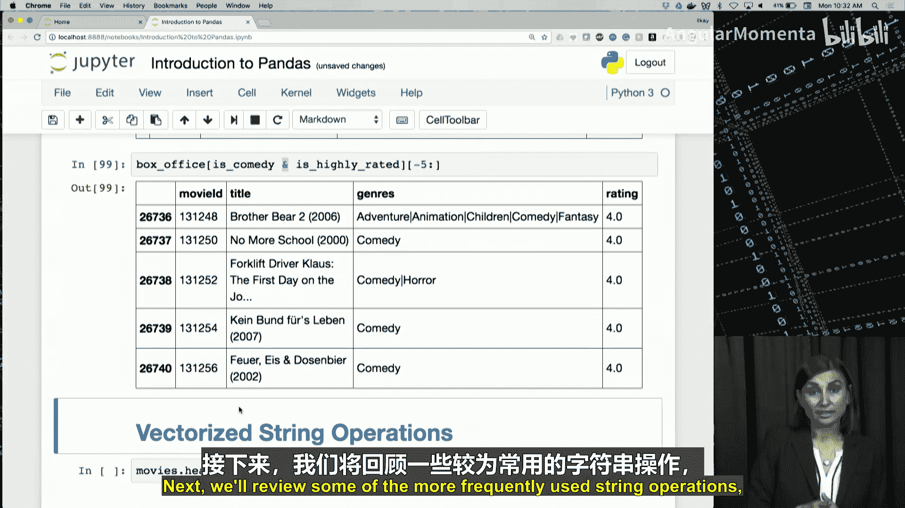
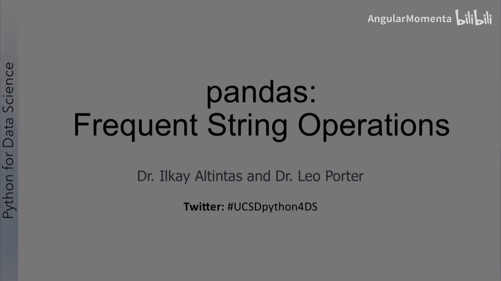
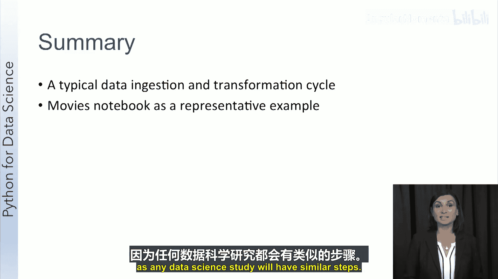

# 【加州大学圣地亚哥分校】Python数据科学-｜-Python-for-Data-Science-p17-05-03-02-视频-Pandas_合并数据框--BV1jwFUzjEXu_p17-

Often when working with data frames， we need to work with data from multiple frames。

 a common practice is to merge data we want from two frames into a single frame and execute operations on the knee frame。

😊，If you' are familiar with database management systems。

 this is very similar to a join operation in this video we will review how to do this in pans by the end of this video you should be able to explain that data is usually distributed across different locations and tables。

 combined data from distinct data frames to obtain a big picture and distinguish among different ways to combine datas。

😊，For this video we will use the two data frames given here as examples。

 the left data frame has two key columns， key1 and key2。

 and additional two columns for city and username。😊。

The right data frame has the same two key columns and additional two columns for higher date and profession。

😊，The concath function in pandas can be used to stack data frames and create a new data frame out of them。

Here we see the data frame called Left being concatedinated with itself。

The index for the resulting data frame will have the raw indexes from the original tables preserved。

If the two data frames given to the Concad function have columns that are separate。😊。

The resulting data frame will have the columns from both frames represented。In that case。

 some of the cells for the columns that didn't exist in the original data frames will end up having NAN or missing values as they will be missing in the first data frame we merged into this larger data frame。

Instead of having extra rows with missing numbers， we could also try and inner join。

Innerjoin is a useful operation for merging data as it combines the column values of two data frames into a E data frame。

 just like we see here。😊，Notice the way to do this is to specify to conca that the joint type is inner。

In the previous slide， the concatedinated data frames were stacked vertically。

Here they are placed next to each other horizontally using the indices0，1， 2， and 3。😊。

In the horizontal stacking， unfortunately， this isn't the perfect merge for our data either as the key columns have been duplicated when they were merged into the new data frame separately。

😊，An alternative to Concat is append， we can also use the append function to append the data frame any other data frame。

It behaves similarly to the Concat function， but it is a function of the data frame itself。

 so we'll say left aend and then give it another data frame。😊，Like our first use of Concad。

 we've got those many empty cells again here。The operation。

 which will give us a true combination of these two frames， is called merge。

The benefit of using the merge operation。😊，Is that it can eliminate the duplicate columns between the data frames it joins。

So it's behaving very much like conca using or inner join。

 it just strips out those duplicate columns we had。😊。

Although all these methods have utility depending on the situation。

 I find myself using merge fairly often as I'm often trying to combine data from multiple different sources。

😊，嗯。Which all share the same keys。In summary， data in the form of tables benefits from both clean and simple joining and merging operations。

 similar to relational database operations。PaandAs provides support for these database like Op through its native data frame functions。

 making it an easier to integrate data from a variety of sources for analytics on the mergeG dataset。

So now let's start our live coding session to see some of this functionality。😊。

Please go to the merge data frames part of your notebook。🤢。

And let's remember what the columns are in the tags and movies data frames。🤢，In our notebook。

 so here we see that both data frames have movie ID as one of the columns。

So we can use this movie ID column to do an inter merge on these two data frames。

So what they'll do is they'll say movies。That merge。Tags。On movie ID， do a Enjoin。So let's run this。

Notice how we merge both the tag data and the movie is data all into one frame。

 so we are merging movies with tags on the Mo ID column using an inner join。🤢。

Notice the link we provided here because there are a number of useful examples on merging at this site。

 and I really encourage you to go there on your own and exploring more of these merges。

Now let's try to bring everything we learned so far together。In the first line here。

 we group all the ratings。😊，Rings， group by。Based on the movie Id column。

We chose as indexed to be false， so new sequential indices for rows will be generated。

And in the second line， since we don't or won't be using the user ID column。

 I'm just deleting user ID。🤢，And。In the third line here， printing， again， using the head function。

 the top five rows。🤢，Let's run this。We see that。Be grooveed by movies， ID， all the ratings。

But since as index was false。😊，A new index from 0 to 4 or 0 to n was generated。

 If I actually made the index true， you would see the difference here。

If you run this movie ID will be the index， so let's switch back to false here and run this and we'll have our average ratings frame a frame。

This is great， so we have average ratings now for each movie。😊。

We can now merge these average tradings into。With the movie table。So。

We are using the average ratings。We are calling it box office Mo merge instead of tags now we are giving the knee frame we generated every trading frame。

 which also has a movie ID just like Mos data frame head and we are doing an inner merge and then we get the last。

😊，5ive rows， just to check。Here we see。This many Negros are in this merged box office data frame。

 the one that we call box office。🤢，And we have our movie IDs， title， genres and the ratings。

The rating comes from。Our average rating。Data frame that we created and we merged into the movie database。

嗯。We can now use what we have learned on applying filters。😊。

We'll start by setting up a filter for those which are highly rated， as we did before。

 our filter name is called Is highlyly Rd and from this box office data frame we are selecting the rating column。

That is greater than or equal to 4。0。And let's get the bottom5 with。In that new data frame。嗯。Next。

Will set up a filter for those movies which are which have the genre of comedy。

 So it's the same exact filter we've done for animation before。 But this time we call it is comedy。

We select all the genres。All the roles with genres that contain comedy。

<|OTHER|>And let's print the first five here。From that box office。

 you'll see all the comedy movies here selected。🤢，We can also apply both filters at the same time。

 so we are looking for comedy movies with high ratings。

 maybe we want to watch comedy movies tonight and we want to find those it's very useful。

We can apply both filters using the and operator here。

A logical operator to get back movies which are both rated for。Or higher。

 and those are which are comedies。So when we have that bill'。See that。

We printed the bottom five of that list。By using merging along with some of these skills from prior videos。

 we can see that it's。Very powerful。When we combine these features。

Next we'll review some of the more frequently used string operations。

 including the contains function from the string object which we've already seen。🤢。

So far。String is a commonly used data type because data science often involves studying text data。

In this video， we will review just a few of the many useful string operations in T for those of you who worked。

😊，Through the Python basics a few weeks ago， you'll recognize that many of these methods are quite similar to the methods from Python strings。

😊，By the end of this video， you should be able to describe what operations the string methods can perform。

😊，Navigate your way to find the right string method for you。

And perform basic string operations in pandas。One of the most important strength operations is split。

 it helps with separating data into pieces around a delimiter character。For example。

 the city column in the DF data frame here is split around the underscore character。😊。

Returning an object with arrays of all the pieces for each row in the city column。😊，To be clear。

 the city field now contains an array of strings rather than just a string。😊。

For the split function itself， notice that city underscore zero has been turned into two strings。

 city and zero。The same has been applied for each string in the city column。The function contains。

Provides a simple way to check if a string has a given character in it。

We already used this in our live video coding sessions before。

 but let's look at this example when we check if any of the values in the city column contains two as a character。

😊，We see that。😊，Only index 2 has it。So the result is a Boolean series with only one true value for that index2。

😊，Using the replace operation， we can replace a substr with another one。For example。

 we are replacing the underscore character with two hashtags here。😊。

The extract function will return the first match for a regular expression it finds。

The top example here is a regular expression to extract words in a string and the bottom example is how we can extract the strings。

😊，In general。😊，Extract can be a quick way to get new features and values。😊，For example。😊。

You can use it to build a numeric feature out of text data like in the lower example。In summary。

String operations can be very handy in data cleaning。

Please use the link provided here to get started on exploring more string operations to make yourself familiar with the rest of it。

😊，Okay， now let's see a few string functions in actions。As a reminder。The movie is table。

Has the title and genre columns。Both of these columns， however， have composite information。😊。

Let's use some string operations to separate out the values here。

When I said composite operation I meant toy story has also the。

Year and genres has more than one genre， all stringed together by those five characters。🤢。

So we will start by the split function to convert each value in the genres into a separate column for each movie。

We need to select the genres column。From the movies。

And on each row or to that whole data frame column， we will use the split function。

SDR got split with pipe。As the separator。Normally。The split function。Willll return a series of lists。

By providing expand through option here that we have。Given to the split operation。

We make sure the output is not just a series of lists， but it's an actual data frame。

 we see it as a data frame。🤢，So let me run this。And。Display the first。10 rows in that Nve data frame。

Okay。You can also。Add a new column to detect each genre if it's comedy or not。

This will be handy when creating new features in your machine learning course later in the Micromasters。

What we are doing here is。😊，嗯。Now we split。All the genres into a separate data frame so when we look at that this would be normally adventureure pipe animation pipe children。

 so we have this data frame， probably one of the rows has nine genres in it。

 which is why we have nine columns here。We will now add another one that says。True or false。

If the movie genres。Is comedy and it we'll call that column is comedy so's。From that？

And select the first 1 now we see that last column is called East comedy。

 it's added to the same movie genres data frame。And it has true or false values。Lastly。Let's yet。

Add yet another column， cold here。And we'll separate out。The year from that title that we've seen。

In the original data frame， so what we'll do is we'll extract out， for example。

 1995 as a separate column instead of together with the movie title。

We will use the extract operation here。We are selecting the title from the movies。

And they'll provide it a regular expression similar to what we had in our stream editor discussion in the UniX part earlier in this class。

😊，This regular expression here says。Extract any value in between the parenthees。😊，In depth。

String Valley that comes out of that movie is title column for that row。And if you remember exp true。

 we'll make it a data frame。So we'll adding to the movie's data frame。

 not to this new one that we made， movie genres one， but the original movies data frame。And。

They'll call that new column year。So what we extracted as the year using this extract function and regular expression will be coped as a new column at the end of movies。

If you run this now。Let's go first runner extract operation。😔，Then let's get the bottom of it。🤢。

We'll see that a year is a new column here。And it just gives us the year。

That was mentioned at the end of the title in a new column this could be pretty useful when we are doing quick grouping over that year。

 all the movies in， for example， year 2007 we'll need to group that by with that year column initially we couldn't do this because it's a part of that title。

So there are many other string operations of course and your ability to work with text data will often depend on your knowledge of these functions。

 we can't list all of them or give you examples on all of them unfortunately。

 but please spend some time going through these operations at this link。😊，That we provide here。

We'll also of course， have some more examples in the upcoming notebooks。

Working with timestamps can be difficult due to a number of different time data formats and resolutions in this video we will go over some of the time data formats and structures and operations By the end of it you should be able to explain what Uni time PaOS time and epoch time is De data types for date time。

😊，Select rows based on times stepss。And sort tables in chronological order。

Unix time tracks the progress of time by counting the number of seconds since a specific time instant。

That instant is the start of the year 1970 as per UTC time zone。Notice that this is an integer。

 We need to find a way to convert this readable。😊，This to a readable date and time。

Daatetime 64 NSS is a general data type for datetime。This general data type。😮。

Maps to specific data types called M8 before M8 or after M8， depending on your machine。

Our big task is to convert into 64， which was that original instance since 1970 UTC time into either one of the above date time format。

 so Python renders it in a human readable format， it's kind of confusing maybe seeing all these data types。

 but we can quickly convert a timestamp to Python format using， for example。

 to date to time function here。😊，This function simply will convert to input to datetime format to form。

🤢，To a form that Python understands。And in this case， we'll put that into that past time column。

 which you see is pretty human readable as well。🤢，The unit argument is most important here as it tells the function。

 what the unit of the input is。In this example。The input column is timestamp from the data frame called tags。

 and the unit of the input is declared to be seconds。

The output is stored in a new column that is named par time。Once time is converted to Python format。

 you can use it to create filters。😊，The filter will select only the rows that will match your criteria。

For example， once we build a Boolean filter called greater than T。And in this case。

 make that timet to be after 2015， February 1 or 021。🤢，We can use this filter。😊。

To select only the cells in the data frame that are true for this condition。

We can also leverage the timestamp to sort data in ascending or descending order。

The sort values function in pandas data frames provides a number of options to sort one of which is by parse time。

So we are getting the parse time column in date format that we had before。

And sorting time series data using the sort values function that's already a function of the data frame。

Sorting time series data like this can help and improve and effective visualizations because then you can provide a sort of data to your visualization。

😊，嗯。So we can say in essence tremendousous abilitiesities to sort data based on timestamps can give us a big picture almost instantly。

 you can even look at this data set or data frame。🤢。

And see a progression over time by looking at fromval to the lower rows in the data frame。🤢。

In summary。Pos or Uni time can be hard to read for users because it's a large integer。

 but converting it to Python datetime format。Gives us practical ways to select the data and make it human readable in terms of timestamps。

😊，And create conditions on it using understandable timestamps from a human readability point of view。

 Let's now start our live coding session with the timestamps。As you know。

 any data with timestamps opens up enormous possibilities for insights because when we know when。🤢。

That data was acquired。 We can actually do a lot of。

Gerate a lot of understanding on that instance of time。So in this section。

 we want to explore Panda's ability to see these timestamps and use these timestamps。😊。

If you remember， our original data set had sometimes stamps， but we removed those。

 so I'm going to reload that tags。csv into our tags data frame。嗯。And。Run the data types on it。

Notice that。This timestamp column is now being added right since we removed it initially we weren't able to see it。

 but user ID movie ID tag， timestamps for the original。🤢。

Tablim or comma de limitedited values in this CSV file。嗯。Notice this is。Of type int 64。However。

Humans don't think of time as an integer。 We think of time。As a month。

 date of the month and time of the day， or rather as a combination of both。

A very common format used by machines for storing time， as I mentioned in our overview。

 is the Uni time or epoC time。So here we see it in。That original。呃。Integer inch 64 value。

Now we have to convert this integer number into a data type that Python can render as a date we understand。

So what we do is。嗯。B。Pase that to datetime。And we'll call the new from tag timestamp with a unit S that was the function so we overview。

嗯。And we'll add that as a new column called parse time in our data frame。

So when we look at that data type， it will now be M8。😊，And if you get the top five。

They'll see that it's actually Python knows how to render it as a year month day and a 24 hour date format。

🤢，By default。We can tell。This function to take a column as input， just to review。Tax times stump。

And convert it into a daytime。In this case， the format is M8。Even though if it's a weird name。

 it's just a data type name。嗯。It's。Notice that the new column parse time。

The timestamp appears in a human readable way here。In contrast。

 the original timestamp was just an integer。Okay。Once we have converted the time to a human readable format。

 we can now create filters using timestamps we understand and select rows of interest。😊。

What's the times that we understand， for example， just a time， year month， day format？😊。

Here we say greater than T。😊，We are creating a filter。

We are selecting that parse time from tags and checking if it's after or greater than this date。

And then we'll create。In me of。Frame on this by。Applying the greater than T signal to our tags data frame。

And you can see that。Initially in tax， there were about。465。

000 rows with those five columns using writingoid tag， timest partse time。And the selected rows。😊。

Has 12，000 something rows in it。With the exact same columns。That means about 12，000。130 of those。

Original 465，000 values were added after 2050 in February 1st。

We can also sort rows in chronological order so that the data flows from the beginning of time as it was recorded and users can see the chronological order in this frame。

So we'll say tags our frame。Sorword values by par time。

 parse time was our new column here in ascending form and give us the top 10 values in there。

You could see that the original data started in 2005 and the time is growing from then。

 if you remember， 12，000 of that was after 20150。With this knowledge。

 you now have resources to tackle Uni timestamps in your data science projects。

Let's now go back to our。Notebook， panda's notebook。And see maybe average movie ratings over time。

Our movie ratings related to the year of launch is a question you might answer。

Here we have average ratings。😊，If you would remember， this will be the average ratings frame。

 movie ID rating for each movie， we had the averages。

And then we can now merge this every trading with the movie ID。😊，And create。

A correlation value between movie ID and the rating。No。

We can create yearly averages by grouping by over year on that joint table。

 we were joining it and we have the years in there as well。If you select the top five， we see。

The year of the movie。And the ratings for death。Lo， but only based on the year。

So now if we take a yearly average plot here。We'll see that some years look better for box office movies than others。

😊，But one year is particularly good。Does that seem like an outlier to you in some sense， yes。

 and by really successfully combining everything we learned about filtering， about joining。

 about counting， averaging。Adding these columns， we were able to really start generating that insight to analyze what years are better for better years to make movies。

 how they affected our ratings over time and things like that， so I'll leave you with this graph。😊。

To think of other ways to see correlations with Windows values。😊，And plot may be different aspects。

 different features in our data。😊，Before we move on with a more advanced pandas example in the next lesson。

Hope you enjoyed this example。😊，We will now have a small video to wrap up our week our lesson for introduction to Pandadas。

Let's review the practical skills we learned in this lesson based on the movie database notebook。😊。

First， we talked about data ingestion in which we reviewed how to ingest data in multiple formats and the basic read operations related to these formats。

😊，We also talked about series and data frame as the two basic fundamental data structures in pandas。

😊，Then the overview of the functions to perform basic statistical operations on series and data frames。

 these were described for joint descriptive statistics and individual functions for generating min。

 max and standard deviation values。😊，Mod of data， as well as functions for correlation analysis they also reviewed。

We went through data preparation and exploration options in pandas like INL， N androp&A functions。

We also overviewed data visualization and in there we saw examples of inline plots。

 boxpls and histograms using Pada's plot function， we also saw how to adjust the A formatting and other window properties。

😊，We talked about slicing out rows and filtering data frames as well as aggregating data using the group by operation。

😊，We executed examples for running basic statistical functions on these groups。

We also talked about merging or joining data from multiple data frames using inner joints and other operations。

😊，We talked about three main operations called split Con and extract。

 and finally we talked about how to work with timestamps。😊，In summary。

 in this lesson we went through the typical operations in data science to take advantage of the Pandas Library。

 the movie's notebook we built is a representative example to keep as a reference as any data science study will have similar steps。

😊。

