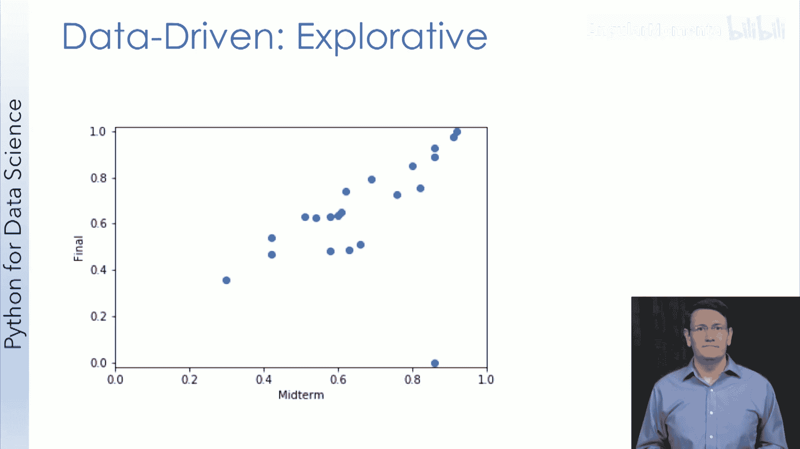
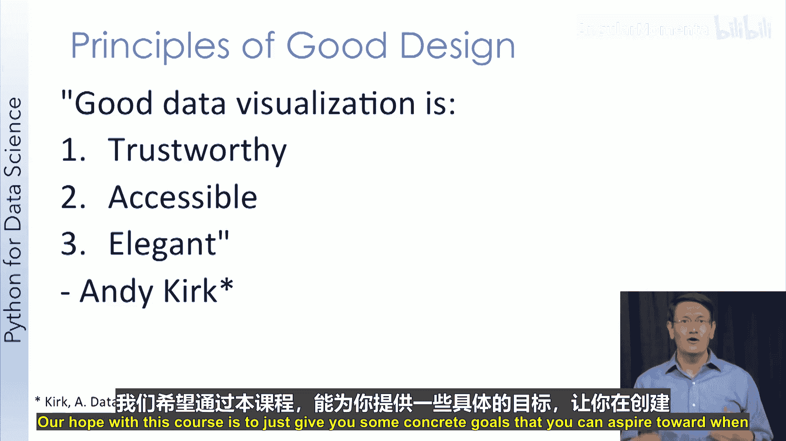

# 【加州大学圣地亚哥分校】Python数据科学-｜-Python-for-Data-Science-p18-06-01-03-视频-数据可视化--BV1jwFUzjEXu_p18-

Data visualization is one of the primary skills of any data scientist。

 and its value cannot be understated。However， it's also a large field in itself。

 There are a number of graduate courses at universities and design labs around the country just focused on data visualization。

So this week is really just an introduction to a much， much broader topic。For the introduction。

 we'll first spend some time looking at data visualization conceptually。

 then we'll dive right into making some visualization using Python libraries。Lastly。

 we'll take a look at some particularly effective data visualizations and their impact。

I will also mention that if this area is interesting to you and you want to learn more。

 we'll be sure to provide links to textbooks and other resources on data visualization。

In this video we'll be talking about data visualization and its role in data science。

 so by the end of this video， you should be able to define data visualization。

And begin to understand its important role in the data science process。

Now that we're facing the explosion of data that ILKI talked about in week one。

 what matters are the skills associated with handling all of this data。

Let me just read you this quote from Google's chief economist back in 2008。The ability to take data。

 to be able to understand it， to process it， to extract value from it， to visualize it。

 to communicate it。That's going to be a hugely important skill in the next decade。

Because now we really do have essentially free and ubiquitous data。First。

 I like this quote because it points out well before big data and data science became buzzwords。

 the need for data scientists。In his full interview， he makes a clear case for statisticians as well。

As you know， statistics is one of the core areas of data science。

 and using statistics is one way to try to understand data。

I can't understate how important statistics is。But you'll be learning more about statistics in the next course。

So back to his quote， the other part of understanding data is visualization。In fact。

 visualization is part of much of the process that he describes。Processing data。

 extracting value from it， or understanding it often requires visualizing it to gain that kind of insight。

And when you want to communicate your results， you'll often want to use data visualization to do that too。

So visualization is central to the skills that he describes。

There are two definitions of defining of visualization that I particularly appreciate。The first。

 the use of computer supported interactive visual representations of abstract data to amplify cognition。

On a second。The representation and presentation of data to facilitate understanding。

Both discussed the importance of representing and presenting data。

Each of these is central to data visualization。But what I like the most about these two quotes is actually that they end on the same key part of data visualization。

Improving how we understand and think about the data。If we think about it。

 a pretty large chunk of our brain is dedicated to vision。

 and we've got some really powerful processing associated with that vision in our heads。In contrast。

 we're not very good at deciphering raw data。If you give me 100 raw Xy coordinates。

It could take me hours working with them by hand to see what they mean。

But if you give me a plot with  a thousand0 points on a trend line。

 I can often tell you in seconds what the data is telling us。That's the power of data visualization。

In fact， let's do a couple of quick experiments。All these data points are from one data set。

Can you see the relationship between x and Y？Take a few seconds。Here's some stats about X and Y。

Do they help？Not really。Correlation might help a bit， as 0。

88 implies these two values are correlated， specifically that they may have a linear relationship。

But we've done a lot of work and we still don't completely understand what's going on here。

But now we do。It looks like there's exponential growth for y with respect to x from the start0 until it hits around x is7。

At that point it hits some ceiling for y is 33 and increasing x no longer increases y。

Notice that correlation was actually a touch misleading as it implied a linear relationship when the data on appearance。

Doesn't apply that。But the key point is that the human visual cortex is really talented。

Let's do this one more time。Here's a new set of data， all these points are from one data set。

If you focus on these for a while。You may begin to notice that the x and the y values seem pretty similar with some noise。

But again， let's see if we can understand it better in a graph。Aha。

The scatter plot shows us that these are really correlated。

 higher x values imply higher y and vice versa。In fact。

 correlation as a staistic would have been helpful here and would have given us the value of 0。5。

The value is lower than you might expect because of the outlier。

 and visually you probably notice that there's a strange outlier right here。

But I don't know what to do with that information right now。With just the raw data points。

 I don't know if this is an error in the data or what caused that outlier。

I like to dive into that value more， but I'm stuck without context。

And that's the other point I want to make here without a context。

 we don't know what to think about the data or this outlier。In fact， without context。

 I'm not sure if I even care about these data。So we need context。

So it turns out that these are pseudo hypothetical midter and final exam scores for each student in a class。

Now that we know that， we can recognize that performance on the midterm is pretty closely tied to performance on the final。

For instructors， this information might lead them to try to intervene for students who perform poorly on the midterm。

And for the outlier， context helps as well。What happened with the student？

You could figure out which students supplied this data point and let's say after looking into that student。

 you find out that they didn't take the final。What it turns out then is that when you are cleaning your data。

 the missing entry for the student was made to be a0。

 but a zero on the exam and not taking the exam are two different things。

If you remove the outlier due to missing data， you gain a better understanding of the data。

 and by the way， the correlation would now be a 0。89 without that outlier。

Thinking more about the outlier， if we consider the correlation for the other students。

 we could infer that if this student were to take the final， they would have likely done quite well。

But we'll get more into predictions in a later week。

I also want to point out that not taking a final exam is odd for a strong performing student。

 so if I were their instructor， this data would cause me to inquire about their wellbeing。

 and I'd actually do that for any student missing a final exam。

So these results tell me what I might be able to predict for an outcome and to take out action regarding that outlier。

The key point is that visualization of data means nothing without the context of the data when we didn't know what X and y were。

 we didn't really care about the data。Context is what makes us value the visualization and gives us the ability to dig deeper into the data。

 looking to explain outliers， and also to be able to come to conclusions about the data itself。

Now that we have these working definitions of data visualization。

 let's talk about the ways that we use visualization to conduct data science。

Visualizations play a number of different roles in data science。

 and the role that they play changes how we'll handle the visualization。By the end of this video。

 you should be able to understand the different ways that data visualization is used in data science。

There are two key ways to categorize data visualization。

The first is whether this is conceptual or data driven。

Most of what we'll focus on this week and in this course is data driven。

But visualization of concepts is important as well。

 particularly when we aim to explain how things work conceptually。For example。

 economists may seek to visualize the notion of the classic supply and demand curve without using real data。

 and then back it up with data supporting the concept from say， Uber surge pricing。

Because data driven is where we spend much of our time as data scientists。

 let's look at the second categorization in that context。Declarative。

 there's a point when we've analyzed the data and we have a data support conclusion we wish to articulate to our audience。

At the point presenting， we want our visualization to convey this conclusion to the observer in the most straightforward possible manner。

It exploratory。We spend much of our time exploring data， and visualization plays a key role in that。

Visualizations often encourage us and enable us to look deeper into the data。

Let's take a look at some examples from these categories。

So this is the classic supply demand curve from economics that I just mentioned。

It explains the relationship between supply or the quantity of goods available with demand or the amount someone is willing to pay for the item。

When quantity is low， demand is high， as quantity goes up， demand will decline。This is conceptual。

 and these lines are hypothetical。But since much of our work is going to be data driven。

 let's focus on that for now。Here I'm taking a declarative example from a research paper of mine where we show the that the peer instruction pedagogy resulted in a significant decrease in failure rates for students relative to standard instruction and computer science classes at UC San Diego。

My goal in presenting these results was to convey to the reader the impact peer instruction had on failure rates in our classes。

Without diving into the details too much， we had failure rates from a number of classes at UC San Diego。

 where instructors either taught using the active learning pedagogy of peer instruction or using standard lecture style pedagogy。

If you're interested， please read the full paper for a complete explanation of our experimental methods and possible limitations of these results。

As good science will always detail potential limitations of results， along with study methods。

 I hesitate to use the word declarative here， as it doesn't quite seem right。Rather。

 I prefer the term presenting。We knew the result that we had。

 and we were aiming to present it to the audience in a clear and useful manner。

The example of the correlation between midterm and final exam scores from our previous video is likely explorative。

I might create a plot like this when trying to better understand the relationship between these exam room scores in my class。

As results would likely cause me to explore the data more。With its floative data visualizations。

 I'm not going to spend as much time polishing the appearance so long as I can interpret it。

 that's fine。Likewise， I'll often want to be able to quickly plug in different parts of my dataset into the figure to explore different relationships。

 say homework scores against the final exam rather than midterm against a final exam。

Exploration is really at the heart of the data science process， which we talked about in week one。

When we're finding outliers or trends， we're often using visualization tools。

And those visualizations lead us to dig deeper into the data。As we dig deeper， we do the same thing。

 looking at data distributions using histograms， exploring relationships between variables or seeking other trends。

Ultimately， we find ourselves zooming in and out of various parts of the data set as we try to gain a better understanding。

And this process of zooming in and out of the data is almost always accompanied by and facilitated by。

Data visualization。

So now that we understand the different uses for data driven visualization。

Let's explore metrics of success for those visualizations。

Now that we know what we mean by data visualization。

 let's talk about what makes a visualization useful。By the end of this video。

 you should be able to recognize the qualities of good data visualizations。You know。

 there are lots of opinions about criteria for good data visualization。

 but I really like these three put forth by a lean data science visualization educator， Andy Kirk。

Data visualization needs to be trustworthy， accessible， and elegant。

Let's talk through all three of these in more detail。

 but before I do just a quick word about Andy Kirk's book， which I've mentioned a few times already。

His book is a great reference for all things data visualization。

 and I highly recommend it if you wish to dig deeper into this area of study。

By saying that visualization is trustworthy。We are saying that the data presented is honestly portrayed。

For example， if you're displaying something。In such a way that it implies a relationship or a trend or a correlation。

There should be evidence for such a relationship in the data。Otherwise。

 you're just misleading your audience。Let's look at a quick example。

Here's a hypothetical figure you might be shown in a business meeting。

Take a little and see if you can spot what's wrong with it。If you notice the Y axis。

You realize this isn't a surge at all。 The Y axis is zoomed into just a small part of the graph。

We're looking at a roughly 2% increase between Q1 and Q4。That's hardly surging。

I suspect the author of such a chart。Of trying to be dishonest or the very least misleading。

 They're trying to convince me of something which isn't true。Let's just look at all the flaws here。

Surgge。2% is a surge。The title's simply misleading。

We already mentioned that the Y axis is being zoomed。

In on to exaggerate the growth between Q1 and Q4。 But did you notice how the font size and Y axis seems to have been made intentionally small。

 just so it's hard to read。Lastly， the fourth quarter is when holidays occur。

 I expect to see a rise in profits for many industries during the fourth quarter。

A more honest graph might also plot prior year's profits to compare against。So yikes。

The time I'm done reading this graph， I simply do not believe the author anymore。

All credibility is gone。So let's see how we could have done this better。Okay， in this figure。

 we set up the Y axis honestly。And this actually looks like pretty steady revenue over each quarter of 2016。

 so I fixed the title。To reflect that。If this is the only year for which we have data。

 the story might be over。But if we have data from prior years。

 we should plot them to see how things look。Supposing we have prior year data。

 if I plot last year's quarterly revenue， I see that there was a surge in profits in 2015。

 which is absent in 2016 In 2015， the company had a 12% boost between Q1 and Q4。

 which is less than 2% in 2015。We could have titled this in in different ways。

 we could have just said that our revenue was steady in 2016， and that's not misleading。

Or we could focus in on the fact that we didn't see a surge in Q4。Either way。

 we want to dive into the data more to figure out why we didn't see the revenue boost in Q4 of 2016 that we saw in Q4 of 2015。

And we do that prior to presenting these results， so we have good answers of why this happened。

So after fixing the presentation and pulling in more hypothetical data。

 we've actually reversed our initial misleading conclusion。😊，So there are two key takeaways here。

 which I'll echo some of the messages you heard in for week one。First。

 you need to take trust seriously。People who are looking at your results are trusting you not to doctor the data or misrepresent results。

They want to take action based on your findings。To make this even more concrete， as a scientist。

 I often review papers for publication。If I find one seemingly intentionally misleading claim or figure。

 I call it doubt everything the author said。And if someone similarly tries to mislead you with poor data visualizations。

You shouldn't trust them either。The second point is just a reminder that honesty isn't limited to the visualization stage。

Hwnonesy has to be everywhere in data science。And this can be hard at times。

 you may have your own beliefs about what you'll find in the data。In fact。

 we could have an entire separate course on how to combat human psychological bias。But for now。

 it suffices to say that you should recognize the biases you have before you look at the data and do your best to have the data itself。

 not your bias， drive your inquiry。Our second key principle is accessibility。

Accessibility to me is about focusing on your audience and their ability to use your visualization。

Let me give you another example。This is a hypothetical example from one of my areas of research。

 computer architecture。This graph could be useless or great， depending on your audience。

For a computer architect， the Y axis is reporting instructions per cycle or IPC。

 which is one of three major components of execution time。

And the inverse of execution time is often used as a measure of performance。

We're reporting average IPC for an accepted benchmark suite SPEC 2006。

 which is used by researchers in computer architecture。If these processor models are real。

 it's possible I know a lot about them and know how they differ architecturally。

That gave me intuition about why these results differ by model。

So does someone who knows these processor models。This figure could be honest。

As there may be a compelling reason to report only IC。

 ignoring the other two elements of execution time and performance。To an expert。

 this figure could be both honest and accessible， depending on their use。Notice。

 I said depending on their use。If the goal of the figure was to show me the IPCs by processorcessor model。

 this works great。But as an expert。I might want a more complex figure which helps explain why the X23I has such higher IPC than the others。

So this figure fails if the intent is to not only report IPC。

 but to also explain why we found these differences。Of course。

 that might be a separate figure or could just be part of the knowledge of how these processor models differ。

But for someone not in computer architecture。This graph means virtually nothing。

You don't know what these models or processors are。

 so you don't know why they may perform differently。

You likely don't know what IPC is or even what spec 2006 is。So for a non expert。

 this figure is clearly not accessible。It's unreadable and has no relevance to them。

And if a viewer doesn't know what IPC， that IPC is just one component of performance。

This could be unintentionally misleading。So the two main things I'd stress are to know your audience and how they perceive the information。

Understand what they understand and know how they might interpret the result。

Also be sure to know what the purpose of your visualization。

 are you exploring the data or present it？That helps you craft it in the appropriate way。

One last point。Take into account the expected time for the audience to read and understand the result。

 that depends on whether this is a slide you might show for one minute at a presentation or a figure that you're sharing with a colleague who might spend some time really diving into it。

These questions about your audience。And how the visualization will be used allow you to craft it appropriately to make it accessible。

What do you think of when you hear the word elegant。You might think about style or grace。

 you might think about something clear and aesthetically beautiful。

These are all reasonably applied to good data visualizations。I would note that in practice。

 I put a lot more time into elegant visualizations when I'm presenting results。

When I'm exploring data， it's nice to have， but it is no means critical。

I like to think of it this way。If my graphic is going to be front and center on the New York Times。

It better be perfect。If it's in a slide deck for teaching， it should be really solid。😡。

And if it's for me when I'm displaying the data， it should be acceptable。At the very least。

 the lack of elegance shouldn't get in the way of my interpreting the data。For example。

 later in this week， you'll be creating an overlay like this。Take a moment to take it in。

There are elements of this， which are elegant。 The use of an overlay on a map helps an observer see the different countries quickly。

The color coding to show numeric data helps the viewer quickly interpret results。

The color scheme goes towards darker blue with more CO2 emissions per capita。

So that actually might not be perfect。 More CO2 emissions per capita is arguably a bad thing。

 so a different color scheme which conveys the CO2 emissions as bad， might actually be better。

There isn't unnecessary other data here。 I didn't put the numbers over each country as that likely distract more than it help。

 I didn't try to combine this with some other measure like GDP per capita in the same figure as it likely be too much to process。

But might make a really nice complementary figure。If I added any additional decorations。

 like maybe a smokestack on high CO2 per capita producers。

I be sure it added to the figure rather than detracted。 with this figure。

 I thought it actually detracted more than it added。 So I left it off。Overall。

 style and beauty is subject。But I think when we look into our case studies at the end of this week。

 you'll be able to appreciate the elegance of some of their design。

We'll also give you links to websites and talks， which were exceptionally elegant visualizations as well。

For elegant visualizations， you should focus on what is relevant and remove anything which isn't adding to the figure。

You're trying to make the design invisible so the viewer can take as much of the visualization as possible without being distracted。

And this isn't the same thing as minimalism， but I've heard some folks argue for。

I feel minimalism doesn't just remove the unnecessary。

 but often starts remove things which are helpful。So there's a balance to be struck with how much to include。

Think about your style For those of you who read Nate Silver's website 5，38。

You know there's a distinct style to his presentations and graphs。To me。

 I really like that style and his website's success， I think， is likely tied。

 at least in part to how recognizable his style is in presentation。

Decorations may seem contrary to honesty， and in some cases， they kind of are。

In scientific papers about blood donations。I'd be surprised to see the bars and a bar chart intentionally made to resemble flowing blood。

But if the graphic is put out by a charity encouraging folks to give blood the week before Halloween。

 decorations may bring the visualization extra attention。

And this just goes back to knowing your intended audience。

If this were a data visualization course in a design lab。

 we could have spent much of the course just not exploring these principles in depth。

Our hope with this course is to just give you some concrete goals that you can aspire toward when you're creating your visualizations。

