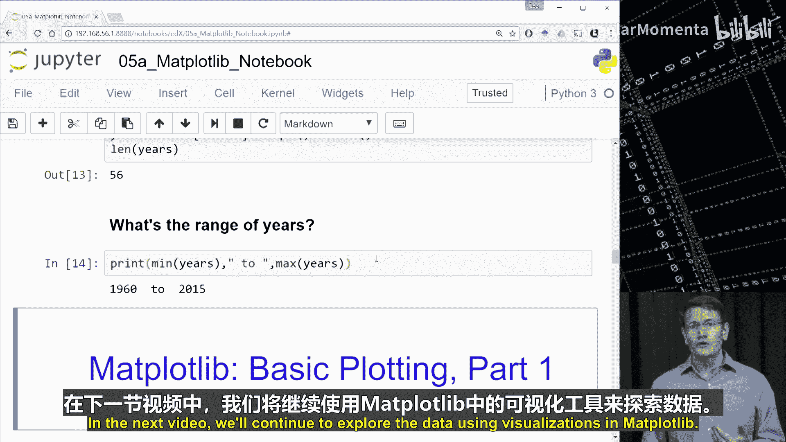
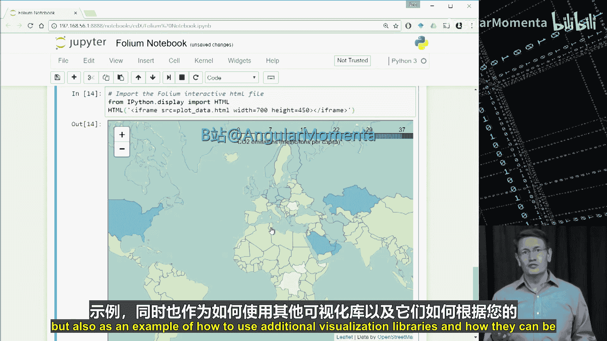

# 【加州大学圣地亚哥分校】Python数据科学-｜-Python-for-Data-Science-p19-06-02-04-视频-Matplotlib--BV1jwFUzjEXu_p19-

In this lesson， we'll be focused on MatPlotlib。So by the end of this video。

 you should be able to explain the role that MA Plotlibb has in data science。

Matplotlib is a widely used plotting library for Python。 It's often my go， too。

 for creating quick plots of data， and almost all the plots I showed you in the last lesson were made just using Matplotlib。

I value Mapllib because it's easy to produce quick plots of data when I am doing data exploration。

 and because I find the plots clean and generally aesthetically pleasing。

I should really like this phrase from the Mattpltlib homepage。The first part。Make easy things easy。

Is what I was referring to when I said it my go to for most plots during data exploration。

You can produce a bar chart， a line chart， a scatter plot， a box plot， or a histogram。

 and just a few lines of code。This is fantastic as you can quickly check the relationship between features。

 plot trend lines， or just get a better feel for the distribution of data。

The second part is why you'll find yourself often using MaplottLib。

 even when you create complex visualizations or you want to customize your plots for presententing your results。

One of my favorite stories about Mattplotlib is that a colleague of mine took the time to set up scripts for the figures in a journal paper that we published。

The setup took a bit of time as he wanted to have an elegant design。

 and he wanted the fonts to mesh seemingly with a paper text。If you've read research papers。

 you'll undoubtedly have seen a figure which just stands out from the paper in a bad way。

One reason why figures stand out in this way is that all the fonts are completely different。

And the figure from the paper。Another reason is that if you're using lawte for your paper。

 the figure may seem less elegant than the paper。So his work aims to remedy these common problems。

What was so great about his work was that because he relied on Python scripts。

 Read CSV files and Matt Plotlibb， we built the scripts into the building of the paper using a make file。

 So we'd update the CSV with some new results。 We'd hit build and wed get an updated paper with these really clean figures。

😊，And all this is made possible by Matt Platli。In the larger context of Jupiter notebooks and the landscape of Python tools。

You may know that Python that Matplloot Lib is a fairly low level tool for plotting。

There are a ton of other tools out there， including Seaborn， Gigiplot， Altaire， Bouquet， Ply。

 and Foium， among many others。For us， we use a library that fits our visualization needs best。

Based on those needs。So we'll have a reading later in this lesson which outlines when you might want to use one library versus another。

 and we'll keep updating this as new libraries come out or as libraries add new features。

Given that there are so many libraries out there， or we so frequently work with Mat Ptlibv in our。

 in our everyday work， we'll start by diving into a notebook book， showcasing Mat Ptlib。

Then we'll have a short notebook later showing you how to work with more advanced libraries。

Before we dive into the visualizations， remember that I said visualizations have little to no meaning without a context。

So this week， we'll get started working with the World Development Indicators Data set。

 which is an open data set on CAGL。This is just a slightly modified version from the data set that's actually available from the World Bank。

So by the end of this video， you should be able to use the World Development indicatordics data set to conduct data science。

The first step with any data set is perform an initial exploration， so first let's import pandas。

 nu PI， random， and mapplt Litop P plot。Next， let's read in the CSV file into a pandas data frame and display the shape of the data for this to work for you。

 be sure that you've downloaded the data and placed it in the appropriate directory。

So it's a big data set and reent may take some time。In fact， the dataset set has 5。

6 million rows and six columns。So let's now use the head method to see what these columns hold。

Interesting。So we've got the name of the country， the code for the country。The name of an indicator。

An indicator code， a year and a value。So this is actually a four dimensional data set。

Where the dimensions are country。Indicator， year and value。Looking at these indicators。

 I'm already seeing some really interesting things here。As someone who's environmentally conscious。

 I'm pretty curious about that CO2 emissions per capita， we'll actually use that metric a bit later。

I'm also curious how many countries are in this data。

 I can test that by using the unique method on a column of the data frame to find out how many unique entries are in the column。

Looks like we've got about 247 countries。I'd like to do a quick Sany check on the data if we get 247 countries。

 we should have 247 country codes。And we do。I'd also like to know how many indicators we have。Wow。

 1344 is a pre extensive list of indicators， if you want to explore a full list of the indicators themselves and more details about them。

 we have a link for that at the top of this notebook。All right。

 so we know how many countries and how many indicators。

 now we need to know how many years of data we have。

So 56 years is a pretty good timeframe for data collection。Let's see what this timeframe is。

A1960 through 2015 great at this point， we feel like we have a pretty good feel for the data set。😊。

We have various indicators per country over the time span of 1960 to 2015。In the next video。

 we'll continue to explore the data using visualizations in Mapltlibb。

This week we'll dive back into our Jupiter notebooks and see how plotting is done using Ma PtLib。

At the end of this video， you should be able to create bar charts， line charts。

 and histograms using Ma Plib。And you should be able to recognize the common components in a mappotlib figure。

So back into our Jupiter notebook from the last video。

 we already have a feel for what's held in the World Development Inds data set。

What I'd like to do now is explore the CO2 emissions for the United States。To do that。

 I'll set up two masks using this string method contains that Ichi introduced you to last week。

The first will be a mask for all the rows for which the indicator name contains CO2 emissions。

And the second is those Rose whose country code is the USA。I'll keep。

The results of that data in a temporary data frame called stage。

Let's check to see withins our new data frame。We have in our new data frame are all the countries are the United States。

 the Count code's US and the CO2 emissions， so it looks like we have the CO2 emissions per capita by year for the United States。

So now let's explore how these have changed over time using Ma Ptlib。

I can do this really in two lines of code， what I'll do is I'll grab the years and then the CO2 emission separately。

 and then I'll send those to a barpl。Remember how I' had said in the last lesson that just a couple of lines in my planet lib lets me create a plot for data exploration。

 this is a perfect example of this。I can see that there was a rise in CO2 emissions per capita from 1960 to 1970。

 and has remained fairly steady since。The plot isn't perfect right。

 I don't have a Y axis label which is actually really important here。😊。

Without knowing what I plotted， this plot doesn't stand alone on its own very well， but again。

 that's okay if I'm just trying to explore the data。To make this graphic a bit more appealing。

Let's use a line plot。So I'll use PLT to plot。 I'll add the labels for the X and the Y axes。

 and I'll add a title。I'm not sure if we need the X axis label。

 it's pretty obvious that these are years， but we'll add it just for clarity's sake。

And look in these lines a bit more carefully。First， the Pl T dot plot method。As for lime plot。

Labeling the aes in the plot itself is called X label。And why label， these are methods on the plot。

Each of these functions takes a number of parameters and you could change things like font size。

 color， and other things using those parameters。Similarly， we'll set up the title。

And then we'll just plot the graph。So this is nice。

 but notice that the Y axis is actually starting at 15。

 and that could be misleading as we've learned from the earlier lessons。

So let's fix that by making a call to access and passing the ranges we want plotted。

So I've already written this line of code， it's just commented out。

 what I'll do is remove the comment。And rerun。The plot now is arguably better than the original bar chart。

 and it certainly stands alone better because of the proper labeling in the Y axis。Next。

 let's use histograms to explore the data。I'm going to plot all the CO2 emissions per capita values in our data。

 but I put some code in here if in the comments which would let you just explore the values within one standard deviation。

Sometimes it's helpful with histograms to avoid the data getting two spread out because of outliers。

 but let's go with plotting all the data for now so let's have the hisT data point to all the CO2 emissions per capita values in our current data set and calling the dot values on the data frame gives me back the nuI andD array representation of that data。

So I could ask for the number of data points using length， and I'll get back 52。

Now let's plot those 52 elements using the plot dot Ki。Method。

 which is the call to create a histogram。I'm passing the method， the endD array。

 then 10 for the number of bins。Then I'm setting the norm to be false to make sure it doesn't scale the data。

 and then I am setting the color to be green。Then I'll label the axes and label the plot。

When we get back。Is a histogram binning CO2 emissions per capita for the US？

And this is really telling me that most years fall between 18。5 and 20 with some outliers。

Now if you find it hard to read。We could add back into grids。 so let me do that。

 So if I do plot thatt grid true and then res it。It's easier for me to。

Get the counts for the number of years。Given that we usually fall between 19 and 20 metric tons per capita。

 I'm curious how the US stacks up relative to other countries。

 so let's pick a recent year where I have data for the US 2011。

I'll ask for the data where the indicator。It CO is the CO2 emissions per capita。

 and the year is 2011。That should give me all the countries that gave us data over that time window。

Nice， it looks like I got back what we wanted。 We have different countries and their CO2 emissions per capita in 2011。

You know， just looking at these values， 4。7， 6。9， 5。8， 5。3。

 I'm already suspecting the US might produce more CO2 per person than other countries。In fact。

 I probably would have guessed that before we got into this analysis。

 but let's see that how this stacks up using a histogram。So how many countries do we have here？

We've got 232。And that would include the US because I didn't do anything special to exclude the US。

Now let's create the plot。Notice that I'm doing something slightly different at the start。

Clling plotot。splots gives you back the figure and the axis separately。

I'm going to use the axis reference with annotate， but before we look at annotate。

 let's look at the Plata hist call and see that we're setting up basically the same histogram as our last one。

 except this time we're counting the number of countries with a certain amount of emissions per person rather than the number of years。

 So let's see what this looks like。Wow， it looks like the vast majority of countries have CO2 emissions in the range of0 to 10。

 metrictrotons per capita。The US at around 17 in 2011 is actually a real outlier。

But where did that nice label of the USA come from？

This is one of those features we talked about with MaPtlibb。

 it supports doing more complex things like annotations or lines to charts。If we go back to the code。

We'll notice that I added an annotation of the string USA。

I placed it at the Cors 1830 and then drew a line from Cors 1830 to 185。

YouThere are more parameters to the An method if you wish to read the documentation more。But mainly。

 I want to show you this to point out， sorry for the pun that you can do more advanced graphics with MA Footlibb。

There are more questions I have about this data for now。

 but I'll leave you to explore them if you want， But before I wrap up the video。

 I want to point out that you after just seeing a few of these figures。

 you've probably already picked up on the common features of a mattepltlib plot。

 So let's state them explicitly。The common features are the chart type， and here we have a bar chart。

Next， we have the ranges for the x and the y values。The have possible labels for the axes。

We could also possibly label the figure itself and provide a legend。And then lastly。

 aesthetics like font size， line size， plot size， and even more complex things like annotations can be added。

So now that we've seen all these features of mappit plots。

 I encourage you to use this notebook along with the others we provide this week for more examples。

But before we finish with MapltLib， I want to explore the relationship between CO2 emissions and GDP。

 but let's do that in our next video。We'll be working with Matt Plotlibb again in this video。

 continuing to explore that World big bank dataset set that we started with。

So by the end of this video， you should be able to create line charts and scatter plots using Mapllet。

So a question I had about the data will allow us to explore using line plots and scatter plots。

We saw that CO2 emissions per cap in the US went up in the 1960s。

 and then with some minor variance has remained prec since。

I'm curious how that relates to the US economy， specifically the US's GDP per capita。

So let's set up similar masks as in the last video。

 to pull out the GDP per capita for the USA over time。

And then what we'll do is we'll check what this output is by running the head method。

Looks like we have the data we want per year we have the GDP per capita based on the value of US dollars in 2005。

So this is pretty similar to what we had for CO2 emissions per capita。All right。

 before we plot these against each other， let's first take a look at the trend in GDP per capita of the US。

 I'll use a line plot for that。For the most part， we're seeing solid growth over time。

 There are a couple of dips here and there and one noticeable dip in the recession around 2008。

 but the upper trend is restored by 2010。So knowing that CO2 emissions over that same time period didn't behave the same way leads me to think that they aren't closely related。

But let's look at a scatterner plot to see。So first。

 I want to make sure the timeframes are the same by calling mint and max in these columns。

 and the reason I want to make sure that these are the same is that scatter plots require the same number of years in the data set。

Ug， so they both to start in the same year in 1960， but I have more data for GDP than I do for CO2。

So I need to have the same number of data points for the scatter plot and to do that。

 I'm going to trim off those extra ones。To do this trimming， I was ask for the years before 2012。

 and then I'll check that our data has the same number of values for both the GDP and the CO2 emissions。

Ah here we go。 We have 52 years worth of data for both。To make a scatter plot。

 we'll first call out the fig and the axis like we did before using。The plot outside plots。

Most of the rest should be fairly recognizable， except for the calls to the methods scatter。

To create a scatterpot with these two arrays。All right， now when I run this。

What I get back is a pretty weak relationship， it looks like when GDP and CO2 emissions were climbing in the 60s。

 they tracked together。But after that， there doesn't seem to be much relationship at all。

We could also test this using correlation， I'll use the correlation coefficient function in NI to get back the relationship between these two arrays。

The main diagonal is each against itself， so we expect to see 1。0 there or perfect correlation。

But on the other diagonal， we see 0。0。077。That's a really weak correlation between these two indicators。

So we just got started looking at these relationships。

 but if someone were to argue we need more CO2 production per capita to boost our economy。

 this initial data analysis would not support that claim。

I have more ideas for what to do with this data， could we look at the relationship between CO2 emissions per capita and GDP for other countries。

 what about overall CO2 and GDP minus the whole per capita component？This is an extremely rich data。

 so I encourage you to continue explore these on your own。

This is a short video introduction to the notebook with additional map plot of examples that we provided for this week。

So by the end of this video， you should be able to use additional Jupyter notebook resources as its examples。

In our additional notebook， we provide code for number of examples。

 still working with the world development indicators。

 we we pick random indicators and compare them against each other using line plots and scatter plots。

then after working with the World Development indicatords。

 we also provide an example of how to create 3D plots like this in Maplotlib。

We also provide an example using bubble plots。Bowbble plots can be really helpful when you want to graph three dimensions easily。

 You can have an x and a y and a size of each point。In this example。

 we also use color code to provide a fourth dimension， so in this image we have angle。

 distance from the center， size of the bubble and color all coded here。

Know that unlike some of our earlier figures， you need to spend time interpreting and understanding the data in a figure like this。

 but it could be incredibly valuable for data exploration and for conveying more complex relationships when you're presenting your data。

In addition to histograms， I frequently use box plots when I'm trying to understand distributions。

 This example provides you with a template for box plots and for placing figures side by side in mappllib。

Box plots tell you the median values within the inter quartile range and elements above the third quartile and below the first。

 as well as the maximum minimum values。That's a lot of useful information， all in one figure。

So please be sure to check out these additional notebooks as well as other examples online when you're looking for ways to visualize your data using MapludLb and your upcoming project weeks。

We mentioned earlier that there are a number of useful libraries outside a map pod。

 particularly when working with data， a data set like the World Development indicatordics。

 creating geographic overlays can be a powerful way of visualizing your data。

So by the end of this video， you should be able to use the Foium library to create geographic overlays。

So jumping into our Juuber notebook before you're able to use Foum。

 you may need to install it in your system， you'll also want to grab the JSON file listed below and place it in your folder under geoworlcountries。

 Json if you haven't already。So let's set this up。I' in Portfoo， Port Panas PDd。

 and then I'll set up this geo。So let's read back the world Development indicators。Again。

 this can take some time because it's's a large asset。And then by running data ahead。

I can see that this is the same data as before。So what we want to do next is let's pull out the CO2 emissions for all the countries in 2011。

 just like we did before。Checking the data， it looks like we got back the indicators we wanted。

So let's set up our data for plotting by keeping just the country code and the values that we plotted。

So we'll pull in just those。Values。And we can see that we get back the country code and the value。

We'll also want to extract the name of the indicator for use as the legend in the figure。All right。

 now we're actually set up to create the Foium interactive map。

We'll tell it to create a map at a fairly high level of Zoom。

Then next we'll use the built in method called chloroppath to attach the country's geographic JSON and the plot data。

We need to specify the relevant columns。Key on feature ID refers to the label in the JSON object。

 which has the country code as a feature ID。Attached to each country's border information。

And you could find this by reading the JSON object。

But this is the tie that we need to set up our data。

 Our country code in the data frame matches the feature ID in the JSON object。Next。

 we specify some of the aesthetics， like the color scheme and the opacity。

 and then we label the legend。So the output of this plot is going to be saved as an HTML file。

 and the HTML file is actually interactive。So what we'll need to do is save it and then read it back into the notebook in order to interact with it on the map。

And then we have our map。Notice first， the dark colors imply a higher CO2 emissions per capita。

The US and some of the European countries， as well as Middle Eastern countries。

 stand out as being high producers of CO2 per capita。

But remember that this is not total CO2 emissions， this is CO2 emissions per capita。

 so countries with large populations could have high CO2 emissions。

 but still have a lower CO2 emissions per capita。So we provide this notebook as an example of how to do geographic overlays。

 but also as an example of how to use additional visualization libraries。😊。

And how they can be powerful depending on your visualization needs。

So please be sure to check out the res along with our library recommendations on what visualization library might work best for your needs。

