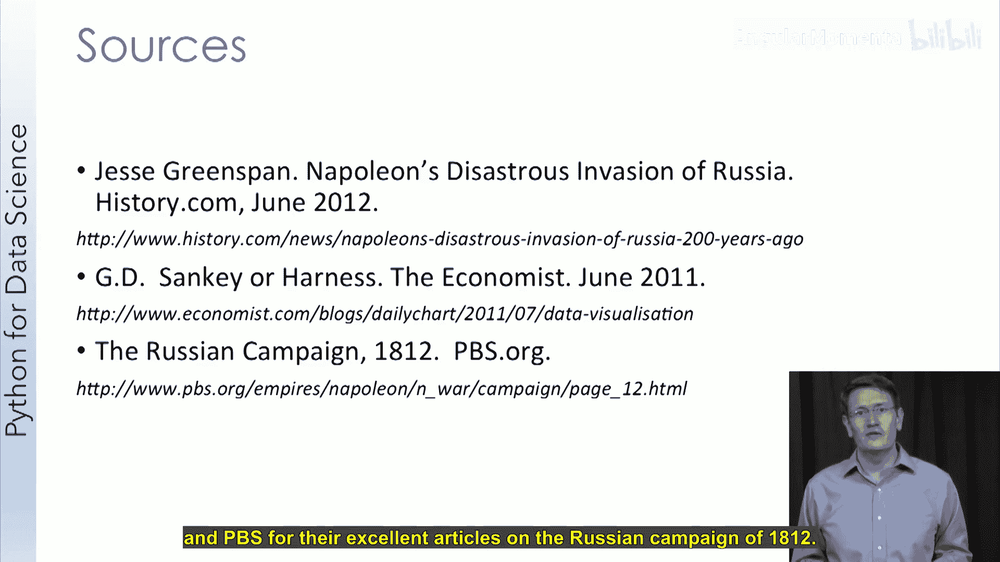

# 【加州大学圣地亚哥分校】Python数据科学-｜-Python-for-Data-Science-p20-06-03-02-视频-案例研究_1_霍乱--BV1jwFUzjEXu_p20-

This lesson will focus on case studies of exemplar data visualizations。In this video。

 we'll focus on a data visualization which helped the world understand the true cause of cholera。

So by the end of this video， you should be able to describe the role play by data visualization in understanding how cholera spread。

As background， cholera is a bacterial infection， which can cause severe diarrhea。

Possibly leading to death through dehydration。After exposure to the bacteria。

 a person shows symptoms 12 hours to five days later， in acute cases can kill within hours。

 if untreated。Unfortunately， cholera is still a danger today。

 with millions of cases worldwide and deaths in the tens to hundreds of thousands。

For those of you who are a bit squeamish， you may want to skip ahead to the video where you see the map graphic。

Color is particularly dangerous as it can easily cause outbreaks in areas with poor sanitation。

People with cholera have diarrhea， which causes the bacteria。

 which contains the bacteria for up to 10 days after the infection。If someone ingests that bacteria。

 they can track the disease。So if sewage contaminates food or water supplies。

 this can cause an outbreak。Today， we know how cholera spread because of a scientist who had a theory and a terrible outbreak which occurred in 1854 in London。

Now， in London in the 1800s， Sanitation struggled， particularly in poor neighborhoods。

With a rising population and lack of proper sewage and sanitation guidelines。

 many folks lived in terrible conditions。 They often got their water from wells。

 but well water was susceptible to contamination。If they didn't know it was spread through water。

What exactly did they think caused it？They actually thought it was a combination of spelling something bad and poor constitution。

The first was what LED to doctors wearing masks， like in this image。

The artwork here actually relates to doctors trying to avoid the black death。

 but the same theory was still present in the 18 hundred0s。Bad smells cause disease。

 and if you could put some sort of perfume in the mask with you， you could avoid those smells。

Although we know now that this thinking is flawed。We have the benefit of germ theory。

I suspect back in the past， the origin of this idea was likely just a mistaken correlation for causation。

Areas where there were people who were ill or had pooranation。Like we had worst odors。

And since most people got sick in areas with poor odors。

 they falsely attributed the smell to the source of the disease。

The second idea was a bit more repugnant。At the time。The poor tenant to suffer more from disease。

Not surprising， given what we know now about how diseases are spread and the conditions in which they lived at the time。

But at the time， some people believed poor people were just somehow weaker people。

 and by their own weaknesses， were susceptible to disease。Again。

This is mistaken correlation for causation。 However， this time is combined with bigotry。

So now that you have a decent idea of what they think caused the disease。 that leads us to John Snow。

 who is a scientist living in London in the 19th century。

 His background was as an anesthesiologist where he applied scientific principles to make the practice far safer for patients。

Hed also published his theory that Cholera was Waterborn in 1849。

But his theory gained little traction。So John Snow is living in London in 1854。

 near where the cholera outbreak occurred。The outbreak was caused by contaminated water entering the well。

 sourcing the Broad street water pump。After the outbreak。

 John Snow went doed door to door in the vicinity of the outbreak and followed up with every fatal case to find out where they lived and where they got their water。

 He plotted all these deaths on a map。😊，This is the full。It it's a bit hard to see。

 but the Bro Street pump is right there in the middle of all those blocks。

Each of those little rectangular blocks was a death from cholera。If we zoom in。

We see that there are a large number of deaths in the neighborhood around the pump。

 away from the pump， the deaths decline。By talking with the families of the deceased。

 he was able to learn where victims got their water。And in a perfect example of data science。

 the outliers were critical for for finding convincing answers。

There was a workhouse or a prison nearby by the Broad Street pump with many inmates。

 but almost no fatalities。Turns out the workhouse at its own will and shipped water in from a different source。

 so they weren't using the pump。There was a brewery nearby by， which had also escaped cholera。

 And again， they had their own water supply， or they drank the liquor that was produced in the facility。

 So they weren't drinking from the pump。Lastly， there's a woman and her niece who lives some distance away from the pump。

And a died of cholera。With some investigation， he found out the aunt had previously lived in the area and liked the water from the Bro street pump so much that she had it delivered to her and often shared it with her niece。

The combination of this figure and the gathered data that Johnson had put together led town officials to shut down the well at removing his handle。

Despite being skeptical that the pump was the cause。

 the number of new infections almost instantly declined and were quickly stopped。

So even though this outbreak was dimmed by the action of taking off the handle from the pump。

 it took some time before John Snow's ideas were widely accepted。One key piece。

 this puzzle was provided later by a reverend in the area named Henry Whitehead。

He had sought out to prove Johns Snow wrong。 By the process。

 he stumbled on the answer to the mystery of how the pump got contaminated。

A baby had become ill from collarra in a house near the pump Shortly before the outbreak。

 The parents had cleaned the diapers for the baby into a cesspool near the well。

 which then seeped into the well， contaminated。Another keyine related to cholera came some years later。

 when a German physician， Robert Coe， isolated the bacteria which causes cholera。

 and did that in 1883。These epidemics and the realization of its cause LED to Europe and the United States adopting water sanitation。

 Snow， for his work， is often regarded as one of the pioneers of the field of epidemiology。

I would note that while much of the v world has access to clean water。

 the story of Coloradora is sadly not over， as my numbers at the start of this video told you。

The World Health Organization has estimated that almost 80% of people in their world countries lack access to clean water supplies。

 and in many of those areas， there is no sewage treatment either。

Despite our knowing how to prevent cholera， it remains a global health concern。

To end things on a positive note， I want to share a picture of me next to the Broad Street Pump in London in 8 2013。

As was there for a conference and as and appreciate the science and the and the data visualization and the story around the Broad Street pumpump。

 this was actually one of my first stops of that trip。😊。

I also want end with a quick plug for the book， The Ghost map。

 The story of London's most terrifying epidemic， how it changed science。

 cities and the modern world by Stephen Johnson。Much of my knowledge about this story came from reading this book。

And when I was teaching an interdisciplinary course on scientific literacy and disease at Skindmer College。

 we use this book as required reading。So I really can't recommend it enough。

In this video， we'll be looking at another famous visualization。

 This one was used to depict France's Russian campaign。In 1812。So for the end of this video。

 you should be able to explain why the data visualization of Napoleon's Russian campaign in 1812 is considered so effective。

Charles Joseph Mina created this figure in 1869。 The title of the figure is when translated English。

 figurative map of the successive losses in men of the French Army in the Russian campaign 1812 through 1813。

Ma was a successful civil engineer in France， who was considered an early leader in using visualizations in engineering and statistics。

He is most well known for creating this figure， which charted that Russian campaign。In O。

 we of the French army as it advanced from the crossing of the Neeman River towards Moscow。In black。

 you had the French army and retreat。The width of the line depicts the size of the army。

You could zoom in quickly to the Naman River， where you'll find the Army's size at the start in the end of the campaign。

You can see almost instantly how disastrous the invasion of Russia was for the French。

 They started with around 450000 troops， although some estimates are actually higher。

 and they ended with barely 10000。So how were those losses suffered？

Let's briefly talked through this campaign using the figure。So first， what started all this？In 1812。

 Russia， under Tzar Alexander I， having blocking British goods as allies of France。

They were blockadeing British goods under Napoleon's edict that barred trade with England。However。

 the banning of trade with England was having disastrous effect on the Russian economy。

 so Russia decided to end its participation in the embargo。Napoleon。

 after negotiations with Russia to restore the embargo failed。

 began his campaign to invade Russia in 1812。The plan was to attack the smaller Russian army near the Russian border。

Crush it in battle and end the war。That was the plan。 However。

 the Russian Army refused to engage Napoleon's huge army in direct battle。As the Russian army fled。

Back to Moscow， they would destroy the countryside。

 causing the French army to fall short on supplies。

 You can see that in the highlighted region of this figure here。In addition。

 Russian Cossacks would perform small hit run attacks in the French army。

 both killing troops and also lowering morale。Without engaging in any battle。

 the French army was suffering huge losses， mostly due to sickness and desertion。

Napoleon finally got the battle he desired at the village of Boroino outside of Moscow。

The battle was brutal， and ultimately， France prevailed。

 but it did so without the decisive victory it desired。 On September 14。

 the French army moved into Moscow only to find it deserted。 and shortly， much of it was on fire。

Napoleon had suspecteded a Russian surrender when he entered Moscow。

 but he would never receive one After wait a month in Moscow to negotiate surrender。

 Snow flurries began to fall。 Napoleon realized his army could not weather the winter in Moscow。

After leaving Moscow， the French army was attacked by the Russian army。

 which had received reserves and was now able to actually go on the offensive。

Their presence forced Napoleon to flee using a northern route。

 which was problematic as winter continued to set in。Moreover。

 the Russian forces were able to attack the French army as they continued to flee。

Conditions during the retreat were terrible。 The troops lacked supplies。

 They were being attacked while they were fleeing， and they had to endure in early and harsh winter。

On this figure are the temperatures the troops faced during their retreat。

Temperatures were often below 0， and the Army encountered a great deal of snow。

So by the time Napoleon's army returned to their start。

 it was a tiny fraction of its former strength。Without the might of his former army。

 Napoleon's power in Europe would now come under challenge。

So what makes this visualization so special？Most notably。

 it has six types of data all being visualized， which we've discussed。

We have the latitude and the longitude for the armies。We have the direction the army was traveling。

 the size of the army， the distance the army traveled。

 and the temperature the army faced during their retreat。By encoding all these types of data。

 one figure is capable of presenting the story of how French losses during the Russian campaign in 1812。

To conclude， I want to acknowledge some of the key sources I use when assembling this video。

 thank you to Jesse Greenspan， the economist and PBS for their excellent articles on the Russian campaign of 1812。

 I encourage you to explore these articles more if you wish to learn more。

