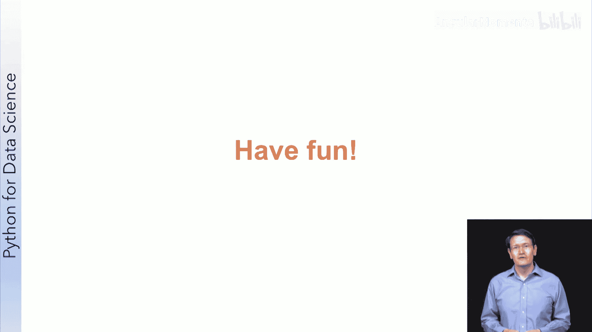

# 【加州大学圣地亚哥分校】Python数据科学-｜-Python-for-Data-Science-p21-08-01-02-视频-小型项目--BV1jwFUzjEXu_p21-

This week is all about bringing together what you've learned so far into a meeting project。

So far， you've learned about the data science process， Jupyter notebooks。NumbI， pandas。

 and data visualization in MAPt。Also， you've seen us use these tools to analyze WiFIR data。

 movie rating databases， and the World Development indicatordics data among others。

Your goal this week is to tackle one of these data sets yourself and extend what we found together for yourself。

You can find more details about the project in the readings this week。

What we want to do is pick a data set that you've already explored in the notebook we provided。

Pick an appropriate research question you'd like to explore in that data。

And do an initial exploration of the data。It'd be great if you could come to some conclusions。

 but be honest in what you find。Once you're done， you'll answer a few short questions about what the question was that you try to solve。

 and then you'll turn in your notebook。And be sure to put some effort into the presentation of your work。

 it's important that you communicate your findings to others well。

You'll then submit both those for peer assessment， where you'll be graded on the work you did。

 but also receive constructive feedback on what you could do better in the future。

A quick word about peer assessments。Please take your role as a reviewer seriously。

 you should expect to spend a decent amount of time reviewing someone else's work。As part of that。

 realize that you're representing us in this work and along those lines。

 grade your peers how you would like to be graded。As a scientist。

 I participate in peer review both as a submitter of papers and as a reviewer。

For those of you who haven't been part of that process。

 a good review is one which is well thought out and offers constructive feedback on how to improve。

But it isn't necessarily one which is solely complementary。

A bad review is one which is either too harsh or overreaching in its criticisms。

Is incorrect in his understanding of the work or is too shallow to be a valuable feedback？

Treat your peer assessment the same way， you should understand the work they did。

 you'll find positives and negatives， praise the positives。

 and have constructive suggestions for the negatives。

Weigh them against each other in meaningful ways。Don't fail someone just because of a typo in their notes and don't give someone full marks if they did a shallow analysis with obvious flaws。

And lastly， be fair， respectful and professional。Review the edX code of conduct if you're unsure of expectations of your behavior when you're interacting with the other learners。

And on a lighter side， really someone may think differently than you。

Maybe you're an avid Harry Potter fan， and you don't like that the movie database analysis portrays token movies as better than Harry Potter。

Please try to be fair in reviewing their work even if you don't like the conclusions。You know。

 you've come a long way already with data science and Python。

 this is an opportunity to put your skills to practice。

And hopefully do this on a data set that's interesting to you， so try to have some fun。

