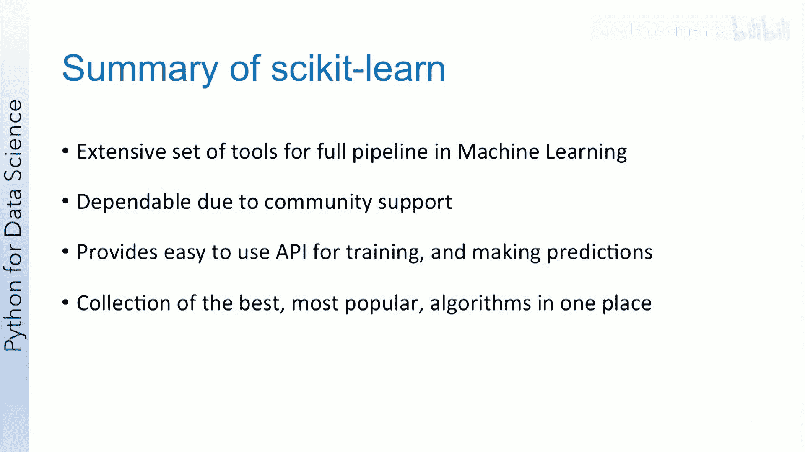

# 【加州大学圣地亚哥分校】Python数据科学-｜-Python-for-Data-Science-p22-09-01-03-视频-机器学习导论--BV1jwFUzjEXu_p22-

Yeah。

This week， we will introduce you to the basic concepts in machine learning。😊。

And show you some example notebooks using Psyit Learnn， a popular machine learning library in Python。

😊，You won't be an expert in machine learning after this week。

 but you will be able to go through and understand machine learning analysis the basic ones。🤢。

As well as create simple machine learning tasks in Python。😊。

You will build up upon this knowledge and know more about machine learning after taking the machine learning class in this Micromasters。

So take this week as an appetizer to what's coming later。😊，Since this week is about machine learning。

 let's start by defining what that means。We hear this term a lot these days used in many contexts。

 so it's good to start out with a solid definition of what machine learning means。😊。

By the end of this video， you should be able to explain what machine learning is and list three applications of machine learning encountered in everyday life。

Machine learning is a field of study that focuses on computer systems that can learn from data。

That is， these systems often called models， can learn to perform a specific task by analyzing lots of examples for a particular problem。

😊，For example， a machine learning model can learn to recognize an image of a cat by being shown lots and lots of images of cats。

😊，This notion of learning from data means that a machine learning model can learn a specific task on its own。

The Ma learning algorithm is programmed to learn from the data。

 but there's nothing in the algorithm or program which directly aims to learn the given task。

In other words。😊，Machine learning models are not given the step by step instructions on how to recognize the image of a cat。

 instead the model learns on its own what features are important in determining whether a picture contains a CA from the data that it has analyzed。

Because the model learns to perform this task from data。

 it's good to note that the amount and quality of data available for building the model are important factors in how well the model learns from the task。

Because machine learning models can learn from data。

They can be used to discover hidden patterns and trends in the data as well。

These trends and patterns lead to valuable insights into the data。Thus。

The use of machine learning allows for data driven functions to be made for a particular problem。

So to summarize， the field of machine learning focuses on the study and construction of computer systems that can learn from data。

😊，Without being explicitly programmed。Machine learning algorithms and techniques are used to build models to discover hidden patterns and trends in the data。

Allowing for data driven decisions to be made。Machine learning has been used in many different applications。

 many of which you probably encounter in your everyday life， perhaps without even realizing it。😊。

One application of machine learning that you likely use this past weekend or even just today is credit card fraud detection。

😊，Every time you use your credit card， the current purchase is analyzed against your history of credit card transactions to determine if the current purchase is a legitimate transaction。

😊，Or a potentially fraudulent one。If the purchase is very different from your past purchases。

 such as for a big ticket item in a category that you'd never show an interest in or when the point of sale location is from another country。

😊，Then it will be flagged as a suspicious activity in that case。

 the transaction may be denied or you might get a phone call from your credit card company to confirm that the purchase was indeed made by you。

😊，This is a very common use of machine learning that's encountered in everyday life。Another example。

 application of machine learning encountered in daily life is a handwritten digit recognition。😊。

When you deposit a handwritten check into an ATM or a machine learning process is used to read the numbers。

Written on the check to determine the amount of the deposit。

Handwritten digits are trickier to decipher than type digits due to the many variations in people's handwriting。

🤢，A machine learning system can sift through different variations to find similar patterns to distinguish a one from a9。

 for example。Recommendations on websites is another example application of machine learning that most people have experienced firsthand。

😊，After you buy an item on the website， you will often get a list of related items。😊。

Often this will be displayed as customer who bought this item。

 also bought these items or you may also like。These related items have been associated with the item you purchased by a machine learning model and are now being shown to you since you may also be interested in them also。

This is a common application of machine learning used often in sales and marketing。

These were just a few examples among many。As we have discussed。

 data science has its roots in statistics， machine learning， artificial intelligence。

 and computer science among other fields。😊，So machine learning is a part of this field that encompasses the algorithms and techniques used to learn from data。

😊，There are a number of other terms we hear in conversations about machine learning。

The term data mining became popular around the time that the use of databases。😊，Became commonplace。

 so data mining was used to refer to activities related to finding patterns in databases and data warehouses。

There are some practical data management aspects to data mining related to accessing data from databases。

😊，But the process of finding patterns in data is similar to machine learning and often uses similar algorithms and techniques。

Predictive analytics is another term and it refers to analyzing data in order to predict future outcomes This term is usually used in the business context to describe activities such as sales forecasting or predicting the purchase of behavior of a customer。

😊，But again， the techniques used to make these predictions are the same techniques for machine learning。

😊，As we have discussed before。😊，Data science is a need term that's used to describe the process of processing and analyzing data to extract meaning。

 and again machine learning techniques can also be used here。

Because the term data science became popular at the same time that big data began appearing。

Data science usually refers to extracting meaning from big data。

So it includes approaches for collecting， storing， and managing big data as well as machine learning。

To summarize in this lecture， we've discussed what machine learning is。😊。

And how it is being used in our daily life。Machine learning models learn from data to perform a task without being explicitly programmed。

They are used to discover patterns and trends in the data。😊。

And allow for data driven decisions to be made for the problem being studied。

We also discussed in this lecture some examples of how machine learning is being used。😊。

We see from the example applications that machine learning can be applied to many different areas and it's practically everywhere。

😊，There are different categories of machine learning techniques for different types of problems。

The main categories will discuss are classification， regression。

 cluster analysis and association analysis in this video we'll go over each of these in detail。😊。

By the end of this video。😊，You should be able to describe the main categories of machine learning techniques and summarize how supervised learning differs from unsupervised learning。

😊，In classification， the goal is to predict the category of the input data。😊，As an example of this。😊。

Is predicting the weather as being sunny， rainy， windy or cloudy。

The input data in this case would be sensor data specifying the temperature， relative humidity。

 atmospheric pressure， wind speed， wind direction， etc。😊。

The target or what you're trying to predict would be the different better categories like sunny。

 windy， rainy and cloudy as we discussed。😊，The category is to be predicted。😊。

Are called classifications。Another example is to classify a tumor。

Is as benign or malignant In this case， the classification is referred to as binary classification。

 since there are only two categories， but you can have many categories as well as the weather prediction problem shown here。

😊，Another example of classification is to identify hundreds and digits as we talked about in our last video as being one of 10 categories。

 zero to nine。😊，When your model has to predict a numeric value instead of a category。

 then the task becomes a regression problem。An example of regression is to predict the price of a stock。

😊，The stock price is an numeric value， not a category， so this is a regression task。😊。

It is not a classification task。If you were to predict whether the stock price will rise or fall。

Then that would be a classification problem。But if you're predicting the actual price of the stock。

 then that's a regression problem。That is the main difference between classification and in。

To summarize， in classification， you're predicting a category and in regression。

 you're predicting anmer value。😊，Another regression application。

 in addition to the stock example here。😊，Is for prediction of the amount of rain for the region。

Recall that in our discussion on classification， we had discussed predicting if it will rain the next day that is predicting between one of the two categories rain or not rain。

😊，So that's a classification problem。😊，But if we are predicting the amount of rain。

 which is an numeric value， that would be a regression problem。😊，In cluster analysis。😊。

The goal is to organize similar items in your dataset into groups。

A very common application of cluster analysis is referred to as customer segmentation。😊。

This means that you're separating your customer base into different groups or segments based on customer types。

 for example， it would be beneficial to segment your customers into seniors。

 adults and teenagers these groups have。Likely different likes and dislikes and have different purchasing behaviors。

😊，When companies segment customers into different groups like this。

 they may be able to provide targeted marketing ads for each group's particular interests。

Note that cluster analysis is also referred to as clustering in different contexts。

Next is association analysis the goal here is to come up with a set of rules to capture associations between items or events。

😊，The rules are used to determine when items or events occur together。

A common application of association analysis is known as market basket analysis。

 which is used to understand customer purchasing behavior。😊，For example。

 association analysis can reveal that banking customers who have checking or deposit accounts also tend to be interested in other investment vehicles such as money market accounts。

😊，This information can be used for cross selling， so if a financial institution advertises money market accounts to your customers with CDs。

 they are likely to open such an account。Other common applications can be recommendation of similar items based on purchasing or browsing history of customers。

Finding items that are often purchased together and offering based on these related items at the same time to drive sales of both items would be very beneficial。

😊，Identification of web pages that are often accessed together。

Can also provide us a good basis for association analysis。

One can imagine more efficiently generating offers on these related web pages to create further benefit of this information。

🤢，We now looked at the different categories of machine learning techniques， their classification。😊。

Regression， cluster analysis and association analysis。😊。

We've also seen some examples of each category。For the techniques we've discussed here。

There are two ways of conducting the learning itself。

These categories are referred to as supervised versus unsupervised learning。In supervised approaches。

 the target， which is what the model is predicting， is provided。😊。

This is referred to as having labeled data because the target is labeled for every sample that you have in your data。

🤢，Referring back to our example of predicting the weather category of sunny， windy， rainy， or cloudy。

 every sample in the data set。😊，Is labeled as being one of these four categories。

So the data is labeled。And predicting the better category is a supervised task。In general。

 classification and regression are supervised approaches。😊，In unsupervised approaches。

 on the other hand。The target that the model is predicting is unknown or unavailable。

 this means that you have unlabeled data。So you can't train using these labels。

Going back to our cluster analysis example of segmentig customers into different groups。

The samples in your data are not labeled with the correct group。Instead。

 the segmentation is performed using a clustering techniques group items based on characteristics。😊。

Of what they have in common。Thus， the data is unlabeled and the task of grouping customers into different segments is an unsupervised one。

In general， cluster analysis and association analysis are unsupervised approaches。😊，In summary。

 in this video， we looked at different categories of machine learning techniques and we discussed classification。

 regression， cluster and association analysis as some of these techniques。😊。

We also defined what unsupervised andsupervised approaches are in machine learning。

 and which one of our earlier categories fit in these two categories。

Now let's review some of the terminology related to machine learning。😊，By the end of this video。

You should be able to。Describe what the feature is and how it relates to a sample。

Name some alternative terms for feature。And summarizer how a categorical feature differs from a numerical feature。

😊，Before we delve into the methods for processing and analyzing data。

 let's first start with defining some of the terms used to describe data starting samples and variables。

😊，A sample is an instance or example of an entity in your data。This is typically a row in your data。

 This figure shows part of a data set of values related to weather。😊。

Each row is a sample representing weather data for a particular day。😊。

The table in the figure shows four samples of better data each for a different day。In this table。

 each sample has five values associated to it。These values are different information pieces about that sample like the sample date。

 minimum temperature， maximum temperature， and rainfall on that date。😊。

We call these different values variables of the sample。

And sometimes refer to them as features of the sample。In fact。

 there are many names for samples and variables， some of which we've already used in some of our previous weeks。

😊，Some other terms for sample that you might hear in the machine learning context are record。

 example， row， instance， and observation among many others。

It is good to know that all of these terms mean the same thing in the machine learning context。😊。

That is， they all refer to a specific example of an entity in your data。😊，Similarly。

 there are many names for variables in addition to feature。😊。

Some other terms for variable are feature。😊，Column。Dimenssion。Attribute and field。

All of these terms refer to the same。😮，Specific characteristics for each sample in your dataset。

An important point to emphasize about variables is that they are digital values with a type。😊。

Each variable has a data type associated with it。😊。

The most common data types are numeric and categorical。There are other data types as well。

 such as string and date， but we will focus on more common data types of numeric and categorical in the context of data mining。

As the name implies。Nummeric variables are variables that take on numbers。They can be measured。

And their values can be sorted in order in some way。

Note that an numeric variable can take on just integer values or be continuous valued。😊。

It can also have just positive numbers， negative numbers， or both。A variable with labels。

 names or categories for values instead of numbers are called categorical variables。For example。

 a variable that describes the color of an item such as the color of a car。😊。

Can have values such as red， silver， blue， and black。

These are non numeric values that describe some quality or characteristics of an entity。😊。

These values can be thought of as names or labels that can be sorted into categories therefore。

Categorical variables are also referred to as qualitative variables or nominal variables。

To summarize。A sample is an instance or example of an entity in your data。😊。

A variable captures specific characteristics of each entity。😊。

So a sample has many variables to describe it。😊，Data from real applications are often multidimensional。

 meaning that there are many dimensions or variables describing each sample。😊。

Each variable has a data type associated with it。😊。

And the most common data types are numeric and categorical。

Note that there are many terms to describe these data related concepts and youll find likely find that different references。

 textbooks and data scientists use many of these interchangeably。

Now that we talked about the basics of machine learning。

 let's overview a machine learning library in Python called Psychic Learn by the end of this video。😊。

You should be able to identify key strengths of psychic learn。

Explain why it is a leading library for machine learning。😊。

Navigate your way to find the right tool in S it Learn。😊。

And search for tutorials that provide problem specific examples using library functions。

Psyit Learnearn is an open source library in Python for end to end machine learning。😊。

It builds upon the strengths of Nmy， Si P and Matplt Lib， like many other Python libraries。

It is being rapidly developed and improved by an active community of developers， for example。

 in May 2017 as we speak， the number of contributors to p Psychic Learn was 846。😊。

When I set and to end machine learning， what I mean is the entire data science process。

 including machine learning， data cleaning， and data transformations。

PsychitLn supports the whole process by providing utility functions for data transformations as well as a range of data cleaning and preparation functions that help with many tasks including scaling。

 normalization， feature engineering， and missing value handling。😊。

PsychitLn also provides built in functions for many machine learning algorithms ready for modeling and analysis。

Although it requires some expertise to use these algorithms appropriately for the right tasks。

 there are many resources online that make the learning curve easier。😊，Additionally。

 the documentation on the website for Psychic Learn includes tutorials to get started。😊。

We find this documentation really easy to follow。For example。

 the clustering part of the documentation nicely overviews the available algorithms， their metrics。

 scalability， parameters， and even potential use cases。😊。

Psychit Learn also includes specialized implementations for dimensionality reduction algorithms。

Although we won't go into the details of these algorithms in this course。

 it will be handy in your upcoming machine learning course in this Micromasters。😊。

In machine learning。We use a number of techniques to evaluate and select the right model。

You will find a number of methods to help with this as well。😊，As a summary。

PsyCit Learnear provides an extensive set of tools for the full machine learning process。😊。

Thanks to Python， we can combine these tools with the rest of the data science tools in Python that we've learned up to now。

This open。An extensible machine learning library is vibrantly being developed and documented by a very active community。

😊，We hope you will enjoy using this library as much as we do。😊。

