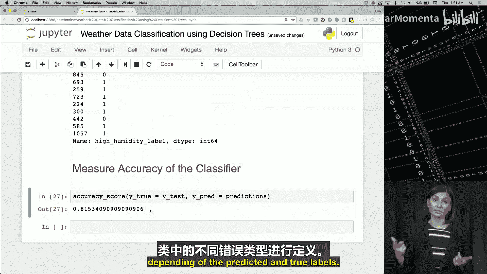

# 【加州大学圣地亚哥分校】Python数据科学-｜-Python-for-Data-Science-p23-09-02-03-视频分类--BV1jwFUzjEXu_p23-

In this lesson， we will focus on a category of machine learning problem called classification。😊。

By the end of this video， you should be able to define what classification is。

 discuss whether classification is supervised or unsupervised。

 and describe how binomial classification differs from multinoial classification。😊。

As we discussed before， classification is one type of machine learning problem。😊。

In a classification problem， the input data is presented to the machine learning model and the task is to predict the target corresponding to the input data。

😊，The target is a categorical variable， so the classification task is to predict the category or label of the target given。

😊，The input data。For example， the classification problem we discussed before and illustrated in this image is to predict the type of weather。

😊，The target that the model has to predict is the weather and the possible values for weather in this case is sunny。

 windy， rainy or cloudy。The input data can consist of measurements like temperature。

 relative humidity， atmospheric pressure， wind speed， wind direction， etcter。😊。

So given specific values for temperature， relative humidity and all those other measurements。

 the task for the model is to predict if the weather will be sunny， windy， rainy。

 or cloudy for the day。This is what the data set might look like for the weather classification problem。

😊，Each row is a sample with input variables， temperature， humidity， and pressure。😊。

And target variable weather。Each row has specific values for the input variables and a corresponding value for the target variable。

😊，The classification task is to predict the value of the target variable from the values of the input variables。

😊，Since a target is provided。We have labeled data， and so classification is a supervised task recall that in a supervised task。

 the target or desired output for each sample is given。

Note that the target variable goes by many names such as target， label， output， class variable。

 category， and class。A classification problem can be binary。😊，Or multiclass。

With a binary classification， the target variable has two possible values， for example， yes and no。

With multi class classification， the target variable has more than two possible values。 For example。

 the target can be short， medium and tall。😊，Multiclass classification is also referred to as multinomial or multilabel classification。

😊，Remember， though， the target is always a categorical variable in classification。😊。

Some examples of binary classification are predicting whether it will rain tomorrow or not here there are only two possible outcomes。

 yes it will rain tomorrow or no it will not rain tomorrow。😊。

Another example is identifying whether a credit card transaction is legitimate or fraudulent。

 again there are only two possible values for the target， legitimate and fraudulent。😊。

Some examples of multi class classification are。😊，Predicting what the type of product that a customer will buy。

In this case， the possible values for the target variables would be product categories such as kitchen。

 electronics， clothes， and things like that。And there are more than one categories of products。

 so this is a multi class classification problem。😊。

Another example is categorizing a tweet as having positive， negative or neutral sentiment。 Again。

 the number of possible values for the target is more than two here， although it's three。😊。

So this is。Also， a multi class classification task。In summary， in classification。

 the model has to predict the category corresponding to the input data since the target is provided for each sample。

 classification is a supervised task。😊，The target variable is always categorical in classification。😊。

Now that we learn what classification means， let's talk about what it means to build a classification model and how building a model differs from applying a model。

😊，By the end of this video， you should be able to discuss what building a classification model means。

😊，Explain the difference between building and applying your model。

Summarize why the parameters of a model need to be adjusted。

Describe the goal of a classification algorithm。😊，And name some common algorithms for classification。

😊，A machine learning model is a mathematical model or a parametric function over the inputs in the general sense。

 this means that the model has parameters and uses equations to determine the relationship between its inputs and outputs。

😊，The parameters are used by the model to modify the inputs to generate the outputs。

The model adjusts its parameters in order to correct or refine this input output relationship。

Here is an example of a simple model。 This mathematical model represents a line。 Y is the output。😊。

X is the input。M determines the slope of the line and B determines the y intercept or where the line crosses the y axis。

M and B are the models for parameterss。Given a specific value for x。

 the model uses its parameters along with x to determine y。😊。

By adjusting the values for parameters M and B， the model can adjust how the input X maps to the output Y。

Here we see how the output y changes for the same value of input X when parameters be changed。😊。

Recall that V is the y intercept or where the line crosses the y axis。😊。

The value of P is positive1 for the red line and negative one for the blue line。😊。

For the input x equals 1， the value of y is 3 for the red line as indicated by the red arrow。😊。

For the blue line and the parameter B changes from positive  one to negative  one。😊，For x equals 1。

 the value of y is 1 as indicated by the blue arrow。

So we see that with just a simple change in one model parameter， the input to output mapping changes。

😊，A machine learning model works in a very similar way。😊。

It maps input values to output values and it adjusts its parameters in order to correct or refine this input output mapping。

😊，The parameters of a machine learning model are adjusted or estimated from the data using a learning algorithm。

😊，This， in essence， is what's involved in building a model。

This process is referred to by many terms as model building， model creation， model training。

 and model fitting。😊，In building your model。We want to adjust the parameters in order to reduce the model's error。

In the case of supervised tasks such as classification。😊。

This means getting the model's outputs to match the targets or desired outputs as much as possible。

Since the classification task is to predict the category or class given the input variables。😊。

You can think of the classification problem visually as carving up the input space into regions。

 corresponding to different class labels。😊，In this diagram， for example。

 the classification model needs to form the boundaries to define the region separating red triangles from blue diamonds。

 from green circles， from yellow squares。😊，In this example。

 if a sample falls within the region in the upper right corner。

 it will be classified as a blue diamond。😊，Classification decisions are based on these regions and the regions are defined by the boundaries。

 as indicated by the dashed lines in this diagram。Thus。

These boundaries are referred to as decision boundaries。

Building a classification model then means using the data to adjust a model's parameters in order to form decision boundaries to separate the target classes。

Note that the termclassifier is often used to mean classification model。In general。

Building a classification model as well as other machine learning models involves two phases。😊。

The first is the training phase in which the model is constructed。

And it parameters adjusted using what's referred to as training data。

Training data is the data set used to train or create the model。😊，The second is the testing phase。😊。

This is where the learn model is applied to new data that is。😊，Data not used in the training model。

Here's another way to look at the two phases in the training phase。

 the learning algorithm uses the training data to adjust a model's parameters to minimize errors。

At the end of the training phase， you get the train model。😊，In the testing phase。😊。

The train model is applied to test data。And test data is separate from the training data。Remember。

 training data is previously。😊，Seen by the model and the test data is not previously seen by the model。

The model is then evaluated on how it performs on the test data。😊。

The goal in building a classifier model is to have the model perform well on training as well as test data。

😊，We will discuss in more detail the use of training and test when we discuss model evaluation。😊。

So summarize what we learned until this point。😊，So adjust the model's parameters。

 we need to apply a learning algorithm。😊，Now let's outline some commonly used algorithms for building a classification model。

😊，Recall that the classification task is to predict the category from the input variables。

 a classification model processes the input data it receives and provides an output。😊。

Since classification is a supervised task， a target or desired output is provided for each sample。😊。

The goal is to get the model output to match the targets as much as possible。😊。

A classification model adjusts parameters to get it output to match the targets。

 to adjust a model's parameters， a learning algorithm is applied。😊。

This occurs in the training phase when the model is constructed。😊。

There are many algorithms to build a classification model， including KNN or Kin years neighbors。😊。

Decision trees and naive base。KNN Star stands for K nearest neighbors。

 this technique relies on the notion that samples with similar characteristics that is samples with similar rallies for input likely belong to the same class。

😊，So classification of a sample is dependent on the target values of the neighboring points。

Another classification technique， which is very popular is referred to as decision three。😊。

A decision3 is a classification model that uses a three like structure to represent multiple decision paths。

😊，So we're seeing each path。Leads to a different way to classify an input sample。

A E phase model uses a probabilistic approach to classification。😊。

Base CRM is used to capture the relationships between the input data and the output class。😊。

Simply put the base CRM compares the probability of an event in the presence of another event。

Here we see the probability of a if B is present， an example for this is。😊。

Probability of having a fire if the weather is hot。You can imagine event B。

 depending on more than one variable， EG batteries hot and windy。

There are many other classification techniques， but we will now move on to decision trees as a form of classification algorithm。

😊，To do better classification insyit Learn in Python。😊。

So let's review decision three before we move on with our notebook。😊。

Let us now look at the Dec tree model， a popular method used for classification。😊。

By the end of this video， you should be able to explain how a decision tree is used for classification。

 describe the process of constructing a decision tree for classification。

 and interpret how a decision tree comes up with a classification decision。😊。

The idea behind decision trees for classification is to split the data into subset where each subset belongs to only one class。

😊，This is accomplished by dividing the input space into pure regions that is regions with samples from only one class。

With real data， completely pure subsets may not be possible。

 so the goal is to divide the data into subsets that are as pure as possible。That is。

 each subset contains as many samples as possible of a single class。😊，Graphically。

 this is equivalent to dividing the input space into regions that are as pure as possible。😊。

Boundaries separating these regions are called decision boundaries and a decision three model makes classification decisions based on these decision boundaries。

😊，A decision3 is a hierarchical structure with nodes and directed edges。😊。

The node at the top is called a root node。The notes at the bottom are called leaf nodes。

Not noteses that are neither the root node or the leaf node。Are called internal nodes。

The root and internal nodes have test conditions。Each leaf node has a class label associated with it。

😊，A classification decision is made by traversing the decision tree， starting with the root node。😊。

At each node， the answer to the test condition determines which branch to traversea。

When a leaf node is reached， the category at the leaf node determines the classification decision。

The depth of a node is the number of edges from the root node to that node。

The depth of the root node is zero。😊，The depth of a decision tree is the number of edges in the longest path from the root node。

😊，To the leaf node。The size of a decision three is the number of nodes in the three。

This is an example of a decision three， and it can be used to classify an animal as a mammal or not a mammal。

According to this decision three， if an animal is warm blooded。😊，Gives live birth。

And has a vertbrarate。Then it is a mammal。If an animal does not have any of these three characteristics。

 then it's not a mammal。A decision tree is built by starting with all samples at a single node。

 the root node。😊，And adding additional notes when the data is split into subset。😊，At a high level。

 constructing a decision tree consists of the following steps。😊，Start with all samples at a node。😊。

Partition the samples into subsets based on the input variables。Here。

 the goal is to create subsets of records that are purest that is。😊。

Each subset contains as many samples as possible belonging to just one class。

Another way to say this is that the subsets should be homogeneous or as pure as possible。Repeatedly。

 partition data into successively pure subsets until stopping criteria are satisfied。😊。

And an algorithm for constructing a decision three model is referred to as induction algorithm。😊。

So you may hear the term3 induction used to describe the process of building a decision tree。

Note that at each split， the induction algorithm only considers the best way to split the particular portion of the data。

😊，This is referred to as a greedy approach。😊，Gedy algorithms solve a subset of the problem at a time and is a necessary approach when solving the entire problem is not feasible。

😊，And by feasible， Im incomputable in a reasonable amount of time or space。

Using a greedy algorithm is necessary for decision trees。

 it is not feasible to determine the best tree given a data set。😊。

So the tree has to be built in a piecemeal fashion by determining the best way to split the current node at each step。

And combining these decisions together to form a final decision three。😊。

In constructing a decision tree。😊，How is the data partition？😊。

How does a decision3 determine the best way to split the set of samples at a node？Again。

The goal is to partition the data at a node into subsets that are as pure as possible in this example。

 the partitions shown on the right results in more homogeneous subsets since these subsets contain more samples belonging to a single class。

😊，Then the resulting subsets shown on the left。So the partition on the right results in pure subset and is the preferred partition。

Therefore， we need a way to measure the purity of a split in order to compare different ways to partition a set of data。

😊，It turns out that it works better mathematically if we measure the impurity rather than the purity of a split。

😊，So the impurity measure of a node specifies how mixed the resulting subsets are。

Since we want the resulting subset to have homogeneous class labels， not mixed class labels。

 we want the split that minimizes the impurity measure。😊。

A common impurity measure used for determining the best split is called the Gie index。😊。

The lower the gen index， the higher the purity of the split。😊。

So the decision tree will select the split that minimizes the GNE index。😊，Besides the Gen index。

 other imp measures include entropy or information gain。😊，And misclassification rate。

The other factor in determining the best way to partition a node is which variable to split on。😊。

The decision three。😊，We'll test all variables to determine the best way to split a node using a pur measure such as the GN index to compare the various possibilities。

😊，Recall that the three induction algorithm repeatedly splits nodes to get more and more homogeneous data sets。

😊，So when does this process stop building subsets？When does the algorithm stop growing the tree？

There are several criteria that can be used to determine when a node should no longer be split into subsets。

The induction algorithm can stop expanding a node then all samples in the node have the same class label。

 this means that this set of data is as pure as possible and further splitting will not result in any better partition of the data。

😊，And since getting completely pure success is difficult to achieving。Prial data。

This stopping criterion can be modified to when a certain percentage of the samples in the node。

 say 90% for example， have the same class labels。The algorithm can stop expanding a node and the number of samples in the node falls below a certain minimum value at this point the number of samples is too small to make a much difference。

In the classification results， which pro splitting。

The induction algorithm can also stop expanding a node when the improvement in impurity measure is too small to make much of a difference in classification results。

Additionally。The tree or the algorithm can stop expanding a node when the maximum3 left is reached。😊。

This is to control the complexity of the resulting tree。

There can be other criteria that can be used to determine when three inductions should stop。

 but we'll stop here。Let's take a look at an example to illustrate the induction process。😊。

Let's say we want to classify loan applicants as being likely to repay a loan or not likely to repay a loan based on their income and amount of debt they have。

😊，Building a decision3 for this classification problem could proceed as follows。😊。

Consider the input space of this problem as shown in the left figure。😊。

One way to split this data into more homogeneous subset is to consider the decision boundary where income is T1。

😊，To the right of this decision boundary。😊，A mostly red samples and to the left are mostly blue samples。

The subsets are not completely homogeneous， but that is the best way to split the original data based on the variable income。

The decision3 boundary is represented in the decision tree by the condition income is greater than T1。

😊，At the root node。This is the condition used to split the original dataset set。

Samples with income greater than the threshold value of T1。😊。

Are placed in the right subset and samples with income less than or equal to T1 are placed in the left subset。

 just as shown in the left diagram。Because the right subset is almost。Perfectly predicts。

That lenders will repay properly。The right subset is now labeled as red。

 meaning that the loan applicant is likely to repay the loan。😊，The second step。

Then is to determine how to split the region outlined in red。

Its shown in the left diagram in input space。😊，The best way to split this data is specified by the second decision boundary where depth equals T2。

😊，This is represented in the decision tree on the right with the addition of the。

Note with condition depth greater than Ti2。Samples with a value for depths greater than T2 are shown in the region around the decision boundary。

😊，This region contains all blue samples and so the corresponding node is labeled blue。

 meaning that the loan applicant is not likely to repay the loan。😊。

The third and final split looks at half to split the region outlined in red in the left diagram。

The best split is specified by the boundary with income equals T3。😊。

This splits the red region into two pure subsets。😊。

The split is represented in the decision3 by adding a node with condition income is greater than T3。

😊，And the left resulting node is labeled blue and the right resulting node is labeled red。

 corresponding to the resulting subsets with the red border in the left diagram。

We end with the final decision three on the right， which implements the decision boundaries shown as dashed lines in the left diagram。

😊，These decision boundaries partition the data set as shown。

The label for each region is determined by the label of the majority of the samples。😊。

These labels are reflected in the leaf notes of the Dec three shown on the right。😊。

You may have noticed that the decision boundaries of a decision tree are parallel to the axes formed by the variables。

😊，This is referred to as being a recti linear。😊，The boundaries are recti linear because each split considers only a single variable。

😊，There are variants of the three induction algorithm that consider more than one attribute when splitting a value however。

😊，Each split has to consider all combinations of combined variables。😊。

And so such inductional algorithms are more computationally intensive。😊。

Or we can also call them more computationally expensive。

There are a few important things to note about that this Dec3 classifier。

 the resulting three is often simple to understand and interpret。😊。

And this is one of the biggest advantages of decision threes for classification。😊。

It is often possible to look at the resulting three to see which variables are important to the classification problem。

😊，And understand how the classification is performed。😊，For this reason。

 many people will start out with a Dec three classifiers to get a feel for the classification problem。

 even if they end up using a more sophisticated model later on。😊。

The three induction algorithm as described in this lesson is relatively computational inexpensive。

 so training a decision tree for classification can be relatively fast。😊。

The greedy approach used by the three induction algorithm determines the best way to split the proportion of the data at a node。

 but does not guarantee the best solution overall for the entire dataset set。😊。

Decision boundaries are rectiline and this can limit the expressiveness of the resulting model。

 which means it may not be able to solve complicated classification problems that require more complex decisions。

😊，Our decision boundaries to be formed。In summary。The decision reclassifier uses a three like structure to specify a series of conditions that are tested to determine the class label。

 for example。😊，The decision three is constructed by repeatedly splitting the data。😊。

And partitioning the data into successively more homogeneous subsets。

The resulting tree can often be easy to interpret。😊。

So now let's look at our notebook to do a decision3 classification on our better data and Python。😊。

In this notebook， we will use psychic Learn A to perform a decision three based classification of betterada。

😊，This weather data was curated from sensor data of a better station located here in San Diego。

 California。😊，And the weather station has sensors that capture weather related measurements such as air。

 temperature， air pressure， and relative humidity。The data was collected from a period of three years。

 so it has longitudinal information from September 2011 to September 2014。

And this ensures also that sufficient data for different seasons and wetter conditions are captured。

Let us now import our necessary libraries so we go to our notebook。

 hope you located the notebook called Better Datata Classification using Decision3 in the zip file for the week that was provided。

So we are in week seven， letter classification using decision three。😊，So I'm going to my first cell。

 starting to。Import the necessary libraries to get started with the analysis。

The task of classification， as you just learned， is a supervised learning task where we supervise the algorithm to learn how to label a given sample by training it。

😊，Here we will leverage existing methods in the Psyit library。😊，As you see from what we import。

 we will be using the decision tree classifier for this example。😊，So we have imports pandas as a PD。

SK learn metrics， accuracy score， SK learnn， which is a psychic learn， model selection。

 train test split， and then SK learn at three， we import Dec three classifier。😊。

So these are all our imports for this notebook and as a side notes。

You can import these libraries at any point in your notebook， for instance。

 when you use them and you're about to use them。🤢，But it's also a good practice to have them all listed on top of the notebook so you'll often see them like this in practice。

 this ensures that the users of your notebook understand what you'll be using when they open the notebook。

But it really doesn't matter in practice。So let's ingest the CSV file， again。

 the CSV file is also given to you for this week in the folder called Weer and the name of the file is daily Ve thats CSV。

Daily underscoreretor。csv。You already learned this， we'll be importing this into a pandas data frame。

 we'll call that data using the RE CSV function， so let's import our data。

We'll quickly look at the panndas data frame and the null values in it to give us an idea about the data。

🤢，But before that。Let's。Remember， this data is collected again from a better station， right。

 let's look at the columns in it。嗯。We'll see that air pressure a。

 air temperature at 9 am and things like that are in the data set， all the columns。

And if you look at the markdown cell right below that。😊，We describe what each of these columns are。

 why are they named like that， for example， air pressure at 9 am is air pressure averaged over a period from 855 to 904 am and the unit is in Fahrens。

🤢，You can understand if you read through this markdown， feel free to stop the video。

 you can understand more about the data sets before we go on。And of course。

 we could look at this data frame after hopefully you've just read through that。

 what is this data bits in the markdown？And we see the values for different columns in the dataset。😔。

And now we can look at the null values。In it， if there are any nu values。

 we see that there are some NANs in the data set。So we see some rows with null values。

So let's clean the data frame a little bit to get ready for analysis。

This data was curated a little bit so there's not much to clean in fact very little to clean。

 but that number column for example， is just a unique number ID for each entry we won't need that so I'll go ahead and get rid of that column。

🤢，So let's go back to our notebook and delete that number column。

And we've just looked at it right there are some null values。

 we'll drop those null values and remember the drop and a function in pandas will give you an opportunity to drop all missing values。

🤢，So let's go to that cell。😊，I'm just。Storing the number of rows before dropping the null values to a variable called droprop before rows。

🤢，It's。Thousand95 column rows。And let's drop the null values using data。

drop NA and we store that slice of the data frame into data again itself as a slice。

 and then after those I guess get the shape of that。嗯。

We have 1064 rows after cleaning those null values let's see how many rows we dropped if you actually execute this。

 we'll see that 31 rows overall was dropped。Let's call this we clean our data set and we can now get started with our classification task。

 which is the main goal for as a learning objective from this notebook。😊。

We will use a classifier to predict humidity on a given afternoon by looking at the weather in the morning。

🤢，So。It gives us the ability to predict weather in the afternoon just by looking at the morning weather。

 it's useful in some contexts。😊，And。Remember， we use the D& A function to generate a slice of the data and assign it to the data frame instead。

🤢，Now they'll copy the slice into a new data frame that is not a slice。

It's a real data frame or what we would call if the data was what we would call a view over the original data。

 the one that we assigned it we'll call this clean data will be a real data frame again。

And after this step。😊，We will add。Clean data and new column called high humidity label。

This new column will store one for humidity values higher than as you see here。24。99。

And if we look at the relative humidity at 3 pm， if it's higher than 2499。😊。

It's going to give us a true false value。 We multiply this true false value。

 generated by that comparison。Greater than operator。We'll multiply that by  one。

 the true false value by one to turn the column into integer values， 0 or1。

And when we actually print that column。We see that we have ones and zeros。

 so to summarize what we did here， we created a new variable， that's zero or 1。

 that's our target variable。And we call this target variable， the high humidity label。

 so we labeled our target variable as high humidity， so if it's one。

 we know that value is high humidity or above 24。99。🤢，And if it's zero， we know it's below that。

Going with the parametric function analogy， y equals Fx。We will now create a new data frame called Y。

For what we are trying to predict， so by looking at x， we'll try to predict y that's the analogy。

And we will do this by storing our high humidity label column into Y。嗯。So， now we are storing。

The high humidity label in our clean data。Into why， let's un why here to see what's stored in it。

 it shouldn't be a surprise that it stores that high humidity labels from the clean data。

So now we have our labels。😊，Stored and why。嗯。I'm just going to， for cleanness sake。

On command why and move on。So we can also print out the first five rows of y and clean data to compare the humidity values with the high humidity labels and verify them。

 so let's do clean data humidity at3 pm。head。😊，We see the humidity values ranging from 12 to 76 in these five rows and then wide that head and when we look at these it indeed values。

 remember about 24。99， 36 and 76 or once that converted to one as a label。

 high humidity label and values below that are turned into zero。

Now we'll select the features for the data in the morning。

Remember that we are using the morning data to come up with a predictor for the afternoon and。😊。

We below all these morning， 9 a variables。Or features into a list called Morning features。

So here let's run this one， morning features， air pressure at 9 a air temperature at 9 a。

 all of this is stored in a list called Mor features。After we run this。😊。

We will create a matrix or a data frame in this case， with only these morning features as columns。😊。

We will literally copy the values in those morning related columns into a data frame called X remember again we are trying to do y equals a fixed。

 so that's why we call the labels y and the input we'll be using to train X。So given the X。

 we'll try to come up with the y values， that's what we are trying to do。

Here the values in clean data are now in X are pretty standard data types， however。

 if they were lists or other more complex data types， we might have had to use a deep copy。🤢。

In that case， we would have said inside those parenthes in the copy， deep equals true。

For the copy function， that will ensure if you have any complicated data types like arrays or lists in your。

Input matrix， they'll be copied over to X in this situation。

Now let's double check the columns for x and y， so we can say x odd columns。

 we see that everything we selected within those morning features are columns of x。🤢。

And Y will have a label， high humidity label as the column index。Great， so far。 so good， I hope。

Now we will start building a model， our first model， a classification model using decision three。😊，嗯。

To do that。We will split the data sets into tests and training samples。🤢，Just as a reminder。

 we'll need to use and if you look at this figure here from our slides before。

 we'll need to use some part of our data for training and that's the training data。😊。

And we'll use the wrist for testing。To do this， to be able to do this。

 we use train test split function。To generate these two data sets now these two data sets will be slices of our original data set stored in X and labels stored in y。

Let's discuss a little bit the arguments here。🤢，RightWe have the train test split， we give it the X。

😊，Our input and why the labels for train。So in addition to these two。

 we provide a value for how much of the data we want to test with called the test size。😊。

So we are telling this function。Store。33% of the data keep it， don't show it to the trainer。

Because go。Use it for testing later。We also have the random state seed here set as 324 in this notebook。

Although this seed is changeable。😊，It will lead to different partitioning of the original dataset。

And later， leading to different prediction accuracy。So。

I strongly recommend that you keep it as it is if you'd like to follow along and you can later on maybe test with different seats。

Okay， let's look at what this function has as a summary。

Train test split here takes two data frames and returns four data frames。Right。It's the X train。

 x test， Y train and Y test。Now please feel free to stop the video。

 I actually recommend that you do and oncom or add to the lines in the next code cell to explore these data frames before we go further。

😊，Hopefully you were able to run on comment and run those lines in the code block。😊。

Now let's use a decision treeclassifier to train on the training dataset and I will name this training data。

Our decision three， in essence， is a humidity classifier。Here we are。

 we are trying to fit on the training data now。We have the humidity classifier。😊。

And to the Dec three classifier。We will set max leaf nodes as 10。

 so this is our staffing criteria for the three induction。If you left it as default。

 it would have been unlimited， making it potentially over 5 to3 to the training data。

 we don't want that。But in general， you need to experiment with it a little bit。😊。

And the random state argument in this algorithm is used for splitting the notes。

Zero here is one of the internal states used to build a decision tree。🤢。

Although just like random seed before， this one is changeable。

 keep it as zero if you would like to replicate the results in this video locally on your end。😊，Okay。

So we use the Dec3classifier， we give it the max left leaf notess and random state。

And we assign that to humidity classifier。Next。So we created a decision three classifier object called humidity classifier。

 right， we will use the fit method of this object。🤢，Okay。To make the classifier。

 tune itself to learn from the samples。So we have the communityclassifier。

fi and we give it the training sets for x and y that we split in the code cell before。😊。

At the end of this function。😊，We will have a decision three based classifier， a model。😊。

If we run this， we see that the type for the humidity classifier object is indeed the decision3 classifier。

🤢，Now we will use the test data for this prediction to test the model we just built。

We will use the predict function of the Dec3 classifier object。🤢，Which was our humidity classifier。😊。

This function。Will accept。Our test data。So we are doing humidity classifier that predict。😊。

It will take x underscore our test data。And that means we are asking the classifier to predict on the test set。

 which has not seen at all during the training test。🤢，During the training phase。Let's run this。

And display。🤢，The first ten0 values in those predictions。And let's also see what why test。Is。

Because that's the one that we kept as labels from the original data。So we have our predictions。😊。

And that's the predicted。诶。Humidity labels。Based on what the model learned。

 and when we gave it test data， X underscore test。🤢，It came up with。Now。

 before we move on to look at the errors。Let's summarize what they've done。We had。And x。

 which is our input data and y， which is our label。We created。😊，Training setss。

For the input and the labels。We also created a training set。嗯。

We also created a test set using our input and labels。

What we've done is we created a model using the training X。🤢，And training wise。And we use our test X。

To create a predicted why。And not be just displayed in predictions。Is the predicted wise。

 but remember in our Y test， we have the labels， the actual labels for those data， for the test data。

🤢，So now we can compare the predictions with the yt and when we look at that。

 the first two values are zero， then we have four ones in the prediction， four ones。😊。

5ive ones in a row in our actual data， so there's an error， right， one of them didn't get predicted。

 wasn't predicted right。And we have 011 and here we have 001， so again another value。

So we have about 10 values here and two of them were wrong。So overall。

This is called an error for the classification task。

 an error occurs just like this when the model's prediction of the class label is different from the true class label。

We can measure these errors by calculating the number of correct labels， just like I've done now。

We had two wrong， so if we had 10 rows， it would be that many wrong in it and we can turn that into an error measure。

For example， like we did， if we just looked at the first 10 rows for the generated labels。

 we can see that the values and the prediction are pretty close to the values in y tests。

 but you know we can't always count right how close， especially when we have a large number of rows。

 how do we test the accuracy of our classifier by calculating the accuracy store。😊，Score。嗯。

We actually have a function for death。It's called the accuracy score and if you look at that。

 the accuracy of our algorithm here is about 81%。😊，嗯。

We can also define the different types of error in the classification。

 depending of the predicted and true labels。

But here we will stop and call this 81% our accuracy store score Okay lasting。

 is this a good enough classifier considering it's only looking at the 9 am measurements to predict the 3pm better。

🤢，I would say so， especially for San Diego the weather varies all the time。😊。

