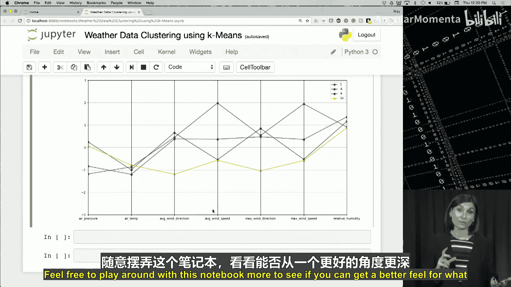

# 【加州大学圣地亚哥分校】Python数据科学-｜-Python-for-Data-Science-p24-09-03-03-视频-聚类--BV1jwFUzjEXu_p24-

Machine learning and Python clustering。

By the end of this video， you should be able to articulate the goal of cluster analysis。

 discuss whether cluster analysis is supervised or unsupervised。

 and list some ways the cluster results can be applied。😊，In cluster analysis， as you would remember。

 the goal is to organize similar items in your dataset into groups or clusters。

 by segmenting your data into clusters， you can analyze each cluster more carefully。😊。

Note that the cluster analysis is also referred to as clustering。

A very common application of cluster analysis that we have discussed before。😊，Is。😮。

To divide your customer base into segments based on their purchase histories。

Some other examples of cluster analysis are characterization of different better patterns for a region。

😊，Grouping the latest news articles into topics to identify the trending topics of the day。😊。

And discovering hotspots for different types of crime from police reports in order to provide sufficient police presence for problem areas。

😊，Cluster analysis divides all the samples in a data set into groups。😊，In this diagram。

 we see that the red， green。And purple data points are clustered together。

 which group a sample is placed in is based on some measure of similarity。

The goal of cluster analysis is to segment theta so that the differences between samples in the same cluster are minimized。

😊，As shown by the blue arrow for our yellow dots。😊。

And the differences between samples of different clusters are maximized as shown by the blue arrow between the red and yellow dots。

😊，Visually， you can think of this as getting samples in each cluster to be as close as possible and the samples from different clusters to be as far apart as possible。

😊，Cluster analysis requires some sort of metric to measure similarity between two samples。

Some common similarity measures are Euclidean distance。

 which is the distance along a straight line between two points A and B as shown in this plot。😊。

Manhattan distance， which is calculated on a strictly horizontal and vertical path as shown in the right plot。

😊，To go from point A to point B。You can only step along either the x axis or the y axis in the two dimensional case。

So the path to calculate the Manhattan distance consists of segments along the axis instead of along a diagonal path。

 as with the Euclidean distance。😊，Cosine similarity measures the cosine of the angle between points A and B as shown in the bottom plot。

Since distance measures such as Euclidean distance。

 are often used to measure similarity between samples and clustering algorithms。

 note that it may be necessary to normalize the input variables so that no one value dominates the similarity calculation。

😊，We discussed scaling and normalizing variables in an earlier video。😊。

Normalizing is one method to scale variables， essentially scaling the input variables puts the variables on the same scale so that all variables。

😊，Have equal weighting in the calculation to determine similarity between samples。😊。

Scaling is necessary when you have variables that have very different scales。

 such as weight and height。😊，The magnitude of the weight values which are in pounds。

 will be much larger than the magnitude of the height values which are in feet and inches。😊。

So scaling both variables to a common value range will make the contributions from both weight and height equal。

😊，Some things to note about cluster analysis are first。

 unlike classification and regression in general， cluster analysis is an unsupervised task；

 this means that there is no target label for any sample in the dataset。😊，In general。

 there is no correct clustering results。😊，The best set of clusters is highly dependent on the application。

😊，How the resulting in clusters will be used。There are numerical measures to compare two different clusters。

 but since there are no labels to determine whether a sample has been correctly clustered。

 there is no ground truth to determine if a set of clustering results are truly correct or incorrect。

😊，Cluters don't come with labels。 You may end up with five different clusters at the end of cluster analysis process。

 but you don't know what each cluster represents。Only by analyzing the samples in each cluster further。

 you can come up with reasonable labels for your clusters。Given all this。

 it is important to keep in mind that interpretation add analysis of the clusters are required to make sense of and make use of the results of cluster analysis。

😊，There are several ways that the results of cluster analysis can be used。

 the most obvious is data segmentation and how the benefits that come from that。😊。

If you segment your customer base into different types of readers， for example。

 analyzing each segment separately can provide valuable insight into each group's likes。

 dislikes and purchasing behavior， just like we see science fiction， nonfiction。

 children's book preferences here。These insights can be used to provide more effective marketing to different customer groups based on their preferences。

😊，Cluters can also be used to classify NE data samples。

Then a sample is received like the orange sample here。😊。

Compute the similarity measure between it and the centers of all clusters and assign an new sample to the closest cluster。

😊，The label of cluster。Mannually determinedatory analysis is then used to classify the if sample。

In our book buyer's preferenceences example， an Eve customer can be classified as being either a science fiction。

 nonfiction， or a children's book customer， based on which cluster the E customer is most similar to。

Once cluster labels have been determined， samples in each cluster can be used as label data for another classification task。

The samples would be the input to the classification model。😊。

And the cluster label would be the target class for each sample。

This process can be used to provide much needed label data for classification。😊。

Yet another use of cluster results is as a basis for anomaly detection。😊。

If a sample is very far away or very different from any of the cluster centers。😊。

Like the green sample here， then that sample is a cluster outlier and can be flagged as anomaly。😊。

However， these anomalies require further analysis。😊，Depending on the application。

 these anomalies can be considered noise and should be removed from the dataset。😊。

An example of this would be a sample with value of 150 for8。😊，For other cases。

These anomalous cases should be studied more carefully。

Examples of this are in a credit card fraud detection or network intrusion detection application。

In these applications， examples outside of the norm are the interesting cases that should be looked at。

😊，To determine if they represent potential problems。To summarize。

Cluster analysis is used to organize similar data items into groups or clusters。

 analyzing the resulting clusters often leads to useful insights about the characteristics of each group。

 as well as the underlying structure of the entire dataset set。😊。

Cluters require analysis and interpretation to make sense of the results since there are no labels associated with the samples or clusters in a clustering task。

😊，In the next video。We will discuss a specific algorithm for cluster analysis。In this video。

 we'll talk about Kaymin's clustering。😊，By the end of this video。

 you should be able to describe the steps and Kmins algorithm。😊。

Explain what the K stands for in K means and define what the cluster central it is。

Recall that cluster analysis divides samples in a dataset into groups or clusters。😊。

The idea is to group similar items in the same cluster where similar is defined by some metric that measures similarity between data samples。

😊，So the goal of cluster analysis is to divide data samples such that samples within a cluster are as close together as possible。

 and samples from different clusters are as far apart as possible。😊。

Kmins is a classical algorithm used for cluster analysis， the algorithm is very simple。😊。

The first step。Is to select K initial cent through it。

Essentialcentro it is simply the center of a cluster， as you see in the diagram here。😊，Next。

 assign each sample in the dataset to the closest cent it。

This means you calculate the distance between the sample and each cluster center。😮。

And assign the sample to the cluster with the closest centroid。

Then you calculate the mean or average of each cluster to determine and Ne send through it。

Those two steps are then repeated until some stopping criteria is reached。😊。

Here's an illustration of how K means works。A in a diagram。

Shows the original data set with some samples。In B， initial sries are randomly selected。😊。

C shows the first iteration here， samples are assigned to the closest cent it。😊，Indeed。

 the centroids are recalculated。E shows the second iteration samplesles are assigned to the closest central it。

 not that some samples changed cluster assignments during this step。In。

The sriyids are recalculated again。😊，Cluster assignments and cented recalculation are repeated until some stopping criterion is reached。

 and you get your final clusters as shown in F。😊，How are the initial sensorss selected？

The issue is that the final cluster results are sensitive to initial centroids。

 this means that if cluster results with one set of initial centroids can be different from results with another set of initial centroids。

 there are many approaches to selecting the initial centroids for ks。

 varying in levels of sophistication。😊，The easiest。

And most widely used approach is to apply kamine means several times with different initial centroids。

Randomly chosen。To cluster your dataset set and then select the centroids that give you the best clustering results。

To evaluate the cluster results， an error measure known as the within cluster sum of squared error can be used。

The error associated with a sample within a cluster is the distance between the sample and the cluster centroid。

😊，The squared error for the sample then is the square of that distance。

We sum up all the squared errors for all samples for a cluster to get the squared error for that cluster。

😊，We then do the same thing for all clusters to get the final calculation for the width cluster sum of squared error。

 for all clusters in the results of a cluster analysis run。😊，Given two clustering results。

 the one with the smaller WSSE provides the better solution numerically。However。

 as we've discussed before。😊，There is no ground truth to mathematically determine which set of clusters is more correct than the other。

In addition。Note that increasing the number of clusters that is the value for K always reduces the WSE。

😊，So WSSC should be used with quotient。It only makes sense to use WDSS to compare two sets of clusters with the same value for k。

And generated from the same data set。 Also， the set of clusters with the smallest WSSC may not always be the best solution for the application at hand。

😊，Again。Interpretation and domain knowledge about what the clusters should represent and how they will be used are crucial in determining which clustering results are best。

😊，Note that there are several other metrics that are used to evaluate cluster results。

Choosing the optimal value for k is always a big question in using K means。

There are several methods to determine the value for k。😊，And we will discuss a few here。

Visualization techniques can be used to examine the data set。

To see if there are natural groupings of the samples。

Scatter plots and the use of dimensionality reduction are useful here to visualize the data。😊。

A good value for k is application dependent。😊，So domain knowledge of the application can drive the selection for the value of k。

 for example。😊，If you want to cluster the types of products customers are purchasing。

 a natural choice for K might be the number of broad product categories that you offer。

Or K might be selected to represent the geographical locations of respondents to a survey。

 in which case a good value for K would be the number of regions you're interested in analyzing。😊。

There are also data driven methods for determining the value of k。

 these methods calculate some metric for different values of k to determine the best selection for k。

One such method is the elbow method。😊，The elbow method for determining the value of k is shown on this plot。

As we saw in the previous slide， WSSC or within cluster sum of squared error measures。😊。

How much data samples deviate from their respective centroids and a set of clustering results？

If we plot WSSC for different values for K。We can see how this error measure changes as the value of k changes as seen in the plot。

😊，The bend in this air curve indicates a drop。In gain by adding more clusters。

So this elbow in the curve provides a suggestion for a good value of k。

Note that the elbow cannot always be unambiguously determined， especially for complex data。

And in many cases。The error curve will not have a clear suggestion for one value。

 but multiple values。This can be used as a guideline for the range of values to try 4K。

We've discussed choosing the initial central it and looked at ways to select a value for k。

 the number of clusters。Let's now look at when to stop。So。

How do you know when to stop iterating when using kings？

One obvious stopping criterion is when there are no changes to the centroids。

 this means that no samples will change cluster assignments and recalculating the centroids will not result in any changes。

😊，So additional iterations will not bring any more changes to the cluster results。😊。

It's time to stop。The staffing criterion can be relaxed to the second staffing criterion listed here。

Which is when the number of samples change in clusters is below a certain threshold， say 1%。

 for example。At this point。The clusters are changing only by a few samples。

 resulting in only minimal changes to the final clustering results。

 so the algorithm can be stopped here as well。😊，At the end of K meanss。

 we have selected a set of clusters each with a cent it。😊。

Each cent it is the mean of the samples assigned to that cluster。😊。

You can think of the centroid as a representative sample for that cluster。

 so to interpret the cluster analysis results， we can examine the cluster centroids。😊。

Comparing the values of the variables between the centroids will reveal how different or alike clusters are and provide insights into what each cluster represents。

😊，For example， if the value for age is different for different customer clusters。

 this indicates that the clusters are encoding different customer segments by age。😊。

Among other variables。In summary。K meanss is a classic algorithm for performing cluster analysis。

It is an algorithm that is simple to understand and implement and is also efficient。😊，The value of k。

 the number of clusters must be specified。And final clusters are sensitive to initial centroids。😊。

After the short overview of clustering in this notebook。

 we will learn how to perform clustering using PsychicLn and Python。😊。

We will use cluster analysis to generate the big picture model of the weather at the local station。😊。

Using a minute granularity data。In this data set。We have in the order of millions of records。

It's a large data set， largeish data set for some of us。

 our goal will be to create 12 clusters from them。😊，So。

Let's first import all the necessary libraries， note that again it's common to import libraries as you keep working down in the notebook。

 you don't have to import all the libraries at the beginning。

 like we did for the classification notebook。But it's cleaner and easier for the end user of your code to understand what the dependencies of this notebook are。

 so I'm just going to go ahead and do it on top here。🤢，We now import the Minwe。

csv into pandas hope you were by the way， able to locate your weather data clustering using K meanss in your package and also the minute weather。

 CSsv in the We folder for week seven。So， we are。Importing it and calling our data frame。嗯Data。Okay。

Each role in this data data frame will contain measurements at the minute interval。嗯。

The minuteute better data description in this markdown here describes the dataset。The timets。

 what air pressure means， what kind of units are there for our data and things like that。

Let's quickly actually see the shape of the data after you read through the markdown。

 hopefully you're back in the video。We see that there are over a million records in the data set， 1。

58 million records。And then 13 rows， which are described right about from row ID to average wind speed to relative humidity。

We should also check our understanding of the data description by exploring with the data frame。

I use the head function here shortly。To get the first five rows of the data。

 to look at the data values and maybe have a feeling of the null values。

But I as usual encourage you to stop the video here and execute some more Explorer3 data queries and slices over this data。

😊，So， you'll have a。Better understanding of the data before we move on。

 this is a very important step for any analysis and I would not like to underestimate that step。🤢。

So hopefully you're back and you explored with the data， you have a good understanding of it now。😊。

And you already know that the data set is large。😊，For analysis sake。

 now we can further sample this data。Down to maybe every 10 minute difference instead of one minutes。

 we'll do 10 minutes。Here we assign the data sample。😊，So a data frame called sampled Df。

 sampled underscore Df， so what we are doing is。We are getting the row ID。And dividing it by 10。

 so we are getting every tent。Data frame。Every tenth0th row compared to our original dataset set。

 so sample Df will have one1。🤢，O。The number of rows in the original data set after we do this。

As you see here， we have about 158，000 rows now instead of 1。58 million。

So let's describe this data set。😊，I'm transposing here when we say sample Df that describe that transpose。

 recall if I didn't say transpose actually。嗯。The original columns would be displayed as columns。

The transfers operation。But we did， let's go back and do that。

Turns the columns into rows and vice versa， the rows into columns。

After the describe operation complete。😊，Let's check out some things， right。

 Let's check out the mean values of each measurement。Let's not worry about the role ID。

 it's an identifier， but let's say the mean for air pressure is 916， air temperature 61 in Fahrenhes。

 average wind direction is 162 degrees and things like that。嗯。

We noticed that some readings are in hundreds， while others are in decimals， it's a large difference。

 especially if you make it a measure of clustering when you're creating clustering metrics。😊。

Let's see how many rows have the value zero for columns？For rain accumulation and rain duration。

 for example。Rain accumulation is how much it rain and accumulated。

And rain duration is how long it rained for。🤢，Here we select all the rows that have value zero for these two columns。

 sample Df rain accumulation and sample DF rain duration。😊，And we check if they're equal to zero。

We select。Those rows that we just。Select it。From the sample D。

And then we look at the shape of the resulting data frame， we have about 157，000 rows out of 158。😊。

So it looks like a significant number of rows are zero compared to the size of the data。

So I'd say let's drop these columns and also clean any missing values for data cleaning。🤢。

So we'll drop the lead sampled thef， rain accumulation and rain duration because they were mostly zero。

And we also hear。Drop。The null values rows before will show how many rows our data frame had before dropping the null values rows after will show。

🤢，How many。Rose。I left after dropping the rows with nu values。 So how many rows did we drop。

It's about 46。In the end， let's see。What columns are left in our sample DF data frame。

 right let's remember our columns now。So we have the raw ID， timest， air pressure， air temperature。

 and down to the relative humidity there。Out of these features。

 we will now select a list of features to declare the columns that we want our algorithm to make use of。

😊，Let's store those features in a list that I'll call features here。Air pressure， air temperature。

Wind direction， wind speed， maximum wind speed， average wind speed to two of them。

And the relative humidity。嗯。Great。Out of these features。

 we will now select a list of features to declare the columns that we want our algorithm to make use of。

😊，Let's store these features in a list which I'll call features simply。😊。

As we did in our classification notebook before， you might have recognized the approach。

 the features we select here are air pressure， air temperature， average wind direction。

 average wind speed， max wind speed and relative humidity。

 so out of about 11 columns we are selecting about six。🤢，So let's look at this what we have。

 we'll use these features。😊，To create a data frame called select data frame。 So remember。

 we had our data。 We put it in the sample data frame， which was the tent of our data。 Now we are。

Reducing the data， the number of columns in the data not rows。

 we get these six columns that we listed in the feature and put it in select the F。

 Then we looked at the columns of this select the F。 we'll see those。Seven columns。

 not six apologies， and if you look at the data frame itself。

We'll see nicely the data nicely copied over into this new data frame。Okay。Now。

 remember our scalability or scale discussion to keep values of different columns comparable。🤢。

We skill。The values in these features， so we will use standard Scalar for that。嗯。It's an object。

And if we give a data frame to it。To a function of it in this case， willll get a nicely scaled。😊。

Input data。For our clustering operation。So we have the standard scalar。

And we use the fit transform function of it。And we give the select D that we just created as an input to that。

Okay。😊，The fit transform function here combines fit and transform operations。🤢，Which means？

It first calculates how much the data sets should be transformed to be scaled。

So it looks at different values and finds how to scale that。

Then it's going to apply that transformation to the data frame we give it in this case， select the S。

And it's going to apply the transformation it came up with to that data frame。嗯。

We will assign the output of this function to x。Just like me it's here。

And that X that we are creating in a nicely scale fashion will be an input for our K means modeling later。

😊，Okay， let's scale， select the F and assign it to x。And if we display x。

 we see the nicely scaled values there。They are not the values here anymore。

 right they are at a certain scale between。A minimum and a maximum number。

 so feel free to explore X further。And compare maybe to the other operations。

 other values in the select the F。And when you come back after death。

 they'll start Kaine's cholesterol。Okay， now we will start with。

Invoking the K means clustering algorithm。Remember our original purpose to create 12 clusters。

And we'll use the scale data frame X with the selected features。😊，As an input。As you see here。

We created a Ka means object called Kas。And we said number of clusters for it is 12。嗯。

And the model was generated by using the fit operation of that Ka means object。

And the input for it was our input data X， which was the scaled version of the selected data values。

🤢，If you look at the。Type of this model object。It is a K means object though。

Note that we use seven features to perform clustering， those are stored in our features。List。

Once clustering is done。😊，We can now look at each of the cluster centers。

It will be a list of seven floating point numbers which denote where the cluster center stands in the seven dimensions of our feature space。

Okay。So we'll assign that to a variable object called centers。🤢，So we are getting the model。

And assigning the cluster centers of that model into centers， which will be an array。

For each 12 clusters， it will have those seven values that represent the cluster center。

We used the attribute cluster centers for that right it was the attribute of the model when we created the model up here。

🤢，It actually was stored as a part of that model。It's great。

 we have now the cluster centers for each 12 clusters， but how do we interact with it。

 how do we visualize it， it would be great to plot these cluster centers。😊。

So we can actually examine。Which clusters are close to each other and what separates different clusters from each other？

For these here we will create two functions that help us transform the data to make it easier for plotting。

😊，Function1 here is called PD centers。It takes in the cluster centers generated by the model。

 the ones that we just displayed。In centers and creates a panda data frame。Returns speed。

Where the header is the name of each feature。It also。Adds a new column。

That denotes the number of the cluster itself。This new column here is called prediction。Okay。

So we have the cluster centers。And the number of the cluster nicely in a data frame。

And we return that as a part of this function。The second utility function we have here is for plotting。

😊，And it's called parallel prop plot。It takes in the data for plotting。嗯。Which is。

The data frame that we just generated actually out of the PD centers。😊。

And generates a colorful graph with different colors to each cluster。

 so if you stop the video and explore this a little bit。

 you will recognize some of the plotting features you learned in our earlier weeks。

This function note that it also sets。嗯嗯。The size of the plot and controls the range of the Viaxes。

 if you look at that。🤢，We have the figure size and Viaxes limits。Okay。

 a parallel coordinates plot is a quick way to visualize cluster centers along all the seven dimensions of our feature space。

 that's why we created these functions。🤢，So let's run them。And first。

 we'll give the features and the centers to PD centers。And they'll get that nice data frame that be。

Genrated， so remember。Senters。Had a value for each feature。4。Each cluster。

So each of these values is the cluster center make up the cluster center for that particular cluster。

 we give it this， but this one doesn't have the information on those features， the names of。

Or the labels， column labels of each value here is in the features。List。

That's why we give both the features used and the centers to PD centers。

And the PD centers we've done will create a data frame for each and label each data frame also with the cluster number。

 so it's going to add to the features。🤢，你。嗯。If we display this， it's going to add to these features。

 a cluster number as well。Three round this。So we see all 12 clusters， zero to 11 here in the rows。

The features we selected and also the prediction， the number of the clusters it was done for。

 which is equal to our row in this case。🤢，Okay。So now we are creating a parallel plot using this P。😊。

嗯。For let's say， the cluster of a relative humidity is less than minus 05。🤢，Right。Notice that the。

Xaxes。The notes each of the seven features we use for clustering， the values for that。

And the y axis den the values。Of each cluster center。

 so we have the labels in the x axises for the features and the values in the y axis。嗯。We can now。

 after we plotted them， we can compare these clusters， which clusters are similar， which are not。🤢。

Remember， we are doing clustering for the features we selected in the features list。😊。

Including relative humidity。Like we selected here。And air temperature。For each of the three plots。😔。

Be sure。Dry days， relative humidity is less than 05。Warm days。The air temperature is above。0。

5 remember this data is scaled。And cool days。Which show。The relative humidity about 0。5。

So these are the clusters。That have。The behavior， so to say of dry days。Warm days and cool days。

And the cool day is a combination of relative humidity above 0。5 and air temperature below 0。5。😊。

For example， let's look at red and blue clusters in each graph。😊。

If you follow the cluster line for red。And blue clusters in each graph。

You can notice that they are close to each other for a few features and far apart on others。

If they differ on a particular feature。😊，This is one of the features which is likely helpful to distinguish this cluster from others。

🤢，For example， red and blue。Are pretty far here， far here。Far here。Closer here。

So they are pretty different two clusters， right？😊。

They are different clusters about how different and which features are different for is what will help us to identify that。

😊，For the dry days's graph。The differences are in， as we looked at air pressure。Air temperature。

Features related to wind speed， so they are pretty different。😊，Let's look at the warm days。

 if they are。Closers than for dry days。嗯。If you follow the two lines and look at the labels。

Looks like。They actually differ for all features related to wind。And in the cool days graph。

 they vary。😊，For most features， if you look at that related to wind speed。😊。

These are pretty similar up to the point。😊，The moment we look at average wind and maximum wind speed。

We see that they are different。So remember that these parallel feature floods are really useful for analyzing clusters。

 which。We have high dimensionality of features to gain an intuition about how these clusters differ。

Feel free to play around with this notebook more to see if you can get a better feel for what each cluster is from a better standpoint。

😊。

To me， for example， cluster 4 seems to correspond to hot and dry days with fairly stagnant air。

So just look at them and try to imagine the error on that day and how you could further now use this information。

🤢。