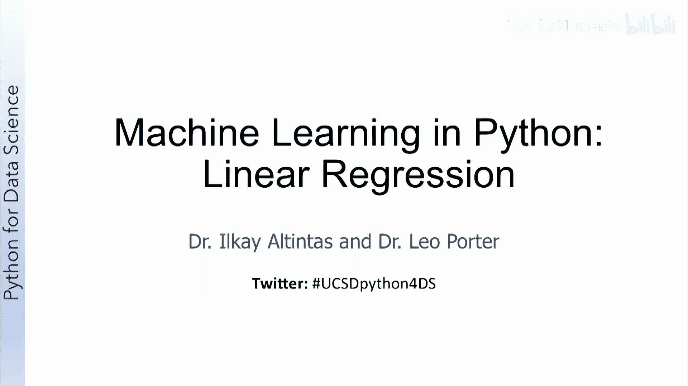
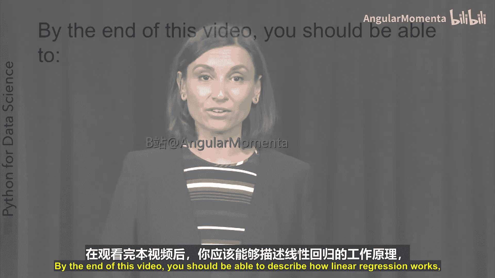
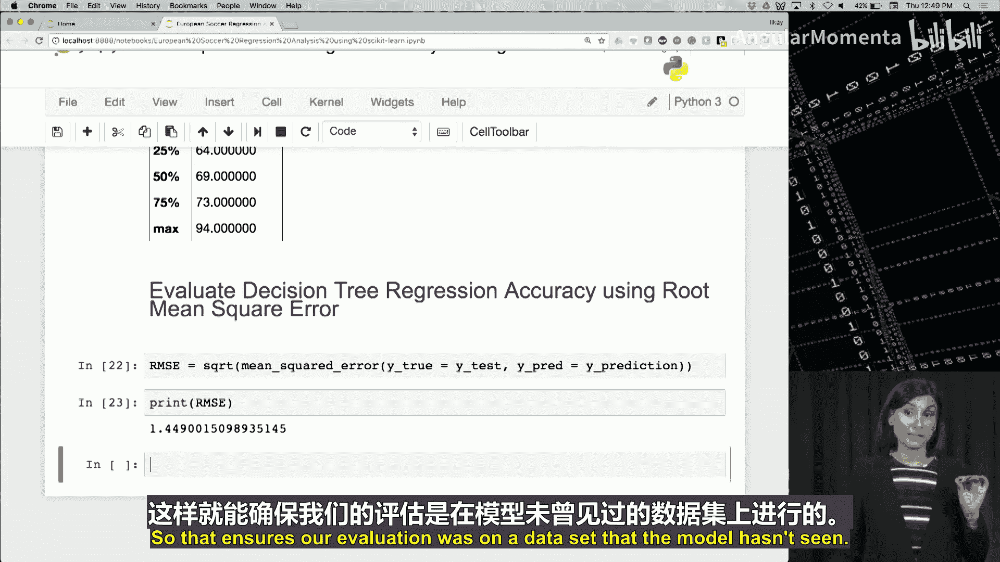

# 【加州大学圣地亚哥分校】Python数据科学-｜-Python-for-Data-Science-p25-09-04-03-视频-回归分析--BV1jwFUzjEXu_p25-

In this lesson， we'll talk about regression analysis and review regression analysis toolkit in Psychic Learn。

😊，By the end of this video。You should be able to define what regression is。

 explain the difference between regression and classification。

 and name some applications of regression。😊，Before we talk about regression。

 let's review classification again in a classification problem。

 the input data is presented to the machine learning model and the task is to predict the target corresponding to the input data。

😊，The target is a categorical variable， so the classification task is to predict the category or the label of the target given the input data。

 the classification examples shown here is one we have seen before， the input variables。

 and measurements such as temperature， relative humidity， atmospheric pressure， wind speed。

 and wind direction， the task for the model is to predict the weather category associated with the input data。

😊，The possible values for the better category is sunny。Windy， rainy or cloudy。

Since we are predicting the category。This is a classification task。With that context in mind。

 let's now discuss regression。When the model has to predict a numeric value instead of a category。

 then the task becomes a regression problem。An example of regression is to predict the price of a stock。

 the stock price is nuic and another category， so this is a regression task instead of a classification task。

😊，Note that if you were to predict not the actual price of the stock。

 but whether the stock price will go up or go down。Then that would be a classification task。😊。

That is the main difference between classification and regression in classification you're predicting a category and in regression。

 you're predicting an nuic value。😊，Here are some examples where regression can be used。😊。

We can use it for forecasting the high temperature for the next day or estimating the average housing price for a particular region。

😊，Determining the demand for a new products， a new book， for example。

 based on similar existing products is also a regression task。

 as well as predicting the power usage for a particular smart grid。😊。

This is what the data set might look like for the regression task of predicting tomorrow's high temperature。

The input variables could be。😊，The high temperature for today。

The low temperature for today and the month and the target is the high temperature for tomorrow。😊。

The model has to predict this target value for each sample。

Recall that in a supervised task the target is provided while for an unsupervised task。

 the target is not available or not known， since the target label is provided for each sample as a numeric value here。

 the regression task is a supervised one similar to classification。As with classification。

 building a regression model also involves two phases。

 a training phase in which the model is built and a testing phase in which the model is applied to leave data that the model hasn't seen before。

The model is built using training data and evaluated on test data。😊，Similarly， with classification。

 the goal in building a regression model is also to have the model perform well on training data as well as generalized to need data。

😊，The use of two different dataset sets that we have previously discussed also applied to regression recall that the two dataset sets are used as followss。

 the training dataset is used to train the model that is to adjust the parameters of the model to learn the input to output mapping。

😊，The test dataset is used to evaluate the performance of the model on Ne data or the leftover data。

😊，Something that we haven't discussed yet， but you will hear a lot in your machine learning class later on is validation data。

😊，The validation data set is used to determine when stopping。😊。

Training in order to avoid model overfitting。In summary。In regression。

 the model has to predict a numeric value corresponding to the input data。

Since the target is provided for each sample， regression is a supervised task。

The target is always a numerical variable in regression。😊，Next。

 we will discuss a specific algorithm to build a regression model。

Now we'll discuss linear regression， a simple but powerful and popular regression algorithm。😊。

By the end of this video。😊。

You should be able to describe how linear regression works。😮。

Discuss how least square is used in a linear regression and define simple and multiple linear regression。

😊，A linear regression model captures the relationships between a numerical output and the input variables。

😊，And the relationship is modeled as a linear relationship， hence the linear in linear regression。😊。

To see how linear regression works， let's take a look at an example from the IIS Flower dataset。

 which is a commonly used data set for machine learning。😊。

This data set has samples of different species of ir flowers along with measurements。😊。

Such as pedal width and pedal length。Here we have a plot with pedal width measurements in centimeters on the x axises。

😊，And petal length measurements on the Y axis。Let's say that we want to predict pal length based on pedal width。

😊，Then the regression task is this， given a measurement for pedal width， predict the pedal length。

We can build a linear regression model to capture this linear relationship between the input pedal width and the output pedal length。

😊，The linear relationship for these samples is shown as the red line on the plot。😊，From this example。

 we see that linear regression works by finding the best fitting straight line through the samples。😊。

This is called the regression line。In the simple case with just one input variable。

 the regression line is simply a line。😊，The equation for the line is y equals m times x plus B。

 where M determines the slope of the line。😊，And B is the intercept or where the line crosses the y axis。

 and M and B are the parameters of the model。Training a linear regression model means adjusting these parameters to fit the regression line to the samples。

The regression line can be determined using what's referred to as the least square method。😊。

This plot illustrates how the least squares method works， the yellow dots are data samples。😊。

The red line is the regression line。😊，That is a straight line that goes through the samples。

This line represents the model's prediction of the output， given the input。

Each green line indicates the distance of each sample from the regression line。

 so the green line represents the error between the prediction。

 which is the value of the red regression line。😊，And actual value of the sample。😊。

The square of this distance is referred to as the residual associated with that sample。😊。

The least squares method finds the regression line that makes the sum of the residuals as small as possible；

 in other words， we want to find the line that minimizes the sum of the squared errors of prediction。

😊，The goal of linear regression then is to find a best fitting straight line through the samples using the least squares method。

Once the regression model is built， we can use it to make predictions， for example。

 given a measurement of 1。5 centim for pedal width， the model would predict the value of 4。

5 centmeter for pedal length based on the regression line that it has constructed。😊。

In linear regression。😊，If there is only one input variable。

 then the task is referred to as simple linear regression。😊。

In cases with more than one input variable， then it's referred to as multiple linear regression。

To summarize。The linear regression captures the linear relationships between a numerical output and the input variables。

😊，The least squares method can be used to build a linear regression model by finding the best fitting line through the samples。

Let's now switch to live coding to see linear regression in action。😊。

We now learned regression allows us to predict continuous variables。😊。

Now we will use regression technique。😊，To predict a player's overall performance based on their attributes。

For this， we will use the S data set from back in week one where we've seen that overall analysis。😊。

Over the last seven weeks， you've learned quite a bit。

 so we'll do a more hands on analysis of this data set。

 we are ready for that now with the tools we've learned。😊，Let's locate our notebook。

 it's called European S regressiongression Analysis using Psyit Learn。

 it's in your folder for the week along with the data set it needs。

After you open it let's get started by importing the libraries before we import our data。

 we'll import our libraries， just look through them quickly。

 we have some regression methods imported there， the panda SQL light which is to interact with the relational database which is the data for this。

 but we'll learn more about that next week in week8。😊。

And some other mathematical and error detection related modules。😊，Okay， let's import these libraries。

Now we'll import the data set into a data frame， okay， and then let's check out that data frame。

What we are doing here。😊，Is。We are connecting to the dataset。And we are using this connection。

To select the player attributes and load them into a data frame called DF。

You might have noticed by now that once you get used to the data ingestion。

 it is always similar functions to ingest the data into app pan data frame。😊。

So look at other example notebooks， example notebooks we gave you。

 and that should be enough for you to find a data and load that type of data into aend data frame。

In your exercises and things like that。So let's look at the first five rows of this data frame to familiarize ourselves with the data。

🤢，We see that there are some features related to players， overall rating， potential preferred foot。

 attacking work rate， defensive work rate， and things like that。嗯。

We can look at the shape of this function， the data frame， so I'll say Df。That's shape。

You see that there are about 42 features， a little less than that with the identifiers。嗯。

Let's declare a list of these features。We can say the Ft columns。We could see all of them right。

 so now we'll select some of them。We'll select the ones we want to use for predicting the overall rating。

After this video， of course， you can further play with this list and reduce it to see the effect on the accuracy of predictions。

😊，But for now。We'll use。A lot of these features to get started。

Except here we won't see the overall rating。Because that's our prediction target。😊，嗯。

Based on the input data from these features by selecting them。

 we will predict the numeric overall rating value of a player。🤢。

Let's do these declarations of the columns in the future and target will be named overall rating。😊。

Let's now start cleaning the data， we'll simply drop the null values as we know from equal1。

 this is an issue with this data set。🤢，We'll use the data frame and say the FW drop NA。😊，嗯。

Now we have a slice of the data that doesn't have nu values。

Let's now create the two data frames like you're used to it now we need an x the input and a y to go from with the analogy again of y equals fx with features and target values。

😊，X will be our input data frame and we'll select the features we wanted we described declared in our。

😊，Features list。We'll load the data frame without the nu values now into X。🤢，With those features。

Feel free to stop and look what's in X and what's in Y if you're getting confused but we are doing the same operation we've been doing in our earlier notebooks for machine learning for this week。

Let's look at a glimpse of the data， we print one row for x， let's say2。

We see the values in the x datata frame， the potential crossing and things like that。😊。

We can also displayplace y to see the range of values in it。🤢。

What kind of overall rating scores exists and we see that it ranges between 67 to about like 77。

 things like that， 81 we see there。Please refer to the sucker data analysis notebook in week one for further explorations through this data set and now you should be able to understand a lot of the。

Code sell in that notebook， so now it's a good time to go and have more fun with that analysis。Okay。

We are assuming you stopped the video， maybe did some more explorations and now I'll start with a regression analysis task。

We are doing the same operation using train test split。

 we are splitting the data into test and training sets so we can use one for training and the rest for testing of the regression algorithm。

Let's run the cell。Willll perform two different modeling。

Operations using different regression techniques first we will use a linear regressor we'll select the features and use a linear regressiongressor to predict a player's overall rating。

😊，Here we store a linear regression object right here。🤢，And I'll call it regressor。

This is a linear regression。Module we selected from Psychic Learn。And。

We will then use that regressor。Then give it our training inputs and。Label， data sets。

 numeric labels in this case， Xtrain and Y train。So using the fit method of the regressor。

 we fine tune the parameters of the linear regressor to capture the interactions between the two sets。

 the x train and y train， so we are trying to fit。嗯。X train and Y train， and create a model。

We can then use this predict method because we now have a model。A linear regression bow model。

We'll use the predict method of that trained model to perform the prediction on the test set。

 which is our X underscore test。As a reminder。Note that the model has never seen any sample from this test set。

🤢，So it's predicting on a new data set。🤢，Okay， let's go and execute that。And we see a predicted。

Set of values for y。As you know， we can compare them to the values。In the Y test。

And see how accurate they are。嗯。If we look at and describe some things about this data set。

 we see that the overall mean is around 67。6。🤢，And the minimum and maximum are 33 and 94。So。

We see that the predicted scores are actually within the range with。Whitet。

We can also try to describe by prediction and compare them。

 but we'll do something different we use actually， as we describe root means square error to measure the prediction accuracy of our regressor。

😊，That's the RMSSC root means square error in short。

So RMSC captures the variation of the predicted value， as you would remember from the observed value。

😊，So。An RMSC score of zero means perfect prediction with no errors， which is the ideal scenario。

 which almost never happens。嗯。When comparing two regression models。

Then the one with the smaller RMC will be better since its predictions will have smaller difference from the observed values or the measured values before。

🤢，So let's check that RMSC equals square root of mean error and y through is y test and why prediction is。

VhyP is by prediction here。Which are the arguments that we give to mean squared error function。

So when we compute RMSC and print it out， we see that the linear model gives us an RMSC of 2。8。

 this is a good start。Since the range of overall rating is from 33 to 94 with the mean of。

 as you would remember， approximately 68。🤢，Okay。Good stuff。

Let's see if we can improve upon the prediction accuracy now。😊。

By using a slightly more complex model， that would be， let's say， is decision three regressor。

A decision tree regressor。Builds a model in a top down manner by splitting data set on an attribute。

🤢，So the algorithm chooses to attribute。Which gives maximum reduction in standard deviation。

You'll hear more about these in your machine learning course。

 so I'm going to quickly describe it here and then move on to applying it， take this。

 hopefully an appetizer for the machine learning upcoming machine learning course。

 while you'll learn all about these。😊，So now let's use the Dec three regressor to capture player performance as a function of。

 again， their attributes。The fifth method performs the fine tuning again。

 so we are doing the exact same thing， we have a regressor， but since this is a tree， it has a depth。

 the maximum depth is 20。😊，And we are using that regressor。😊，To fit the training， and。

Input and output training dataset sets， so xtrain and Y train。We changed the method。

 but the fit line stays the same。The regressor will be just of another class and another method。So。

It's done， we have now a model and we'll use this model to predict on the test data again。

So let's do that and we see the values has changed a bit。😊。

We have the 66 here and 62 and things like that。😊，To get an idea of the RMSC。😊。

We note that a root mean square error of hundreds， for example。

 would be too high because ourine is 68 and our RMSC is higher than our mean value。🤢，嗯。

So let's run this。Again， we can describe the test。And do the RMC for this leave。

decision three regressor， So remember our linear regression operation gave us an RMSC of 2。8。🤢，诶。

Decision three regression algorithm gave us an even lower one， 1。44。

 which is better in terms of prediction accuracy than the linear model。🤢，Again。

 the RMC captures variant of the predicted value from the actual value by our system。

 so it is a measure of how well a model performs against operations。So， I'd say。An RMSC of 1。

44 for a test set that has a mean of 68 for the target variable is pretty good and the model never got a chance to look at the test set before the prediction。

So that ensures our evaluation was。On a data。That。

The model hasn't seen。嗯。And we saw that linear regression model perform a little less well than or a little worse than the decision tree based regressor。

🤢，Great， we finished our machine learning lecture content for this week， week seven。😊。

I hope you'll enjoy the test notebooks that we give you and have some more hands on experience with what we just discussed。

