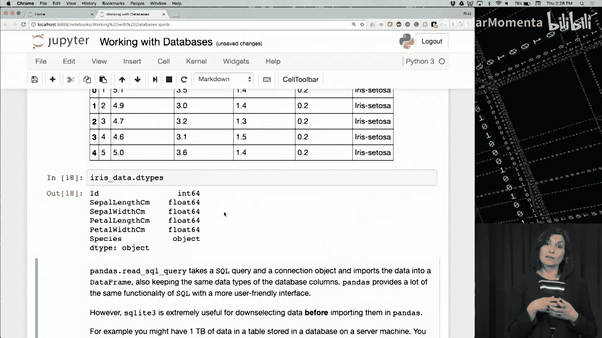

# 【加州大学圣地亚哥分校】Python数据科学-｜-Python-for-Data-Science-p26-10-01-05-视频-关系数据模型--BV1jwFUzjEXu_p26-

In this lesson， we will review a Jupyter notebook to interact with a relational database well known to the data science community。

😊，Before we do that， let's spend a few minutes reviewing what they mean when we say relational data model and how to interact with relational data。

😊，By the end of this video， you should be able to describe the structural components of a relational data model。

 demonstrate which components make up a data model schema。

 explain the purpose of primary and foreign keys。😊，And describe a join operation。

The primary data structure for a relational model is a table。😊。

Like the one shown here for a toy application。😊，You might have also noticed that table structure is very similar to a Python data frame。

😊，Data frames can be used to lowest relational tables， which are also called relations。😊。

This table actually represents a set of topples。😊，This is a relational tuple represented as a row in the table。

We were informally calling this a record before。But now we call it a tuple。Thus。

 this relation is a set of six tuples， there are six rows and six doubles。

Remember the definition of sets， it's a collection of distinct elements of the same type。😊。

That means I cannot add the red record at the end of this table as a tuple into this relation。😊。

Because if I do， it'll be introducing an duplicate。😊，In practice。

 many systems will allow duplicate tuples in relation。

 but mechanisms are provided to prevent duplicate entries if the user so chooses。😊。

Here is another tuple I can add。The red tuple and the bottom has all the right pieces of information。

 but it is all in the wrong order。😊，So this tu。😊，Is this similar with the other six tus in the relation？

Okay， how does the system know that this tuple is different？

This brings our attention to the first row that is the header of this table painted in black。😊。

This row is part of the schema of the table。😊，These are our columns in app panda data frame。

The schema in a relational table。😊，Can also specify keys。

The first column says that ID is a primary key。 This means it's a unique。😊，For each employee。

And for every employee knowing the primary key for an employee。

 we also uniquely know the other five attributes for that employee like first name， last name。

 department， title and salary。😊，You should now see that a table with a primary key logically implies that the table cannot have a duplicate record because if you do。

 it will violate the uniqueness constrained associated with the primary key。😊。

I will call our first table employees with the ID as the primary key。

Let us now introduce a E table containing the salary history of employees。😊。

The employees are identified by the column employee ID A ID。

But these are not the values that this table happens to have。

They are the same IDs that are present in the ID column of the employees table presented earlier。

This is reflected in the statement made on the right。The term references。

Means the values in this column can exist only if the same values appear in employees。

The table being referenced。Disable。Is also called the parentent table。

In the terminology of the relational model。😊，The AMmp ID column of the M Salaries table is called a foreign key that refers to the primary key of the employee table。

Note that MID is not a primary key in the M Salaries table because it has multiple topples with the same MIDs reflecting the salary of the employee at different times。

😊，You may remember join as an operation we discussed as a part of panndas here's an example of a relational join performed on the first three columns of employee and the M Salaries table。

 where employees。id and M salaries that MI columns are matched for equality。😊。

The output table shows all columns involved。😊，The common column is represented only once this form of join is called a natural join。

 it is important to understand that join is one of the most expensive that is time and space consuming operations。

As data becomes larger and the tables contains。😊，Hundreds of millions of toples。

 the joint operation can easily become a bottleneck in a larger analytical application。😊。

So for data science that involves big data。When we need joints。

 it's very important to choose a suitable data management platform that makes this operation efficient。

😊，As a summary， the relational model provides a way to describe unique relationships between entities and data records。

 including the relationships between record identifiers。😊。

Paandnda's data frames implement some features from the relational data model。

 making it easier to work with relational databases。😊。

Now that we simply went over the relational model without going into the details。

 we will talk about how we can retrieve data from a relational database。😊，By the end of this video。

 you should be able to describe what data retrieval means， explain the purpose of SQL。

 and create simple select queries。😊，Data retrieval refers to the way in which data desired by a user is specified and retrieved from a data source。

😊，Note that in this course， we are using the term data retrieval in two ways。😊。

Assume that your data is stored in a data store that follows a specific data model， like for example。

 the relational data model。By data retrieval， we will refer to the way you specify how to get the desired data out of the relational data store and the internal processing that occurs within the data management system to compute or evaluate that specified retrieval request。

😊，Now let's see the query specification happening using a specific language called Strd query language or SQL。

😊，SQL is the ubiquitous query language when the data is structured but it has been extended in many ways to accommodate other types of data。

😊，For this lesson， we will stick to the structured aspect of the language。

You should know that SQL is used in classical database management systems like Oracle。

 as well as modern distributed big data systems such as Spark in the form of Spark EQL。😊。

Let's work now with an illustrative example。😊，Our schema for this business has three relations or tables。

 The first table lists these bars。😊，Their name， address， and the license number of the bar。

Notice that the attribute called name is an underlined because it is the primary key of the bars relationship。

😊，Recall that primary key refers to a set of attributes in this case， just name。

 that make a record unique。😊，Note that the relation bars with the attribute names within parenthesesis is the same as the table shown on the right。

😊，They will use both representations as we go forward。😊，The second table called Beers。

 lists to names and manufacturers of beer。Not every bar sells the same brands of beer。

 even when they do， they may have different prices for the same product because difference in establishment costs。

😊，So the cells table records which bar sells which beer at what price？

The most basic structure of a SQL query is a select from where clause。😊。

In this example where we are looking for beer names that are made by Heineken。

So we need to specify our attribute， which is our output。😊，In this case， the name of the pi。

The logical table， which should be used to answer the query。In this case， beers。

And the condition that all the desired data items should satisfy。

 namely the value of the attribute called month。😊，Is equal to Heineken。

There are a few things to notice here。So our query is select name from beers where man equals Heinecom。

First， the literal heineken is put withted coats because it's a string literal。😊。

Remember that in this case， the string is supposed to match exactly including the case。😊，Secondly。

 if you go back to the data operations we discussed in pandas。

 you will recognize that this form of query can also be represented as a selection operation on the relation Bs with the condition on the mans attribute followed by a projection operation that output the name attribute from the result of the selection operation。

😊，So。The selection operation finds all tuples in beers for which the manufacturer is Heineken。

 and from those tuples it projects only the name column。

The result of this query is a table with one single attribute called name。😊。

This would be a column in pandas or a serious object。

We illustrate some more features of SQL using two more example queries。😊。

The first looks for expensive beer and its price。 Select distinct beer and price from cells where price is larger than 15。

😊，Let's say we consider peerers to be expensive if it costs more than $15 a bottle from the schema。😊。

We know that price information is available from the table called cells。

 so the front clothes should use cells in this case。😊。

The wear clause is intuitive and specifies the price to be greater than 15。😊，Now。

 notice that the cells relationship also has a column Col bar。Now。

 if two different bars sells the same beer at the same price， we will get both entries in the result。

 that's not what we want， regardless of the multiplicity of bars。

That have the same price for the same beer， we want the result just once this is achieved through the select distinct statement in the first row。

 which ensures that the result relationship has no duplicates。😊。

The second example shows the case where more than one condition must be satisfied by the result。😊。

In this query。😊，The business must be in San Diego， and at the same time it must be a temporary license holder。

 which means the license number should start with 32。As we see here。

 these conditions are put together by the end operator。😊，Thus。

 this query will pick the third record in a table because the first two records satisfy the first condition and not the second condition。

😊，One can also place a limit on the number of results to return。

If our database is large and we need only five results， for example， a sample to display。

 we can say limit5。😊，The exact syntax of this limit closed may vary between database management system vendors or even in Python。

😊，As a summary， SQL is the standard querying language for structure relational data and it resembles pandas data frames。

 although it can provide more operations。😊，SQL allows for joining and other operations in addition to the simple data selection queries we focused on in this video。

 but we will not go into the details for those operations。😊。

And we'll show you a notebook next how to use some of these selection queries in the context of Python Jupyter notebooks。

😊，In this notebook， we will use a popular database called Iris。

It features 50 Irish flowers and their classification into three species。

We will use the IIS database from Kagel in SQL Light format for the rest of the notebook。

If you could locate the notebook in your week8 folder， it's called Work with Datas。

The notebook on top has a Cale link， kgggel。comucMl/iris。嗯。

You need to download the data from this link， the data is called database。cite。😮。

And it should be placed in the data slash IIS folder you have for Wgate。

 so now please stop the video， go to this link and download the dataset。

Assum you stopped the video and downloaded the dataset set before we move on。

 please run the next two code cells to check that you were successfully able to complete this step。

 So what's in those next two cells。😊，The first one says。Import OS。

 and it actually brings the data IIS to an object called Data IIS folder content。🤢。

And the error message is a string that we would display if that wasn't there or the database that sQLitete wasn't in that folder。

 so we are checking we put an assertion called database SQolite in Data Iis folder error message please note that this error message Op。

Shows an assertion or a good way of capturing errors in a program using an assert statement。

As search statements generally help you locate or identify bugs in your Python programs as a way of creating such built in tests。

 if you do a lot of testing you'll actually do a lot of search statements。Okay。

Seeming this worked great。😊，Let's move on to。Interacting with our database。

 the database that SQL light that you downloaded。We will import sQel light first。Solite 3。

Is a Python module that allows us to do easy SQL operations。

And we'll use that to connect the database that site in that Iis folder that we placed now we have a connection object。

And we'll use this connection object to get a cursor object。

That cursor object is actually our interface to the database。😊，Before we move on。

 I'd like to also mention that SQLite comes with your standard Python。

 so it's not a library that you need to go and install separately。

 so it's a pretty easy and nice way of interacting with using simple database queries。😊，嗯。

Let's look at the type of that cursor object right， it's the type of type cursor。 So as I mentioned。

 this is our interface to the database and。Mostly through the execute method of the cursor object。

 we'll be able to run any SQL query on our database。

 in our database like SQL light that we have connected to using that connection object。For example。😊。

We can get a list of all tables saved into the database。

 this is done by reading the column name from the SQL master metadata table。

 so SQLite underscore master， we are reading from that， that's the metadata table for our database。

And the output of this execution will be。Turned into an iterator。

 so if I just ran cursor that executes select block。I would get an iterator。

 so now I'm using that iterator in a four loop。😊，To print each row。嗯。

So in the case of the IIS database， we only have one table so if we get that one back， as you see。

 it's called IIS here。A shortcut to directly execute the query and gather the results is also called a fetchch all method so we can retrieve data from a particular table。

Using a select query or in this case， SQL master and fetch it all without that for loop。

 we should get a list out of this。😊，嗯。I can do a similar thing with another。Database。

 that data table like from IIS table instead of the SLite master。

It's going to definitely return a list。If we print the sample of this type。

 we see that it's of class list。We could work with this list but it's very low level and not the most efficient way we also remember that limit that we mentioned in the video just prior to this hands zone session this last query statement so like start from I limit three brings us the top three rows you can change it to five or 20 or however rows you'd like and execute that and if we display that now we see all those 20 rows in our list that was created as a result of fetch and it's a list data structure we know how to work with that data structure right so we get。

The columns for this list。Okay， so。Although it's possible to create many operations like that using SQL light。

 pans actually as you know， provides a more intuitive and efficient way to interact with the data。

 so like we did for our European So database before we will now use pandas Read SQL query function。😊。

To load the data in the IIS table to append data frame。You've seen this before。

 but let's review over now with the knowledge of CQL light again， what's going on here， right？

We have imported pandass PD。And here to a data frame object called IIS data。😊，We read。

We use the read SQL query method from pandas and we give that。A SQL query is select query。

 select star from Iris， now you know what that means。And the connection object。

 So through this connection token and the query， Ps knows。

Or the Read SQL query function node how to get the results of that query and create a data frame for us。

Let's run these， let's first import pandas。Iris data， we are loading the data now。

 let's get the first five using our head operation。And we can also do the the types of each column。

We see that this is simple， you know， now have to work with pandas。

We can also create more complex queries that constrain the data we load into the data frame because if the data is big。

 large， the table is maybe a lot of rows columns。And we maybe want to pick a part of it。

 we can actually create constraints using those sQL queries now that you know what you know about these select queries here。

 for example， it's the exact same， but they are selecting Iris Satosa rather than all three species。

We have a query that says select star from Iris， where species is I Setosa。😊，So once we execute this。

 we'll see that we only have one species in our resulting data frame。If we actually go and say。

 I risk Sentosa。That shape。And our earlier one was Irish data。And。Let's do a print。And print。

Iis datata。That shape。We'll see that。 we have one third。In our Irish Sitosa table。

 So we have 50 of each species in the Irish database，150 robes。 And with this new query。

 we were able to。Slice out， to say in a relational query sense。

 the first or the 50 that belongs to the Irishris Stosa species。

Although we can expand on these SQL queries， let's stop here for simplicity。

 I as usual encourage you to build an exercise for yourself using this database， for example。

 using the IIS database for building models using the machine learning libraries we discussed last week。

😊，In fact， the IIS database is commonly used to demonstrate different machine learning algorithms。

So this is a good time to introduce this data set and hoping you will use it to create exercises for yourself。

