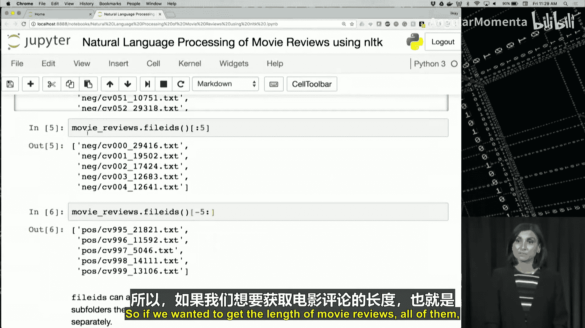
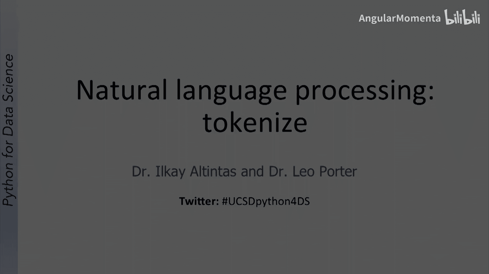
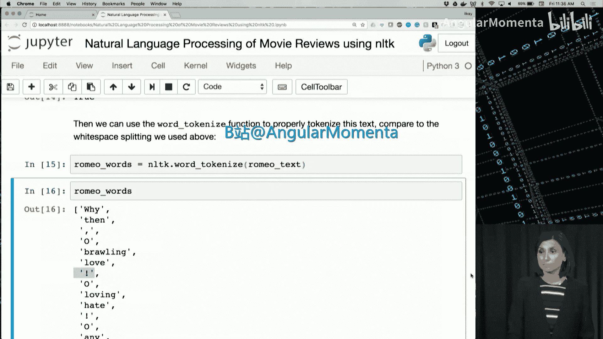
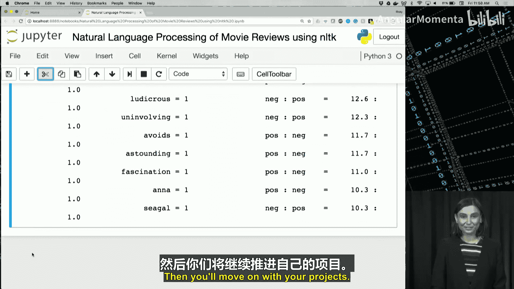

# 【加州大学圣地亚哥分校】Python数据科学-｜-Python-for-Data-Science-p27-10-02-03-视频-使用自然语言工具包进行自然语言处理--BV1jwFUzjEXu_p27-

In this lesson， we will focus on natural language processing using a popular Python package called an LTK。

By the end of this video， you should be able to describe what natural language processing or NLP means list a few examples of NLP in everyday life。

😊，And explain what NLTK is。Natural language processing， or shortly NLP。

 is a data science term used to refer to the interaction of computers and natural language humans use。

This is not an easy task because human language is ambiguous as humans。

 we are good at understanding the context of something said to us and link that to our understanding of the concepts around it。

😊，Doing this algorithmically， however， is not trivial。😊。

This is what the field of NLP tries to improve and develop algorithms and data techniques that make it possible in an effective and fast fashion。

😊，Chances are you have used an NLP application if you used an online summary of news or books。

 looked for keywords generated for most popular Twitter topics or use the virtual assistant on your phone。

😊，Let's list some of these applications。NLP techniques are applied in speech recognition engines like Siri。

 Google Now or Alexa。These engines are designed to learn what and how a human talks over time and constantly improve their accuracy。

Similarly， automatic translators like Google Translate or Facebook。

 automatic translation of Staes use NLP using some recent。

 very effective neural network based techniques that take not only words and phrases into account。

 but also the context by looking at the words surrounding the text they are translated。

Chatbots that can answer questions via a Facebook Mesenger are another example of anLP。

They use NLP engines to process the questions， often simply categorize them。😊。

And match them to existing answers to your question。😊，In this lesson。

We will go through a notebook that uses an LTK for natural language processing。

NLTK is the most popular Python package for NLP。It is an open source library that provides modules for importing。

 cleaning， preprocessing text data in human language。

 and then apply computational linguistics algorithms or machine learning algorithms like sentiment analysis to these datasets。

It also provides over 50 data sets to start working with。

 including the movie database we will be using in our example notebook Let's get started with our notebook。

😊，Please now locate the notebook called Natural Language Pro of Mo Review using an LTK in your folder for Wgate。

😊，Here。We will start with the notebook。And if you go to the first line， code line， code cell。

 it says importport an LTK， that's where we are importing our natural language processing toolkit。

As I mentioned in the lecture video， NLTK offers many datasets will use the NLTK download function to download first the movie Review dataset。

😊，So。We see that it was coped into my home folder users。 Altus。

 I can actually go there and find this folder if I wanted to。This is just one dataset set。😊。

We can also download all the other dataset sets or pick a few to download interactively by typing an LTK download。

😊，Please stop the video and execute this function in a Ne code cell to interact with the pop up window it brings up before you watch the next video on what corpus means and how now we can import this corpus for this data from an LTK。

Hope you were able to explore the data sets and LTK offers interactively。😊。

Now we have a review of the Copora and LTK provides。😊，By the end of this video。

 you should be able to describe what corpus means， list some data sets in the NLTK corpoa。

 and recite the basic features of the movie reviews corpus in NLTK。😊。

NLP techniques depends on large amounts of text or other linguistics data。

These digital collections are called corpoa altogetherto。

 another word you will hear is a corpus which is the singular form of corpora。😊。

As you have seen in our brief live session， an LTK provides means to download some of these large datasets。

😊，After importing an LTK， you were able to interact with a download interface for all of these data sets using an LTK download。

 and more specifically we downloaded the movie Review corpus to start processing our notebook。😊。

The movie Review corpus was downloaded in your home folder。😊。

So if you list directories under this folder， you will see that the corpus has 2，000 reviews。

 health of which are positive and other health negative。😊。

Each review in these files or directories has a significant amount of text。

 not just short opinions on movies， averaging around 800 words。😊。

Let's now switch to our notebook to look at some of these reviews。😊。

Let's continue from where we left and import the movie reviews we downloaded。😊。

So we'll go to our next code line， it says from ntk。 corpus， import movie reviews。

 I'm going to execute that one。The file IDs method provided by all the data sets in an LTK corpus gives access to a list of all the files available。

😊，We can look at the length of this list using the land function。

 but first let's find out all the files that we got from our corpus。Maybe the top five files。

 which are in the negative Neg folder。🤢，And we see the file names and the bottom five files。

But again。This is a list。So we can actually。Run the length operation。For both of these lists。

So if we wanted to get the length of Mo reviews， all of them。

 all the reviews that the Mo reviews gives us using the file IDs， they could have done L。

Movie reviews here。Okay。When we looked at the negative fields and positive fields。

 we saw that it started with the negative reviews and switched over to positive reviews in the post directory。

 so it shows us there are two directories， thousand of them。Are negative reviews？And。

Thousand of them for positive and in line 7 here in in 7。

 what we've done is we've filtered the list as positive and negative categories。

We saw that we had two equal lists for each。So， we could。

Also inspect one of the reviews using the row method of movie reviews。

 each file is split into sentences and the curators of the data also removed from each review from any direct mention of the rating of the movie。

So in the next code line， we get that。😊，Positive file I is 0， the first review。

In the positive reviews。😔，And here is the review。😊，It's indeed a significant amount of text。

 but how do we start working with this text？😊，One way is to tokenize this text in the next video we will talk about this technique to tokenize any text like this。

😊，And use it for natural language process。

Now let's talk about tokenizing the words in text。By the end of this video。

 you should be able to explain what tokenization means and use an LTK word tokenizer。😊。

The first step。In NLP is generally to split the text into words。This process might appear simple。

 but it is very tedious to handle all corner cases。😊，What are corner cases？

They include inconsistent use of punctuation or contractions or shortened versions of words。

 they can also be hyphenated words that include characters like the New York based example here。😊。

How do we tokenize such cases？NLTK offers libraries to remedy these challenges。

When we switch to a notebook in a few seconds， we will first use a simple white space based tokenizer。

Then we will learn how to do it better and easier using an LTK。😊，Okay。

 let's now switch back to our notebook。😊，For our tokenization example。

 let's use the short text of Romeo。😊，We see that the example here has some punctuations。

 Let's go to this Romeo。And there are some punctuations like love here， love exclamation mark。

 and we also have。For example， a hyphenated， it's still walking。

If we use now the string splitter function in Python in the next line here。😊。

It will give us a list of these words。Let's execute that。😊，Oh， sorry， I didn't run the line before。

 don't forget to run the lines。One after another， after line 12 or code cell 12。

 we are going to use this Romeo text that split。😊，And this。Check this out with a little bit。

We see that there are some punctuations with the one with love or hate here。🤢，And combined words。

Like well seeming。They were all listed as one word。

 ideally we would have love as one word and that punctuation。

 the exclamation mark as one word or maybe we won't even remove that。

 but how do we remove these punctuations？😊，For that task。

 we need to download an already trained English tokenizer。😊，That one is called puned。

So come up with the punctuations。Let's execute this。Code cell。

Then we can use this word tokenizer to generate the tokens。Remember， before we actually。Used。

Just a split operation， Romeo that text Rome underscored text that split。

 and it was what the string provides us。 We are trying to do more。

 we are trying to actually use an LTK puned， which has。🤢。

These punctuations already defined and we are using the word tokenize from this。😊。

To come up with a list of words now if you display these list of words。

We indeed see that low exclamation mark we had above is separated nicely。😊。

The good news is all corepora in an LTK already provides a way to generate tokenized words for each data file。

😊。

So for our movie database， let's go find that。😊，嗯。Words for the first positive files can be accessed using the code block here。

We have Mo reviews。 wordss and positive file IDs and zero is our first record。😊，Let's execute this。

We have a list here right we have a list of words from that first positive records now that we have our words in the next set of videos。

 let's see how we can use these words to build a simple bag of words model for them。😊。

In this video， we will review what bag of words means。😊，By the end of this video。

 you should be able to explain what bag of words mean。😊。

Understand how you can build machine learning features from words and give examples of stop wordss。

B of Word model is a very simple representation of a body of text as a loose set of words。😊。

It flattens and it takes into an unordered collection of words。😊。

Although it disregards the sentence structure associated to the words。

 this simple technique is pretty useful to identify a topic or sentiment in text。

 like if a product review has a negative or positive sentiment or what a body of text talks about。😊。

We can use the words in a future matrix， where each word is a column and each text bud or review in our movie example is a row that has Boolean data values。

😊，A cell in the review row gets assigned through。😊。

If the word appears in the review and falses if it doesn't。

Just by looking at these three rows in this matrix with a limited set of words， we can identify that。

😊，The topic of these reviews are movies。😊，And probably review1 and review3 are positive and review2 is negative。

😊，Before we move on to our notebook， I would like to mention that it is often practiced to filter our stop wordss and maybe even the punctuations from the bag of words before further analysis。

😊，Sttop words are words like the death and is， which occur a lot。

 but don't have a big significance in identifying the context of the text being processed。😊。

Now let's switch back to our notebook to execute our first bag of words model。😊。

As we just overviewed from the bag of Word model， we can build features to be used by a classifier。

 and here we assume that each word is a feature that can either be true or false。😊。

We implement this in Python as a dictionary。😊，But， each word。In a sentence， we associate。With true。

And if a word is missing， that would be the same as assigning false。

 or in this case we won't have anything。So let's do this four loop word。

It's true for word and Romeo words。So we'll have。As you see here， a dictionary。😊。

Where each word in Romeo words are assigned through。

 and there are no false values because we are not assigning false for anything。

You would remember from our earlier videos as this underscore here is the last output that goes into the standard out。

🤢，Andですよ。So if you had assigned that dictionary。To a variable。😊。

You need to write the name of that variable within this type。Okay。To generalize what we did。😊。

This creation of the dictionary here。We can turn what we've done here into a Python function。

In this code cell here we define a Python function。And next we will use it。

 let's execute this Python function， it's calledBuild underscore bag underscore Off underscore words underscore feature。

 so we are building a bag of words features for the words that we just created as a dictionary。

So this function will accept a dictionary or sorry。We'll accept a set of words。

And return a dictionary for it。So let's run the function and see if we get that same output with what you just line in line。

Great， we get the same output。😊，This is what we wanted。😊，But， notice。Here。

 punctuations like exclamation mark or comma or dot。🤢。

Are still showing up and those are useless for classification purposes。Similarly。

 we have words like off that or is or in。Those don't need to be included。🤢。

So those words are named stop wordss and NLTK actually has a corpus of them for each language or in this case English so we can actually。

Download the step words from an LTK。We can now use the stub wordss in English。

And punctuation characters in the string class。Which are these characters？

That are listed in our out 24 line。We can use this to create a list of what we don't want。

We'll call this list useless words。Here。I create useless words as a list。

 and it's a combination of stop words for English。😊，And the punctuation characters。嗯。

If you're having。Maybe curiosity or maybe not completely understanding what Star wars are。

 please feel free to。Print out the stop words that are here。

the NLTK corpus start words English to explore with those words a little bit and see what those words are。

嗯。We can， of course， now。Andtcom useless words。And。See the list ourselves here， so there I， me。

 my myself and the list goes onwards from there。So for simplicity， I'll comment out that line。

And run this again。Now we will actually update our bag of words function that we built with an if statement to check if the word exists in useless words and skip that word if it does。

😊，So we have the same function word。It was true before now it's one。For word and words。

 but there we have a condition， if not， word in useless words。

 so it means if the word is not in useless words， add that to our dictionary。😊。

As you might have noticed。Instead of true as a value for the word here we are using one in the S function。

😊，Let's run our function。😔，And now we'll use this function， build bag of words featured filtered。

Features being the useless words filtered。嗯。To give it the Romeo words as input。So if you do that。😊。

We see that the punctuation and some of those stub wordss that we had about are gone and we have a cleaner list of words。

In our dictionary。We are making progress。😊，Next， let's see how we can calculate and plot the frequencies of words in this list。

Now let's look at what we can do further to analyze word frequencies。By the end of this video。

 you should be able to count how many times an item appears in a list。

Plust word frequency in logarrionic axis。And Pword counts histograms。When we switch to our notebook。

 we will see that a quick check of the amount of words in our movie review database shows 1。

6 million words， which can then be reduced to 710，000 via removal of useless words as we call it。

This is still a lot of words。 how can you find out the frequency of each word that is how many times each word appears in this corpus？

😊，We will use the counter object from the collection package in Python for this purpose。

Counter works very similar to the unique command in Uni we discussed before。

We can provide it with a list of words， and it returns an object via which we can find out the repetition of each word。

😊，You would already guess that movie is a very frequent word in a movie database。

 and indeed it occurs5，771 times in this corpus。Once we have frequency in a counter。For each word。

 we will see how we can plot the distribution of words using matplotlibb。😊。

This graph is coped from our notebook where we sorted the word counts and plotted their values on logarithmic axis to check the shape of the distribution。

😊，This visualization is particularly useful if you are comparing two or more dataset sets。

A flatter distribution indicates a large vocabulary while a peak distribution。

Indicates a restricted vocabulary often due to a focused topic or specialized language。😊。

We will also create histograms of the words for visualization of the frequencies。😊。

Let's now switch to our notebook to see what we just reviewed in action。😊。

We are now starting to count frequencies of words in the movie Review corpus。

Let's go to our notebook and first check the number of words。Quickly， using the land function。

We mentioned before， we can get all the words in the movie reviews and assign it to all words。😊，嗯。

And we'll use the land function around those all words and printed in the millions format。

 we reviewed some of these in our very early videos。 I hope you still remember。嗯。

So what we are doing here is we are turning this number into millions format。So we have about 1。

6 million words， it's a lot of words， but this number includes the useless words we listed before。

Let's filter those words out here。😊，Using a for loop。And call this result。嗯。

Or the resulting list filtered words。 So what we'll do we'll assign the filter words。

 the output of this word loop， the for loop。It says word for word and movie reviews words。

 so if for each word in the movie reviews。Only do this if word is not in useless words。嗯。

So we can execute this if you'd like to see the type of this filtered words。😔。

Let's execute this again。Takes a little while because it's checking constantly if the word is in a list。

 we see that filter ver is indeed a list。And we'll get to。Number of words in this list。

 It's now down to about 710，000。 so 0。71 million。 so it's about health。

We were able to reduce the amount of words to about health。

Next let's create a counter object using these filtered words what we'll do is we'll start by importing counter from collections。

And we'll give counter this filtered words that's like 710，000 words。And we'll turn that。

Into a counter object， this counter class that we are initializing here will create a word counter object。

So I'm running this once we had this word counter object， it was successfully ran。

 it was fast as you saw。😊，嗯。We can use any function the counter class provides us or the properties of this class。

嗯。Most common function of the counter objectject。Lets us see the most frequency words in our movie database。

Let's actually execute that and in the next one I'll print this most common words。

 the top 10 as you've seen here。As we see here。Most common words are the ones with the highest frequency in our movie database。

 as expected are film one and movie。Let's plot now this word font counter。

We need to sort this list before we can plot it， actually。🤢，嗯。We will use matpllib。

 as you've seen before matpllib。 You're familiar with it。

 We'll use it to generate a logarithmic plot of the list。 So we had。Srt it。

Word counter and the values in it， and we assign that to a list called sorted Word counts。

Will give those sorted word counts。To the log log function to create that logarithmic Fl。

 and we'll name our X label word rank and y label frequency。So if we do this。😊。

We'll have that graph be overview in our slides before。嗯。It's a logarithmic flood， and。

As we describe here。This flatter distribution indicates a large vocabulary like we have。

We can also plot the histogram of sorted word counts。

 which displays how many words have account in a specific range， not per word。

 but the words are binned。To be。Together， if they have a similar count。So。

Since we have many words with low frequencies in our。Histogram。Or in our corpus。

 we'll see that the histogram peaks on these low counts right close to 0。

 we have a huge spike of words and it sort of。Trickles down to be less and less in the order of 5000。

Displaying this at log scale in this case would give us a better plot to communicate this information so what we'll do is instead of histogram So value counts。

 we'll say log true here。The same 50 bins。And we'll have a better， more informative graph。

You will learn more about it as you go through probability and other classes in this specialization。

Great， we are almost at the end of our notebook。As usual， we save the best for last。

 that is to use the exploratory analysis we just went through in a classification model。😊。

Let's go through this in the next set of videos to see how we can achieve it。😊。

We will now start using the bag of Word model we created in a classifier for sentiment analysis of Mo reviews。

😊，By the end of this video， you should be able to explain what sentiment analysis is。😊。

Train a sentiment analysis classifier with NLTK。And check accuracy on training and test data。

Of this model。So what is sentiment analysis？The term refers to the activity of identifying attitude or emotion encoded in a body of text。

 like a product review or work of literature。😊，Classification using machine learning is a technique used for sentiment models in our notebook we will build a predictor of sentiment using the movie Review corpus。

😊，As you would remember， classification is a supervised activity and requires labels from a ground root data。

😊，This is where we will take advantage of bag of words and the curated negative and positive reviews we downloaded。

😊，We will use our previously implemented bag of words function to create a positive or negative label for each review。

😊，Baaggo fors。We will use naive Base Classifier for this task。

Although we haven't reviewed naVs before， it is a very simple classifier with a probabilistic approach to classification。

😊，What this means is that the relationships between the input features。😊。

And the class labels is expressed as probabilities。😊，So given the input features for a sample。

 the probability for each class is estimated， the class with the highest probability then determines the label for the sample。

😊，Let's now switch to our notebook one last time to end with the Sen classification task using na vase from an LTK this time。

 not psychic learn。We will now start preparing our inputs and label data sets for the classifier。

So we are using， again， a na based classifier。U。We are lucky that the database is curated to separate positive and negative reviews right so we will use this as ground truth data。

And built two dictionaries as a bag of words for positive and negative reviews。

So I'm going to quickly do that here。 We have a negative features build bag of words features filter。

 This is the。This is the function we've done before。 we've created before。

 We are using that and giving the words with。呃。Negative fields。 And we'll have。嗯。

A label nag associated to that。For each file in negative fields。

 we'll build a bag of words and store that in negative features。So。

We can print that one record in this negative features。 We'll see that there are a bunch of。

Words for the reviews， for one review， and it's labeled negative。

We can do the same thing for positive features and print one record for positive features。嗯。

We can now see， for example， positive feature6， the sixth review on that。嗯。Frame is positive。

So now we have our two features and remember we have thousand records in them。So for each of these。

We'll have about 00 records with a positive label and about exactly  thousand0 records with a negative record。

A labelbel。So now。We will start using the naE base classifier。Let's import that from as you see here。

 this is not psychic Learn， this is an LTK classifier， so it's the classifier that comes in an LTK。

And remember we had thousand records in them， we can use 80% of the data for classification in na B。

😊，嗯。When we provide the first 800 rows in each feature， it's 80%，10 times 80% so we'll。

Sttorore at number 800th。In a variable called split。

And we'll use that split to slice the first 800 for training and the remaining 200th for testing later on。

🤢，So what we are doing here is we are giving the naive based classifier to build a classifier that we will call sentiment classifier。

And we are using the nab classifier to train it。😊，With the first 800 positive features。

And the first 800 negative features， remember， they had labels， pause and Neg。

 we created them like we see here。So the classifier will know what to do with it。

So we create the sentiment classifier。😊，On the。Oops， we need to create the split again。

 don't forget to run each cell before you move on， we'll use the first 800 records for positive and negative reviews to create our classifier using May basease classifier。

 we'll call that the sentiment classifier。😊，So we'll now check the accuracy of the model we built。

 and this model is called remember Sentiment Classifier on Traing set。😊，We'll use the。

Classifications， accuracy function， it's the utility of the classification。

And we are giving that the classifier and。What they've given to train it。

With the positive and negative features。Remember， we trained it。

 the model has already seen this data set， these are the training data sets。🤢。

So what kind of accuracy you would expect it should be high， right， because model has seen this data。

And we see that it's about 98% accuracy， so it's good， it's normal。

 but how will the model behave on the 20% of the data it hasn't seen yet？Let's go and。

Give that 20% now to the accuracy function， we are applying the sentiment classifier to predict the labels for the rest of the data。

🤢，So these are our test data。And the accuracy of it， if we calculate it， is around 71%。😊，嗯。A human。

The estimated accuracy for a human is about 80%， so the in accuracycuracy of around 70% is a pretty good。

Accuracy for such a simple model， considering， again。

 the human estimated human accuracy is about 80%。Remember。

 we had a large vocabulary and the sentiment classifier used all the words。

But which of those words gave us this？Highish accuracy。The sentiment classifier。

 the one model we build has a function it says show most informative features。

 you can actually run that and see what。😊，Words or what features in those reviews？

Were most informative if you look at this。Outputts with the outstanding insulting vulnerable。

 these actually affected the outcome quite a bit。So if we will stop here。

 let's cut these to clean up our notebook。😊，Well done， you're almost through week eight。

 we have one more lesson then you'll move on with your projects。

