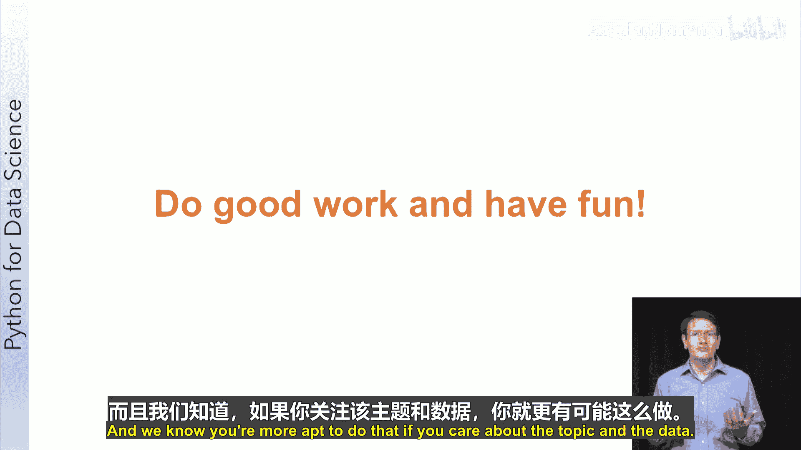

# 【加州大学圣地亚哥分校】Python数据科学-｜-Python-for-Data-Science-p28-11-01-02-视频项目_周--BV1jwFUzjEXu_p28-

First， I want to congratulate you on all you've achieved so far in the course。

 You've already learned a great deal about data analysis。😊。

What we want to do next is put all that learning together into one final project we've given you a fair amount of time to work on this project because we want you to produce something you're really proud of。

 something you can show to your friends and family about what you can do now that you've taken this course。

Remember this slide， we showed it to you right at the start of the course。

 this was our goal for you by the end of the class。By the end of the course。

 you should be able to find useful data sets， form research questions about the data。

 perform basic data analysis to help answer your research questions， and present your findings。

In this final project， you'll do this full process effectively。

 you'll create a Jupyter notebook from scratch and perform a data analysis on a data set of your choice。

I'm going to go over the project at a high level next。

 but please be sure to read the project description and green Ruric carefully before you get started。

This week we want you to find a dataset which is of interest to you we'll give you a list of places with valuable datas in a reading next。

 but feel free to find whatever data you want， or if you have data which is public an related to your hobbies or your work。

 feel free to use that instead。Next， you'll need to explore the data and see what it contains。

 and you should do this in a Jupyter notebook。In the process。

 you should get a feel for what kinds of questions are answerable with the data。

This step often involves data cleaning as well。And that leads the next step。

 which is to identify a research question。What do you want to know that the data might help answer？

By the end of this week， you should have your data set and research question ready to go for next week。

In week 10， you'll continue working with your identified data。

 although exploratory data analysis never stops， we will mainly focus on furthering our analysis with modeling methods you've learned so far。

You may need to either clean or merge your data depending on how it's formatted。

 but you should also plan to use the machine learning and text analysis techniques that you learned in the later weeks of this course。

You want to look at the data in multiple ways to put together an answer。Is the data reasonable。

 if appropriate， what checks did you perform to help verify that the data is accurate？

Visualize the data to better understand it。Then when you start gaining the insight into an answer。

 be skeptical， what would someone critical of your result ask about your findings？If possible。

 try to answer those critical questions or be upfront and admit your results may be limited because they're based on certain assumptions。

Once you're comfortable with the results and understand and document the limitation or supporting findings。

You'll put together a presentation for another learner to review and give you feedback。

We'll give you a template of a slide deck which you can use to put together your findings。

It is your responsibility to communicate your findings in a clear and concise manner using your analysis to support your conclusions。

I encourage you to get friends or family to give you initial feedback in your presentation。

Just because it's clear to you doesn't mean it's going to be clear to someone else。

Once you're happy with your presentation and notebook， you can submit for peer review。

Speaking of which， I quickly remind you of the importance of taking peer review seriously。

Just like in week six， you need to be critical but fair。

I have generally found folks more critical than they needed to be when they first do peer review。

So if you need to air。Air on the side of being lenient。

This doesn't mean give a poor project rate marks， but it does mean that if you're debating between a good or a very good rating。

 feel free to go with a higher mark。Since this project is really open ended。

 other learners may pick topics which are different than what you might do。For example。

 you might be an avid environmentalist and you find yourself reviewing a notebook trying to predict the next location in the Arctic to drill for oil based on geographic surveys。

You may not like the topic the author picked， but your job isn't to judge their choice of topic。

Your job is to judge the work。Did they do a good job analyzing locations to drill and were their predictions good。

 were their methods appropriate， For example， did they use accepted machine learning methods by separating out their training in their test set。

In other words， do your best to review the work objectively。This project is open ended。

 and part of the reason we do this is that we want you to dive into your data fully。

 and we know you're more apt to do that if you care about the topic and the data。

So do a careful and meaningful analysis， but also try to enjoy yourself along the way。

We can't wait to see what you'll create。This week， in addition to the project。

 we would like to provide you with example notebooks with additional use cases applying various Python data science libraries to real life scientific applications。

An application on astrophysics was developed by our course assistant Dr。 Andrea Zonka。

 Andrea has a PhD in astrophysics from the University of Milan。

He now works as a senior data scientist and a high performance computing expert at the San Diego Supercomputer Center。

He also teaches practical courses in computational data sciences as a part of software carpentry。

Software Carpentry is a nonprofit foundation that teaches computing skills for early career scientists。

 which could be a great resource for you。You can find this notebook developed by Andrea under your week9 directory with the file name of Plan satellite data simulation using pandas。

This example is inspired by one of Andrea's projects here at the San Diego Supercomputer Center in which a collaborative group of scientists analyzed satellite imagery of the cosmic microwave background to study the beginning of the universe。

 it sounds fun。😊，The notebook uses Python libraries familiar to you from this course， however。

 it also includes domain specific references in cosmology。😊。

This is a typical situation for data science where domain specific skills get combined with data science skills。

😊，We are aware that you don't have a PhD in astrophysics。

 but please don't be discouraged as the notebook is self explanatory and is designed with you in mind。

😊，It is very likely that you will find yourself in an interdisciplinary team as a data scientist in the future。

😊，So this is a great opportunity to start sharpening up your skills to take a domain problem and try to understand how you can apply data science methods and techniques to it。

😊，The example has three distinct sections using advanced functionalities of pandas。

 numpy and matpllibb。In section1， we will read a map created by the Plank satelliteate。😊。

And explore a scientific data format called HDF5 in Section 2。

 the notebook will use Nmpy to create a simulation of how planks scan the sky throughout a year of observations。

 and we will plot scanning rings。😊，In different reference frames。In section 3。😊。

The notebook will use the scanning coordinates created in section 2 to simulate an observation of the map used in section 1。

😊，We hope you have fun going through this advanced notebook and celebrate how far you come in the last nine weeks。

😊，Another example notebook for this week is called the Protein Data Bank Analysis。

The notebook was developed by David Dorner， one of our top students in the UC San Diego Master of Advanced Studies Program in Data Science and Engine。

Although this notebook is not in the same format as your final project。

 nor does it have all the steps as we outline there。

 it contains a number of components of an excellent final project。Namely。

 this notebook provides a great example of using structured scientific data through an API。

And visualizing it。PDB is a large repository of semi curated。

Crowdsourced proteinte structure data The notebook uses PDB's restful web service to access the data available in PDb。

And uses the Bouquet library to visualize the data。Although most of you are not biologists。

 we hope that you'll explore the notebook for possible ideas you might want to use in your project。

