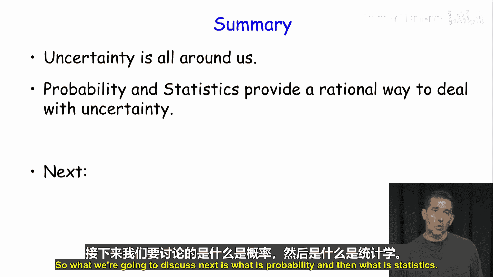

# 【加州大学圣地亚哥分校】使用Python进行数据科学中的概率与统计--Probability-and-Statistics-in-Data-Science-p02-02-01-03-地形概览--BV1gJFDzkEPg_p2-

Hi， my name is Yoav Freend， and this is introduction to probability and statistics。

 This is the first video therefore。It is the introduction to introduction to probability and statistics。

So we're going to talk about probability that is roughly speaking about tossing dice。

 and we're going to talk about statistics， which is roughly speaking about keeping scores in baseball。

So why should you care about probability and statistics？Basically。

 it's because this is a very powerful tool for dealing with uncertainty。

 so consider the example here that we have Google trying to give us a good route from the point A to the point B。

And there are two routes that are shown here。One is the shortest route。

And the other is the fastest route。Okay， so。If we think about shortest route from A to B。

 that is a certain certainty， once we know how the roads are constructed， that is a certain thing。

On the other hand。In terms of the fastest route from A to B。

 that depends on traffic on other conditions， and that really is something that we have a lot of uncertainty about。

 and therefore we need statistics to help us deal with that uncertainty。Here's another example。

Search engines， suppose you have a search engine and you're looking for some information。

The first kind of query that you can make that is certainty query。

Is to find all the web pages that contain the words Trump or Hillaryary。

And debate okay so that is basically a very specific condition and you can ask your search engine to look for all of those pages on the other hand it might be more relevant to ask for the 10 most relevant pages for the query Trump and Hillary debate。

Okay so that is not a query that has a specific set of welldefined answers。

 it has to do with what words appear in those kind of things and with what pages are really most relevant。

 most up to date， various things with which we have uncertainty。Okay， the last example。

Is about an insurance company， so with an insurance company you have a contract and it says with certainty that if you have life insurance with this company and you die。

 then the insurance company has to pay your family some prescribed number amount of dollars。Okay。

 so that's a certainty。 On the other hand， the insurance company itself has to deal with a lot of uncertainty。

 It doesn't know which people are going to die， So it has to figure out what is the minimum life insurance premium such that。

The probability that the life insurance company will go bankrupt in 10 years is smaller than say 1%。

 probably much， much smaller than that， but in any case what the company needs to somehow deal with is the uncertainty of how many people will die that have insurance and how much they will have to pay them okay so that's a case we need to deal with uncertainty。

So。What are you going to learn in this course？So first of all。

 navigation and search engine that I showed you， those are very advanced problems。

 as is the life insurance market。What you will learn here are the foundations that these kind of methods are based on。

So you'll solve basic problems of reasoning under uncertainty。So it is an example。You will ask。

 you will know how to answer a question of the type if you flip a coin 100 times。

 what is the probability of getting at most 10 heads？

Or what is the probability of getting four of a kind hand in poker。

 these are questions that you would be able to answer。

And if you're interested in computer science examples。

 here are some other questions you might be able to answer。

 which is suppose you have a hash table with a million elements and you don't want to allow more than five indirects for at most 10 elements so how big does the table need to be。

 that's a calculation that you will be able to do？A similar one is suppose that you have a router and that the router fails from time to time and the rates of failure is。

 let's say once a year， okay so that gives you some information。

 but you would want to know specifically let's say what's the probability that it will fail during the first month。

 given that it on average fails once per year。So that's。

That's a question that you'll be able to answer。So it's not universal the belief in statistics here is an example from a basketball coach who does not believe in statistics because there are too many other factors and so on。

 so there are many people that basically don't want to trust statistics and that is fine but on the other hand you can say many other people dealing with the same domain here。

 basketball do trust statistics， so this is an app for fans of basketball to have statistics about different players and so they can do fantasy basketball and win a lot of money。

So to summarize。What we have all around us when we are doing anything in the world is uncertainty。

And probability and statistics provide a rational way to deal with uncertainty。

So what we're going to discuss next is what is probability？

And then what is statistics？So I'll see you then。