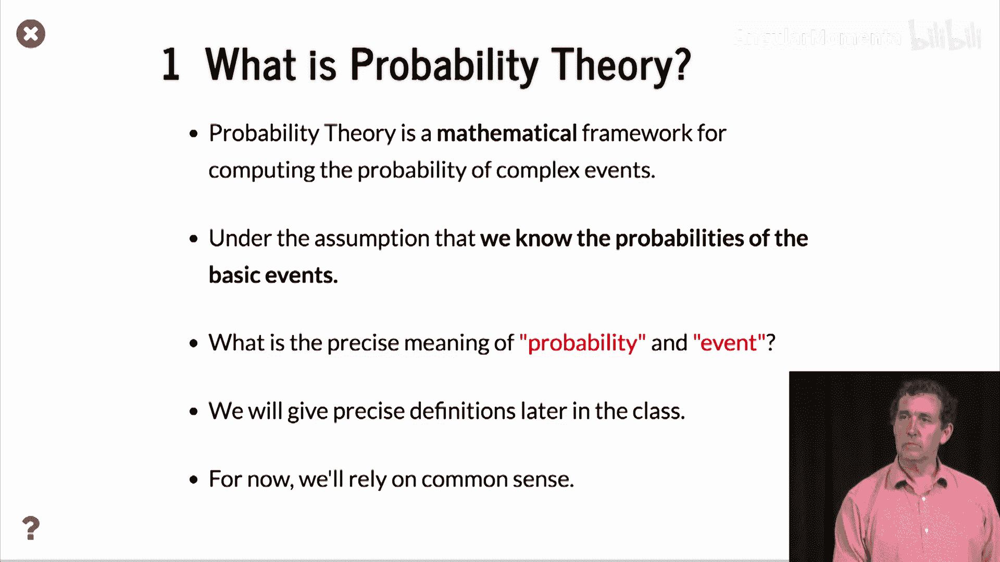
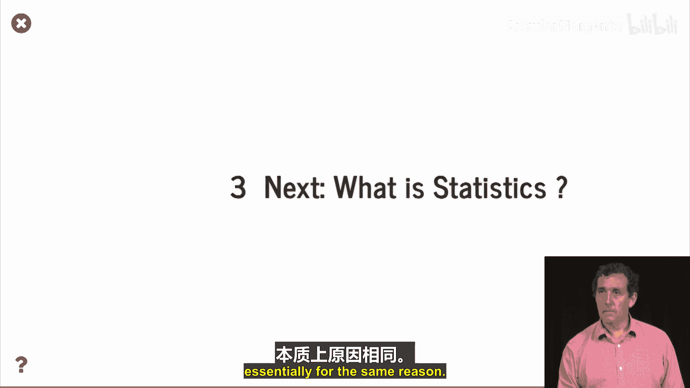

# 【加州大学圣地亚哥分校】使用Python进行数据科学中的概率与统计--Probability-and-Statistics-in-Data-Science-p03-02-02-03-概率论--BV1gJFDzkEPg_p3-

Hi， welcome to the course。 In this course， there are two main subjects that we will study。

 One is probability， and the other is statistics。 These are very related subjects。

 but they are still different。 So let's start by thinking about what is probability。Okay。

So probability is the mathematical framework for computing probabilities of complex events。

 That's a mouthful。And we make an assumption that we know the probability of the basic events。

What precisely do we mean by probability and by event？

Those will be defined later in the class for now， let's just think in terms of common sense。Okay。

So let's think about a simple question， we flip a coin。And we get tails。We flip it again。

We get heads okay， what we believe somehow is that the probabilities are equal。

But what do we really mean by that。 What does that mean。

 Does it mean that we'll exactly get the same number of heads and tails。 No， it just means that。

If we flip the coin many times， then for some very large number of coins that we flip。

 let's say 10000。We'll get the number of head is approximately or about。5000。Okay。

 that's what we expect， but what do we mean by about okay。

 how can we express this notion of about in a better way because we might be actually interested in knowing how far from that we are。

Okay， so we're going to simulate coin flips。We'll use a pseudorandom number generator to simulate coin flips。

And instead of heads and tails， it will be more convenient to use 1 and minus-1。

 and then the number of heads relates to summing all of these plus 1 and minus-1。

 and what we expect is that the sum will be0 or close to 0。So we will vary the number of coin flips。

 which we denote by k。And here is a little bit of code for generating such random coin flips。

 Here we're generating the coin flips themselves。And here we're summing the coin flips along a particular sequence。

 we're generating many sequences at once， and this is the number n that we say here is by default 100。

So this is a central part of the code， but I'm not going to show you all of the code for to see that you have to download the notebook yourself and play with it to see the details。

So here is a histogram that shows for flipping a coin a thousand times what is the distribution of this sum that we said。

 the sum is about zero， but as you see it's not exactly zero。

 and every time that I rerun this experiment，Every time that I rerun the experiment。

 what you see is that the histogram that you get is slightly different， however。

 even though it is always it is each time slightly different。

 there is something very much in common for all of these coin flips。

They are all concentrated around 0， but they' are not exactly0。

 and for this number of coin flip 1000， it is extremely unlikely that they are below 1250 or above minus-250 and above 250。

Okay， so with probability theory， we can calculate how small we expect S the sum to be。

The absolute value of this sum， because it can be either negative or positive。And what we show。

 we will show is that the probability that this Sk is larger than 4 times square root of k。

Is extremely small， It is 2 times 10 to the minus8 or 0 dot 0，0，0，00，2%。

 so we'll have to flip the the sequence of 1000 coins many， many。

 many times before we can see that it will be bigger than4 square root of k。

 So lets let's actually do the simulation and see if that is the case。Okay。

 so here is our simulation what we see is here we have 100 coin flips here 1000 coin flips and here are 10。

000 coin flips and the red line mark what probability theory says is the boundary。

In which it is very， very likely that the total number of coin flips reside。 Okay。

 so I can rerun this experiment， too。And you see that again。

 each time the distribution is somewhat different， but it never goes outside of the red bars。

So that's consistent with what we said Now here it seems that all of them are very similar right it doesn't really matter if you do 100。

1000 or 10，000 coin flips， but that's really because I'm scaling it according to this boundary so the boundary here is minus-40 to 40 here it's100 and something to 100 and something and here it's minus-400 to 400 if we scale if we plot the full scale of these coin flips。

 what we see is the following。We see something like this。

 so when when we plot the whole scale from100 to 100 for 100 coins and from  minus 10，000 to 10。

000 for 10，000 coins， then we see that the distribution becomes more and more concentrated around zero relative to this scale so if I run it again。

Again， you get each time a different distribution， but you get that the distribution is more and more concentrated if you flip the coin more and more times。

 and the width of this is square root of k or4 times 2 times square root of k。

So you see that the more coin flips you in modern times you flip the coin。

 the closer it is relatively to the range to0。Okay。

 so let's summarize we did some experiments where we sum K random numbers that are correspond to coin flips。

With probability X， so we had X minus1 or plus one with probabilities half and half。

And our experiments show that the sum is almost always in the range minus4 square root of k to plus 4 square root of k。

Okay， so we can write it this way if k goes to infinity。

 we have4 square root of k as the range divided by k， so that is 4 divided by square root of k。

 which is equal to0， which goes to 0 as k increases。And so what we can say is that。SK relative to k。

 so the ratio of the number of the difference between heads and tails divided by k that goes to0。

 and that's basically what we mean by the probabilities being half and half。Okay， so again。

 what is probability theory， It's the math involving proving in a precise way。

 the statements that we made above。 Okay， so before we just kind of did simulations and alluded to something that will prove in the future。

 But that's really what probability theory is is proving these in a precise way。In most cases。

 we can approximate the outputs。This probabilities using simulations。

 these are called Monte Carlo simulations， and that's essentially what we did in these little experiments that we did。

So why isn't that enough？Because first of all， calculating the probability gives you a precise answer and doing Monte Carlo simulation just gives you an approximation and you need to run the experiment longer and longer to get more and more accurate answers。

And the second is that it is much faster than Monte Carlo simulations。

 essentially for the same reason。

Okay， so。That is a quick description of what is probability。

 and next time we're going to talk about what is statistics。See you then。

