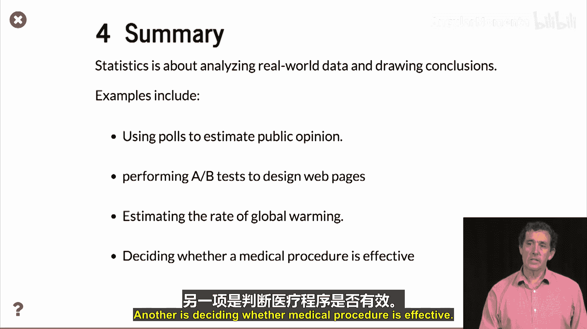

# 【加州大学圣地亚哥分校】使用Python进行数据科学中的概率与统计--Probability-and-Statistics-in-Data-Science-p04-02-03-03-统计学--BV1gJFDzkEPg_p4-

Okay， so in the previous video， we talked about what is probability。

 and this time we're going to talk about what is statistics。So in probability theory。

 we compute probabilities of complex events from the underlying base distribution。

Statistics takes us in the opposite direction。Were given data that was generated by some stochastic process or some random process。

And from that data， we infer properties of this stochastic process。So here's an example again。

 let's go back to our coin， here's our coin， and we believe that it is an unbiased coin。

 so it gives us exactly half heads and half tails。But how can we be sure？So。

Previous time we saw that we talked about the distribution。

Now we want to turn the question around if we flip the coin 1000 times and we get 570 heads。

Then can we conclude that the coin is biased， so the coin is not a fair coin？What about sorry？

Can we conclude that the coin is biased， not a fair coin？

What can we conclude if the outcome is 507 heads。 It's still not exactly 500， but。Closer to it。

 so how can we decide whether the coin is biased or not？

So here is the logic of statistical inference， we want to say something about the coin and we use the following kind of logic。

Let's say that the coin is fair， okay？And then we can calculate what is the probability that the coin will give us 570 coins。

If this probability is extremely small， then we can reject with confidence the hypothesis that the coin is fair。

 we can say it is very unlikely that a fair coin would generate this sequence and therefore it is not a fair coin。

So let's see how we can calculate the answer。Recall the simulations we did with the video what is probability？

We use the X minus1， X plus 1。Instead of heads and tails。

 and we looked at the sum of all of these variables。And if the number of heads is 570。

 then we can easily see that the sum over 1，000 plus ones and minus ones will give us 140。

Now we know we haven't really shown it yet， but we already I already stated it in the previous slide that it's very unlikely that this sum is the absolute value of it is larger than 4 square root of k。

 which in this case is 126。5。So this is how I calculated this 126。5。And therefore。

 it is very unlikely that the coin is unbiased， right？We can say the coin is probably biased。

Because it is very unlikely that an unbiased coin would generate this outcome。What about 507 hits？

Well， if you have 507 heads， 493 tails， then SN is going to be 14。

 and 14 is much much smaller than 126。5 so at least according to the rule we just had。

 we cannot say that the probability is very small and as we'll see the probability is actually quite reasonable that its quite large that a fair coin would generate 507 heads。

So we cannot conclude that the coin is biased。It might still be biased。

 but we might have to flip the coin many， many， many more times before we can deduce that。Okay。

 so as a conclusion， the probability that unbiased coin would generate a sequence with 570 or more heads is extremely small。

 and from that we can conclude with high confidence。That the coin is biased。On the other hand。

 if this sum is larger than 507。That is quite likely。

 and so getting 507 heads does not provide us with evidence that the coin is biased。

Let's think about some real world examples。 So statistics， unlike probability。

 which is a part of math， statistics is really about。Problems in the real world。

And so you might ask why should I care about coin being biased。

 that's not a problem I kind of face many times。And that's a very valid critique。

 and we will now give some examples for real problems where the statistics is very closely related to whether or not a coin is biased。

So， let's。Take polls， for instance。 Suppose there is elections that are going to take place in a few days。

 and we want to know how people plan to vote。 Suppose there are just two parties， D and R。

We could try and ask all of the potential voters what they plan to vote。

But that would be extremely expensive。 We cannot really afford to do that。

So instead we can use a poll， what is a poll， we call a small randomly selected set of people。

 ask them of their opinions， and then we extrapolate from that， what do people think in general？

So call in people at random and count the number of dev votes。And the question is。

 can you say with confidence that there are more dev votes or more R votes？Mathematicically。

 this is exactly equivalent to flipping a biased coin and asking whether heads is more likely than tails or tails more likely than heads。

 it's the exact same question and the same math holds for it。Here's another case。

 this is called AB testing， which is a very common practice now on developing web interfaces。

You basically think about two alternative designs for your webage， one is a， one is B。

 and the only difference in this case is whether this bar is to the left or to the right of the screen okay。

So to see which design users prefer， we randomly present a design A or design B when people visit our website。

And we measure how long the user stays on the page or whether the user clicked on an advertisement or any other indication that the user likes one of the designs more than the other。

We want to decide with some confidence。Which of the two designs is better？Again。

 this is very similar to making the decision with confidence on whether head is more probable than Tas or vice versa。

Okay， so to summarize， statistics is about taking data from some real world process and drawing conclusions about this process from the data you collected and we talked about several examples。

One is using polls to estimate public opinion。Another is performing AB test to design web pages。

And of course， there are many， many others that are all around us。One is。

Estimating the rate of global warming。Another is deciding whether medical procedure is effective。

 So these are slightly more complicated and they don't map directly to to flipping biased coin。

 but they are of a similar type。

So this ends the description of probability and statistics。

 and we are now going to start diving into the details of how to do probability。Thank you。

