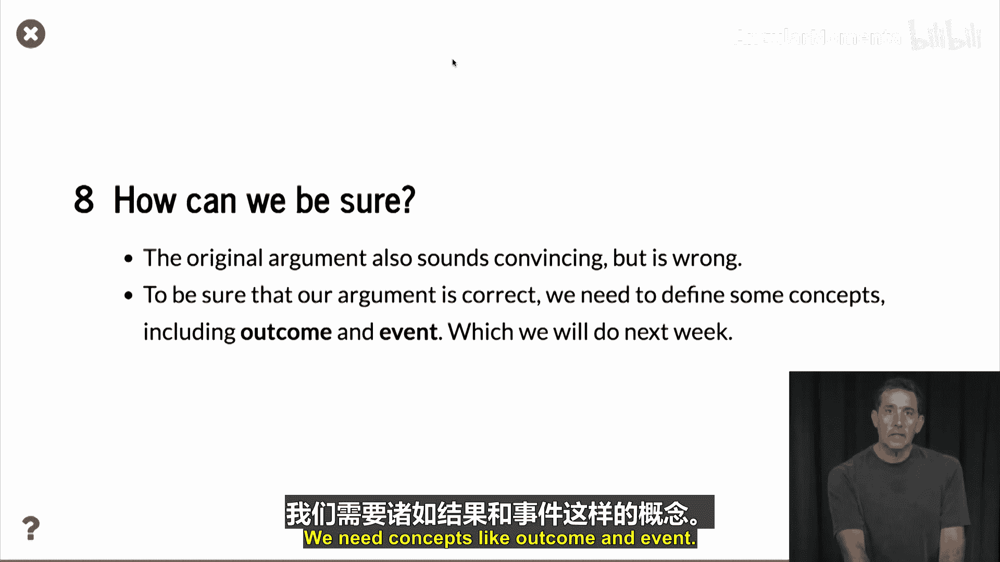

# 【加州大学圣地亚哥分校】使用Python进行数据科学中的概率与统计--Probability-and-Statistics-in-Data-Science-p05-02-04-03-A_三卡拼图--BV1gJFDzkEPg_p5-

In a previous video， I gave you a short explanation for what is probability。

 and you might wonder why do I really need that all this math。

 does it really help me in real world situations？So I'm going to give you here a little puzzle。

 it's a very natural puzzle， it's not something contrived and I'm going to ask you to think about how you would want to answer this puzzle so it's called the three card puzzle。

And。What I want you to imagine is that you have three cards in a hat。

Okay so the cards are one card is red on one side and blue on the other side。

One card is blue on both sides and one card is red on both sides so I have those cards here let me show you here is the card that has red on one side blue on the other side this is a card that has red on both sides and this is the card that has blue on both sides okay simple enough so we have these cards in in the hat and we mix them we mix the cards。

And do the following， we pick a card at random， okay， and we put it on the table。 All right。

 so here we have a blue card on the table。And the color of the side that is facing up is。

 I call it U， it's B or R。Okay， so here is the bit that I'm suggesting we make。

If the other side of the card has a different color。I will pay you $1。

If the other side has the same color， you pay me $1。Okay， and I think that this is fair。

 why do I think it's fair because suppose it's red， actually it's blue。

 so what what can this card be it can be either the blue on both sides or the blue and red。Okay。

 so there are two options， one is with the other side being red and one is with the other side being blue。

 so they both have the same probability of happening so having a bit of one to one is a fair one okay so let's see this one。

Yeah actually I got red so I pay you $1 so to decide what is the probability of winning a dollar or losinging a dollar。

 let's use a Monte Carlo simulation like we did earlier okay so we're going to have a little program that generates at random and order for the cards chooses one of the cards and then chooses a side for the card and then prints out the card and the outcome of whether which side wins okay。

So here is the outcome of our Monte Carlo simulation， you can actually rerun it。

So each time I'm getting slightly different outcomes but if you look at the numbers that come out down here。

 it shows that the different is 17 times and same is 33 times so clearly different happens much fewer times than same okay so I basically have here a game that is even as simple as it is it's going to it's unfair to you and I'm going to gain money on average from playing it okay so as we saw the simulation does not agree with the argument we made before the argument must be false in the simulation the two sides have the same color about twice the number of times that they have different color so they have about twice the probability so what does that mean it means that you if you play this game you are twice as likely to lose a dollar as you are to win。

And because of that， on average， you are going to lose 33 cents per iteration because you lose $1 with probability 23s and you gain a dollar with probability a third。

 so you're losing 33 cents on each iteration。So here's an alternative argument okay so if we pick a card that's random。

 then two3 of the time we pick a card where the two sides have the same color and only third where the color is different。

So that basically explains what we saw。So。So supposedly now we understand the game。

 but the problem is the original argument also sounds convincing， but it is wrong。

 so how can we distinguish between this argument and another argument and say which one is right without doing a simulation。

 okay， a simulation is fine， but sometimes as you saw already running a simulation to answer a probability question is hard you have to run for a long long time and you get only an approximate result。

Okay。So。To be sure that we need the argument is correct， we need more formalism。

 that's the point of this video， we need concepts like outcome and event and those are things that we're going to start talking about next week。

