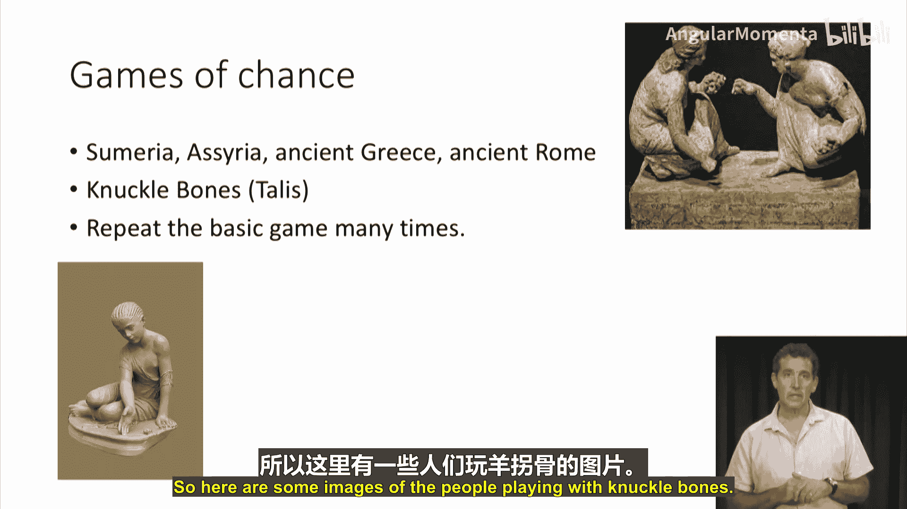
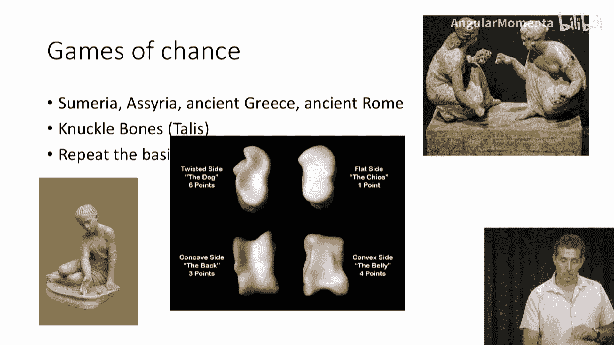
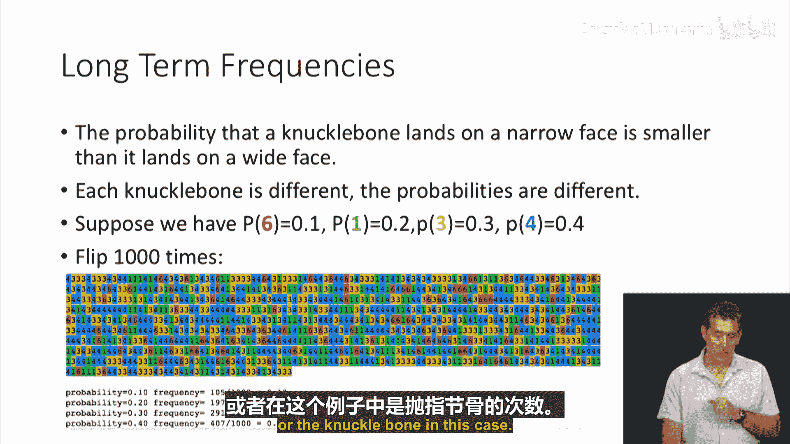

# 【加州大学圣地亚哥分校】使用Python进行数据科学中的概率与统计--Probability-and-Statistics-in-Data-Science-p06-02-05-05-概率论与统计学发展史--BV1gJFDzkEPg_p6-

系い。Today I want to tell you a little bit about the history of probability and statistics。

 this is not because this is a course about history。

 but simply it would really help you before we start working on the details and mathematics of doing probability it would help you to know what is the general framework and what are the kind of questions that people ask in statistics and it turns out that it's a very diverse set of questions so it's helpful to know from the get go about these different types of questions。

So in general， you can say that statistics and probability in its modern form started around 1650。

But the types of questions that have been asked fall into two groups in general and one is repeated games of chance。

 and the other is strength of evidence and degrees of belief okay so this is a kind of diagram that shows many of the things that happened during history in these two threads but we're going to look at this diagram more in a future video but now we're going to just start looking at some of the major component and to remind you again there is a red component which is games of chance and there is this blue component which is about degrees of belief。

Okay， so games of chance， games of chance have existed for a very， very long time。

 much before the 1600， probably from before Christ。嗯。

And the earliest kind of games were based on what was called knuckle bones or tallies。

 so those are bones that are taken from goats and they were used to play games。

And the important thing about these games is that they were played many times one after the other。

 okay， so here are some images of the people playing with knuckle bones。

And here is a picture of what the basic knuckle bone game is。

 this is the strain shape of the knuckle bone and depending you throw it in the air it falls and depending on the size on which it falls。

 you get different amounts of points okay so this is the ancient game of knuckle bones。

So of course， today we have many different types of games of chance， we have dice。

 we have the roulette， we have cards， we have coins that we flip。And in general。

 before any probability was known， this was kind of seen as a way to check your luck or to see what God is trying to tell you。

And the simplest assumption when you play these games is the equal probability assumption。

 so if you have in dice six sides then each side has a probability of16 or if you have a coin each side has probability a have and so on so you just assume because of the design of the thing that you're playing with that all of the outcomes have the same probability and that's the simplest setting of probability and we're going to work with that quite a lot okay but it doesn't always hold so it's true for dice and roette but it is actually not true for knuckle bones because knuckle bones are asymmetric and so the probability that they fall on different sides is not the same。

So then in that case， is it that we what does it mean that we say that the knuckle bone has different probabilities for different outcomes？

哎。So the probability， as I said， of a knuckle bone to land on a narrow face is smaller than to land on a wide face。

So each knuckle bone is different and so the probabilities are going to be different。

 but let's just assume for now that the probability of the four sides is as it says here 0。10。20。

3 and 0。4 so those are the probabilities of the four possible outcomes each one with the number of points that you get。

So what we can do and you can download that notebook is we can simulate flipping the knuckle bone many times and seeing what comes out。

So let's flip it 1000 times。And here we have the sequence of 1，000 outcomes。

And at the bottom here we have how many times we got each one of the outcome， so 105 197。

 when we normalize it according to to to the number of total cons that we found we get 0。1 0。2 0。

29 and 0。41 which are really very， very close to these probabilities we started with。

 so that's what we call long-term frequencies， longterm frequencies are basically the assumption that when you throw something many。

 many， many times you the frequency， the number of times that you get each possible outcome。

The fraction of that from the total converges to some fixed number。

 but of course that depends on how many times you throw the coin or the knuckle bone in this case。

 so if we throw it 100 times that's much fewer and now the fractions that we get are more distant from the true probabilities。

And if we throw it just 10 times， then for instance the outcome3 here that has probability 0。

3 actually didn't happen at all， so we got0 okay so if you repeat this kind of game just a small number of times。

 you get what you don't get anything related to the probabilities。

 but on the long term you get the long term probabilities。Okay， so。

So these are the kind of questions that you can ask about probabilities and the typical one that was asked in this famous letter from Pascal to Fminine 1 in 1654 is the following。

 suppose that we have a game that is just pure chance， basically we have a game of cards。

 but there's nothing that is in it that helps you if you're talented in this game。

 it's just pure chance。And the game is played until one of the sides wins。Okay。

 and both sides put in $1。And the winner takes the $2。

So suppose now that the game is stopped before one of the sides wins and they just have to stop it and go their separate ways。

 so how much money should each one of them take that's really the question。

And so to to answer this question， you want to say given the cards that player one has。

 what is the probability that player one would win at the end Okay， so that was the question that。

Hpacal solved for some cases and sent in a letter to Fairmind。

 that is a classical question that is about games of chance， frequencies and probabilities。

So that's the frequentest point of view。And it basically says the only thing that probability means is that when you repeat the same game or the same trial many。

 many times on many， many people or many， many cases。

 then what you get converges to the probabilities， that's what probabilities mean。

And this gives you a foundation on which most of the mathematics of probability theory can be built。

And it makes sense in games and other situations like polling。But it doesn't always make sense right。

 so sometimes it really does not make sense to think about probability as something that is the result of repeating the same game many times。

 so here are some examples。So suppose the meteorologist says that the probability of rain tomorrow is 10%。

What does it mean？It will either rain tomorrow or not rain tomorrow。

And tomorrow is going to happen just one time。 You can't repeat tomorrow more than one time。So。

You can't really think about this probability of 10% as if you repeated the same day many。

 many times， 10% of the time it would rain No， because that day just appears happens one time。

Similarly， suppose a surgeon tells you。That there is a 2% chance of complications in a particular surgery that you're considering taking。

So it might mean that 2% of the patients that underwent surgery had complications。 Okay。

 so thats' that's a reasonable meaning， but。What does it mean to you right so for instance。

 maybe most of the complications were with patients older than 90 and youre 35 years old。

 so it's really irrelevant for you right so this 2% just doesn't mean anything for you。Okay。

 so this leads us to the other type of probability that has to do with confidence。

 with measuring evidence， and basically quantifying opinions。Okay， so if we go back to before 1650。

 there was this word probable， people used it。But its meaning was not quantitative。But even today。

 if you say this is probable or probably， it doesn't have any quantitative meaning。

 here's the meaning that you find in the Webster dictionary。

 insofar as seems reasonably true or factual or to be expected or without much doubt。

RightSo all of these things they are just basically saying probably means very likely it is very likely to happen。

 or I'm pretty sure it will happen right so that's very common but unrelated to mathematics。

 unrelated to games of chance。So one term that was used before the 1650， that is kind of shows how。

This word probable was used is that there was a term called probable doctor。

And what it meant was that when you say that someone is a probable doctor。

It meant that this doctor was approved by some authority okay so probable just means approved by some in some way and approved meant that at that time in Europe it means simply the church。

 the church said that this is an approved doctor right so that meaning of probably was really very different than what we intuitively think about today。

Today， MDs are approved also they're approved by board and after they do the board exam。

 then they're approved and they're a good doctor or their approved doctor or the board certified doctor。

 so we're actually not that different from back then， even though we use different words。Okay。

 so let's think about the kind of problems that are faced by a doctor。

So if you want to diagnose a patient， it requires putting together many different pieces of information。

Okay， so this is a little diagram that gives you different types of information that goes into the diagnosis。

 the patient interview， physical exam， medical history， medical tests。

And most of the information is uncertain， right， you don't really know exactly is what is the blood content of a person。

 you know for a particular sample it might change from day to day。

And also different pieces of information have different levels of relevance， right。

 it might not be very relevant the results of the blood test or it might the X ray might reveal a lot。

 or the MRI might reveal very little so when you're in this situation。You have。

Information coming from different places。And with each piece of information。

 you somehow want to associate the confidence that you have now the doctor does this by and large intuitively。

 but this kind problems appear all over and not just in medicine。

So when we talk about combining evidence， we are talking about things that are central to medicine。

 to economics， investment， law， science， technology， many。

 many different things that rely on basically combining evidence and if they want to do it quantitatively。

 then they use probability。And statistics。Okay and typically you don't repeat an experiment many times。

 so in some very particular situations you do， but in most of the important decisions that you're faced or a doctor is faced。

 they have this one patient that they need to treat so there's no meaning to saying really what's the probability of something。

Okay， so the math of this is provided by probability theory。

 but much of the discussion around it is not mathematical。

 So it is really discussion that has to do with。Convincing and with how do you compare this evidence to another evidence。

 some of it is math and much of it is discussion and that's the type of things that you get in statistics。

 you don't get really cut and dry outcomes。A popular approach to putting all of this in a very common framework is Bayesian statistics。

 so Bayesian statistics puts it as its main thing， how to evaluate evidence and how to combine evidence and it is not。

It doesn't take the same approach as frequentist， even though fundamentally they use the same math。

Okay， so that's basically the rough introduction I started with。

 and there are more details in this image here and in a future video I will go with you through this image and tell you some more of the details。

Thank you。