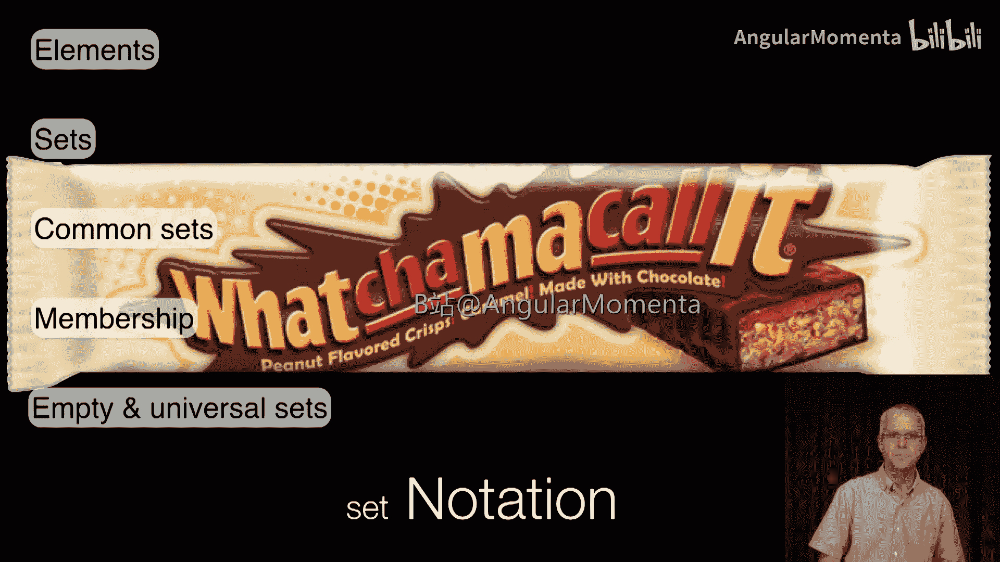
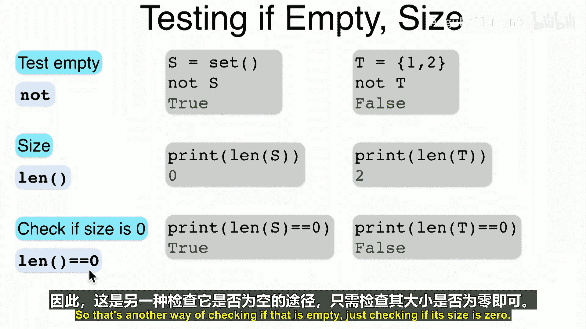
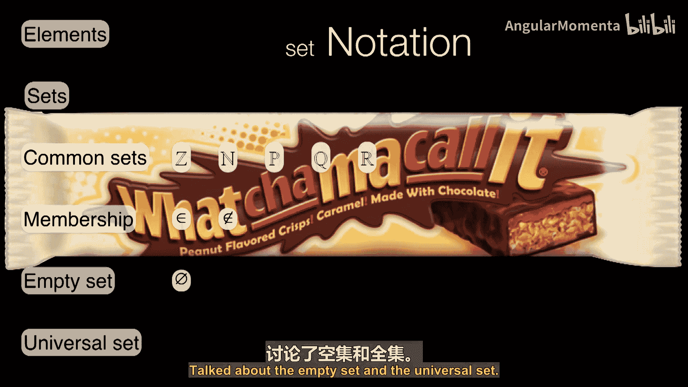

# 【加州大学圣地亚哥分校】使用Python进行数据科学中的概率与统计--Probability-and-Statistics-in-Data-Science-p07-03-01-03-元素、集合与隶属关系--BV1gJFDzkEPg_p7-

Hello and welcome back。Today we'll start talking about sets and we'll begin by giving things names so we can describe them precisely and concisely。

And we'll talk about elements sets。Some common sets， membership， and the empty and universal sets。

We begin with the foundation of sets or the building blocks。

 and they're so basic that we think of them as our atoms so make we now wonder that we call them elements。

And elements can be anything。 they could be a famous athlete like Leosi or a tech company like Google or a helpful drug like aspirin。

And in reality， the sets will deal with typically， I'm sorry the elements we'll deal with typically will be more structured。

 like letters or words or documents or web pages。And。

Because we care about probability and statistics， then we'll talk a lot about numbers。

 but at some point finding cute pictures for so many different things becomes a little tedious so the numbers may look like this。

 but of course we'll know we're talking about really exciting stuff。Now。

 beyond individual elements as important as they may be， we often want to look at the bigger picture。

And so to do that， we look at sets which are nothing but collection of elements， in fact。

 collection is just a synonym for set， just a fancy name for a set。And so to define a set。

What we'll need to do is。We need to specify the elements and we do it by simply listing the elements and putting them inside a frame。

And so using this method， we can specify。Many different sets。

 and we can satisfy we can specify sets explicitly。 For example。

 everyone knows that a coin has two sides， heads and tails。And our bits are zero and one。

And a dye has six faces。And once the set becomes a little larger。

 then we often want to be a little more implicit and leave some elements out， for example。

 if we're talking about the set of digits may say01 up to9 or the set of letters A be up to Z and days。

 Monday， up to Sunday and if the sets become even larger and more complicated。

 then sometimes will just be descriptive when we when we specify them and we can say for example。

 the set of all four letter words and everyone knows what we're talking about love like de and so on。

Now as we progress in this description hierarchy， we get to be more compact and more expressive。

 so this descriptions are more compact and more expressive and both of these are good。

 but they also get to be more ambiguous so it's a little dangerous。

 so whatever you method you want to choose， just make sure you focus on one thing and that is make sure that you're clear。

Now we can use this to describe several common sets。

One of the most common ones is the set of integers they go from minus infinity to plus infinity。

 including minus2 minus1 and so on， and it's denoted by z。

 the set of natural numbers that start from zero and then go1 to and continue so it's about half of the integers。

Denoted by n， the set of positive numbers，1 to 3， and so on denoted by p for positive。

 the rational numbers which are just integer ras of M and N so rashes of two integers when the denominator is non zero so we don't divide by0 and these are called Q for quotients because they are quots of numbers。

And the reals， whose definition is so simple that you can just look it up on Google。

Now you'll notice that we use here and we typically use mnemonic names that we can remember。

 for example， all four real cu for quotients。P for positive and for non negative and the only one that we may not understand is Z for the integers。

 and it's not like they ran out of letters and had to choose the last one because this would be the first set that they defined。

 so that's not the issue。And the reason is that is the named after Zal， which in German means number。

🤢，Okay so as you can also see here we'll be using a convention， maybe a convenient convention。

 and that is we'll use for sets， we'll use uppercase letters like here。And for elements。

Well use low case letters like small A we're going into see。Allright。Now， once we have sets。

 we want to say what's included in the set and what's excluded in the set。

 and so if an element x is in a set A， it is called a member of the set or each set belong to a and is thenoted by x where this symbol belongs to a。

Okay，So for example， 0 belongs to 01， well and 1 belongs to 01。

 and pi belongs to the set of real numbers。Equivally， if x belongs to a。

 we say that a contains x and write it like this a with this symbols。

 which is just the original symbol belongs to reversed so for example， 01 contains 0。

01 contains 1 and the real numbers contain pi。Allright now we also want to talk about the opposite of this thing and whenever you have some nice term like a nice shoe you want also to have the other one。

 so we're going to talk about the converses of these terms。

 so if x is not in a set A then x is not a member or does not belong to a and'snot by x and cross that belongs to sine x does not belong to a for example2 does not belong to01 and pi does not belong to the set of rational numbers。

And equivalently， instead of saying that x does not belong to a。

 we can just say that a does not contain x， which is denoted by this a does not contain x。

 so for example，01 does not contain 2 and the rational numbers do not contain pi。

So with these definitions we are ready for a first quiz， it's a quiz about a set of states， in fact。

 about a set of the United States。So I'll show you a couple of states and you'll tell me if they belong to this set or don't。

So for example， does this state belong to the United States and the answer is yes， belong。

 so it belongs to the United States， it's the state of California。

 how about this state belong or does not belong？Yes， it's the state of Florida。

And this state belong to this set of states。Yes， it also belongs the state of New York。And finally。

 does this state belong or does not belong？No he doesnt， this is the state of Israelra。はい。

So in the definition of said some things matters but some things don't so for example the order doesn't matter。

 the set01 is exactly the same as 10 and you can see for example if you have the set of states the order doesn't matter we're just looking at the collection of all states all 50 states here it doesn't matter how we specify them Another thing that doesn't matter is repetition if you write 01 it's the same as 0111 and just think of it that if you're going to insult me once or you're going to insult me many times it's pretty much the same。

Okay now you can ask what if and what if for example audio matters。

 what if you want to specify the order， then you can use order totals， for example。

01 and that's going to be different from10 so here the audio matters。

 and if for petition matters then you'll use what's called multiet over bag but don't worry。

 as they say we'll cross this bridge。In a few lectures。Okay。

 so let's whenever you have a whole bunch of sets， of course some of them are going to be a little more special than others and now we're going to talk about two special sets。

 I'm going to talk about the empty set which contains no elements and it's denoted by this symbol here that looks like fee but is not exactly that is a symbol for empty set。

Or it's dennot by。This collection is collection of elements， but there is nothing inside。 In fact。

 this is the Python notation for an empty set。As we're going to see。

 so this set is has the property that for everyVx that you take x does not belong to it and you recall from a logical not that for all a inverted like this means for all or every so everyx or all x do not belong to the empty set。

We'll also consider the opposite of the empty set which is the universal set。

 so the empty set is the smallest set you can think of universal set is the largest set you can think of and this set contains all possible elements and will denote it by omega so now for every Vx that you take x will belong to omega。

And the reason we introduce omega is because it lets us consider only relevant elements。

 So for example， if we。If we take omega to be Z the set of integers， then if we talk about a prime。

 then we know that it means numbers like 2，3，5， and so on， prime numbers。

 and it does not mean Amazon Prime or prime real estate or even prime Res as much as some people would like it。

Alright， so notice that omega， the universal set will depend on our application， so for example。

 if we talk about temperature， maybe we'll choose omega to be the set of real numbers and if we talk about text maybe omega will be the set of words。

 so omega changes with the application application。

 but there's always going to be only one empty set is the set with no elements。

 so the many there could be many different universal sets omega that depend on what we want to do but there's always going to be one empty set it's a set with no elements。

Alright， so let's see how Python deals with threat sets so first how do you define a set in Python so to define a set you can just specify the set or write set and then in parentheses the function and then inside specify the set so for example you can write set one equals one2 and then print set one it will give you a set one2 or you can define set two to be the set consisting of two and3 this is the second type of definition set。

Se function2 and3 and then print set two， it will give you to and3。Now。

 if you want to define an empty set。Then you can only use the second notation set of something or set with this empty set so for example。

 empty1 you can write set of nothing and then you ask what is the type of empty we willll tell you a set and print empty1 it will give you set of nothing or you can define empty2 to be the set and then you can specify the empty set here and type of empty2 also set and print empty2 also set and。

You can define so what you could try to define not a set to be this。

 so we're trying to use this definition， and then if we try to type type of not a set you'll get a dit and that's because it defines it as a dictionary and so you should not use this to define empty sets。

 only these two notations。So this is not an empty set with a dictionary， right？Now。

 if you want to test membership。Then you can just type in。For example。

 if you define furniture to be the set containing a desk in a chair and if you type desk in furniture。

 then Python will tell you that this is true and if a type is bed in furniture。

 it will tell you a force because bed was not here。

If you want to test whether an element is not in a set， then you。

Maybe as you'd expect type not in so you can define furniture to be the same way and you can type desk not in furniture and will tell you false because desk is in furniture and you can type bed not in furniture and we'll tell a true because B indeed is not in furniture Finally let's see how to test whether the set is empty and along the way also see how to find the size of a set so to test if a set is empty we use the not command and so for example if we define S to be the empty set like that。

And we ask right not S， what we're really asking is whether s contains no elements。

 so not S means that S contains no element and what you'll get here is true because indeed S contains no elements。

On the other hand， if we define T2 consists of two elements，1 and 2， and we ask not t。

 we're asking whether t contains no elements and the answer is going to be false because t does contain elements。

Now this may look a little unintuitive and it is。 so there's also another way to check whether a set is empty。

 So first to find the size of a set in Python use the length command stands for length so for example you can type print length of s and s is the empty set andll give a0 and print length of T will tell us that t has size 2 contains these two elements so we can also check whether set is empty by checking if it's size is0 so namely we check whether length is equal to 0 so we can print length of s is0 and the answer is going to be true because I says zero elements therefore it's empty and for t we can print length of t equal to 0 we're checking and now the answer is going to be false because the length of T the size of t is not zero and that means that t is not empty so that's another way of checking if a set is empty just checking if its size is0。

Okay， so with that we are done and what we have discussed in this lecture are elements and sets。

 and we define some common sets like the integers， the natural numbers， the positives。

 the rationals and the reels， and we talked about memberships。

 belongs to and doesn't belong to and so on， talked about the empty set。

And the universal set and what we're going to do next time is talk about some basic sets。

 see you then。

