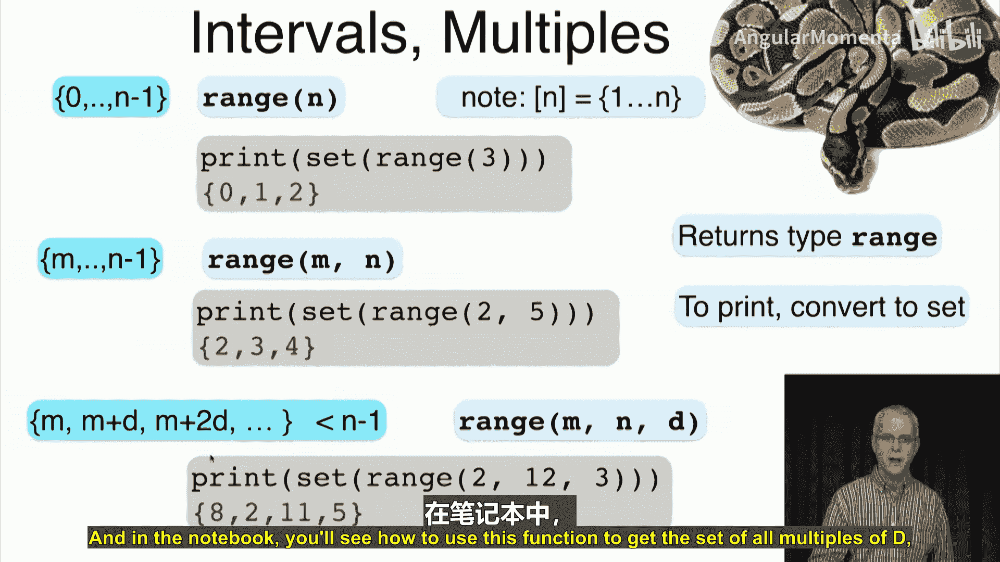

# 【加州大学圣地亚哥分校】使用Python进行数据科学中的概率与统计--Probability-and-Statistics-in-Data-Science-p08-03-02-03-若干简单集合--BV1gJFDzkEPg_p8-

Hello and welcome back in the last lecture we introduced sets and now we would like to define a few basic sets roughly you want to get a new few new toys I'm sorry new tools such as intervals and devices and multiples that we'll be able to use later on。

So you can define sets within other sets， for example。

 if you have a universe or any set you can define a set within it by writing something like that。

 you write the set of all x inside a set A and with this bar sign that would mean all the elements x in a such that tada dot holds。

And sometimes instead of the bar， we'll use the co sign2 dots， for example。

 if you look at a set of natural numbers， you can define it as the set of all integers。

Such that x that is bigger than equal to0， so the set of all integers that are bigger than equal to 0 is the natural numbers。

Or you can define the set of positive numbers to be the set of all non negative numbers that are strictly bigger than0。

And this is useful for many things， for example， if you want to write solutions to equations。

 then you can write the set of all real numbers x， such that x square is bigger than equal to zero。

 that will be， again， the set of real numbers。😊，Or if you write the set of all real numbers x。

 such that x square is 1， that will be the set minus1 plus 1。

Or the set of all real numbers is x such that x square is0。

 and that's going to be just a set zero and one thing to notice is that when you have a set of a single element like this one。

 we'll call it a single tone。Or you can define a set of all real numbers。

X such that x square is equal to minus-1 and that of course is the empty set because no real number square is equal to minus1 whereas if we defined the set of all complex number x such that x squared minus1。

 that will consist of I and minus I， so you notice that it also depends on the set that you're restricting yourself to here's restricting yourself to r and herere to the set of complex numbers。

All right， so with this definition we can define a few simple sets， for example。

 the set M dot dot n is the set of all integers I such as I's between M and N。

And so this is the set from M to n inclusive， namely inclusive means inclusive M and inclusive of M and inclusive of n。

And for example， the set 35 is the set of all integers that are bigger than equal to 3 and less than equal to 5 and that's 345。

 you can visualize it like that here are all the integers on the line and we are here defined the set 345。

And the set 3 dot。4 is the set of all integers between3 and4 inclusive， that's just3 and4。

The set 3 dot 3 is the set of all integers between 3 and 3， which is the3。

 and the set 3 do 2 is the set of all integers that are bigger than equal to 3 and less than equal to 2。

 clearly that's den。So one convenient convention that we'll adopt is that if we want to write a set 1 dot。

t1， the set of integers between 1 and n well just write with square brackets around it and that will stand for the set one up to。

Alright， so just like we defined integer intervals you can define real intervals。

 so if you write a B like that with square brackets that will be the set of all real numbers x such a x is bigger than equal to a and less than equal to B and this square bracket here will indicate that in this case B and a are in the set so for example if we have 35。

 that's the set of all elements or real numbers between 3 and 5 and we'll put like here a solid circle that will indicate that 5 is in the set and likewise here 3 is in the set。

If we want to indicate that an element is not in the set and then we'll use just a regular parenthees instead of a square bracket like that and that will indicate the element is not the sets of example。

 AB， the real interval from A to B is the set of real numbers x。

 such that x is strictly between A and B， so x is strictly bigger than a and strictly less than B。

So this indicates that B is not in a set。And so for example。

3 to5 is the set of real numbers that are strictly bigger than three and strictly less than five and will denote the Hol circle。

To， to show that this element 5 is not in the set。 Okay， so we can mix them。 So here。

 A B with square bracket and and and just regular parentheses。 That's the set of all。

Real numbers that are bigger than or equal to a because we have a square bracket here and strictly less than B because we have a retal parenthsesis here。

And so 35 is the set of all real numbers that are bigger to include with three。

 and here we have a solid circles so three is included and strict less than  five empty circle5 is not included and likewise we can have。

3，5 is this set here。Okay， so a couple of examples， if we have 3，3， we both are included。

 that's just the element 3 to single term okay， if we have3，2。

 that's a set of all real numbers that that are bigger than equal to 3 and less than equal to 2。

That's the same as the set of all real numbers that are bigger than equal to 3 and strictly less than3。

And that's the same as the set of real numbers that are strictly bigger than3 and less than equal to 3。

 all of those are equal， of course to the empty set。Right。The next thing after intervals。

 we want to define our divisibility， so if we have two integers M& N。

Then if n is equal to some C times m where C is some integer。

 then we say that n is a multiple of m or that M divides n and write m with this vertical line n。

 so that will mean that m divides n， let's do a couple of example，6 is equal to two times 3。Okay。

And that would mean that 3 divide 6 y， because here n is 6 and M is 3。

And we say that there is some constant C in this case2 such that n is c times m。

 for in this case 6 is 2 times 3， and that means the3 is divide 6 or that6 is a multiple of three。

Likewise minus8， it can be written as minus2 times 4。

And that would mean that 4 divides minus 8 or that 8 is a multiple of 4。

 and again that's because 8 here is our n and 4 is M and we can write 4 times some constant in this case。

 minus-2 to get minus-8， so the 4 minus8 is a multiple of 4 or4 divides 8。And similarly。

0 equals to0 times minus2， and that would mean that minus2 divides 0 or that zero is a multiple of minus2。

And just one note， I guess note on notation。We're using the bar here to denote the visibility。

 like two divide4， but we used it before to indicate sets and you should be able to tell which one we mean from the context obviously。

 and that's just because it's just a simple notation that it's very tempting to use it more than once。

All， so if you cannot find a C such that n is going to be equal to c times m。

 if you cannot find such c， then we say that m does not divide n or that n is not a multiple of m and we didote it by saying that M does not divide n。

So for example， there is no constant integer constant such that 4 is equal to this constant as 3。

 and therefore we say that 3 does not divide 4 or 4 is not a multiple of three。So for example。

0 does not divide any number that is non0， so for example0 will not divide 1 because there is no number c such that  zero times C will give you1。

Okay， so the zero does not divide。Any nonze and any nonze is not a multiple of zero。

Okay so let's just do a small quiz first let's consider multiples。

 so3 divides what or in other words， what are the multiples of three？

These are all the elements of the form minus6， minus-3，0，3，6， and so on。

1 divides what or what is a multiple of one。Clearly。

 any integer is a multiple of one because any integer we can write is some constant times one。

 name that integer times 1。And zero divides what or what is a multiple of0。

 well as we said in the end of the last slide， only0 is a multiple of0 and that's it。

And let's look at div， what are the divis of four。Very clearly， those are plus 1。

 plus -2 and plus -4 are divide of4。What are the devices of0？namely what which integers divide 0。

 the only so we can see that z itself is divide 0 because we can for any integer n。

 we can write0 as this whatever n times 0， So therefore any n divides 0 or 0 is a multiple of any。

Finally， which numbers divide any and which is non0， namely。

 is there a number that divides any integer that is known in0？

Clearly one divides any integer that is not0 and minus1 divides any integer that is not0。And also。

 you can say that plus minus n， if you're allowed to change your answer here。

 and plus minus n divides N， which is an answer zero。so given those definitions。

 we want to define the set of multiples， so let M be an integer。

 then we'll denote by Mz be the set of integers， the set of integer， the I such that m divides I。

 in other words， the set of all multiples of M。Okay， so there's a set of all integer multiples of it。

 So for example， 2 z。Is the set minus4， minus2，024， these are all multiplepos of2。

Two times anything and we'll call the set will denote it by E and call it the set of E numbers。Okay。

1 z is the set of all multiples of 1， and that's going to be all of z minus2 minus1。

 all of them any integers a multiple of 1， so that z and0 z is the set of all multiples of0 and that's just0 itself。

Okay。Now， if m is an integer and n is a positive number。

 then we'll denote M of the set n and remember that this set n is the set of integers from1 to n to be the set of all integers in one up to n that are multiples of m。

 so these are all multiples of m in  one up to n。So， for example。

 three multiples of3 and 13 is the set of all integers between 1 and 13 that are multiples of  three and these are what these are just。

These are just three，6，9， and 12， all multiples of three that are between 1 and 13。

And if we take multiples of seven in one up to 13。That's going to be this just the element7 because7 times0 is0 is not in one between 113 and 7 times 2 is already 14。

 which is not in 1 to 13。And if we take one multiples of 1 and 13， that's the set 1 up to 13。

And if we take multiples of 14 and 13， that's the same as multiples of 0 and 13。

 both of those are the empty set。And again， we're going to use it for future definitiones。

It examples for future definitions， and we'll do that fairly shortly。All right。

 so to see how to implement intervals and multiples in Python。

 let's start for example with the set from 0 up to n minus1 in Python you just define it using the range function called say range of n and that will give you zero up to n minus1。

 notice that it's a little bit different from our bracket n set that we defined which was the set of integers between 1 and n and that's because Python uses the zero convention where start with zero and take the n elements from then on。

And just small caveat is that range returns a type range。

 so to print it you need to first convert to a set， so for example， if you want to print the set 012。

 you type range3， convert it to a set and then print it will give you all the three elements starting with0 name with 012。

And if you want the elements from between m and minus1 inclusive， then using the same convention。

 your right range of M and N that will give you all the elements that are bigger than equal to m and strictly less than m。

 for example， if you type range 25， that's the elements 2，3 and 4。

And if you want to have all the elements starting from M， M and m plus D and M plus duty and so on。

 up until you get a number， the last number that is less than n minus1。

Then you type range of mN and D， so for example， if you type range of 2。

 12 and 3 that will give you two and then loop 2 plus3 h is 5 and then 8 and 11 and the R and notice that because it's a set then the order is somewhat random and so we don't get them in increasing order but still the correct set and in the notebook you'll see how to use this function to get the set of all multiples of D which are in the setting。

Allright， so just let's recap， so we introduced a few new tools that we're going to use。

 we talked about intervals such as integer intervals m to N。

 we talked about this bracket n which is this set of integers from one to n and real intervals such as a inclusive of a and exclusive of B。

 we talked about devices and multiples and which we denoted by M divided by n and we talked about set of multiples such as DN。

 it's the set of all multiples of D in one up to n and what we're going to do next time。

 we're going to visualize sets， C then。

