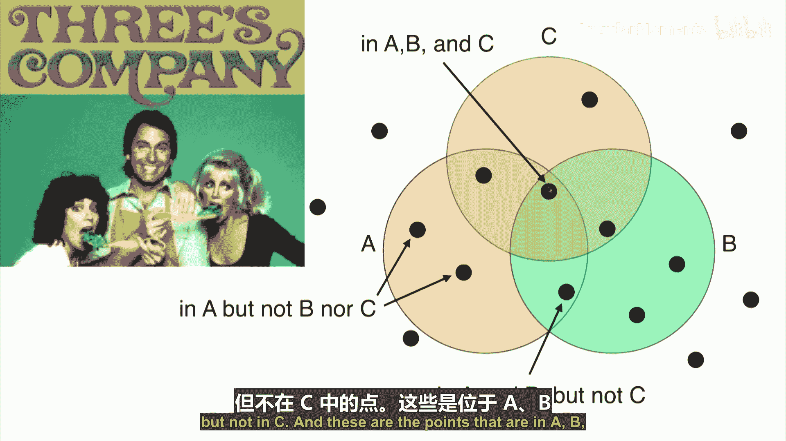
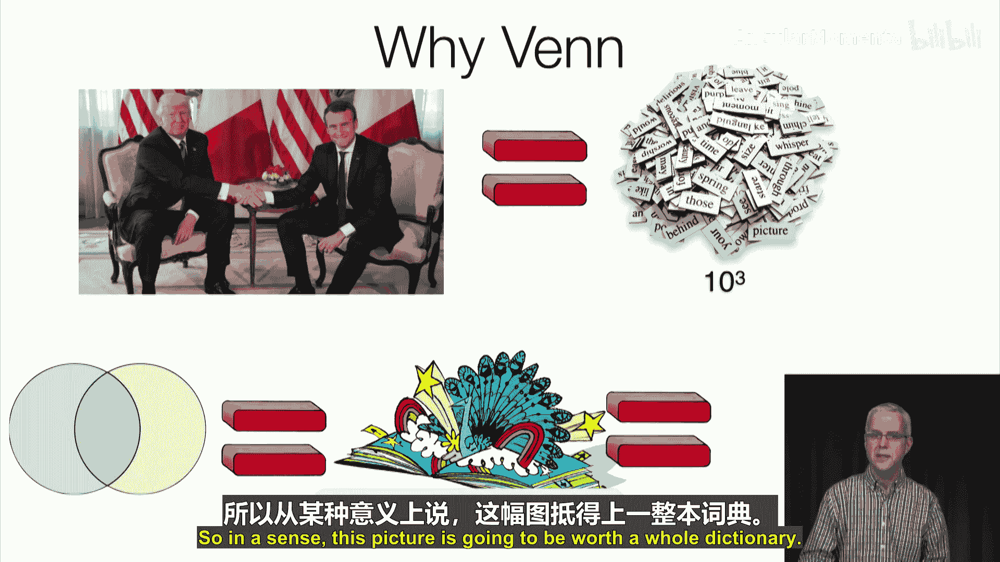
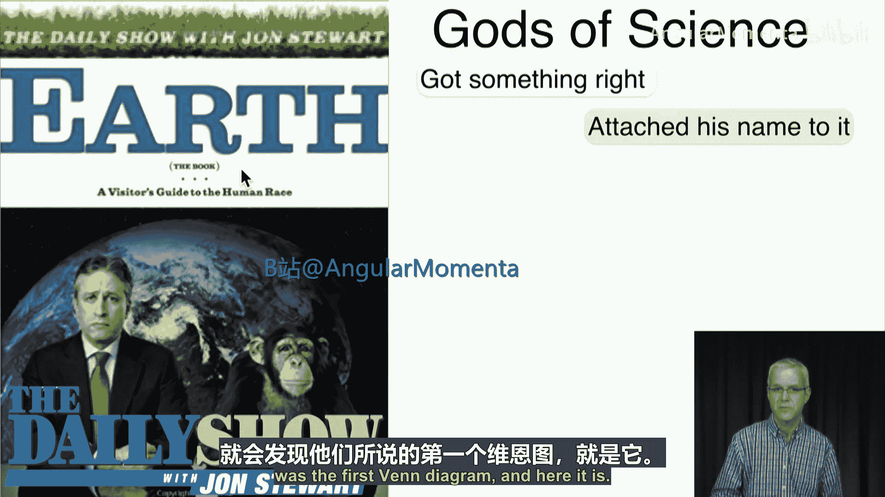
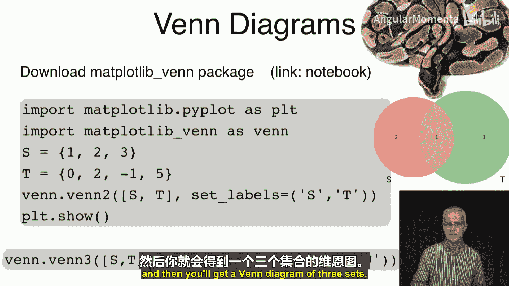

# 【加州大学圣地亚哥分校】使用Python进行数据科学中的概率与统计--Probability-and-Statistics-in-Data-Science-p09-03-03-03-集合的可视化--BV1gJFDzkEPg_p9-

Hello and welcome back。 So now that we have defined and created sets the next thing you want to do is visualize them and advertise them and as we all know。

 this is best done using Instagram except that sets were defined the way were introducing them now a couple hundred years ago and at that time the hottest thing was not Instagram but rather a diagram and specifically a Venn diagram and Venn diagrams are named after John Ven who besides being a mathematician and a priest was also an avid cricket player and he even designed machines that collect cricket balls and so it perhaps not so surprising that when you wanted to visualize sets he visualize them as regions that often use look round like a ball like this ball and he visualized sets as elements as points inside those regions so for example。

 if we consider the sets Si1， then here we have all the。It shows maybe minus1， 01，2， and we put。

This circle around 0 and1 meaning 0 and1 are in the set and minus-1 and 2 are not in the set。

 or if the elements are whatever they could be， we can put the circle around the elements that belong to the set like here so these are elements in the set and the elements outside are not in the set or if we don't even want to even draw the elements we can just draw the circle and we know that whatever is inside will be in the set and whatever is outside this region will be will not be in the set。

And one， you know a single set gets a little boring。

 so one thing led to another and he looked at two sets。

 so here collection of points and if you have a set A so these will be the elements in a set A。

These is all the points in A， and here we have another set B。

 so all this four points here will be four points in B。

And then if you look at this region here where the two sets overlap。

 those two are points that are both A and B。And here appoints the time neither A nor B。And of course。

 things get。Much more interesting still if you have three sets and so here are three sets， A。

 B and C， and these are the points that are in a。But not in B， nor in C。

 and these are the points that are in A and B。A and B， but not in C。

And these are the points that are in A， B， N， C， and outside are the points that are not in any set。

 So why are we interested in vent algorithms， Because everyone knows that a picture is worth。

1 thousand words and when it comes to sets and probability。

 a Venn diagram is going to allow us to replace very long proofs by visual and definitions。

 by visual definitions and visual proofs， so in a sense this picture is going to be worth a whole dictionary。

And if you don't trust me， then maybe you'll believe John Stewart。

 who was the host of the Daily Show and together with his showmates。

 they wrote a book called Earth which is supposed to introduce visitors to a planet to Earth and in this book they have a section called Gods of Science and John Van gets a honorable mention and he gets it for two things first forgetting something right。

 and then equally importantly for attaching his name to it。

 so if you look at this book and you will find what according to them was the first Ven diagram and here it is。

It's the original Ven diagram， it consists of the set that contains the names of people and the other set that contains the names of diagrams。

And guess what's in the intersection， guess what's in both of those sets。Jonathan。So。

If we want to see how to implement Venn diagrams in Python。

 then you'll need to download matplotlib underscore Ven package and there's a link in the notebook and once you do that you can write import matplotlib。

 Pplot as plot and import matplotlib underscore Ven Ven and then you define your two sets s to be1 to3 for example T to be this set and then to plot you write Ven do Venn22t for plotting Venn diagram of two sets and then you can label them you can incorporate the sets S and T and you can label them as S and T otherwise it will just be like A and B and then you just plot or show them and what you'll get is this you'll get the set S because of the label S this set T because of this and then you get the relative sizes so you'll see which one is larger and which is smaller and you can see the inter。

And you can also do Venn diagrams of3 by just Ven。 Ven3 and you write the three sets， STNU。

 whatever the set U is going to be， and you set the labels that you want。

 and then you'll get a Venn diagram of three sets。

Right。So we talked about set visualization， specifically we Venn diagrams。

 and said that we can use them to visualize， to think， to prove and to understand sets。

 and that's going to be very useful in the future for us and next time we're going to talk about such relations。

 see you then。