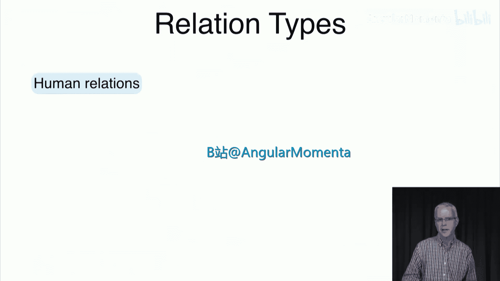
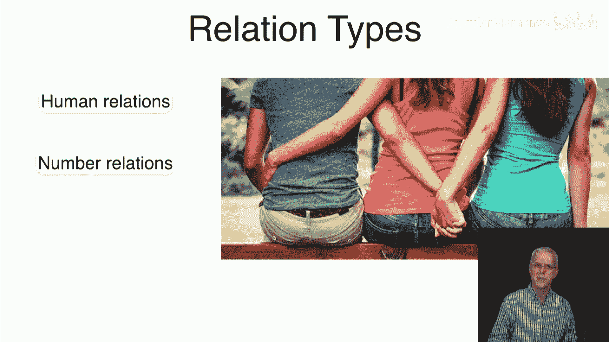
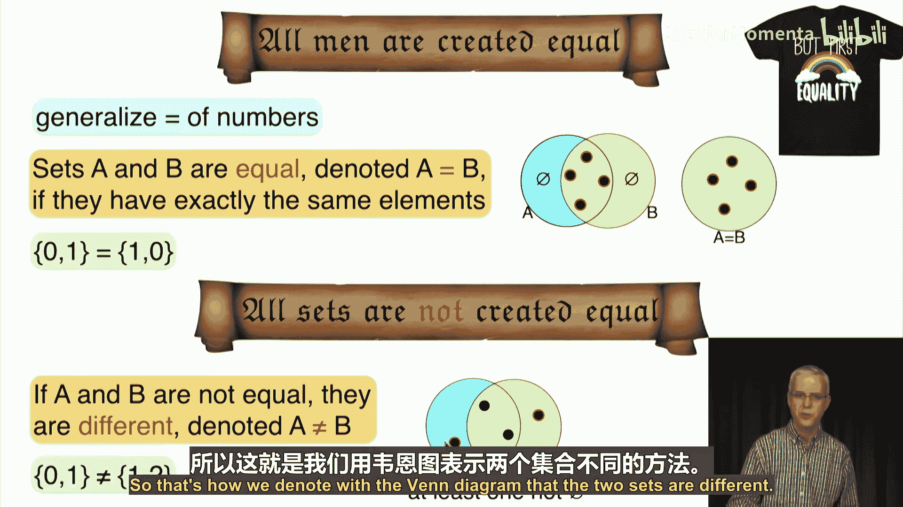
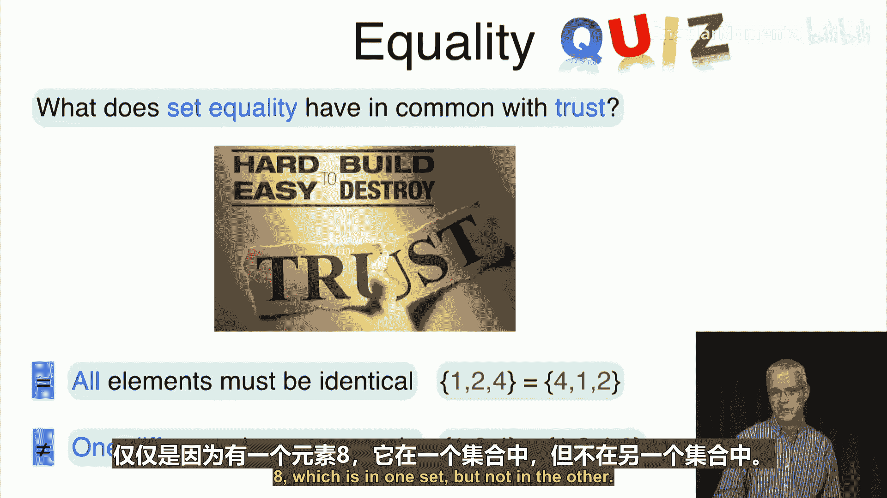
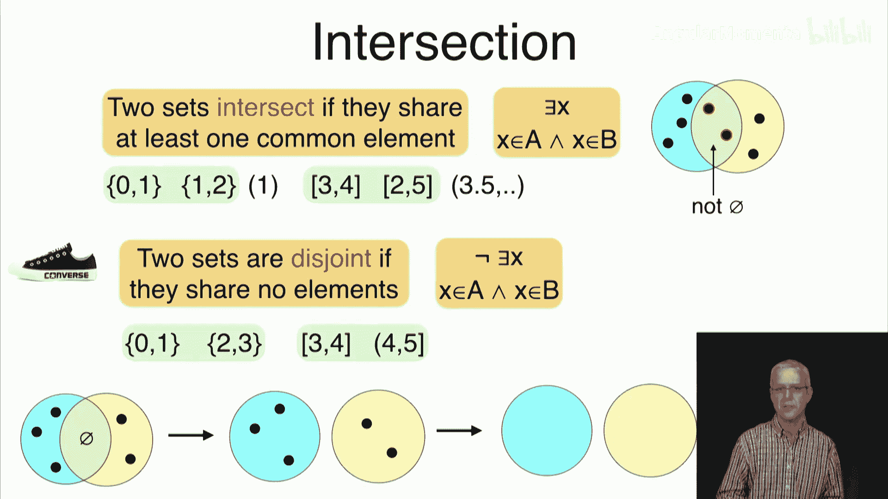
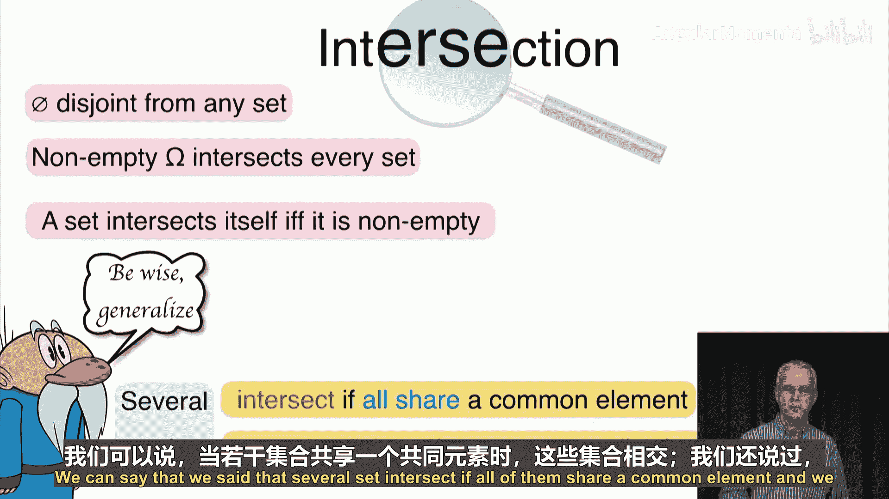
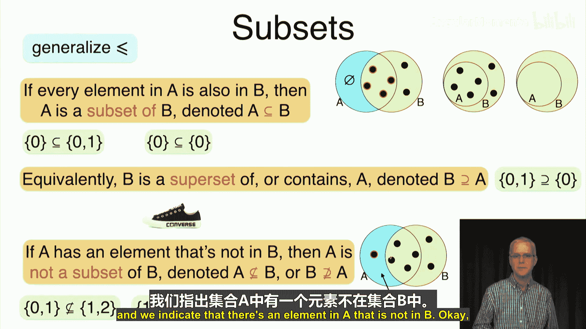
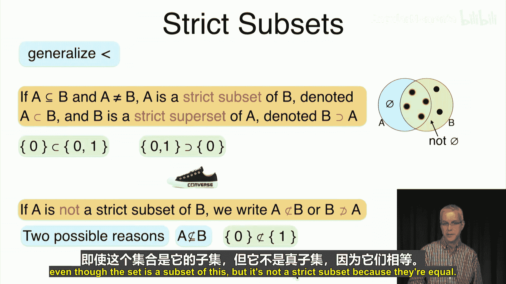
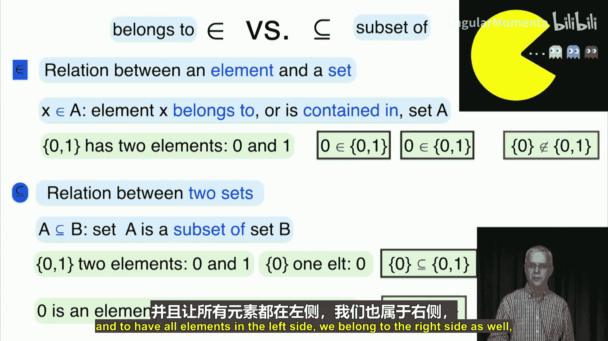
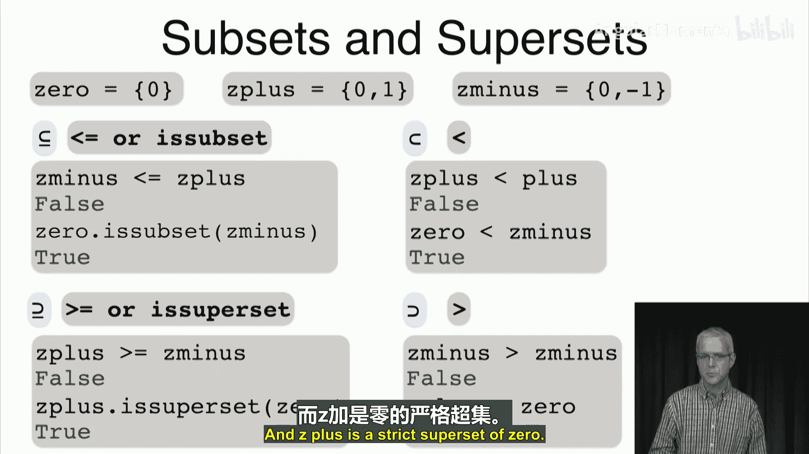

# 【加州大学圣地亚哥分校】使用Python进行数据科学中的概率与统计--Probability-and-Statistics-in-Data-Science-p10-03-04-03-集合关系--BV1gJFDzkEPg_p10-

Hello and welcome back。 So now that we've introduced sets and saw how to visualize them。

 we want to start talking about set relations and specifically we'll generalize some relations between numbers and we'll talk about equality between sets。

 intersections of sets and subsets。OkaySo many types of relations and if you look at human relations for example they can be quite complex so what we'll do is we'll start with something simple which is relations between numbers and specifically we'll look at equality and less than or equal and strictly less than less than and we'll generalize them two sets so that's our modest call for this lecture so carrying the analogy with humans just slightly further we know that all men are created equal so we're going to start with equality between sets and so this as we said we'll generalize equality of numbers so two sets A and B are set to B equal which will node by a equal B if they have exactly the same elements so for example01 and10 these two sets of exactly the same elements0 and1 and therefore they' equal and if we want to show that z Ven diagrams we can show here is the set A and here's the set B and it has to be that they have exact。

The same elements and that means that there are no elements that are in a but not in B。

 so this region is empty， and likewise there are no elements that are in B but not in a。

 so this region is empty too so this is how we deote it and where these two set need to be empty。

But if we don't want to write the empty set even write it twice。

 then what we can do is we can just write the two sets。

 we can draw them on top of each other like this， write as to B that will denote that the two sets are the same。

对。But unlike men all sets are not created equal and there are sets that are different。

 So if A and B are not equal， theyre called different and they're noted by a not equal to B for example。

 the set 01 is not equal to the set12 because they don't have the same elements this one has01 this one is one2 so they' are different and if you want to draw using red diagram we can draw it like that and there has to be an element that is in a but not in B or an element in B but not in a like that so at least one of these two regions。

Must be non empty， so that's how we denote with Ven diagram that the two sets are different。

All， so I have a small quiz about equality and sets。

 so what does set equality have to have in common with trust？😊。

And the answer is that both set equality and trust are hard to build， but easy to destroy。

And the reason is that to get equality， all elements must be identical， so for example。

124 is equal to 418， these two sets are equal and that's because they have exactly the same elements。

 all elements are the same。But to have inequality， it is enough that one element is different。

 so if for example one the set 124 is different from the set 1248。

 just because there's one element 8 which is in one set but not in the other。

So after intersection， I'm sorry after equality， we would like to talk about intersection。

 so the two sets intersect if they share at least one common element on logic terms if there exist in x such as x is in A and x is in B。

And if we take， for example the two set 01 and 12， they share the element 1。

 and therefore they intersect or if we take the two real intervals3 to up to 4 and2 up to 5。

 they share for example， the real number 3。5 and many more numbers they both in this interval in that interval。

 so therefore these two intervals intersect。Now for Venn diagrams。

 we can show the two sets and we must indicate that there are elements that they have in common。

 like here in this light green area， this element， this region is not empty。Okay。And。Conversely。

 if the two sets do not intersect。Then they're called disjoint。

 in other words we say the two sets are disjoint if they share no elements in common。

And logically speaking， it means that there is no x such as x is in A and x is in B。

 or if you want for all x， x is not in a or x is not in。

Now here are a couple of examples01 and 23 share no elements in common and therefore they intersect they are disjoint sorry and 3。

4 and 4，5 they again they do not share any elements because four is the only candidate but four belongs to this set but not to this one because this is。

Open parenttices here so they do not intersect the thisjo and in terms of Venn diagrams。

 what we can do is we can show the two sets and then indicate that element this region where the overlap is empty but if we don't want to write the empty set then what we can do is we can just put the two regions separately so it's clear that there is no element in common and once we do that it's also clear that we don't even need to show the points because we can just try it like that and that will tell us that these two sets or this joint。

All right， so just a few comments about intersection so first。

The empty set is just joined from any set。Because it doesn't show any elements in common with any other set。

And you notice that I'm using the reddish color because this is kind of a result， if you wish。

 and a nonempty universe intersects every set。 So take if you take the universe and it's not empty。

 it's not feel like this， and then will intersect any set and set a intersect itself if and on if if it's non empty。

And so these are three things that are easy to see and one more thing is if you want to be wise and get beyond two sets。

 you can generalize and we can generalize to several sets we can say that we say that several sets intersect if all of them share a common element and we said that several sets are mutually disjoined if every two are disjoined。

All right， so now moving from intersection to subsets。

Substets generalize less than or equal for numbers， so if every element in a is also in B。

 then we say that a is a subset of B and denoted using this symbol， a is a subset of B。

And for example，0 is a subset of 01 because every element of0。

 namely the element 0 belongs also to 01 and notice that0 is also the set containing0 is also a subset of itself that's because every element here belong of this set name is0 belongs to the set on the right side Okay so like in this case we see that the set a is also a subset of itself and using Ven diagrams we can show it by this notation。

 so we have here all the elements of a also belong to B， there are no element of a。

That are not members of B okay so this must be empty and if we don't want to write the empty set we can just put the set A inside the set B and that will show us that every element of a is also an element of B and once we write the sets like this nested。

 then we don't even need to show the element' clear that every point it will be in A will be in B so all these are valid ways of showing subsets using vents。

Now equivalently， if a is a subset of B， then equivalently we say that B is a superet of A。😊。

Or contains a and we thennoted by B with this symbol contains a， and for example。

01 contains 0 because0 was a subset of 01， so I can just reverse the order and write them like that。

And conversely， if a is not a subset of B， that means that if a has an element it means that a has an element that's not in B。

 then we say that a is not a subset of B and denoted by a not a subset of B or B does not contain a。

 so for example 01 is not a subset of 12 because there's an element in in the set on the left namely 0 which is not an element of the set on the right。

 so 01 is not a subset。1 and2 and equivalently， therefore I can say 12 does not contain0。Al right。

 and using Venn diagrams， we can show it like this and there's the set N B and we indicate that is an element in a。

That is not in me。Okay， so this is not empty， this region。

All right， so again， some comments about subset。So if you look at the set P of positive numbers。

 then it's very easy to see that it's a subset of n， the set of natural numbers。

 which in turn is a subset of z， the integers， which in turn is a subset of Q。

 the rational numbers which in turn is in turn is a subset of all the real numbers and we also see that the empty set is a of any set A turn any any set A is a subset of itself。

And also， a reset A is a subset of the universe。And lastly。

 if a is a subset of B and b is a subset of C， then a is a subset of C。

So if every element in a is an element of B and an element of B is also an element of PC。

 then every element of A is an element of C and this is。

This says that that subset is what's called transitive property that if you have that A' is related to B and b is related to C。

 then A' is related to C in the same way it's called transitivity， and very last one。

 if a is a subset of B and b is a subset of A that implies that both of them are the same because every element of A will be an element of B and conversely element of B is going to be an element of A。

 so they have exactly the same elements。All right。And using Venn diagrams。

 we can see it like this because we have a is a subset of B， namely this element。

 this region is empty and B is a subset of A， so this region is empty and that means that everything is here in the area where they overlaps so they have exactly the same elements。

All right。Okay。Allright， now we can also talk about strict subsets and they generalize strict inequality if a is a subset of B and a is not equal to B。

 let we say that a is a strict subset of B denoted by a we have a subset without the equality sign。

And B is a strict superet of a， then by b superet of a， but without a quality。 So for example。

0 is a strict subet of 01。And therefore01 is a strict superet of0 and using Venn diagrams。

 we can see here that we have a is a subset of B， so this part is empty。

 so every element of A will also be in B and also we need to have this region is nonempty so there will be some element in B which is not in a so a is a subset of B。

 but it's not equal to B， so there's some elements which is strictly in B but not in a so conversely if a is not a strict subset of B。

 we write that a is not a strict like this or that B is not a strict superet of a and when that happens there are two possible reasons either a is not a subset of B。

 so that will imply that a is not a strict subset of B。Or a is equal to B。

 it could be that a is a subset of B but the equal is not a strict subset， So for example。

 for here this set0 is not a strict subset of1 because0 is not a subset of1 to begin with。

And here the set containing zero is not a strict subset of the set containing zero， even though。

This set is a subset of this， but it's not a strict subset because they're equal。

All right。And I want to also mention this difference between these two symbols and no I'm not talking about Pman。

 even though I'm talking about something that bothers fresh students maybe just as much and that is the relationship between belongs to this symbol and subset off this symbol。

 so belongs to this symbol is the relation between。An element and a set。

So when we write x belongs to a with this symbol here。

 that means that element A belongs to or is contained in a set A。so for example。

 if we take the set 01 test two elements， 0 and 1， so 0 belongs to 01 and 1 belongs to 01。

 but these are the only elements that can say that they belong to with the symbol to the set 01。

If we take the set0， that set does not belong to 01 because it's not an element of 0。

01 is these just two elements， which are these elements， not the set0。

This for this relationship well need to use subset as we're going to see next。

 so if we use the subset or equal subset like this， then that's a relation between two sets。

And when we write a subset of B， that means that the set A is a subset of the set B。 So for example。

 if we take01 again， the same set it has two elements。

 01 as we have set so if we take on the other hand the set of0 contains just one element 0 so we see that this set is a subset of01 because all its element namely0 are elements here。

 so it follows that0 the set containing 0 is a subset of the set containing 01。And conversely。

 we see that0 is an element of 01， but 0 is not a set。

 and therefore we can write that 0 is a subset of 01 because to do that we need to have two sets here and to have all elements in left side B belong to the right side as well and that we don't have it here。

 So I would like to end with a puzzle we defined what it means to be an element off and to be a subset off and a puzzle is this other two sets A and B such that a is both an element and a subset of B in other words a。

In other words， a belongs to B。And a is a subset of B。 So others are such two sets。

 So we'll talk about this in the next lecture。And before we finish I just want to talk about set relations in Python。

 so equality inequality and this jointintness， so let's define three sets S1 S2 and S3 and actually one fourth set T and you can see that when you look at them you can see that S1 and S2 and S3 have something in common。

In fact， they're all the same。 So all of three of them are just the set01 just defined slightly differently So this is the set01。

 This is again set01 just defined using the set function and this is 101。

 but as we know repetition doesn't matter So this is again the set01 where t is different it's set02 So now if you want to check equal we use the equal equal s and we can write s1 equal equal S T and we'll get the answer is false because as we know the ss are different from the T's from the T and if we write S1 equal equal S2 we'll get it's true because all the ss are the same and S1 equal S3 equal equal S3 again it's true if you want to check if two sets are different then we write exclamation1 equal and then we can ask whether s1 is not equal to S2 but as we know the sets are the same So we'll get false and S1 not equal to T this sets are different So this is true and if we want check if sets are this joint then。

You can use the is this joint function and you can write S1 do is thisjo of T。

 and the answer is false because S1 intersects T because both of them contain the elements0。

And we can。Ask whether S1 is thisjoin from the set2 and S1 is01。

 it is thisjoin from 2 and so the return。Okay，If you want to look at subsets and supers。

 we can again define a few sets like0 contains just the element 0。

 z plus contains 01 and z minus contains 0 and minus1。Then to check subset。

 we can just write less than equal because as we know this generalizes inequality or write is subset so we can write z minus less than equal to z plus。

And this is z minus， and this is z plus， we can see that it's not one of them。

 neither of them is the subset of the other。So we'll get false， but if right z minus is subset 0。

 that would mean that0 is a subset of z minus and the answer is true。

And strict inequality we can use right using just less than strict less than。

 so we can write z plus less than z minus the answer is going to be false again。

 and if you write 0 is a strict subset of z minus and in right use 0 is 0 and z minus is 0 and minus1 it's a strict subset。

 the answer is true。And similarly superset we can write bigger than equal or is superset and we can write z plus bigger than equal to z minus answer is false but z plus is superset of0。

 that answer is true and strict subset is bigger than z minus bigger than z minus the answer is no because they're the same so it's not a strict subset and z plus is a strict superset of0 and that answer is true so to summarize we talked about satulations specifically we discussed equality and inequality which should deote by these symbols。

 we talked about intersection and thisjoness， we talked about subsets and superset。

 we are denoted by these symbols and talked about den negation when it's not subset not superset and in Python we talked about equality difference is thisjoint subset。

 strict subset， strict superset and strict superet。

what we're going to do next time， we'll talk about set operations， see you then。

