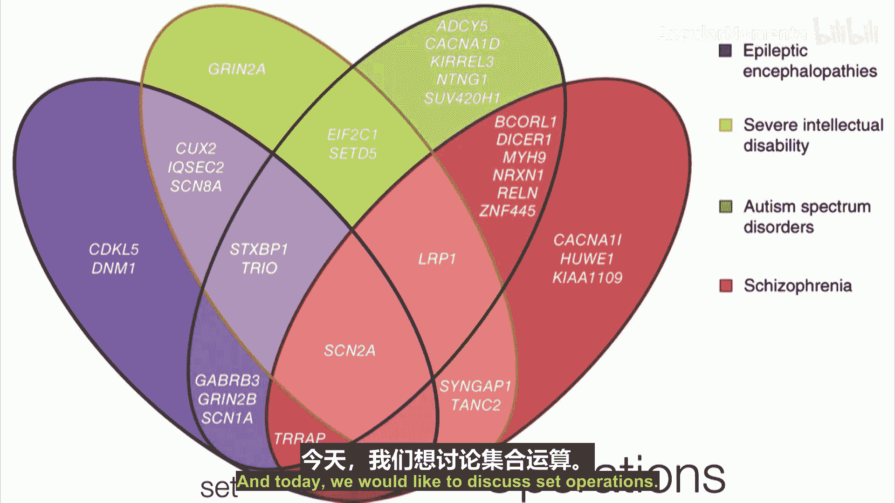
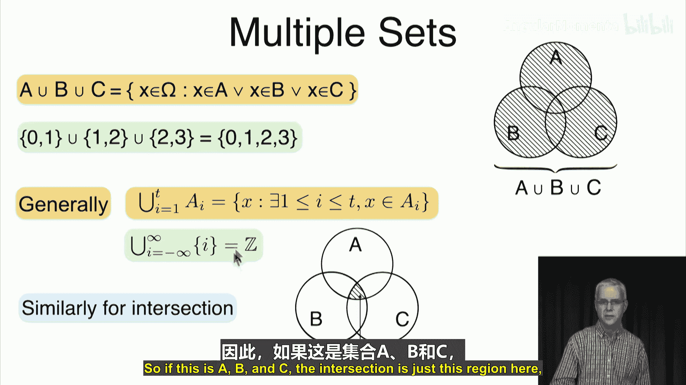
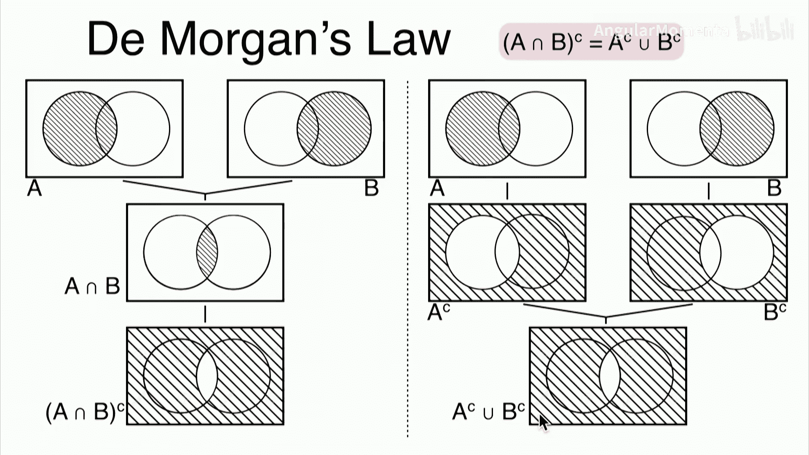
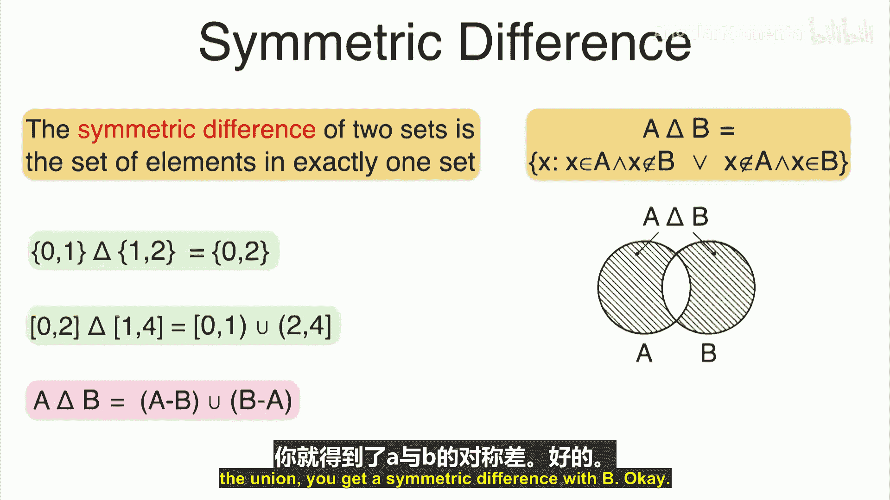
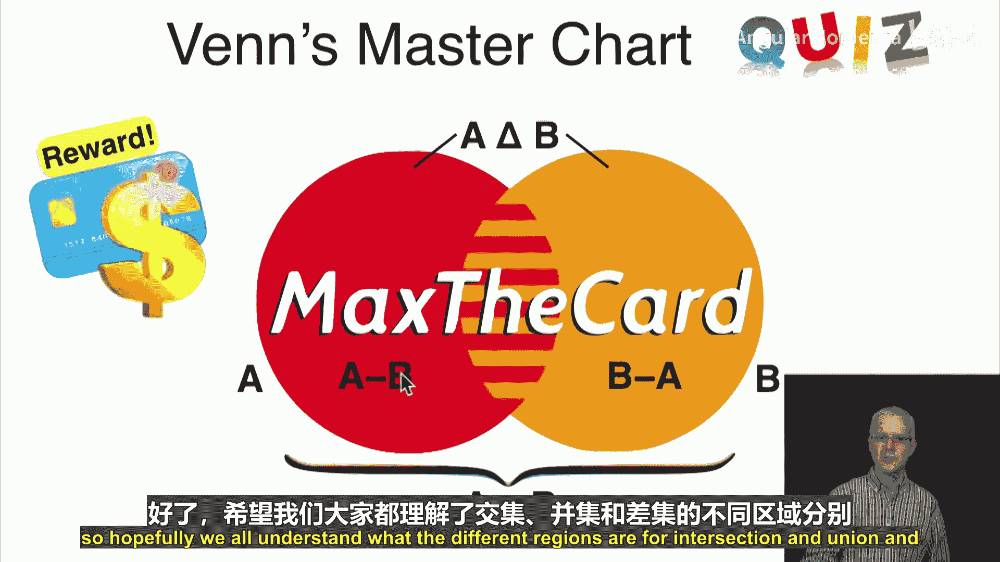
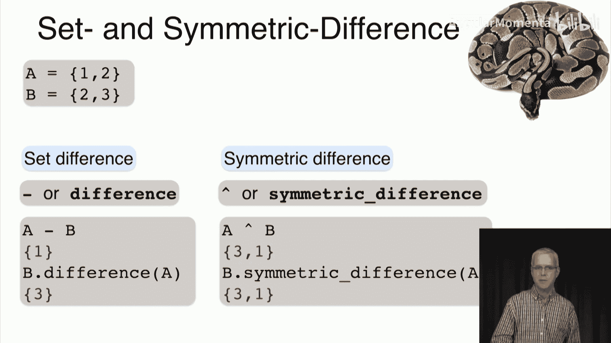

# 【加州大学圣地亚哥分校】使用Python进行数据科学中的概率与统计--Probability-and-Statistics-in-Data-Science-p11-03-05-03-集合运算--BV1gJFDzkEPg_p11-

Hello and welcome back in the last lecture we talked about set relations and today we would like to discuss set operations but before that we have a puzzle to resolve so if you remember we asked whether there two sets A and B such that A is both an element and a subset of B namely a is an element of B and a is a subset of B and the answer is yes。

 and one thing it helps us is to note that the empty set is a subset of any set as we have seen so if we take a to B the empty set then half of this question will be solved for us and we'll just need to find so we take a to be the empty set and so we already have that a will be containing anything else that we're going to choose for B and we'll just need to choose a B such that the empty set will be a member would be an element of B so we just need the element the empty set to be an element of B and that's very easy we take B to contain to consist of just the。

set is an element， so B is the set that consists of just a single element and that element is the empty set and once we do that then we see that the empty set belongs to B belongs to set that contains the empty set and as always we have that the empty set is a subset of the empty set thats because this is always true and so we found two sets namely the empty set。

And the set containing the empty set such that the empty set is an element of that set。

 and the empty set is a subset of that set。So the answer is yes。

 and these are the two simple sets that satisfy these two relations。

 Now you can find more complex relations that do not imply the do not use the empty set。

 but this is the simplest that you can find。All right。

So what are we going to do remember that for set relations we generalize numbers。

 namely we looked at equality less than equal and strictly less than and we define similar relations for sets equality subset and strict subset and we would like to do the same here for operations and what we would like to generalize our addition subtraction and multiplication and addition we denote by union subtraction we'll denote again by subtraction multiplication again we'll use the same civil multiplication and in this lecture we'll talk about addition and subtraction or union and difference as they're called for sets and we actually also talk about intersection and multiplication we'll discuss in the next lecture。

So first let's start with a complement， so recall that the universal set omega contains all elements。

 and so the complement of a set a is which is denoted by this notation a complement is the set of all elements in omega that are not in a。

In logic terms， a complement is a set of all x elements x in omega that are not in a segmentmatication。

And using a Ven diagram here is our set a， here is omega and a complement is all the elements that are not that are in omega clearly but not in a so is a complement Okay so let's do a couple of examples。

 let's omega our universe B01 then what is the complement of the set containing 0 is the set of all elements that are not0 in our universe which is us B1。

And what is the complement of01， that's a set of all elements of omega of 01 that are not in01。

 there are no such elements， so this is the empty set。

And what is the complement of the empty set that's going to be zero1。

And notice that a complement depends both on a and on the universal set omega。

 So if our universe now is 012 and we take the complement of 0。

 that will consist of the elements1 enter。All right。Now if we take our universe to be Z。

 the set of all integers， then the complement of the negative numbers。

 minus1 minus2 and so on is the natural numbers， the set of non negative numbers。

 and if we let still the same universe z and we let out E with the set of e numbers。

 which is you remember we define it to be the set of all numbers divisible by 2， namely minus2。

02 and so on。And then if we take the complement of that。

 it's going to be the set of all numbers that are not divisible by  two， like minus3， minus1。

13 and so on， and we denote this set by0 and call it the set of odd numbers。

Now we can get a couple of identities and identities are just relations that all for all sets。

 so for example， if we take the complement of the empty set， it's going to be the universe。

The complement of the universe is the empty set if a and a complement are this not if A and a complement are always disjoint because a complement consists of all the elements that are not in a。

And if you take the complement of a and take the complement of that again， you get back a。

And this is called the complement is called an evolution if you take this operation and apply twice to a set。

 you get a set itself。And if a set A is a subset of a set B。

 then the complement of a will be a superet of the complement of B。Okay。And now we want。

To move from complement to intersection and the intersection of two sets A and B denoted by this notation is the set of all elements that are both in A and B。

And again， using segmentation and intersection B is the set of all elements x that are both in A and B。

And here' is using Venn diagrams here A and B， and the a section of all elements that are in this region where they overlap。

And for example， after we take01 and 13， the intersection is one because it's the one element that contains both。

And if you take set 0 and the set one， the intersection is empty and if we take the two intervals， 0。

4 and 36， and then the intersection is all the real numbers between 3 and 4 inclusive of3。

 but exclusive of4 so it's  three up to4 and02 intersection 25 because because this。

The interval does not include too， this intersection is going to be empty。Right， and finally。

 if we take an intersection of the following two sets， the set word。

Rain cats and the set with rain dogs， we get the intersection is the set where it rains cats and dogs。

Moving from intersections to unions， the union of two sets and B denoted using this symbol here is the collection of all elements in A。

 B or both。And using segmentation， A union B is the set of all x's that are in A or in B or in B。

And Venn diagrams， this is a and this is B， and we're looking at the set of all elements that are in one of them or both of them that's going to be the whole shaded region here that's a union B。

 Okay some example if we take01 union with 12 we get the set of all elements that are in at least one of those two sets that's01 and 2 and notice that we can get012 from union as union of other sets。

 for example 01 and just2 thatll give us the same union 012 because the element2 now is just here once beforehand it was I'm sorry the element1 here is here just in this set whereas here was in both sets and it's not really necessary to have a choice。

And if we take the union of these two real intervals。02 union 13， what do we get。

 we get the interval from 0 to3 inclusive of both and if we take the union of01 with the single turn1。

 what do we get we get the interval from 0 to1， but now it includes the element 1。

And if we take the union of the events and the odd， we take we get all the integers。All right。

So we can generalize of course to multiple sets and A union B union C。

 therefore with the collection of all elements x， such that x is in a or in B or in C。

 and using a Ven diagram， here is a B and C and the union is just the collection of all elements that are in any of those sets。

 so it's the whole shaded area and if we take01 in 12 union23， you get0123。

 and generally if you have more than three sets if you have T sets。

 the union of AI I going from1 up to t is the set of all x。

 such that x belongs to AI for some I between 1 and。RightAnd the union， for example， of all integers。

 the set of all integers， so we have the set of containing I and we take the union of all these sets from i going from minus infin to infinity is just a set of all integers。

And similarly， we can define intersections， so if this is A， B and C。

 the intersection is just this region here， which is the set of all elements that are all in A。

 B and C。

Okay。So let's mention a few identities first for one set， and identities are also called laws。

 there are relations that all for all sets， so the first identity is actually called identity。

 it says that if you take any set A and intersect it with the universe you get the set A itself。

 and if you take the set A， any set A and take the union with the universe you get the universe。

Second identity called universal bond says that if you take the set any set A and intersect it with the empty set。

 you'll get the empty set and if you take any set A and take the union with the empty set。

 you get the set A itself。Then we have the important identity that says that if you take a set a and dissect with itself。

 you get the set A and if you take the set a and take union with itself。

 you get a and complement that is if you take a and dissect it with a complement as we know this does dejo。

 so the intersection is going to be empty and if you take the set A and take union with its complement。

 you get the whole space omega。And again， these are just very basic and I think。

 kind of intuitive identities， so we won't give proofs。

 but just mention them and you can kind verify them。

Right and then if you move to laws with two or three sets get the commutative law that says that a intersection B is the same as B intersection A because these are just the set of elements in both A and B and a union B is equal to B union A。

We get the associative law that says that A intersection B， intersection C。

 if you first intersect A and B and then intersect it with C。

 the same as taking a intersecting it with the first intersecting B and C。

And if similarly for the union， the order in which you perform the operation does not matter。

And the distributive law that says if you take A and intersect it with the Union of BNC。

It's the same as taking a intersection B and taking the union of that with a intersection C。

And same for union and intersection and finally one that well use a little more often。

 the Morgangan's law that says that if you take any two sets and take the intersection and take the complement。

 that's the same as taking the union of the two complements so basically the complement of the intersection。

is the union of the complements and you can have symmetric law or if you take the union and take the complement。

 that's going to be the complement of a intersection of the complement of B or in other words。

 the complement of the union is the intersection of the complements。

And this one maybe we're going to show why it's true and we're going to use Venn diagrams for that。

 So the Morgan's law and we' prove that will show that the complement of the intersection is the union of the complement so we're going to show first draw this Ven diagram for this region and then for this one and we'll show that they' are the same So here is a set A and here is a set B。

 there could be any set then a intersection B we're doing this one first is this set here。

 this is a intersection B and if we take the complement of that which we need to hear and that's going to be this whole shaded region here that's a intersection B complement on the other hand if we do the right hand then。

Again， this is a and this is B。 this is a complement and this is B complement。

 and now if we take the union of these two sets， we get the whole shaded region here。

And we can see that these two areas are exactly the same and therefore the complement of a intersection B is the same as the union of a complement and B complement。

All right， and then we also would like to discuss set difference。

 so the difference a minus b between two sets is the set of elements that are in a but not in B that generalizes minus4 numbers。

 so a minus B is the set of x is such that x is in a but not in B。And pictorially this is a。

 this is B， This is going to be the set a minus b of all elements that are in a but not in B。

 For example， 01 minus1 is the set containing just0 and 01 minus 012re looking at all the elements that are in this set a but not here and are none so this is going to be the empty set and if we take the interval 1 to 3 minus the interval 2 to4 these are all the elements in the interval 1 to 3 not 2 to4 its going to be the interval from1 all the way up to2 but not including two because we're removing2。

And if we take 1，3， minus-1，3， then we'll just be left with the numbers one and the number3。Okay。

 and one observation again denoted here and because it's kind of a result。

 it's always true a minus B， it can express it as a intersection B complement。

And a note on notation that that set difference， which we denote by Mans is also sometimes denoted by the slash back slash sign。

And once we have difference， we can also define symmetric difference。

 symmetric difference of two set is the set of all elements that are exactly in one set。

 a deelta B is the set of all elements。They are in a。

 so the set of elements a such that x is in a and not in v or x is in B， but not in a。

 so they're in exactly one set。Fctorally this is a， this is B。

 the symmetric difference is just elementary doing a not B or B in a not A。

 in other words they're in just exactly one set。If we take01 symmetric difference with 12。

 we're looking at all elements that are in exactly one set and that is going to be 0 and 2。

If we look at the interval 02 ssymmetric difference with 14。

 that's all the elements that are in exactly one of those two intervals and that's going to be0 up to1 or two up to4 and we are not including one because one is here so it cannot be included。

 we want it to be included in just one element and so here one is in both of them so it's not in the set and likewise two is in both of them so it's not included。

Alright。And you can observe that the symmetric difference of A and B can be expressed as a minus B union with weight minus a。

Because this is a minus B here and this is B minus a。

 you take the union you get asymmetric difference with B。

OkayAnd again from two set to three sets， if you have three sets then you can define similar operations just define recursively so this is going to be these are ABc。

 this is a intersection B intersection C， this all this intersection for three of them and this is a intersection B that's what we have here minus C so we're excluding this region here we're just talking about this region and this region here is a minus the union of these two regions so it's a minus B union C。

 and if we take the union of these three region， this one and this one and this one that's going to be B union C minus a。

And so on。So hopefully we have talked about many different operations。

 so to test I would like to do the Ven master chart quiz and this quiz actually comes with real rewards that you can use。

So I'll give you two sets and I'll show you some regions and ask you what the regions are。

 so first let's introduce the set， this is our set A and this is our set B and if we ask what is this whole region where we have points either in a or in B。

 what is this origin that is a union B？Very good。 And now let's say we eliminate this set。

 So we'll left with just this region here， what is this region。It's a minus B。

 and if we reverse things and we now look at just this region， is what is it， it's B minus a。

And if we look at both this region， the red region here and the orange region here， what are they。

 That's a symmetric difference with me。 Very good。 And then last one。

 if we look at the intersection here， what do we get。Mastercard。And if you got all of them correct。

 then you can go and match the code。So okay so hopefully we all understand what the different regions are for intersection and union and difference and now we just want to express them in Python so set operations first union intersection。

 again define two sets a and B like that and the union is expressed using either the bar again or union and so we can write a union B。

 we get  one to3 and can write C equals a union dot union of B。

 we get and then print C we'll get the same thing and intersection。

 you can write as n which kind of like borrows from the logical notation or intersection and can write intersection B you'll get2 or C equals a dot intersection B and then print C and you'll get2 again which is the intersection。

And set difference and symmetric difference。 So again and we are the same set difference。

 we write as either minus or difference。And can write a minus B and we'll get1。

 So the element which is in a， but not in B is just one。

Or we can write B dot difference with a and we'll get3 because this is B。And we subtract a。

 youre just element 3 and symmetric difference you can write using this characterrot notation of symmetric difference。

 so write a characterro B， you get31， the elements that are in A or B， but not both。

 or can B dot symmetric difference A and again you get31。

So to summarize， we talked about set operations， we discussed complement which is denoted by a with superscript Rrc for complement of set A I intersection denoted like so union。

That difference denoted by minus and symmetric difference denoted by deelta。

 and what are we going to do next time we're going to discuss cortesion products。See you there。

