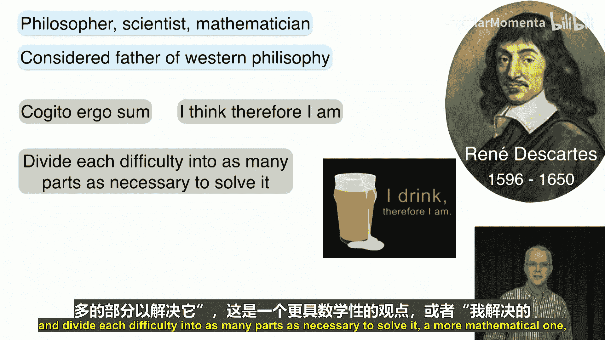
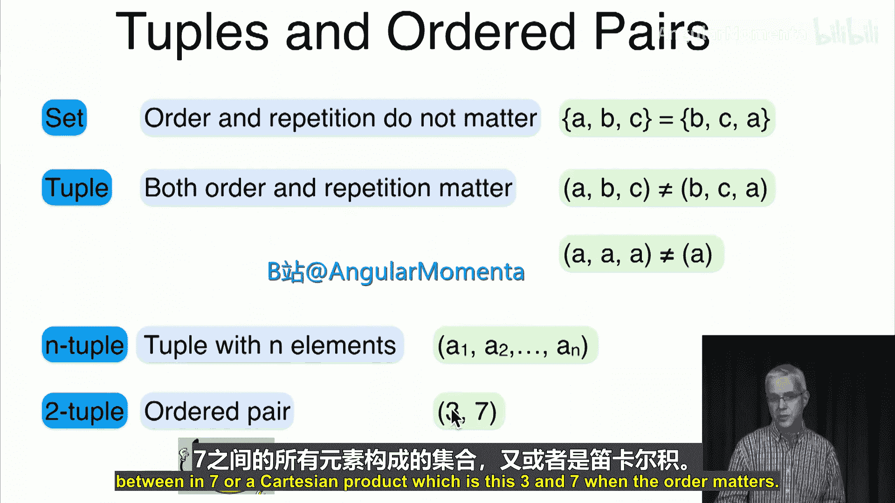
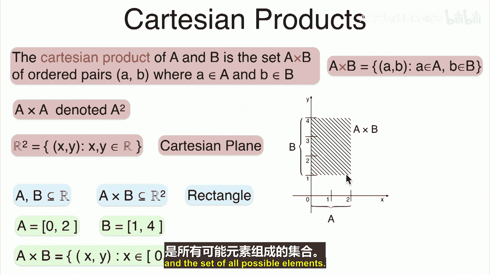
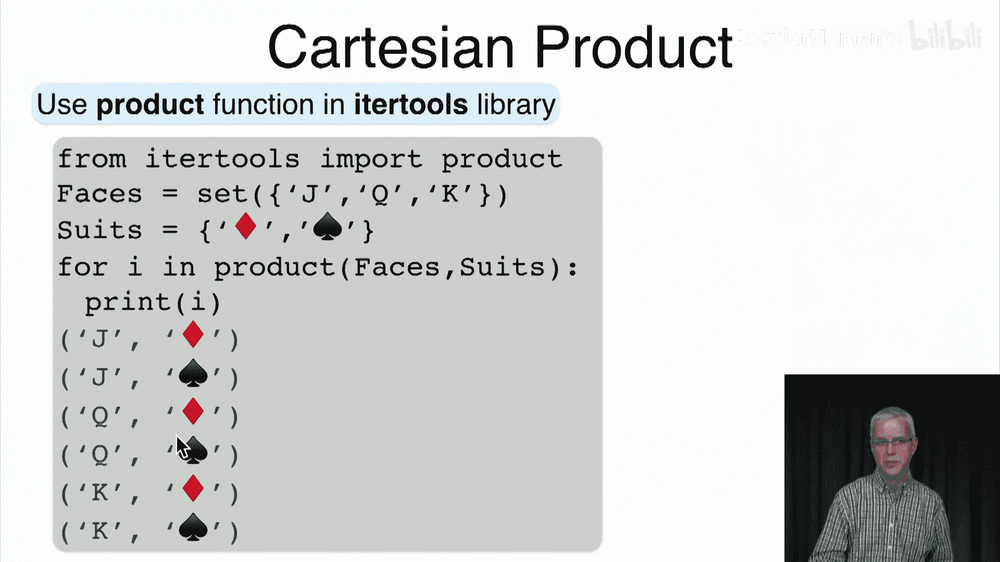

# 【加州大学圣地亚哥分校】使用Python进行数据科学中的概率与统计--Probability-and-Statistics-in-Data-Science-p12-03-06-03-元组与笛卡尔积--BV1gJFDzkEPg_p12-

Hello and welcome back In the last lecture， we discussed set operations like unions and intersections and in this lecture we want to talk about the final operation。

 which is Carteian products， Coteian product orname after Dete that's where where Cartian comes from and Rene de Carte was a French and then a Dutch mathematician and philosopher and scientist and is' considered by many to be the father of Western philosophy and he gave us many gems。

 including Cogito Elgo Soum， which means I think therefore 4 am or as our students here in San Diego say I drink therefore 4 am and divide each difficulty into as many parts as necessary to solve it a more mathematical one or each problem I solved became a rule I later use to solve other problems or a good mind is not enough the main thing is to use it well。

And also to improve the mind， learn less and contemplate more so with this let's learn a little bit more so it actually the story about the court is that as a kid he was quite sick and he stayed at home for long periods of time got special permission to do that and he continued this habit after he graduate from school he would show up to work like around you know like noon and then work and then go home again and many graduate students famously admire the car so much that they adopt the same philosophy so the story goes that one day he was in bed you know it was almost noontime and he watched this saw a fly and he said oh when I go to work you after lunch I want to tell my colleagues where the fly was and how am I going to describe I'm going to describe the location of the flight。

To them and he said， oh， let me describe the distance from the ceiling， the distance from this wall。

 the distance from that wall， and by giving those three。Real numbers。

 they'll be able to tell where if fly was and that's how we came up with Cartesion product there's maybe a small a fly in this ointment and that is the same system was used by period deformma and E com before the car but maybe that's the small detail。

So before talking about cartesion products， let's talk about topples and ordered pairs。

 so remember that is set。😊，Is collection of elements where the order and repetition do not matter。

 so ABC is the same as BCCA。And if we want order to matter， then and also repetition。

 then we use topples and topples， both the order and repetition matter。 So， for example。

 ABC is not going to be equal to BC， It's not going to be equal to ABBC and so on。

A is not going to be equal to。And n tuple is a tuple with n elements。

 a1 up to anN with tuples in parenthsesis and with commas in between the elements。

And a special case of an nple is a two tuple， which this contains two elements and it's also called an ordered pair。

 so for example， 37 is an ordered pair。And just a small warning when you see something like 3。7。

 it could also mean a real interval， the interval of all elements between3 and7。

 but from context you'll typically know if we're talking about an interval or just which is the set of all elements between in7 or Carttesion product which is this3 and 7 when the order matters so I can tell from context so now what a Cartesion products。

 the Cartesion products of two sets in B is the set A cross B of all ordered pairs A B where a is in a and B is in B in other words Cartesion product is a collection of ordered pairs a comm a B。

 but not just any collection but the collection where the first coordinate could be anything from a set A capital A and the second element could be any element from a set B。

So using segmentation， a quotteion product B is a set of all ordered pairs AB。

 such as A belongs to a given this given set A and B belongs to this that set B。

And if we have a coteion shown product with itself。

 it's denoted by a square and of course the best known quoteion product is the quotesion product with of the real numbers with themselves also called the real plane it's a set of all X Y such that X and y are both real numbers and again it's called Carttesion plane and it's denoted like this so we have here the set of all elements。

 so here we have the real numbers X and real numbers Y。

 the set of all elements that can write is the real plane quotsion plane R2。Now。

 if A and B are set are real sets， subsets of the real line。

Then a Cartesion product B is a subset of the whole cartsion product。

And will be shown as a rectangle and for example， if a is the set 0 to 2 and B is the set 1 to 4。

 then a codigent product B is the set of all elements X y， such that x is between0 and 2。

 and y is between 1 and 4 and it's denoted like so。

X is between0 and 2 that's our set a here and y is between2 and 4 and a set of all possible elements。

 here is the quotsion product， which is the rectangle。

OkayNow we'll talk about discrete sets which are sets that are either finite or accountably infinite。

 not continuous and the cotsion product is the same for those sets except it's simpler because we just have fewer points to deal with。

 So for example， if we have the set A B Cotion product with one to 3。

 it's a set of all elements X and Y such that x is n element in N B and y is n element in1 to3 and this is just the collection of all elements A comma 1。

 a2 a comma 3， B1， B2 B3， all those elements and luckily we can organize them again in。

On the plane so we can write A B here and 123 here and this will be the set A1， A2 a3， B1。

 B2 B3 as you can see here， so the only difference is that here we draw the first set four discrete sets we typically draw the first set vertically and the second set horizontally just to mimic what we do for matrices。

 the coordinates for matrices， the first one corresponds to the vertical axis and the second one corresponds to the horizontal axis。

All right， so here the first coordinate is vertically and the second horizontally you don't have to do it that way。

think。Typically people do that so some identities about cartesion products。

 if you take the cartesion product of set A with the empty set。

 it's the same as the cartesion product of the empty set with set A。

 which is the empty set if we take a cartesion product of set A with the union of two sets is the same sta of the union of the corresponding cartesion products and here is why just a simple villageization。

 let's say that a consists of two elements AB and B consists of1，2。

3 so then a cartesion product B is the set of elements and then if we have again the set A but same C which is now 2。

34 and a cartesion product with C is going to be the set of all those elements， a2。

 a34 and so on and then if we take a corteion product with B union C it's going to be B union C is the set1 to34 so a cartesion product of the union is just going to be these8 elements。

And it's easy to see that this set is the union of this one and that one。And likewise。

 if you take a carteion product of a set with the intersection of two other sets。

 it's going to be the intersection of the carteion product and the contion product of a set with a difference is the difference of the cartesion products so all these things carry over。

Okay， now examples of Cartesian products include tables that we use with computers all the time。

 So tables are Cartesian products。 So here is an example of a table。

 These are called the rows of the tables and in。Database language are called records。And for example。

 here， each record corresponds to a student。And the columns are called attributes and here we have three attributes。

 the name， the gender and the GPA and individual elements of core cells Okay so these。

 whenever you see a table we should think of quotession products of the rows with the columns and we have all possible combinations here。

Right， so cell is the entry。 Okay， and Cartesion products can be generalized to three sets clearly。

 So if we have a times B， we get a two dimensional rectangle。

 And if we consider a Carteion products with B Cartesion products C， we get a three dimensional。

Cubbooid， so to speak， so here is the quotion product of the set A with the set B and the set C。

And one reason why we care about colttesion products and about ordered pairs and tuples in general is the tuples that sequences which we use all the time are just tuples without the parenthses and the comma and sometimes without a comma。

 so for example， if we consider A1， A2， A3， B1， B2 B3， we can just write it as A1， A2， a3 and B1。

 B2 B3 or we could if you want， keep the commas and so on so a sequence is just a tuple where we don't write the parentheses and sometimes we don't ever write the commas。

And if you look at01 square， so the coltesion product 0 times 01， it's a set of all x y such that。

X and y belong to01。 So if we look at the sequences like that so it's 00，01，1。

0 and11 whereas if we want to look at this quotsion product we'd have0 comma 0 with parenthses parenthses 0 comma 1 the the order per1 comma 0 and so on So sequences are the same as in this case ordered pairs we just don't write the parentheses and we don't write the commas in 01 cube is just00。

0001 up to 111。Okay so we can create carion products in Python again we use the product function in the Etools library and what we do is we import from E toolsols we can import product for Carion products。

 you can say faces if you do for example cards with the set consisting of Jack， Queen and King。

And we can have the suits， for example， consisting of。

 let's say just diamonds and spades and then we can do 4I in the product we take product we'll take the quotesian product of face and suits and if we want to print them all we say forI in this product print I and we'll get all the all these ordered pairs to summarize we talked about cortesion products。

 we discuss doubleples like a1 a2 up to AN and the special case of ordered pairs。

 we just have two elements like A and B， we mentioned that sequences which we're going to use a lot are the same as tus except that we remove the parentheses and sometimes we also remove the commas and for Python we say that we can implement quotsion products using the product function in the Etotools library and next time we're going to talk about perplexing paradox see you then。

