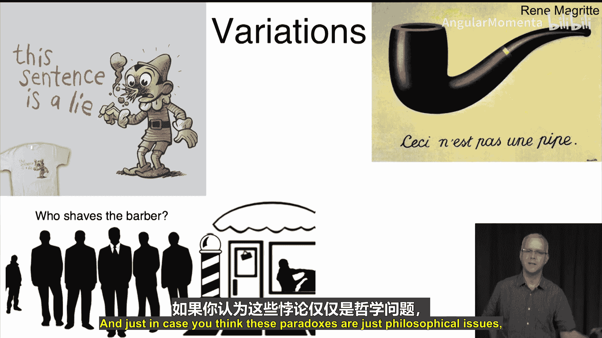

# 【加州大学圣地亚哥分校】使用Python进行数据科学中的概率与统计--Probability-and-Statistics-in-Data-Science-p13-03-07-03-罗素悖论--BV1gJFDzkEPg_p13-

So this is our fourth and last video about sets， so I thought I'll show you how even the simple topics we discussed。

Can lead to interesting and surprising consequences in this case。An interesting paradox。

The paradox is due to Burton Russell， who is a British mathematician， philosopher and author。

And amongst other things he received a Nobel Prize for literature， he was also well known w。

 who had something to say about almost anything and he had a special place in his heart for human intelligence intelligence。

 so here are a few of his quotes， he said that in democracy fools have the right to vote while in a dictatorships fool have the right to rule。

That most people would rather die than think。 and， in fact， most do。

 And perhaps most relevant to our course， he said that men are born ignorant， not stupid。

 but it's education that makes them stupid。 So with that。Let's educate ourselves about his paradox。

Let's start with a small review about sets in sets。Remember that sets can be elements。

 for example here is a set and another set and both of them are elements of the set that contains both of them。

Also， you remember that every set can be a subset of itself， for example， the empty set is contained。

In itself。The more interesting question is whether a set can belong to or be an element of itself。

Namely， can a set S be an element of the set S？Now typically sets do not belong to themselves。

 for example， if you take the set that contains just zero。

 it has a single element which is the number0， so the set zero is not a member is off or an element of the set zero similarly the empty set contains no element and therefore in particular the empty set is not an element of the empty set on the other hand some sets do contain themselves and do belong to themselves。

 so consider for example n nontrmp， the set of anything that is not Trump。

This set contains several elements， for example， here at Clinton is not Trump， so she's in。

The number 0 is not Donald Trump。 So it is in the set。 The sets 1，2 is not Trump。

 So it's also an ante。 And when you think about it， lots of elements are in the set。 In fact。

 everything except Donald Trump is in the set。 So in particular， the set and T itself。

 it is not Donald Trump。 So N T itself is in the set。

 So we therefore forget that the set and T does belong with is an element of itself。

So that's surprising and indeed can lead to interesting consequences。

 one of them is that if you have a set that contains itself。For example。

 if you take this slide and if it contains itself， then the smaller slide is the same as the original slide and therefore it containss itself again and the smallerest slide contains itself once more and so on。

 so you get an infinite recursion that way。But don't worry about that。

 the only thing we need to know is that subset sets。All elements of the cells， for example。

 the set and T is an element of itself， while other elements like the。

Set other sets like the set containing just zero is not an element of itself。

 that's the only thing we need to know and you notice that this is something we could have discussed even after the first lecture we don't need anything except that you have a set that contains itself and a set that does not contain itself。

Okay， so with that， what is Russell's paradox， it is that you can define a set that cannot exist。

So Russell considered the following set R， it's the set of all sets that don't belong to themselves。

In other words， it's the collection of all S such that S is not an element of itself。

Since this is our main definition， it may be worth。Thinking about it。

 we're defining a set such that if a set is an element of itself， then it is not in R。

 and if the set as is not an element of itself， then it is in R。

 so now clearly the set that contains 0， as we saw before is not an element of itself。

 we saw it in the previous slide and therefore by our definition it is in R。Conversely。

 Nt was an element of itself。And therefore by our definition here， it is not in R。Okay， so。

The question is。If you take R itself is R in R or is R not in R so clearly one of those two things must hold either R is in R or R is not in R and what we are going to show is that both of those will lead to a contradiction so this cannot happen so imagine first that R is in R namely R is an element of itself then by our definition r cannot be in R because the set R just contains the elements that are not in so if r is in R then r is not in our set in Russell set。

And this means that R is both in R and not in R， which is a contradiction。Now， if R is not in R。

Then by the definition of our set， R is in Russell sets， and therefore R is in R。 so again。

 we get that r is both not in R。N in R， which is again， a contradiction。

And that means that if R existed， then it would。Both be that R is in R and。R would not be in R。

 both of those would hold， and that's impossible， and therefore that means that R has been defined。

 but it cannot exist， so that's the contradiction。Right， now let's see what happened so we defined。

The sets recursively， and that was the source of our problem because when we looked at sets that contain sets that contained themselves。

Then we got an infinite recursion。And when we considered a set that included sets that do not contain themselves。

 then we got to contradiction， so either way， once we got to recursive theians。

 we were not in Kansas anymore。But don't worry， we're still in the continental United States so we keep it things simple and we'll only consider sets that are not recursively defined。

 so we'll avoid sets that are self referential and also this material is not needed for the exam although I think it's something that you probably want to know。

Okay， now。This paradox has several variations， for example。

 you have a barber who shaves exactly the people who don't shave themselves and the question is does the barber shave himself or does he not。

 because if he shave himself， shaves himself， then he shave someone who does shave himself and if he doesn't shave himself。

 then he doesn't shave everyone who does not shave themselves。

And a similar paradox is this sentence is a lie， is this sentence true or not true。

 even Pinocchio cannot figure this out。Or this is not a pipe by theli。

 And just in case you think these paradoxes are just philosophical issues。

 maybe you want to consider this。 I would never want to belong to any club that would have someone like me remember。

That's the key joke of my adult life in terms of my relationships with women。

I hope you learned and enjoyed the videos and next time we'll start talking about counting。

 thank you。