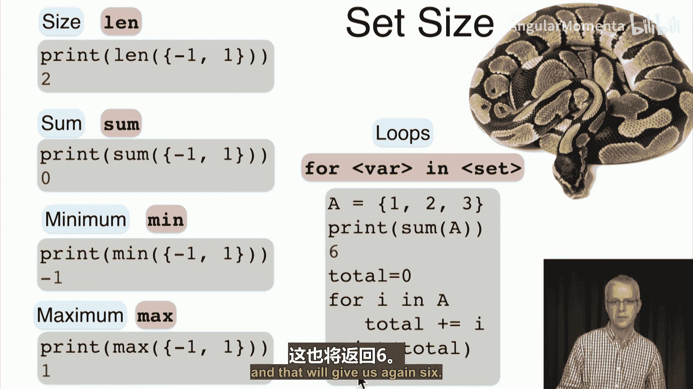

# 【加州大学圣地亚哥分校】使用Python进行数据科学中的概率与统计--Probability-and-Statistics-in-Data-Science-p14-04-02-03-集合大小--BV1gJFDzkEPg_p14-

Hello and welcome back。 So we're done talking about just set on their own and we want to start talking about counting and don't worry。

 we won't be counting sheep and fall asleep because we'll be counting sets。 and in fact。

 our goal in these next few lectures is going to be to develop techniques so that actually we don't need to count almost at all。

 If we get it right， we will never need to count to more than just three。

So as we said we're counting sets so we need to describe what we're counting。

 so the number of elements in a set S is called its size or cordinality and is denoted by these two vertical bars。

 the size of S or pound S， again， the size of S。So let's do a few examples。

 so the set of bits consists of0 and1 and so it's called analogality is 2， it has two elements。

 coin has two sides， heads and tails。Its size is also two and a dye has six faces， one up to six。

 there are 10 digits。And there are 26 letters。And the empty set noted like cell has no elements。

 so is its coinality or its size is 0。And the set on the other extreme， the set of integers， z。

or the set of natural numbers n or the set of positive integers or the set of rational numbers。

 all have infinitely many elements and the reels also have infinitely many elements so the sizes is also infinite but its actually a difference between these two infinites but we're not going to worry about that right now these are calledcountably infinite and these are called uncountably infinite。

 but let's not worry right now。Right， let's look at two other。

Seets and the sizes so remember we discussed integer intervals so for m less than equal to n we define n dot dot n to be the set of integers from n to n inclusive of both m and N and for example 3 do5 is the set 345 and the size of M dot dot n is going to be n minus n plus1 and then question often asked is y the plus1 so first of all we can try small numbers like 5 do5 that's just the set 5 so it's1 which is 5 minus5 plus1 or1 do3 1 to 3 that's sizes 3 and that's 3 minus1 3 minus1 which will give us 2 plus1 which will give us3 and as you can see it's as easy as one to3 and so far we didn't need to count more than3 and to see why we're adding the one let's look for example this interval 34。

It's the interval here， we you we see we can have three points like that， but when we count 5 minus3。

 we're not counting the number of points or elements。

 we're just counting the distance between 5 and 3。hich is two and worked to accounting is the length this of this segment from three to 5。

 which is the number of unit intervals here。Okay， but what we are interested is in the number of points and there's one more point in our intervals because there point to the left of every interval and then there's a point to the right of the rightmost interval interval。

 so we need to add one。Okay， allright， so5 plus minus3 plus1。

 which will give us three Allright also we talked about more integer multiples。

 so let me just for clarity we said that the set n is the set one up to n。

 let me denote it by open brace open appheses here and then square bracket on the right to just indicate even more strongly that we're not using zero so it's one up to n just another notation。

So the set of integers between between1 and n that are multipls of d is denoted like that。

 it's a set of integers between 1 and n that are divisible by d or the are multiplpos of d so for example3 the set of integers that are multiplpos of3 between1 and 8 is 3 and 6 which is1 times 3 and then2 times 3 and the set of integers between 1 and 9 that are divisible by 3 36 and 9 which is1 times 3。

2 times 3 and3 times 3 and if we look at the size of this set it's easy to see that it's n divided by d and then we're taking in the floor。

 the largest integer that is less than equal to this ratio so for example for integers between1 and8 that are divisible by 3 it's the floor of8 over 3 which is2 and that's because we have one times 3 and2 times 3 here and the largest we can。

Multiply is going to be， in this case， the floor of8 over three。

And when we have the size of the integers that are multiples of three between 1 and9。

 it's going to be the flow of 9 over3 and that's three， that's because we have one times3。

2 times3 and three times3 and again three the number three comes from9 divided by3 and going take the flow of that now in Python set size is is expressed using the length function so for example we can write print length of minus1 and1 it will give us2 and we can do other things for example one to calculate the sum of the element in a set we write sum so print the sum of minus-11 will give us0 and find the minimum of several elements using the min function。

 print min of minus1 in1 give us minus-1 and the maximum using the max function print the max of minus-1 and 1 will give us1 and we can also do these calculations including sum including length。

iterating over elements we write a loop so we say for some variable in some set。

 do something So for example here a is 123 and if you want to calculate the sum of a we can just write print sum of a will give us6 or we can say total is0 and for I and a total plus equals I and print total and that will give us against6 so with that we're going to continue next time by calculating the size of different sets like unions and intersections and so on see then。

