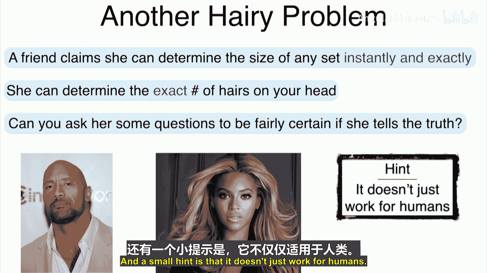

# 【加州大学圣地亚哥分校】使用Python进行数据科学中的概率与统计--Probability-and-Statistics-in-Data-Science-p15-04-03-03-不相交并集--BV1gJFDzkEPg_p15-

Hello and welcome back now that we've got basic counting under our belt。

 let's talk about these joint unions， so we're going to discuss the addition rule， subtraction rule。

 how it applies to pets and also a her problem。So we'll begin with thisjo unions。

 so here is a set A that contains two elements and another set B that contains three elements and you notice that these two sets are this joint they don't share any elements。

 so it is very easy to see that the size of the union is just2 plus3 which is 5。Okay， so the numbers。

 the normal of elements just added up。And in general。

 we call a union of this Jo set a this joint union。

And we'll use these two thesejo sets like here to denote that we have this joint union I'm using the master code colors as you notice。

 and so for example if we take the set containing zero and the set containing one。

 the thisjo so the union is a thisjo union is equal to01。

 it's also a thisjo union will just mark it like that。

So what we can see is that if you have this joint set to set the dont share any term limitss。

 then the size of the union is the sum of the two sizes and in formula we have that the size of a disjo union a union B is just the size of a plus the size of B。

Okay and but this is called the additional， which well denote by plus and it has numerous applications and implications I'm going to see some of them in the next few lectures and it's also the reason why we say that union is roughly like addition because you see if you have a union and the sets of this joint。

 then the size of the union is the sum of the sizes as we see here。All right。

 so let's do a couple of simple examples， so here you have a class with two boys and three girls。

We wonder how many students are in the class well the class is the union of the set of boys and the set of girls。

 these two sets are disjoint and so the number of students in the class by the additional is going to be2 plus three。

 which is5。Here's another example， you have a jar with marbles and you have one blue marble two green marbles and three red marbles and we wonder how many marbles are in the jar again it's the union of three sets。

 the set of blue marbles， the set of green marbles and the set of red marbles the union is this jointin。

 namely the red marbles are distinct from the green marbles and so on and so we apply the additional actually twice to get the number of elements in the set is one for the blue plus two for the green plus three for the red which is6。

So so far， no surprises。Let's next talk about complements。

 so the quintessential thesejo sets are a set and its complement。

And here is the set A and here is its complement， here a complement， and as we all know。

 these two sets are this joint。And furthermore， the union is omega。

 so the a union a complement is omega， and therefore get that the size of omega is the size of the union。

But because these two sets are disjoint。And in complement of this joint。

 the size of the union is going to be the sum of the sizes by the additional。And so we get that。

And now we can rearrange the term and write to the size of a complement， therefore。

 is the size of omega minus the size of a。So the size of the complement of a set is the size of the universe minus the size of the set。

And this is called the subtraction or complementary and as we see it will denot it by minus and as we see it's a simple application of the additional。

Right and this is also why set difference is similar to minus because were subtracting and the number of elements we'll subtract we'll talk about that a little more later so here is an example take a dice the set of faces is the set of integers from one up to6 which as you recall is denoted like that and if we define D to be the set of integers。

In between1 and6 that are divisible by 3， a set of I between 1 and 6 that three divides that are divisible by 3 or multiplepos of 3。

 then it's the set 3 and 6， and this is the same as the set of multiplepoles that we discussed before of course。

And the size of the set is2 of the set of numbers divisible by by 3 here is two now we can look at the complement and that's the set of all integers between 16 that are not divisible by 3 are not multiples of three。

And that's a set  one， two，4，5， so excluding three and 6， and that size。

 the size of that set is four， so we can easily see that the size of the complement of D。

Wwhich is 4 is 6 minus-2， namely the size of omega minus the size of the set d。

 so we get here the subtraction rule in action， so the size of the complement is the size of omega minus the size of the set。

All right， so that as we expected。嗯。So here's again the subtraction rule。

 the size of the complement is the size of omega of the universe minus the size of the set。

 but sometimes it's actually useful to think of it slightly differently so this becomes handy for when we try to calculate the size of large or complex sets so imagine for example here that you have a set A which has many。

 many points or that counting the points in here is very difficult okay。In that case。

 instead of calculating how many elements are in this circle。

 counting the number of elements in the circle， it might be useful to think outside the circle。

And think here。 Okay， and so we can see that we can。

Rearrange this formula instead of writing the size of the complement is the size of the universe minus size of a we can say that the size of a itself is the size of omega minus the size of the complement and if calculating the size of the complement is easier then this gives us a way to to find the size of a so here is an example suppose we want to count the size of the set a it' the is the set of all integers between1 and 100 that are not divisible by 3 all the numbers that are not multiples of 3 so that will consist so this are the integers between 1100 again that are not divisible by3 so this will consist of one it's not very visibleible by 3 to not divisible by3 not3 but45 not6 but7 and so on up to 100 So 99 is not going to be in the set 98 is going to be in the set and when you try to count the number of elements in the set A it's actually not so obvious how to do it right because it's not clear what。

What's the regularity and if it is then still well need to think about it maybe a little bit。

 but so if you try to do it to count manually you'll be in a little bit of draw but we can observe that the universe here is the set of integers from one up to 100 the set here and we observe that the complement of a is the set of all integers between one and 100 that are divisible by3 because these are the elements that are not divisible by three the complements are the elements that are divisible by3 So these are the element 36。

9。12 and soa to 99， and as we have seen before， the size of this set of this complement is 33。

 it's just 99 divided by 3。And so if you want to calculate the size of a。

 then we can just say the size of a is the size of the whole universe。

 minus the size of a complement， the size of the universe is 100。

 the size of the complement is 33 and the difference is going to be 67 and instead of you know getting buried under all the work。

 we can just be happy and maybe fall asleep。Allright。

 so okay so this rule is a little more general than what we've discussed。

 it does not apply just to taking complement with respect to the universe。

 suppose that you have a set A which is containing another set B and the set B then this would imply that you can write the set B as a union B minus a as shown here this is the set A and now we have a set B that contains a。

 then the set B is a union it's the set B which is drawn here is maybe bluish set here union with the yellow is set here。

 it's like maybe turquoise with the set here and so this is B minus a and furthermore we see that a and B minus a or thisjo。

Therefore， by the addition rule， we' get to the size of B is the size of a plus the size of b minus a because there has this joint。

 and therefore the size of b minus a is the size of b minus the size of a。Okay。

 so we'll continue to don this by the subtraction rule which and we'll denote it with this minus so again this slightly more general subtraction rule says that if a is a subset of B。

 then the size of b minus a is the size of b minus the size of a。Okay。

 so once again we were you know， we were thinking outside of this circle and you know we can get results about the circle。

 just in case you think that thinking outside the circle is an abstract mathematical concept with no applications。

 I want to point out that mathematicians are not the only ones who think that way， in fact。

 anyone who has a pet does that。

🎼，🎼，🎼，🎼There are lots of reasons to weigh your pets it's especially essential before giving your pet any licensed medicine to avoid accidental overdose we know that getting your pet away itself might be a challenge but there's a much easier way to do it and we're here to help just follow these three steps。

😊，🎼One， weigh yourself。🎼Two weigh yourself holding your pet。🎼Three。

 now subtract your weight from the combined weights of you and your pets and hey Presto。😊。

🎼If your pets a little tricky to lift up or you just want to make extra sure visit your nearest pets at home store and we'll do a free weight check for you This doesn't just work for dogs it's a great method and just as importance for any pet type we're always happy to help so ask in store about our free weight checks or any other questions you might have so to summarize we talked about this Jo union we discuss the additional the subtract and how it applies to pets and what I would like to do is finish speaking about pets with the hair problem。

😊。

For example， suppose that you have a friend who claims that she can determine the size of any set instantly and exactly。

 so in particular she says she can determine the exact number of hers you have on your head and the question is whether you can ask her a few questions and determine fairly accurately or fairly certainly whether she tells the truth。

😊，so for example， you could ask her， okay， tell me how many hairs I have with my head。

And if you're the rock， then she'll probably tell you the right number。

 but you may not be that impressed。🤢，On the other hand， if you're Beyonce。

 then getting the right number would be quite a feat， but you'll never know if she's right。

 so other a couple of questions you can ask and know whether she's telling the truth。

And a small hint is that it doesn't just work for humans okay so if you want to find answer。

 see you next video。

