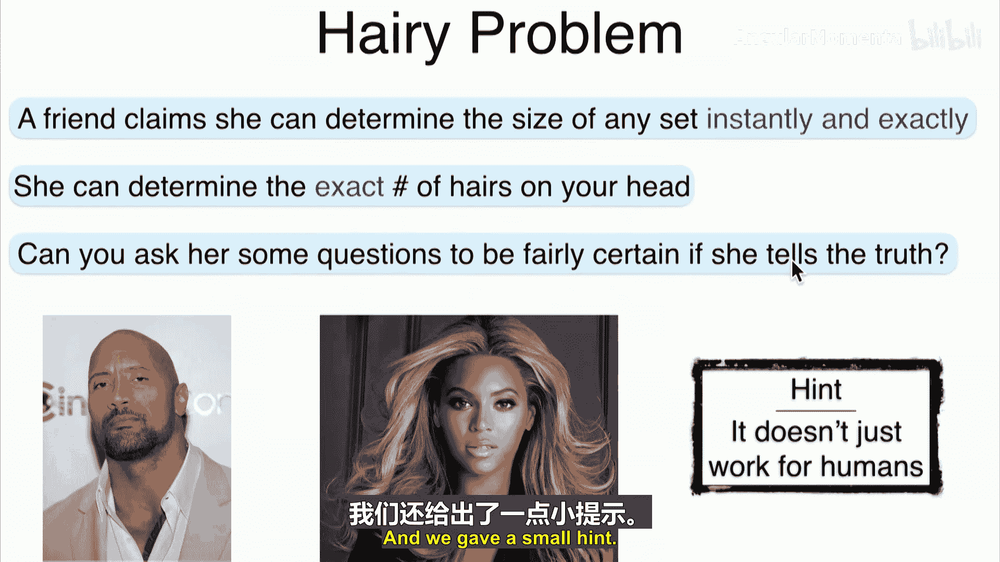
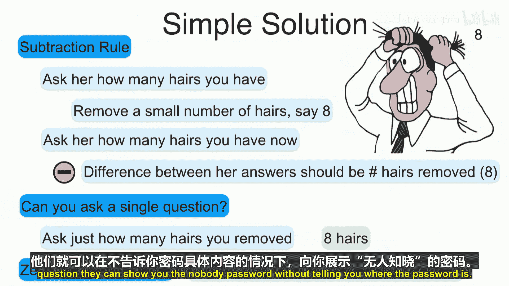
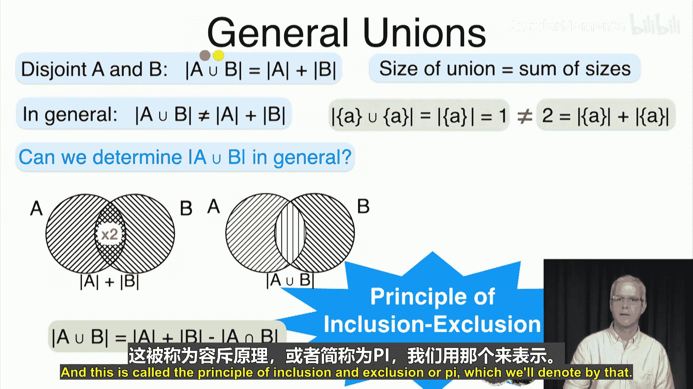
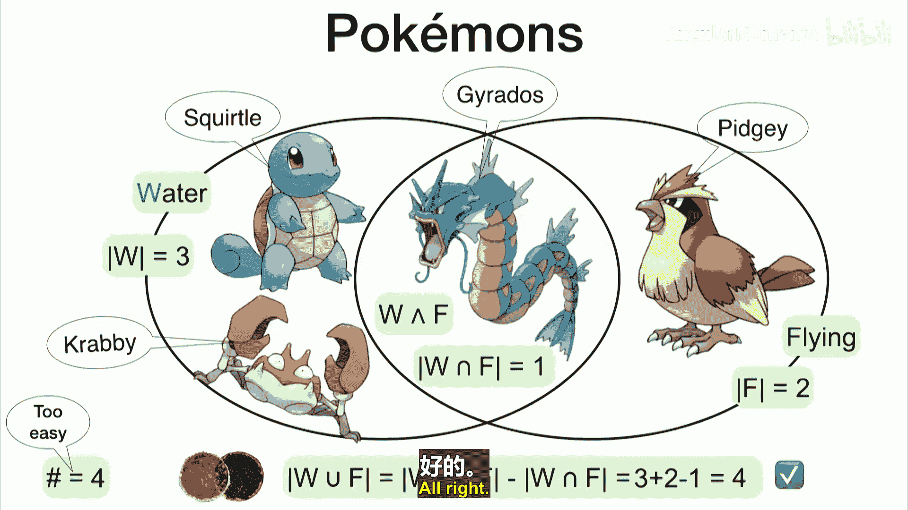
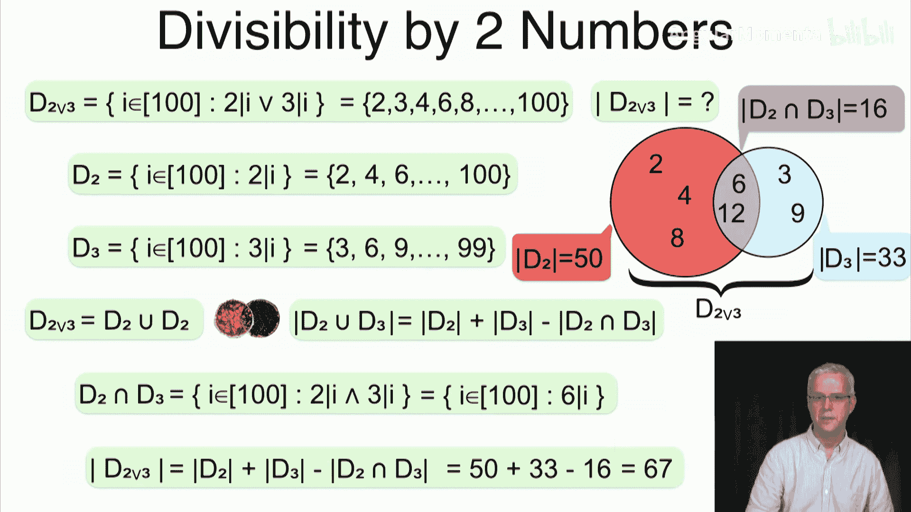
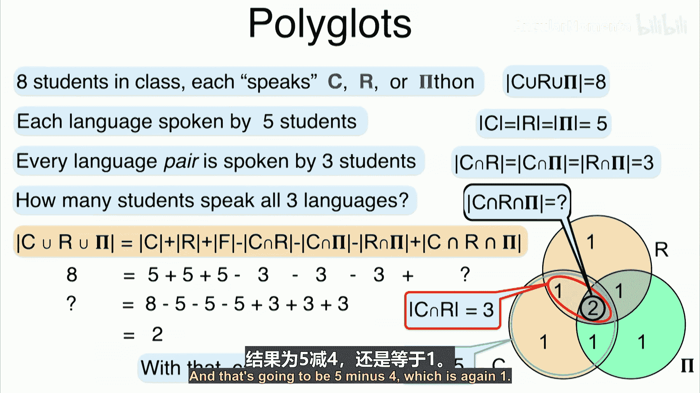
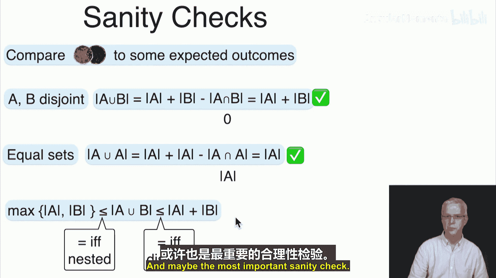
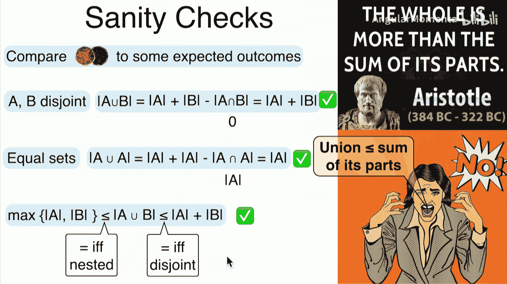

# 【加州大学圣地亚哥分校】使用Python进行数据科学中的概率与统计--Probability-and-Statistics-in-Data-Science-p16-04-04-03-总体工会--BV1gJFDzkEPg_p16-

Hello and welcome back in the previous lecture we talked about thisjoin unions and now we would like to find the size of general unions and we'll show that it's actually doing that is a piece of tie。

And so we'll talk about how to calculate the size of general unions。

 we'll discuss the principle of inclusion exclusion。

 we'll talk about how to find the size of multiple sets。

 but we want to start with the hair problem that we presented at the end of the last lecture。

Okay so just to remind ourselves， you have a friend who says that she can determine the size of any set instantly and exactly。

 she says that you can therefore also tell the exact number of hairs that you have on your head and we wondered if there are a couple of questions you can ask her and be fairly certain that she tells the truth and we gave a small hint okay so we'll provide a very simple solution that perhaps not surprisingly uses the subtractional so what you can do is you can ask her two questions first you ask her how many hairs you have。

😊。

And then after she gives you the answer， you go someplace where she doesn't see and you remove a small number of hairs。

 let's say eight from your head， then you come back and you ask her how many hairs do you have now now if she by the subtraction rule。

 the difference between her first and second answer should be the number of hairs you removed right because initially she had the total number of hair that you had and then the number of hairs you had after the you remove those eight and then using the subtraction rule。

 the size of a minus b is just the difference between the size of a minus the size of B。

 which should be 8。Now， if she gave you the number eight。

 if the difference between the two answer is eight， two answers is eight。

 then you're fairly certain that she knows what she is talking about。

 whereas she gives you the difference any number different than eight。

 then you know for sure that she made at least one mistake and probably was wrong both times。

OkaySo so that was pretty easy now can you ask her a single question and be firmly certain that she knows how many hairs you have。

 that she can tell how many hairs you have。Well， you can because you don't need to ask her about the number of hairs you had at the beginning and the number of hairs you had at the end。

 you can just make her do the math for you and you can just ask her how many hairs you moved and if her answer is eight。

 then you know she's telling the truth。Probably， and if the answer is not eight。

 then you know for sure that she's not telling the truth。And this may look like a silly puzzle。

 but in fact it's used for something called zero knowledgege proofs where you want a person to prove their identity without revealing more information about themselves or what they know。

 so for example here she only reveals that she knows the difference between the number of hers。

 but she doesn't give you any information about how many hers you had before。

 how many hers you had afterwards， so you can do this。

 like if you want to say if someone knows the password， you ask them a certain question。

 they can show you that nobody password without telling it where the password is。

So now let's go to the main topic which is general unions， so for thisjo sets A and B。

 we saw that if the two sets are disjoin， which we didote like that。

 then the size of a union B is the sum of the two sizes。And like that and some of the union。

 And in general， but in general， the size of a union B is not the size of a plus the size of B。

 for example， take the set a union with itself that gives you just the set A again。 Okay。

 and therefore， the size of the union of a union A is the size of。Just the set A。And which is 1。

 but this is not equal to 2， which is the size of a plus the size of a。

 so here we see that the size of the union is1 is different from the sum of the sizes which is2。

 and that's because A and A are not disjoint， they intersect clearly。Okay， so。

So the question is can we determine the size of a union B in general and the answer is yes。

 because if we take the set A and we add to it set B。

 then if we add the numbers the number size A plus the size B。

 then what happens is we count every element here once， every element here once。

 but every element in the intersection we count twice。Okay， so these counted twice。

 so we wanted to count every element in each region once here once， here once and here once。

 so what we need to do is we need to subtract the number of elements that we counted twice。

 so the size of a union B is therefore the size of a plus the size of b minus the size of the intersection。

Okay， and this is called the principle of inclusion and exclusion or pi， which will do not buy that。

 so we have the two sets here that intersect。

All right， so here is another example， so here's a squirrel and here's Krabi and both of them are water Pokemonons。

And here's PG and here's a flying Pokemon。And here is Girados and he is both a water and a flying Pokemon now suppose we want to know how many Pokemonons we have here altogether together so true we can count 1。

2，3，4 but you know that's maybe too easy or maybe it's more than the three that we would like to count so what we can do instead is use the inclusion exclusion principle and we can say that the size of w。

 the set of water Pokemon union the set of flying Pokemon so that's what were trying to count the size of the union of these two sets is the size of W plus the size of F minus the size of W intersection F。

Water intersection flying。 Now， the number of water Pokemonons， as we can see here， is 3。

And the number of flying Pokemon that we have， so we can see here is2。

And the number of both water and flying Pokemons is one。

 so therefore the size of the union is going to be 3 plus 2 minus1。Which is for again。

 as we found out initially。Or it。So that works here well now let's do a slightly more complicated example let's look at divisibility by two numbers so we've looked at div visibilityibility by one number one to look at divisibility by2 so suppose that we let D2 union 3 be a set of integers between one and 100 that are divisible by 2 or by 3。

So this consists of the elements， not one because it's not divisible by two or by 3。

 it consists of two because divisible by  two，3， it's divisible by 3，4， divisible by 2。

6 divisible both of them， and so on up to 100， which is divisible by  two。

So the question is how many elements are here and we can see that we're going to it's going to be relatively easy to solve answer this question using the inclusion exclusion principle so we'll let D2 be the set of all integers between 1 and 100 that are divisible by 2 and that's the numbers 246 up to 100 and so here they' are showing here in the Ven diagram and we'll let D3 be the set of all integers between 100 1100 that are divisible by 3 and these are 369 and so up to 99 and。

Depiced here and so we know that T of2 union3， the set of the numbers that are divisible by 203 is going to be D2 union D3 because every element here is divisible by either 2 or3 or both and so this is the whole set which size we're trying to determine now by the inclusion principle by pi principle we know that the size of d2 union D3 is the size of d2 plus the size of d3 minus the size of the intersection。

And the size of D2 as we calculated before， is going to be 50， 100 divided by 2。

 the size of D3 is going to be 100 divided by 3 floor off， which is 33。

And the size of D2 intersection D3 is the set so D2 intersection D3 is the set of all integers between 1 and 100 that are divisible both by 2 and by3。

 and thats the set of all integers between  one and 100 that are divisible by 6 because if the number is divisible by both two and 3。

 it must be divisible by 6 and by versa。And the size of the set is therefore for 100 divided by 6 floor of that。

 which is 16， so that tells us that the number of integers of the visible by 2 or3 is going to be the size of the2 plus the size of the3 minus the size of the intersection。

 which is 50。Plus 33， I 16。

Which is 67。So moving from two to more sets， we know that for two sets by the principle of inclusion exclusion。

The size of a union B is the size of a plus the size of B minus the size of the intersection when we get three sets。

 the size of a union B union C is going to be the sum of the individual sets as we had before。

Minus the sum of the pairwise intersections again， as we had before， but now there are more of them。

Plus the size of the threewise intersection here okay now to see that let's look at a Venn diagram so here the sets a B and C and we want to calculate the size of the union only the total number of elements in all three sets so when we take the size of a we're counting every element in this region once every element in this region once here once and here what when we add the number of elements in B what we're doing is we're adding the elements here once and here once and here once and here once and you notice that the elements here we counted twice and elements here we counted twice again。

And when we add C like that， then what we do is we add elements here here， here and here once。

 and what we see is that elements in in these regions here we counted once。

 but elements in the pairwise intersection here and here we counted twice an element in the threewise intersection we counted three times so what we need to do is we need to not not double count here and here and not triple count here。

 so we'll do is will subtract the number of elements in this intersection number of elements in this so on so we just subtract the number of elements in a intersection B。

 and when we do that we're going to reduce these numbers by this counts by one。Okay。

 so we reduced one from here and one from here， and then we subtract the intersection of A and C。

 so we subtract now here。Subtract this one and this one。

 and then we subtract the intersection of B and C。So what we do is we subtract these numbers once and what we see is that now is we count these element elements here once and here once and here once。

 but elements here we added them first three times for A B and C and then we subtract them three times for the three pairwise intersection so we're actually not counting them at all。

 so what we need to do is we need to add them again so we add the size of the threewise intersection a intersection B intersection C and when we do that well get one here。

And so we counted everything once。 Okay， so we see that the size of a union B union C is this formula。

 We have the size of the individual sets minus the size of this powerer section plus the size of the。

3wise intersection and this formula generalizes to more than three sets so if you have n sets the size of the union of n sets a1 up to an is going to be the summation of the sizes of the individuals sets minus the summation of the sizes of the pairwise intersection and then plus the summation of the threewise intersection so you'll have an alternating sum until and the n you get plus or minus the the size of the intersection of all sets and if n is even then this number will be negative and if n just like it was here and even it ends with a negative sign and if n is odd then this number will be added this will be a plus1 here willll be adding the last intersection。

All right。So to see like a small application of this。

 consider a class that has eight students and each of them speaks CR or Python。

 and what we mean by that is that they can speak or program C。

 they may be able to program other languages， but there are eight students program in C and possibly other languages and so on。

Okay and since we have Python clearly we know we're going to use the pi the principle of inclusion exclusion but want to so let's C the note the set of students that can program in C R the set of students that can program in R and pi the set of students that can program Python and we're interested in the size of this union C union R pi and I'm sorry we know that the size of C union R in pi is8 and we also told that student each language is spoken by five students so that tells us that the size of C number of students can program in C and potentially other languages as well is5 and the same is the size of students can program in R and in Python。

And furthermore we're told that every language pair is spoken by three students。

 so the size of C intersection R all these intersection have size3 and we ask how many students can speak or can program in all three languages okay so given this information we ask how many students can program three languages so you notice that this is a slightly different application of the inclusion exclusion we're not asking what is the size of the Union but here we're given the size of the Union and the various intersection and we're just asking what is the size of like the three intersection。

So so this is what we want to know and we're going to draw the Venn diagram as shown here and so what we know is for example。

 is that the number of students who can program in C is5 and likewise the number of students who can program in R is also going to be5 and Python and we're told that the number of students who program in C and R is 3。

And the number of students who are programming all of them is what we want to find out。

So what we can do is we can write the inclusion exclusion principle that tells us that the size of C in or pi is the sum of the individual sets minus the sum of the pairwise intersections plus the sum of the three way intersection like that。

And we know almost all the numbers here， we know that the size of the union is8。

 we know these individual sizes are5 each， and we know that the intersections pairwise intersections are three each。

And then we are going to add the size of the threeY intersection， which is what we want to find out。

 Okay， so we can just move things to the other side and we get that the size of the intersection or the question mark that we have is going to be equal to 8 minus35s。

Plus33s， and that's going to be 8 plus 9， which is 17 minus 15， which is2。

So going back to the picture here we've figured out that this size is  two and now we can calculate different sizes if you ask for example how many students can program in C and R。

 but not in Python， that's this region here， which is going to be 3 minus2 which is1。

So this is one and likewise these numbers are one and then if you want to know how many students can program C。

 but not in our Python， that's this area here and it's going to be 5 minus4， which is a games one。

Okay， so we could do that。Okay so let's do a couple of sanity checks。

 so we want to compare the principle of inclusion exclusion to some expected outcomes。

 so if A and B are disjoint， then the size of a union B。Well。

 we know that if they're destroyed and the size of a union B is going to be just the size of a plus the size of B and we want to see if the inclusion exclusion principle gives it to us。

The pi print by the principle of inclusion exclusion is the size of a plus the size of b minus the size of the intersection。

But the size of the intersection is zero because there is joint。

 so it's just the size of a plus the size of B as we expected。If you take two equal sets。

 take the union， so if take a union a and you ask what is the size。

 we know it should be the size of a and once if inclusion exclusion gives that to us。

 so by inclusion exclusion is the size of a plus the size of a minus the size of the intersection。

 but the size of the intersection of a and a is the size of a so gets the size of a plus the size of a minus the size of a which is just the size of a again。

 so again agrees with our intuition。嗯。If we take general units。

 then we can see that the size of the unit is at least the maximum of the size of a and B and you can see it from the inclusion exclusion。

 for example here it's going to be the size of a plus the size of B minus the size of the intersection this difference here is going to be non negative so it's bigger than the size of a likewise it's the size of B plus the size of a minus the size of the intersection。

 the size of a minus the size of the intersection is non negative， so it's bigger than size of B。

 so therefore it's bigger than the maximum of the two sizes and we also see that it's going to be and we get equality if and only if the nested namely if a is contained b or b is containing a you can verify that and we see that the size of a union B is at most the size of a plus the size of B and again we get that because it's the size of a plus the size of B minus some number so it's going to be less than equal to size of a plus the size of B and we got equality here if and only if the size of a intersection B is 0。

so I get equality if and only if they're disjoint。And maybe the most important sanity check。

 So this also agree and for the most important sanity check， let's go back to you know maybe the。

Founding father of philosophyphy I， he told us that the whole is more than the sum of the parts。

 so let's just verify that this is correct and is it。No， because we know that the size of the union。

 if we take the whole， it's a union of part and the size of the union， as we just said。

 is less than equal to the sum of its part。 So just shows you that Aristotle was a great philosopher。

 but maybe he。嗯， maybe连。Know about principle of inclusion and exclusion。All right。

 so to summarize we talked about a solution to the hair problem。

 we talked about the size of a general union， the principle of inclusion exclusion。

 we talked about how to calculate the size of union of multiple sets and next time we're going to talk about quotesion products see you then。

