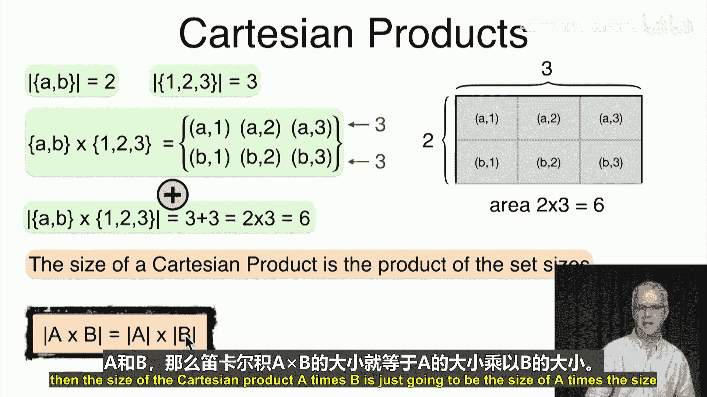
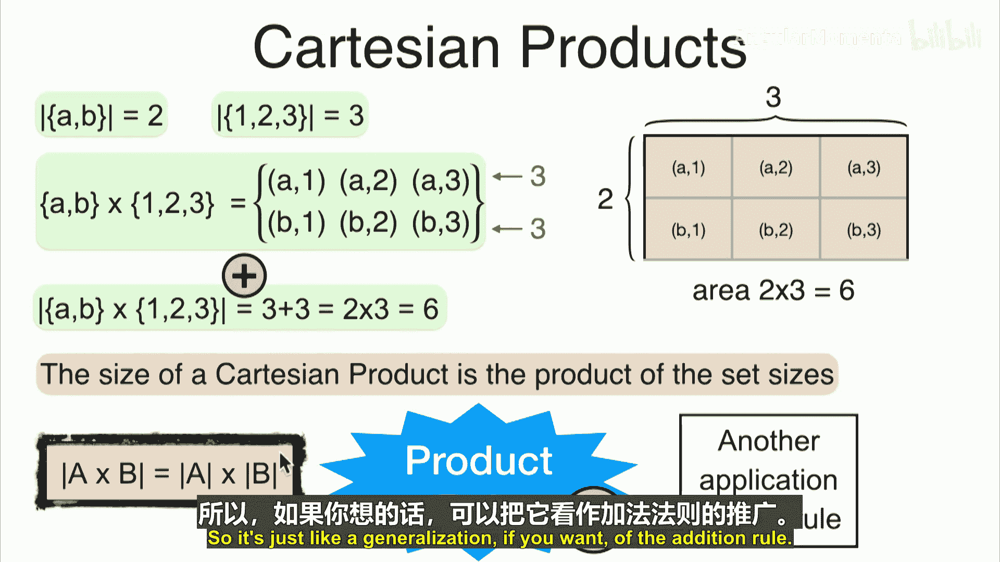
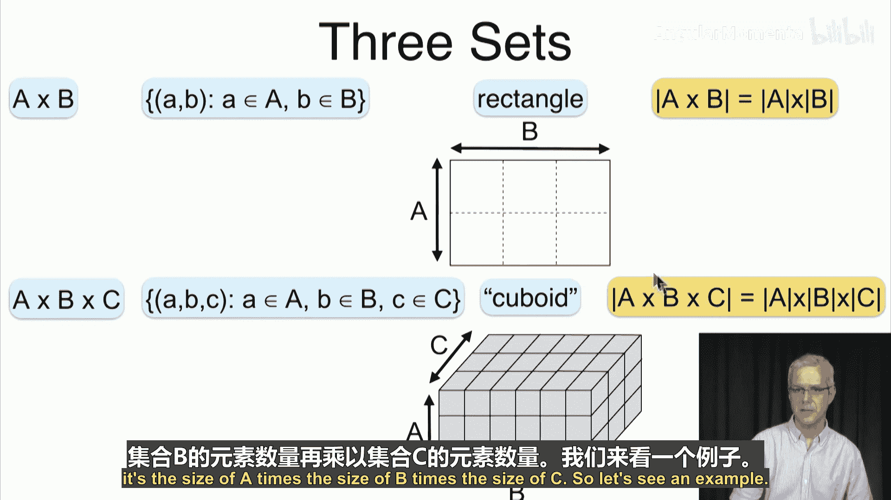
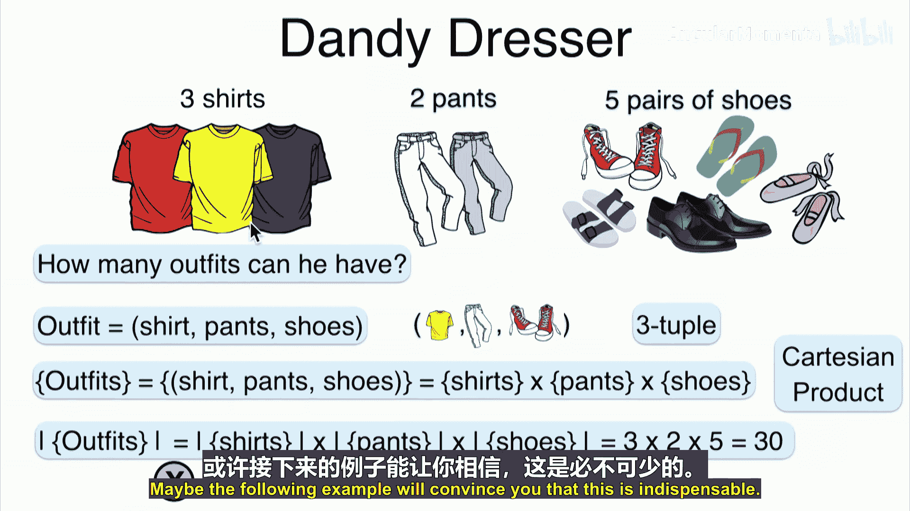
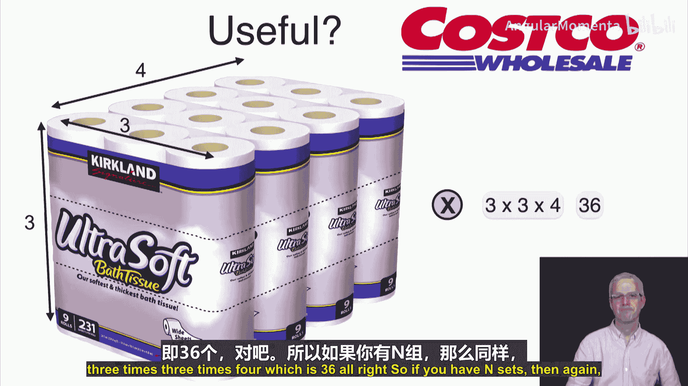
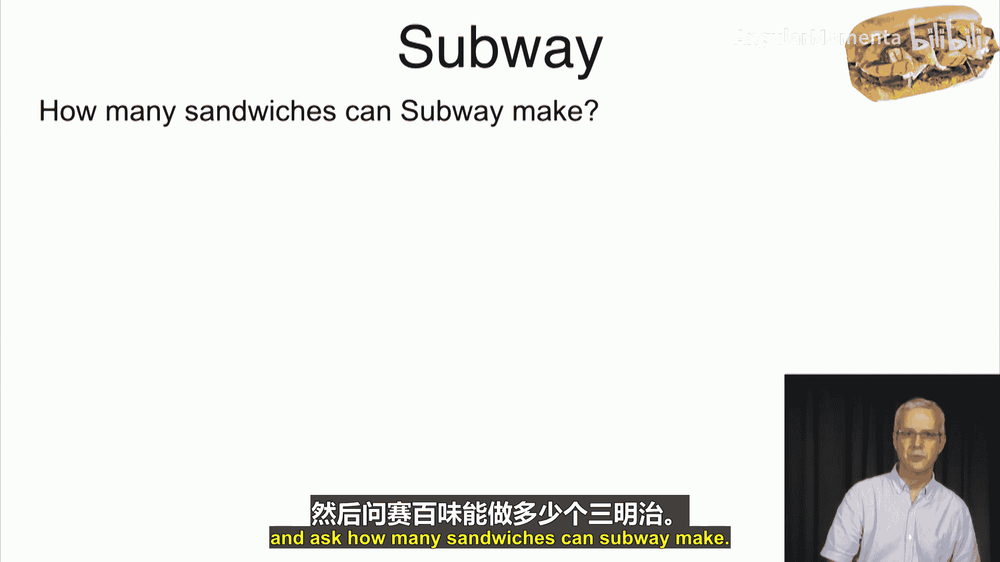
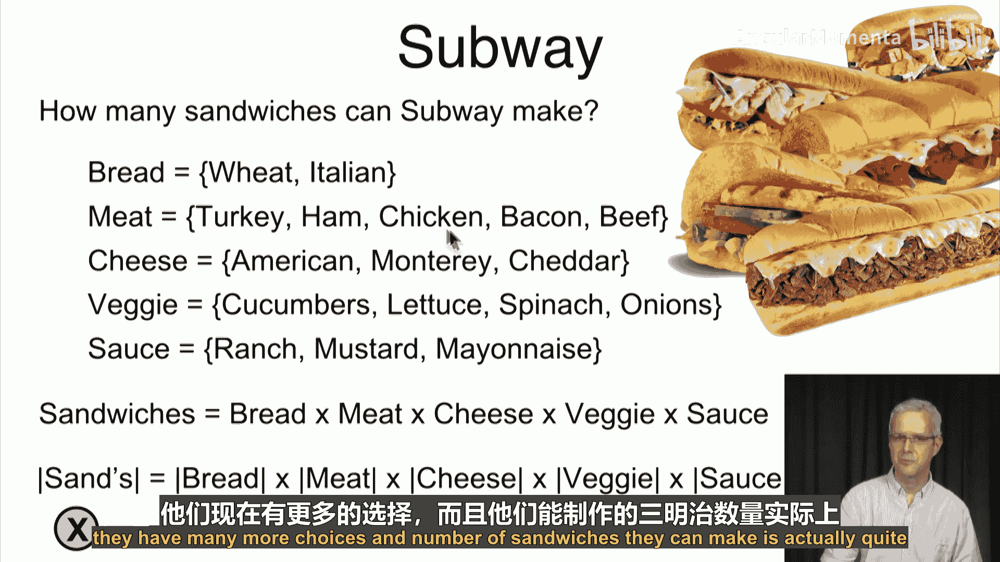

# 【加州大学圣地亚哥分校】使用Python进行数据科学中的概率与统计--Probability-and-Statistics-in-Data-Science-p17-04-05-03-笛卡尔积--BV1gJFDzkEPg_p17-

Hello and welcome back so in the last video we talked about the size of general unions and now we would like to de contsion products。

So。If we have a set， for example， AB and another set 1 to3， the set AB is size2。

 the set123 is size 3， the size of the cartesion product AB times1 to3 is the size as we know of this set here。

 a1 a2 a3 B1 B2 B3 as we know this is the quottesion product of these two sets and the size of this set where we have three elements in the first row and so three elements in the first row and three elements in the second row and these element as this joint。

 the elements here are different from the elements here so therefore by the additional the number of elements is3 plus3 which is the same is two times 3 which is6 and here is another interpretation of the same result we have here old elements a1 a2 and3 B1 B2 B3 we have two rows and three columns so the total number of elements that we have is two times3 which is essentially the same argument but maybe this gives more。

Iea of a volume one area all right so like this the area is2 times 3 which is6 now in general we can see that the size of a quottesion product is the product of the set sizes so if you have two sets A and B。

 then the size of the quotsion product A times B is just going to be the size of a times the size of B。

Okay and this is called the product room which we denote by this X and as you can see it's another application of the additional rule because we just add things you know the size of a times so here we added them twice。

 so it's just like a generalization if you want of the additional。

Okay here are some applications of quotesian products， let's start with the ubiquitous tables。

 so every table as we had said that we use is a quotesian product。

 it has records which are view this rows， here we have five records and has attributes here which are view this columns here we have three and the number of cells that we have。

 is the size of this quotian product and by the multiplication principle or the product rule。

 it's going to be five times three which is 15 cells。Alright。If you have more than two sets。

 so A times B the quottesion product is a set of all AB such that A is in A and B is in B。

 and this gives you rectangle like that and the size of the rectangle as we saw is just the product of the sizes of the two sets if we have quottesion product of three sets。

 its the collection of all AB C， such that A's in A。

 b is in B and C in C and that will instead of a rectangle is going to give us like a cuboid something that looks like that。

 and the number of elements there is going to be the size of this quotesion product is the number of elements it the size of a times the size of B times the size of C。

So let's see an example， we have someone who likes to dress differently and they have three shirts。

 let's say two pants and five pairs of shoes and one more is how many days they can go with different outfits so how many different outfits can they have so notice that an outfit is just a triple it's a shirt。

A， a pair of pants and a pair of shoes， so for example an outfit may be the yellow shirt。

 the blue pants and the red shoes okay so the outfit is just an order triple and the set of outfits so there's an outfit and the set of outfits is the set of three tableples or order triples which is just the quotesion product or shirts times all pants times all shoes。

 it's cartesion product and the size of the number of outfits namely the number of different outfits that they are is by the product rule is going to be the number of shirts types the number of pants the number of shoes。

And in this case， it's going to be three times2 times5， three times2 times 5， which is 30。Okay。

 and you know， you might think， oh， this is again not very useful， discounting number of outfits。

 maybe the following example will convince you that this is indispensable。

So let's say you go to Costco and you want to buy tissue paper。

bathroom tissue and so you get you a package that looks a little bit like that and trying to count how many roles there are is hopeless。

 but what you can do is you can count and see that you know there are maybe the sizes are three by three by four and therefore by the product rule。

 the number of rolls that you have is three times3 times four which is 36。

Allright， so if you have NS sets， then again you can use the product for in induction。

 you get the size of a1 Cotent product A2 up to AN is just the product of the sizes。

And heres an application of that， suppose you want to go for lunch。

 you want to go subway and ask how many sandwiches can subway make？

And let's say that they have two breads with wheat and Italian， they have let's say。

 five meats listed here， three cheeses。Four veggies， three sauces。

 and let's say that you need to create a sandwich， you need to choose one of each。

 you need to choose a bread and a meat and a cheese and so on。

 then the set of all sandwiches that they can make is the contion product of all breads。

 times or meats， times the set of cheeses and so on because every sandwich consists of just one element from each。

you can choose all those all those breads and so on。 Okay。

 so the number of sandwiches is going to be the product of the number of breads and so on。

Okay and that's going to be by the this is by the product rule and that's going to be equal to 2 times 5 times 3 times4 times 3。

 which is 360 Now in fact they have many more choices and the number of sandwiches they can make is actually quite astronomical。

All right， so to summarize， we talked about the product rule that says that the size of a colteion product with B is the size of a times the size of B。

 we dennoted it by this multiplication sign， which said that for multiple sets。

 the size of the cartsion product is again the product of the sizes。

And what are we going to talk about next time， Curteion Powers， see you then。

