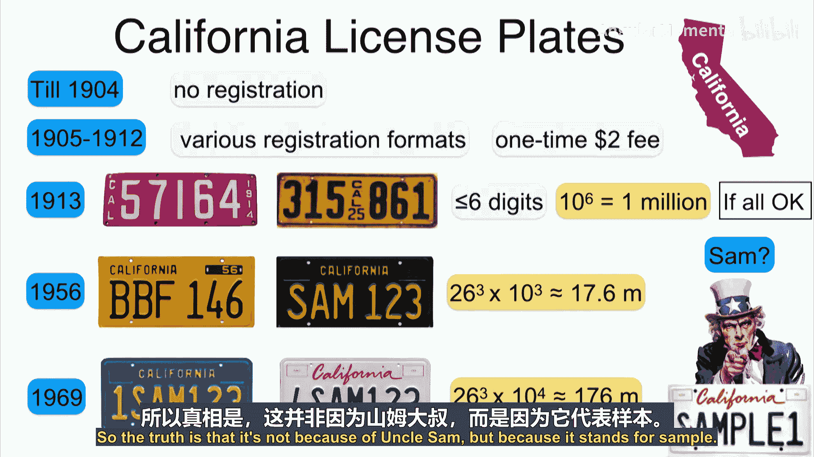
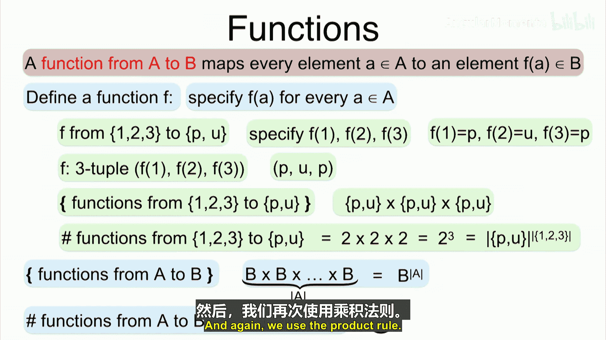
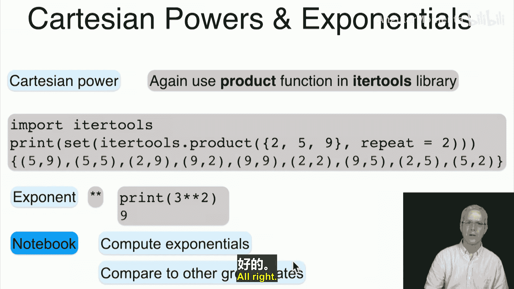
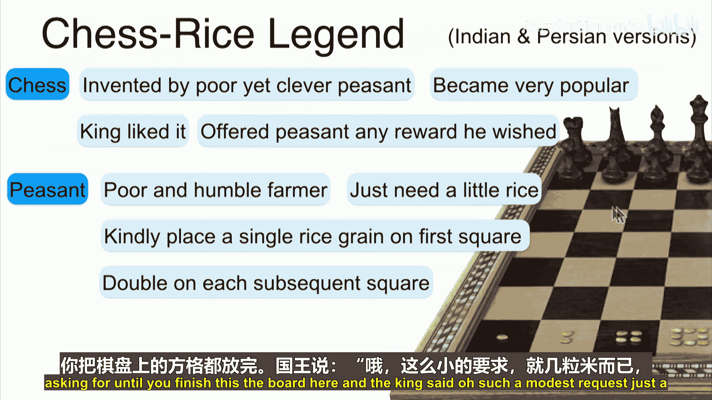
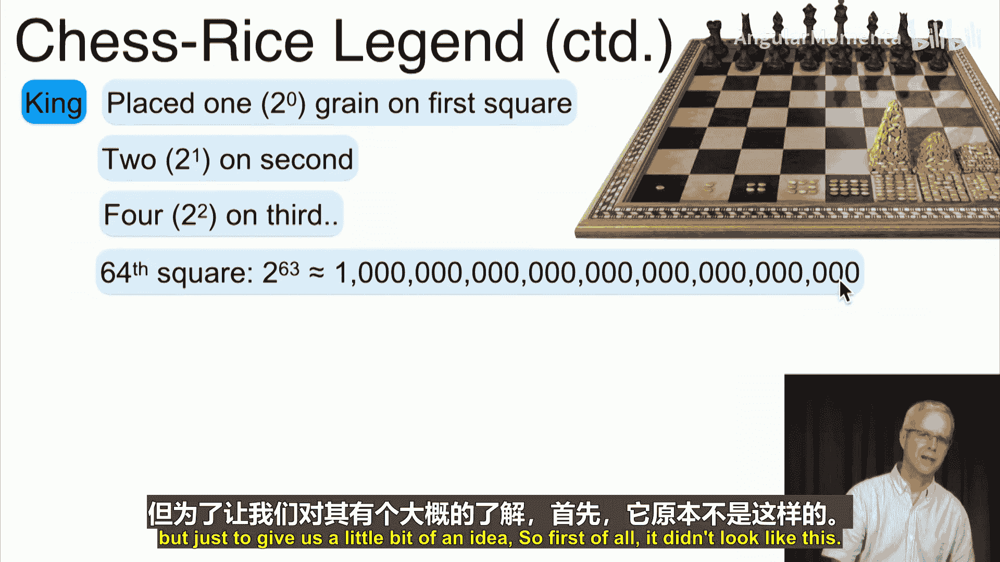
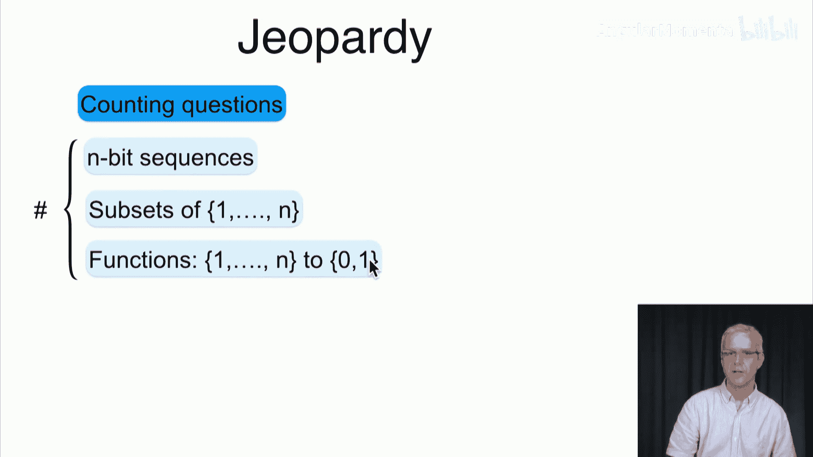
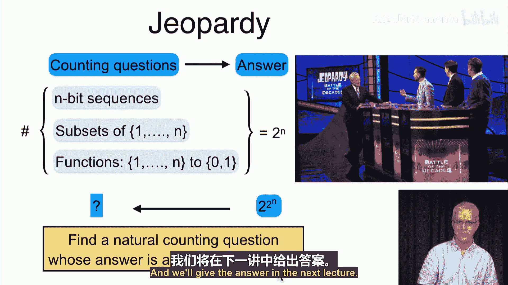
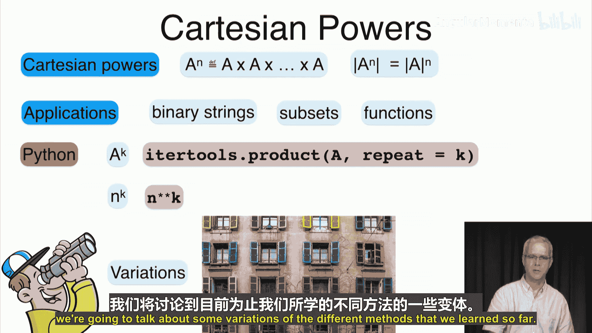

# 【加州大学圣地亚哥分校】使用Python进行数据科学中的概率与统计--Probability-and-Statistics-in-Data-Science-p18-04-06-03-笛卡尔幂--BV1gJFDzkEPg_p18-

Hello and welcome back。In the last lecture we talked about cartesion products and today we want to talk about cartesion powers so we have shown an analogy between numbers number operations and set operations。

 for example we said that number addition correspond to set union of this joint sets。

 we said that number subtraction corresponds to complements of sets and that multiplication corresponds to quottesion product and an actual question is what do exponents correspond to and that's what we'll discuss in this lecture so we're going to talk about quottesion powers of a set and quotesion power for a set with itself a cartesion product I'm sorry a set with itself is called a quotesion power so for example a square is a times a and that's the quoteion square and a to the n if a is a set a to the n is a cortesion product with itself n times。

That's called the n quotion power of a。And the size of a to the n is the size of the quottesion product of a with itself a times and as we have said in the previous video by the product rule is just the size of a times the size of a times the size of a。

 which is the size of a raised to the n power。OkaySo this simple formula has several practical and theoretical complications we'll go over a couple them let's talk about license plates in California。

 turns out that until 1904 you did not have to register your car you could just drive it no problem in 1905 registration started being required and but they had various registration format。

 different formats for the license plates and interestingly they had a onetime registration fee of $2 which makes sense because registration is something you only do once not every year。

In 1913， they started standardizing the license plates and they looked something like this or like that。

 and basically they had at most six digits。Okay， so assuming that all numbers with， you know， one。

One digit and so on is possible starting from zero all the way to the full six digits 999999。

 then the total number of license plates was going to be 10 to the6 which is 1 million and again this is assuming that all numbers are possible in 1956 they started running out of license plates and what they did was they decided to have instead of six digits they decided to have three letters and three digits like that or like that they changed the looks but they kept the。

The format。At some point and that gives us 26 cube possibilities for the letters times 10 cube for the numbers and again we using the product work here maybe a few times first with 26 cube to find how many here and then 10 cube find here and then we multiply because you can choose any sequence of letters and digit so you get this gives you up to 17。

6 million and then in 1969 they were running out of numbers again so they added another digit and which looks like that and then later on they changed it like that again the same format and that gave them a factor of 10 more so now the number is roughly 176 million and this is again using the product rule now you may wonder why they use Sam so much and you know reasonable guess is that maybe it's because of this guy shown here in the back。

Uncle Samname， but in fact， this is California and Uncle Sam is you know kind of liked。

 but you know with some reservations， so the truth is that it's not because of Uncle Sam but because it stands for sample。

 so this is another way that they demonstrate license plates。

So now as we said， cartsion powers have many applications， here is one binary strings。

 so if we take 01 to the n， so01 cotsion product with itself n times。

 it's the set of all length and binary strings。Okay or in other words， L N B strings。

 So here is an example，01 to the1 is just 0 and1，0，1 square is 0，0，0，1，1，0，1，1。

You can see01 square01 cube is the set of all three orbit strings like that and so on and notice that01 to the zero is just the empty string。

Okay， this one here。 and what we see is that we can。

View it like this as each of those is if you want like in this case at two or three tableples。

 we just emitted the differentheses and the commentsas。

 as we said when we talked about Cartesian products and you can also visualize it so this is 01 to the1。

 this is 01 square Cartesion square and this is the Carttesian cube of 01。Like that。

 And the size of01 to the n is just the size of 01 raised to the n power。

 The size of01 is 2 raised to the n， so it's 2 to the n。So the sizes are of01 to the 1 is2 to the 1。

 which is 2，2 to the2， which is 4 to cube up to2 to1。Okay。

 another example of Carttesion products are subsets， so the power set of s。

 which is denoted by this P of s and sometimes by2 to the s， as we will mention。

 is the collection of all subset of a set s。So for example， the power set of AB is the set。

 the empty set， the set consisting of a set consisting of B， and the set consisting of AB。

 all those subsets。And if we're interested in the cordinality or the number of subsets that S may have。

 then we can see that there is a  one to one correspondence between the power set of s and01 to the s the set of all strings of length binary strings of length the size of S so this is all subsets of S and this is the all binary string of length coality of s to see that let's see an example。

 let's look at the power set of A and B， all subsets of A and B and01 square so here all subsets of A and B。

 the empty set， a set of just B， the set of just A in a set AB。

And we can map each of those subsets to a binary string of length2。

 so for example this set does not does not contain A does not contain B， so we'll denote it by00。

 meaning it does not contain A does not contain B， this set V does not contain A。

And contains B will node by0 because it does not contain a and followed by 1 because it does contain B and the set A will node by 10 because contains A but not B and the set AB contains A and B。

 so we can see that we have here1 to round correspondence between subsets of N B and all binary strings of length2。

Okay， and that tells us the coinality of the power set of s is the same as the coinality of 01 raised to the length of s this set here。

 this case it's 01 to the 2， which is 2 to the size of s。

So the size of the power set is the power of the set size。Right， okay， so in fact。

 it's the two power of the set size two raised today。Se size。Okay here's another example functions。

 so recall that a function from A to B maps every element of A in a to an element f of A and B。

And to remember that to define a function F， we need to specify F of A for a V A and a。

So for example， if you look at function F functions from 1 to3 to the letters P。

 then we need to specify f of 1， f of 2 and f of 3。For example， you can specify F of 1 is p。

 F of 2 is U and f of 3 is p。So we can see that F。Every function F is just a three double that specifies F of 1。

 f of 2， f of3， in this case it's going to be PP。Okay so this function is just PUP and if we had a function that maps all of them to you。

 that will be just the triple U UU so the set of all functions from 1 to3 to P is the same as the quotession product P times P times P because we need to specify one element for f of1。

 one element for f of2 and one element for f of3， so we just have a three tuple and the collection of all functions is just the quotsion product。

Okay， so therefore the number of functions from  one to3 to P is the size of this cartsion product。

W which is going to be the size of this set2 times 2 times 2， which is2 cube， which is 8。Okay。Now。

 in general， if you're interested in the number of functions from set A to set B。

Then it's going to be the size of B， the quotesian product B times b times B a times because we need to specify F F for every element in a。

 we need to specify its image in B， so we have one image in B here for the first F of the first element and F of the second element and so on。

 so it's this size which is the size of B raised which the set is B raised to to the size of a。

 and the number of functions from a to B is the coinality of this set is the coinality of B raised to the size of a。

 which is the coinality of B raised to the cordinality of a。

 so this is another application of the size of quottesian power。And again， we use the product for。

Right， both of those give us examples of exponential growth， which is shown here。😊。

So if we look at the function， the exponential function in this case was2 to n。

 it grows like the blue line here and as you can see it grows a lot faster than any polynomial for example n square here。

 this is going just up to 10 and going from0 up to 10 and you can see how much faster2 to n goes already in this range and n or the n square。

 we'll briefly talk about it when we discuss the notebooks so which leads us to Python for Cartesion powers。

So quotesion powers and exponentials， so quosion power。

 just like we talked about Cartesion products implementation in Python before and quotesion powers can be implemented similarly using the product function in the Etools library so what we do is we import E tools and then what we do is we again use the Eer toolsol of product function and we take a set as we did before but instead of multiplying it by another set we just saying we repeat the product some number of times here we repeat it twice So if we do that we'll get the set 59 55 and so on well get the quotsion product of the set with itself。

And exponents in Python are expressed using this double star， so for example。

3 datata 2 is3 square and if we print it， we'll get nine。And if you look at the notebook。

 you'll actually see a couple of interactive functions where you can compute exponentials and see how they grow in other sets。

 and I recommend that you just play with it and see how fast exponential comes。All right， so。

I want to finish with a small legend。 It's called the chess R legend。

 And depending on what part of Asia you come from， you may be familiar with slightly different versions of this legend。

 but the。All quite similar， they all said that the game of chess was invented by a poor。

 yet clever peasant。🤢，And the game became very popular very quickly， maybe the。

Candy crush off years ago and eventually got to the attention of the king and he really liked it and he wanted to compensate the peas for his invention and he said he offered the peas any reward that he wished for。

And the peasant you know being you know， we said poor yet clever said。

 well I'm a poor and humble farmer， I don't need very much。

 I just need a little bit of rice so I can feed my family so if you don't mind maybe you can give me a single rice grain on the first square like we show here and maybe then double on its subsequent square so as you can see here on the bottom right we have give me on the next square give me two grains of rice as you can see here。

We go some pictures。Yeah， so what should we do？Okay， just say。As you can see here， and I could just。

OkayJust get it from two grains of rice。Let me start with just one second here。So maybe I start here。

Yes， okay， so if you don't mind， okay， I'm sub starting。

So if you don't mind kindly place a single rice grain on the first square like that and then double on its subsequent square so on the second square just give me two and on the next  one4 and on the next one8 and that's all I'm asking for until you finish this the board here。

And the king said， oh， such a modest request， just a few grains of rice， of course it's granted。

And the king went on to grant the peasant his wish and he placed one， namely two to the zero grain。

 one grain of rice on the first square and two on the second square， which is two to the 1。

4 or two to the two square on the third square and so on and you can see the numbers here， one248。

 and quickly the numbers grew， and by the time he got to the 64th square he put two to the 63。

 which is one with 18 zeros behind it。And this now is so large I don't even know what it's called but just to give us a little bit of an idea so first of all it didn't look like this。

 it probably looked like that and probably a lot worse and just again to give us an idea the world reaches person maybe Bill Gates or so is worth 90 billion so that's roughly one if it was $100 million it would be it would end here if you take the whole the wealth of all Americans it's roughly 90 times 10 to the 12 so it's a number that ends here and if you take the wealth of the whole all the people on earth then that would end here so we have another 12 zeros to go so so clearly in the end it was quite a bit and there two endings to this story one is that the king went bankrupt and the peasant became。

And the other one is that the king was so upset with the sly peasant that he beheaded him。

So what's the moral of the story that be peasant or keen， you have to beware of exponentials。All。

 so to end。Maybe let's play a little bit of jeopardy。

 so we talked about counting and we gave several counting questions， for example。

 number of n beat sequences， number of subsets of one up to n and number of functions from one up to n to01 and all of them had the same answer。

 it was2 to the n。

So let's play a little bit of jeopardy and ask。If the answer is 2 to the2 to then。

 what is the question？So which in other words， can you find a natural counting question whose answer is double exponential？

And。We'll give the answer in the next lecture and before we finish I want to discuss a small analogy。

 so we've mentioned a few analogies in fact between number operations and set operations which said that number addition correspond to thisjo unions。

 number subtraction correspond to set complements。

Number multiplication correspond to cartesion products of sets and exponentence corresponded to cartesion powers and a very natural question to ask is which came first did number operation come first or the set operation comes first and I would argue that actually what we have been discussing today did come first and the reason is that like all innovations necessity is the matter of mathth and it seems quite reasonable that what people first need to do is look at this joint unions I give you you know three chickens and then I give you another four chickens I give you then a set of seven chickens so they needed to look at these operations first and then they defined number operations to more of these so what we have studies is quite basic and so to summarize we talked about Carteion pros a to the n is the product a times a times a and times and the size of a to the n is the size of a raised to the n。

And we talked about some applications to binary strings， to subsets and to functions in Python。

 we talked about how to compute the case power of a set。

And we also talked about exponents and next time we're going to talk about some variations of the different methods that we learned so far。

 see you then。

