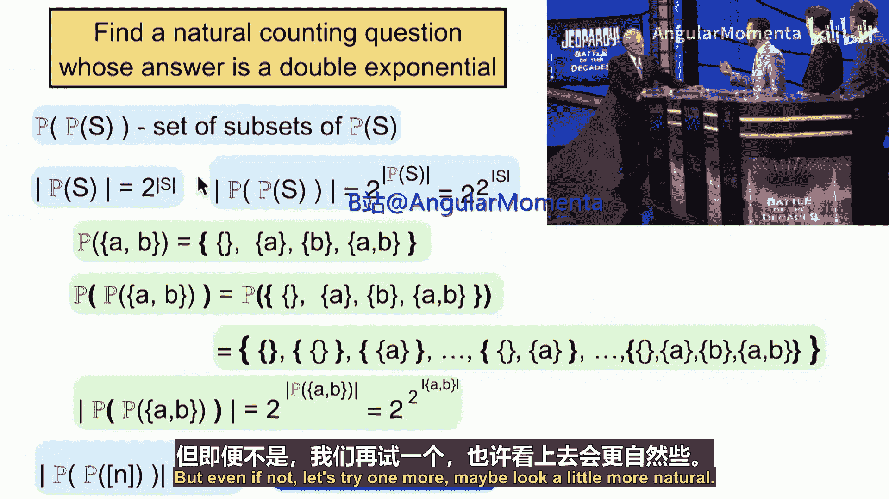
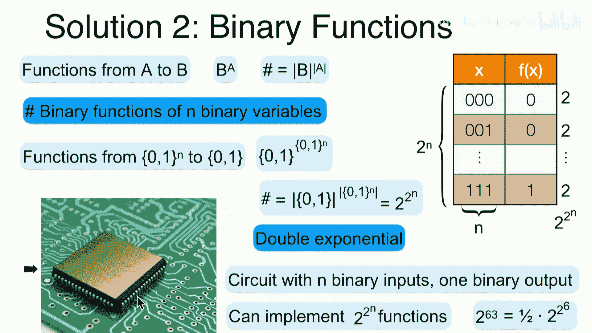
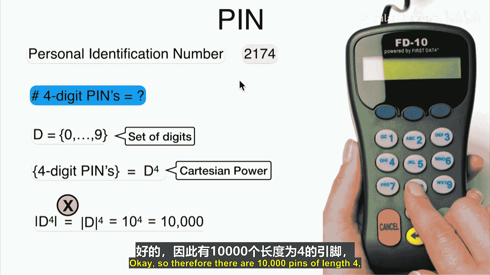
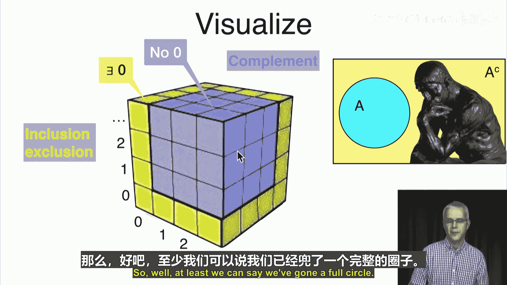

# 【加州大学圣地亚哥分校】使用Python进行数据科学中的概率与统计--Probability-and-Statistics-in-Data-Science-p19-04-07-03-计数变体--BV1gJFDzkEPg_p19-

Hello and welcome back。 So far， we talked about counting different types of sets like。

Unions Carteion products， cartesion powers and what we want to do today is discuss several variations of these sets。

 but before we do that let's consider the question that we asked at the end of the last video so what we asked was whether there was a natural counting question was answer is is a double exponential and what we want to do today is give two answers to this question one of them is using subsets and the second one using functions and actually quite a few more and we'll start with the one that you subsets so recall that the power set of as is a set of subsets of S and the power set of S is denoted like that PFS or two to the S。

OkaySo for example， the power set of the set AB is the collection of all subsets of A and B。

 namely the empty set， the set A， the set B and the set AB。

 and it is easy to check that the size of the power set of any set S is 2 to the size of S and for example here the size of the power set of A and B is 4 as we see here。

1，2，3，4，4 set and it's 2 to the2 namely 2 to the2 to the size of the set AB so we have that the size of the power set of S is 2 is exponential in the size of S。

Now observe that the power set of a set， like the power set of AB is again， a set。

So what if we looked at a power set of PFS， namely the power set of the power set of S？

Okay so that's what we want to now， so the power set of the power set of S is the set of all subsets of P of S。

And the size of the power set of S， as we just said， is 2 to the S。

 so therefore the size the power of the power set of S is going to be 2 to the size of the power set of S like this。

 namely2 to the2 to the S so there we have the double exponential that we asked about and you know maybe we would consider to be a natural question how many what is the size number of subsets the size of the power set of the power set of S。

So let's look at our example we have here the set AB and its power set is the set of all four subsets。

 the empty set AB and AB， and the power set of this set is the power set of this four subsets。

And that's going to be consists of what it's always consists of the empty set， for example。

 it consists of the singletons here， namely the set containing just the empty set。

 the set containing， just the set A， the set containing just the set B， which I did not write。

 and then the sets of size2， namely the set containing the empty set and A， like this set。

 and maybe finally the set containing all subsets here， namely the same as this PF itself。

 namely the empty set containing the empty set A， B and AB， which is written here。

Now the size of power of the power set of AB is therefore going to be2 to the size of the power set of AB。

 name  two to the two to the size of AB， and that's going to be two to the two to the two。

And in general， if we take， for example， the set one up to n。

 then the size of the power set of the power set of one up to n is going to be2 to the two to the n Okay so this is one example where we get a double exponential。

 hopefully consider this to be a natural question but even if not let's try one more。

 maybe look a little more natural。

So the second solution uses binary functions。So consider functions from a set A to a set B and you remember that we said that this is thenoted by B to。

 a set of all functions from A to B， and we also have said that the number of such functions we talked about it when we talked about Cartesian powers。

 the number of functions from A to B is the size of B to the size of a。

So now we can ask how many binary functions order n binary of n binary variables。

 so for example here we have three variables and we ask three binary variables and we ask how many functions order so because we have three variables here we're looking at functions from01 to the in this case3 in general 01 to the n to 01 and that number is going to be according to this formula is going to be well'm sorry the set of function is going to be 01 to the01 to the n set of functions from01 to the n to01 is here and the cordinality according to this formula here is going to be the size of01 raised to the size of 01 to the n and this is two size of 01 and the size of 01 to the then n is2 to the n so it's 2 to the2 to the n which again。

double exponential Okay so here using this table we have n variables and therefore we have two to then rows and we need to specify f of x for every possible sequence length and sequence so we have two choices here。

 two choices here， we have two to then n rows so they have two to the2 to the n possible ways to fill out this table and that's the numberboard that we see here Okay now so this is22 and so on up to2 and that's2 to the2 to n allright now and this is double exponential now to see where this actually。

Comes into play and something that is being used every day consider a chip with n inputs like this one here and so imagine that you have a circuit with n binary inputs and one binary outputs so for example here is a chip that performs some function of the inputs and assume it has a single binary output then it can implement two to the2 to the n functions now to see how fast this number grows。

 this double exponential growths observe that if2 to the 63 which was as we said the number of grains of rice on the chessboard which was much larger than the wealth of the whole planet this number of two to the 63 is half of two to the two to the6 so if you take chip with just six input pins this one is many more if we just had six input pins then the number of functions you could implement was two to the two to the6 which is the number of grains of rice that we。

I don't on on the last square of the chess board， okay so this numbers goes pretty fast and you can just imagine how many different functions a chip like this could potentially implement。

 of course， cannot implement all of them because。The circuits is limited but in theory good All right。

 okay so with that let's go back to you know on the main show today and what we want to do is want to combine different techniques that we learned earlier in this sequence of lectures namely the additional rule。

 the subtraction rule， the multiplication rule and to use them to determine the size of more complex sets okay and we're going to use it using pins and various constraints and these pins are different from the pins that we just saw for the chip。

Alright。Okay， so what is this the pin that we're talking about。

 so these are personal identification numbers， which is how people to used to show that they they are who they claim they are and that of course before they were passwords and because before they were fingerprints and before they were face prints but we were moving a little slow so for example。

 and pin could be two1，74。And the question we want to ask is how many four digit pins are there。

 so let D stands for digit then represent the set of 10 digits from  zero to9。Okay。

 so the set of all four digit pins is the collection of all sequences of length 4 over 0 to 9。

 which as we know is just d to the4， the fourth quotsion power of d， and as we saw。

 the size of d to the4， the size of this set， by the product rule is going to be the size of d raised to the4。

 namely 10 to the4 or 10，000。Okay， so therefore the 10。

000 pins of Fan4 assuming you can choose any sequence of flan4。

Now let's look at some variations， so first let's consider pins of variable length。

 so let's look at pins that have length between3 and53 and5 digits。

 okay for example 314 or 2246 that has length 4 this one or 79382 so again D is the set of digits029。

 so the set of valid pins is therefore d cube union D to the 4 union D to the 5。

OkayBecause it's a union of the set of three digit pins， four bit digits pain and five digit pins。

So the number of pins is therefore the size of this set， the size of this union。

 and observe that this union is disjoined because pin of length  three is different from pin of length 4 and length 5。

 so this union is disjoint， should we doote by these two disjoin circles。

 and therefore by the addition room。The size of the set is going to be the sum of the individual the sizes of the individual sets。

 so it's the size of the cube plus the size of the4 plus the size of the5 and this is going to be 10 cube10 plus 10 to the4 plus 10 to the5。

 which gives us 1，000 plus 10，000 plus 100，000， which is 111，000。

Okay so this is the number of pins of rank3，4 and 5 okay so next we won consider forbidden pins namely pins that don't have certain disallowed sequences so for concreteness let's look at four digit pins that don't have sequences that are all the same for example 3333 or sequences that are consecutive for example 3456 so which sequences are disallowed as being the same the sequences00。

0，1111 up to 999 so we have 10 we have 10 sequences that are all the same and they're not allowed and which sequences are not allowed because they' are consecutive those will be 01 to31234 and the last one will be67。

89 how many other we have they go from0 to 6 so there are seven of those Therefore the number of forbidden sequences is the size or the。

of forbidden sequences is the union of these sequences and with the set of with this set here and this is a disjoint union and therefore by the addition row。

 the number of sequences in the union is the sum of these two sizes， namely 10 plus 7， which is 17。

Now these are the sequences that are forbidden that are not allowed， these are the forbidden pins。

 how many pins are allowed， so the set of allowed pins is d to the401 up to 9 to the4 minus set subtraction the forbidden ones and so these are the allowed pins and by the subtraction rule。

 the size of the set is going to be the size of d to the 4 minus the size of the forbidden set which is 10。

000 as we saw minus17 as we saw here， which is going to be 9983。RightNext。

 let's look at pins that contain zero。So how many pins are there that contain zero， for example。

 pins like 8093， but not 2534 because this pin does not contain  zero while this one did。

Okay so again D is the set from0 to9 and let z be the set containing just0 stands for0 just0 itself and let z complement be the set1 to up to 9 and you notice that I'm using this notation for complement so z bar is the same as z complement set of O non digits1 up to9 so one more simple notation。

 let x superscript n， thenote the sequence x1 up to x and so instead of writing this whole sequence we'll just write x to the n。

And that's the notes and digit sequence。So we're going to define exist Z。

 namely standing for exist zero to be the set of all。And digit sequences here。Such that for some。

X I is in Z， namely Xi is0。So this is a collection of all n digit pins that contain zero。

And what we would like to do is we would like to find the size of the set exists。

 the size of the number of sequences of length n that in some location contain have zero。

And what we'll do is we'll start with n which is2 instead of four we'll just start to get a feel for how to do it。

 we'll start with two digit pins and we'll actually do it in two different ways we do it using the inclusion exclusion principle and then we'll do it using the subtraction rule and have a small note here that。

As notation becomes more complex， we're going to use more latex for formula and therefore the slides will become a little less colorful than Dave used to be。

Right， so for two digits， we're going to use the inclusion exclusion first as we said。

 so exit Z in this case is the set of all sequences x1 and x2 such that for some I 1 or2 X I0 for example。

00 is in the set exists Z because it contains actually 20s，03 has a 0，50 has a 0。

 but 73 does not have a 0， so its not in the set exists0。Now let's define Z1 to be the set of all。

2 digit sequences where x1 is0， the first digit is 0， for example， 00 here。

 the first digit is 0 and 03， but not 50， and also not 73 and let's define z2 to be the set of all digit sequences where the second digit is 0。

 so 00 again， not03， but yes 50 and again not 73。Now it's easy to see that the set exists Z is just the union of these two sets。

Is z1 or z2 because if you have an element here， it has to be either it has a zero here。

 in which case it's here or it has a0 in the second location。

 in which case it's here or it has a00 in in which case it's both so existing z is is z1 union Z2 and therefore the size of exit by the exclusion principle is the size of z1 plus the size of z2 minus the size of the intersection。

Okay， now the size of the Z1。Is 10 because we have zero in the first location and we can vary the second one as we want。

 and the size of z2 is again 10 because we have zero in the second location that can vary the first location as we want。

And how about Z1 intersection Z2 Z1 intersection Z2 is just a set00 because that's the only2 digit pin that contains0 in the first and second location。

 and therefore the size of Z1 Z2 is 1。And therefore we get the size of X。

 the number of pins that contain a0 is 10 plus 10 minus1， which is 19。

Okay so there are 19 prints that contain a zero， namely all those that have zero in the first location plus all those that have zero in the second location and we counted001 twice sorry so we subtract it can we get 90 so this we got this number using the inclusion exclusion principle and now we want to get the same number using the subtractional or complement rule which is the same All right so exit Z is the set of all sequences of length2 in our case such that for some I X0。

And again， it's 0，0，03，50， but not7，3， and so on。And let omega， let our universe be d squared。

 name the set of all the old two digit pins。So the complement of existing。

The complement of this set is going to be the set of all sequences x1 and x2 for which there is a0。

 and that's going to be the set of all sequences x1 and x2。

 such that for every location is not no location is a0 for all IXi is not equal to zero。

 so for example so namely both bits or non-ze， so for example， 7344，119 but not 50。

 only no sequences that are non0 and both location and it is easy to see that this set this set is just the quotesion product of z complement with itself。

It's just the set one up to nine quotesion product with one up to nine。Can like that。

And therefore the size of the complement of exit z is the size of z complement times z complement。

Which by the multiplication rule is the size of C complement square or9 square， which is 81。

And now the set exit Z is the universe minus the complement of exit Z。

And therefore by either the complement or subtraction rule， as we had said， they are the same。

 by the subtraction rule， the size is going to be the size of the universe。

 the size of this square minus the size of the complement of exist z。

 and the size of this square is 100 minus 81 that we calculated and we get 19 again。

So we calculated this number the number of two digit pins that container zero in two different ways and weve got 19 both ways so let let's look at that a little bit。

 so which technique is better the inclusion exclusion or the subtraction so let's visualize this so here is the set of all two digit pins d square it goes from  zero0 up to 99 and we have it's 10 times 10 100 of them now when we used and exit Z is the set that have the set of pins that have a0 and that's this column here。

And row here and we calculate the size of this set in two different parties when we did it using inclusion exclusion。

 what we did was we said let's look at Z1， the set of all pins that have0 in the first place。

 it's z1 here it size is 10 and let's look at Z2， the set of all pins that have a0 in the second location that's the set here。

 and then by the inclusion exclusion principle the size of exists z is going to be size of z1 plus the size of z2 minus the size of the intersection which is going to be 10 plus 10。

inus1 because the intersection is just the0io， which is 19。On the other hand。

 when we use the complement rule。We said that we consider the complement of existing D。

 name the complement of existingD， and that is the set。That is the set the right set here。

 the set from 11 up to 99 and the size of this set is 9 square because this is a quotsion product2。

 it's a quotsion product of one up to 9 times1 up to 9。

 so the size of the set is 9 square which is 81 and then by the complementary the number of elements in the blue set here is going to be 100 minus-81 which is 90。

So again， which technique is better， the inclusion exclusion， this one or the complementary tool？

And I think most people find this one to be a little simpler because you don't need to think。

 you know。Outside the box and so on， you can just just take the sum and subtract the complement you get this。

 but as we see things may change when we go to larger sequences okay so let's look at n digits using inclusion exclusion so again exist Z is the set of all n digit pins that does zero someplace。

It's a set of all sequence x1 up to Xn such that for some I X is zero。

Andzi is the set of all sequences of length n for which X is  zero， for example。For n equals to4。

 z2 is a set of all sequences of the form x，0， Y z， length 4， and where the second digit is 0。

And z4 is the set of all sequences of length 4 where the fourth digit is 0。

 so exit z is the union of all this sets， and therefore by the inclusion exclusion principle。

The size of X Z is the sum of the individual sequences sorry just sum of the individual sets。

ZIs minus sum of the pairwise intersections plus the sum of the triple intersection and so on up to the size of the intersection of all of them now what happens here is the size of each Z is easy to see is just going to be 10 to the n minus1 and it's actually fairly easy to see what is the size of Z1 intersection Z2 and so on what's a little less clear is how many sets we have here how many sets we have here and so on in fact we have not learned that yet so that will make the computation a little more complex but see what happens when we use the subtraction or complementary。

So again， we consider the complement of X， which is the complement of this set。

 is the set of all sequences such that for all I X is not equal to0 only。

No digit here is0 okay and that again is just a complement of z namely one up to9 raised to the n right because it's all sequences for all components。

 all coordinates are one up to9， so it's the complement of z raised to the n。

And so and we we call the set for all zot namely all digits or not zero just for brevity okay？

So the size of this set were all digital or nonze。Is by the product rule because it's equal that is the size of z raised to the n right' the size of z complement raised to n。

 so it's the size of z complement raised to the n and z complement has9 digits， so it's 9 to the n。

And existing disease， therefore D to D， the set of all n digit pins minus this all the non。

Noons seal ups。 And that's going to be。So this is the set and therefore we can write it like that using the subtraction rule。

 it's the size of all pin number of all pins minus the size of the set of non xoppins。

 so it's 10 to n minus 9 in today n。Okay so let's visualize this so here we have the collection of all three digit pins we show it in three dimensions and what we're interested in are the pins that have a zero in some locations so for example here this pin has a zero it's like furthermost here so it has zero in this coordinate and this pin has a zero in this bottomwise coordinate and this pin has two zeros here and here but not in this coordinate okay so we're interested in this shell so to speak and when we try to calculate the size of this shell using inclusion exclusion then what we do is we take the size of this phase plus the size of this phase and so on and then the size of the intersection like this one here and the spine here spine here and then we have the size of all the threewise intersections and things get a little messy。

On the other hand， when we use the complement rule， then what we do is we consider the complement。

 this set here。And so that's a set of all pins that have no zeros。

 all of them are nonze and the size of this set is just9 to n in this case it's going to be9 cube and so we can subtract 10 to the n minus9 to1 and get our answers simply so basically what happens is we started thiscourse trying to think maybe a little bit outside the box and then we said okay let's think outside the circle and now we are thinking inside the box again so。

Well， at least we can say we've gone a full circle。

So to summarize， we combined the addition rule， the subtraction rule。

 and the multiplication rule to get the size of more complex sets。

And we used it for short example of pins with various constraints。

 and what will we do next time will discuss counting trees。See you there。

