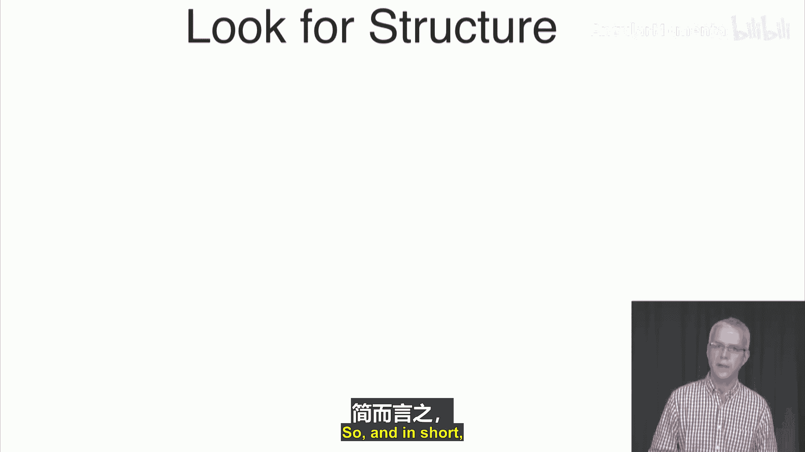

# 【加州大学圣地亚哥分校】使用Python进行数据科学中的概率与统计--Probability-and-Statistics-in-Data-Science-p20-04-08-03-计数_树--BV1gJFDzkEPg_p20-

Hello and welcome back after counting different types of sets like unions。

 cartesion products and so on， we won to talk about a slide generalization which is counting trees。

And we're going to discuss how cartesion products can be viewed as trees。

 but how trees generalize carttesion products and we'll see a systematic way to count trees and how to count paths in graphs and then we'll mention briefly that it's useful for modeling randomness and we'll try to be brief so that we'll still see the forest even with all the trees。

Allright， so so first cartesion product is3， so let's take the following we'll show that quotesion products can be viewed as sequences well actually that we know and then we'll show that we can view sequences S 3 so consider the following quotesion product AB times123 we know that the size of this set is the size of a B namely two times the size of1 to3 namely3 so it's two times3 which is6 and we know that we can interpret this quotesion product here as the collection of all sequences a1 a2 a3 B1 B2 B3 and we can view these sequences as a3 namely and we see that there are six elements here as well and we can view it as a3 namely we start every sequence here on the left and we go a1 so every sequence will correspond to a path that starts at a root and goes to a leaf leaf so we go a and then1 or a and then2 a and3 or。

B1 B2 B3 and every sequence is a sequence from a root to a leaf and so we're actually counting the number of sequences here is the number of leaves in this tree and again we can see that the number of leaves here are two branches here and each branches three branches so it's two times three which is6 so we have six so we can see that Cartesion products our sets of sequences and sets of sequences can be viewed as trees and so we can use trees to more cartesion products and we get the same number here but in fact trees are more general doing cartesion products and because for one thing note that we only use the fact that here we had two branches and here we have each each vertex here at the three branches so we only use the fact that in any level all nodes have the same degree so here this one had degree3 and this one had degree3 name three descendants。

Allright， so now let's see the trees are more general Carsion products。

 so imagine that San Diego opens a new university， it's called University of the data science S and they have three departments computer science E and math and each of them offers two courses so CS offers machine learning and Python E offers image processing and information theory and math offers probability and statistics now we want to know how many courses are offered by the university。

 so observe that this collection of departments and courses is not a Cartesion product because if it was a Cartesion product then every pair of department and course would be possible but here that's not the case because for example Comp science does not offer probability does not offer statistics so this is not。

collection of courses and so I'm sorry departments and courses is not a coltesion product and yet we can still count and see how many different courses are offered or how many it's the same as how many pairs of departments and courses are offered and that's because。

So it's not a contion product because department offer different courses but still we see that every department offers two courses and so we can still count the number of courses so in we see that at each level in this case there's only this level that's interesting all degrees are equal in this case all of them are two so here we have degree 3 there's only one though。

And here we have three nodes and each of them has the2。And because of that。

 number of courses is going to be three times2， which is 6。

 So even though we don't have a quotion product， we can count the number of courses and we'll still call this the product rule because were actually the。

The counting operation is the same， we're multiplying the number of branches here by the number of branches that each one had。

 and if we continued then we'd be multiplying but the degree of each node here if they were the same。

So so to see why we are looking at trees observe that a tree can represent any set of sequences there's an S missing here。

 not just quotsian products so if so one example just now but if you have any set of sequences you can just have a tree that corresponds to the first possible element of the sequence and then the subsequent elements and so on and therefore and furthermore a trees enable systematic counting of the number of leavess so it's useful and it's useful for modeling random phenomena will see a little bit of that later on so its one example let's consider best of n so in many sports。

You have two teams or two players that compete to determine how which is stronger。

And a single competition is often too random because maybe you know some team was not good today they。

 so what they do is they play a certain number of games。

 typically an odd number of games and call it n and the team that wins most of those end games wins so for example。

 in the NBA playoffs n is equal to seven games。And for tennis matches。

 they actually consists of sets and they consist of three or five sets depending on the competition that you're in。

OkayNow it's quite possible that when they started this method。

 they played all end games and then saw who won the majority So the goal here is to win the majority of games and it is possible that in the beginning they played all end games and then so who won most。

 but probably they realize pretty soon that once some team wins more than half the games which can happen before the rich end games。

 once as soon as one team。🤢，Wins more than half the game the audience looks like that they fall asleep because they know who is going to win so then what they do now is they stop so once a team reaches wins more than half the game then they just stop so let's consider Roger Federer and Serena Williams here and let's say that they play a three set match and they stop when one of them wins more than half more than 1。

5 then win one of them wins two sets。So how many win sequences are there so if Roger wins the first two sets then they stop if Roger wins then Serena then Roger wins then they stop again in this case Roger won two。

 but they also played all three game and likewise if Roger and then Serena and Serena wins they stop and if Serena wins the first two two sets then they stop so we can create a tree based on this so here's here's where Roger wins the first set and then you can win the second set and here wins the first and the second and loses the second betweens the third and so on and you notice as we said before that for any collection of sequences you can create a tree like this so we want to count how many sequences there are here in other words we want to count how many leaves are in this tree and so what we're going to do is we're going to recursively。

How many leaves are descendants of every node so let's say we start with the leaf nodes like this one so the leaf nodes have one leaf descendant namely themselves so there's one here now once we counted once we have one for each leaf we can then go up one level and we consider for example this node here and this node here we'll have one plus one which is two two leaf descendants and now that we' have done that we can calculate the number of leaf descendant of this node and of this node it's going to be the one descendant here plus the two descendant that go through this node。

 namely one plus2 here which is three and three here and now that we have done that we've calculated the number of leaf descendants of each of the descendants of the root namely this one and we can come here and them up when we get six。

All right and we're going to come back to this a little later and see a simpler way of counting without writing the tree all right so we can generalize this a little bit to from trees to directed paths in acyclic graphs so we want to find the number of paths from source to the destination and we do it recursively by the by determining the number of paths from the node to the destination and you can think about it and you can see how this simply generalizes what we've done for trees and we're going to use the additional recursively just as we did for trees actually so here for example is the source and you can see the paths and you can see the edges they have directions we can go from here to here in this tree we can only go from left to right。

But sometimes we can go down we can go up or we can go both up and down because this graph is a cyclic the are no cycles in this graph okay so what we can do is we can start with the destination there's one way to get from the destination to itself it's this one and then what we can do is we can look at all the nodes that we can only get to the destination by going from those nodes to the destination for example this node here there's only one way to get from here to the destination we cannot go out in any other way so this is only one way to do that once we have seen sorry。

Once we have seen that there is one way to get to destination from here and one way to get to destination from itself。

 if we consider this node here， we can see that there's one route that will go here directly and then there's another route that will go here so the nova route from here is going to be1 plus1 which is2。

And now we can see that from this node， we can go through either for here or go directly here。

 there are two ways that goes through here and one for here， so the number of ways is 2 plus1。

 which is 3。And then once we get here， we have to go through this node so there's going to be3 and then for this node it's going to be 3 plus3 which is which I'm sorry3 plus 3 plus1。

 which is7 and then this node will have seven plus2， which is9。

 and then for the source we can have nine ways that start through this path。

 seven way that starts this way and three that starts here for a total of 19 paths from the source to the destination。

Now， there was nothing magical starting with the def。 We could have started at the source as well。

 And we can say that from the source， we can count how many ways we we get to individual vertices here。

 So first from the source to itself， we can go in just one way。 and then we can see how many。

Nots we can determine the number for to go there， so if we start here。

 then we can get to this one only if we go from the source because we cannot go back from any other vertex so it's just going to be one。

Okay， and then now we can calculate， we calculated how many ways we can get to every。

Every vertex that leads to this vertex， we calculated the number， so it's one here and one here。

 so the number is two， and here we have2 plus one。which is3。

 and then we can calculate to this one because we know how many paths end up here and how many paths end up here it's 2 and 3。

 So this number is going to be 5 and then this one here is going to be 1 plus5， which is 6。

And this one is 6 plus 2， which is 8， and finally to the destination。

 we can go through past the end of here or here or here， and we get 5 plus 6 plus 8， which is 19。

 which agrees with the number that we calculated out way。

So what's the conclusion of this that we can count not just quotion products。

 but also we can view sequences as trees and we can count them and in fact we can also count paths in acyclic graphs that way and in short what we want to do is we always try to look for structure that will allow us to count things quickly and we want to do it without losing sight of the forest so speaking of the forest we saw that quotion products can be viewed as trees。

 we saw that trees generalize quotsion products we saw a way to systematically count trees and even paths in graphs and we' actually be using especially the counting trees will be using that to randomness or to evaluate randomness later on and hopefully went。

Do it without losing a site of the forest and what are we going to do next time we're going to talk about combators。

 see you then。

