# 【加州大学圣地亚哥分校】使用Python进行数据科学中的概率与统计--Probability-and-Statistics-in-Data-Science-p21-05-04-03-组合--BV1gJFDzkEPg_p21-

Hello again， everyone， Last time we talked about permutations and in this lecture we'll discuss combinations。

So what are they So first we're going to look at subsets of a set and so a subset of size K is called a k subset and will denote all subsets of size K of the set of elements1 up to n by this notation which we'll call the set one up to n choose K。

 so this is nothing but the collection of all K subsets， all subsets of size K of the set1 up to n。

 So let's see a few examples So what is the collection of all subsets of1 up to 3 that have size 1 that is exactly the collection that consists of the set1。

 the set2 and the set3。

And how about the collection of all subsets of size2， in other words。

 two subsets of the set one up to three， that's the collection that consists of  one，2，1，3， and2，3。

And how about the collection of all two LMS subsets of one up to four。

 that's a collection that consists of 1，2，1，3，1，4，2，3，24， and 34， and of course， as you might guess。

 what we're interested is counting the number of such subsets。

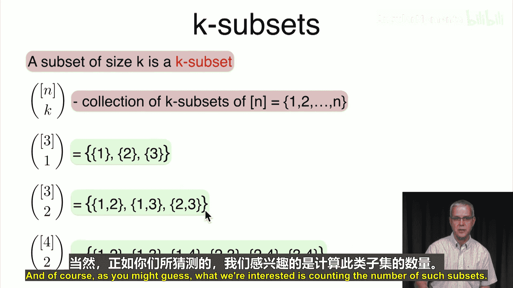

So before we do that， we want to look at an analogous question about sequences with K1。

So we defined the。Colection n choose k the set n1 up to n choose k to be a collection of all k subsets or k element subsets of1 up to n and what we want to see is that it corresponds analogous to the collection of all nB sequences with k1s。

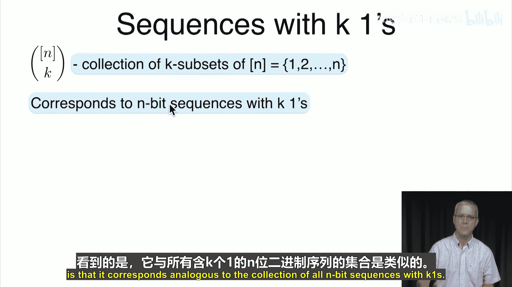

To see that， let's look at a few examples of subsets and binary sequences。 So for this set。

 one up to 3 choose  one， the sets subsets are the subset  one， the subset2 and the subset 3。

 And these are all。Size one subsets of one up to three。

And how about binary sequences of length 3 with a single one， These are the sequences 1，0，0，01。

0 and 001， and we see that there is a  one to one correspondence between those subsets and binary sequences。

 for example one。This represents the location of the single one it's here its we have a single one in the first location。

 this would mean that we have a single one， but it's in the second location。

 that's the sequence here and this subset corresponds to the sequence which with again a single one which appears in the third location。

And how about the collection of all two element subsets of one up to three again this is the collection these are all the two element subsets of one up to3。

1，2，1，3 and 23 and they'll correspond to to binary sequences of length3 with two ones namely these sequences110101 and 011 all of them have length3 all of them have two ones and the correspondence goes as follows if we look at a sequence。

 for example here12 that means that we're looking at a binary string with two ones。

 the first one of them is at location1 and the second one is location 2 that's this sequence here and this corresponds this subset corresponds to again to a binary string of length3 with two ones Lo1 and3 that's this subset string and this one corresponds to011 ones in location 2 and3 and if we looked at four chooses 2 we won list all of them but if we take the subset 12 that will correspond now to four。

Stings because we have subsets of1 up to4 in location 12 and then 13。

 locations of 1 and3 and the last  one，3，4 means that we have we're looking at strings of length 4 because we're taking subsets of 1 up to4 and have two ones in location 2 and4。

 that's this binary sequence here。

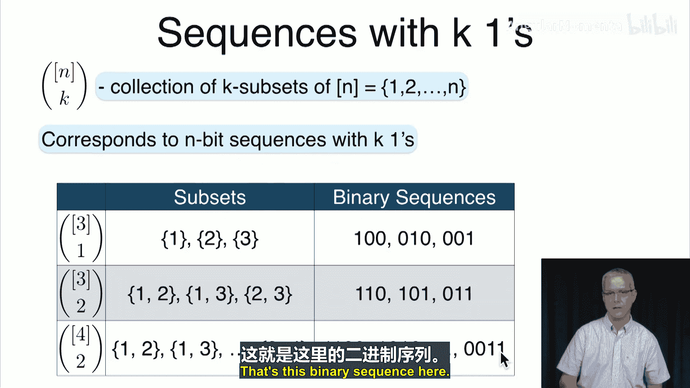

So to summarize what we have seen is we looked at two interpretations of n choose k of this the collection taking the set1 up to n。

 choose k， one of them was a subset of size K of the set 1 up to n。

And the other one was SN sequences with K1s。And for example。

 again to remind us if we take the set one up to3， choose two。

 then that will corresponds to the collection 1，2，1。

323 and if we consider it as binary sequences it will correspond to 110 that is 1 and 21 is in location 1 and2101 that's one in location 13 and 0 and11s in location2 n3 and so we saw that these one to1 correspondence。

 therefore these two sets， the set of k element subsets of one up to n or any endet and the set of and bits sequences with K1s will both have the same number of elements and we want to see what this number is and will mostly count sequences we mostly do this why because。

At least for me， they are easier to see because we just look at sequences， we see what we have。

 and as we'll see later on theyre also generalized to more than binary sequences and more selecting more than one set。

 so it will be easy to generalize。But because it's the same number。

 then the same will apply to subsets or whatever we're going to say here will apply to subsets this one。

So what we're trying to do is again， count how many elements are in those sets。What is the size。

 what is the coinality of the set of two element subsets of one up to three？

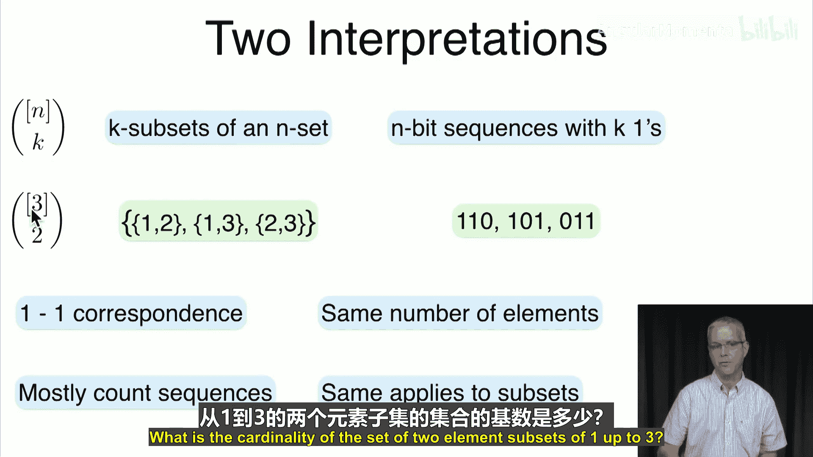

All right， so that's what we want to do and we want to found a number of n bit sequences with K1s。

So we'll denote the number by N choose k。And this is going to be the coinality of the collection of the elements1 up to n choose k so just to clarify and so this is the number of n bit sequences with k1 and again and this is all going to be called the biomal coefficient so this this symbol here is the biom coefficient and again。

This is the number and this is the collection of all such elements。So for example。

 three choose 2 when this is a number is the number of two element subsets in one up to3 okay so here it's the size of the set 110。

101011， which is 3。So therefore3 choose 2 is by normal coefficient is the size of or the cardinality of the collection of all two elements of size 3 three elements。

 therefore the bi normalmal coefficient3 choose 2 is equal to 3。

And if you want to see where this number comes from， why it has to be three。

 then one way to do it is to specify the locations of the ones。

We can do that by specifying ordered pairs from one up to3， for example。

 we can specify that we put a one in location 1 and then in one location2 that will correspond to the sequence 110 or that we put a one in location 1 and then in one location 3 and that will correspond to the sequence 101。

Or put a one location in the second location and then in the first location that will correspond to 110。

 location 2 and3， that's 0 and1， location 31， that's 101 and location 32， location 3。

 put a1 location 3 in location one location 2， and that's 011。So if we did that。

 then we specify all possible。Two sequences of binary sequences of length3 with two ones but as we obviously observe。

 this number is actually6， whereas what we're trying to count is3 and why is this number six because we specified we took numbers from one up to three and we specified two of them so this is the number of permutations。

 two permutations of one up to3 and as we've seen in the last lecture this number is going to be the second following power of three so it's three times 2 because we have three possibilities for the first location。

1， two a3 and then once we chose the first location。

 we have two possibilities for the second location， in this case two or three。

 so it's three times two， which is6。And this is the number of ordered locations。

 but as we obviously have observed this we overcount the number of binary sequences and that's because if we choose location1 first and then location 2 we get 110 but if we choose location 2 and then location 1 for the ones will get the same sequence 110。

 so these two ordered locations will both correspond to the sequence 110 likewise。

 if we chose to put a one location in the first location and then a one the third location。

We'll get the same outcome， the same sequence 101 as if we chose to put a one location 3 and then a one location in the first location。

 location 31 we'll get again 101， both of those will give us 101 and similarly if we first put a one in location 2 and a one location 3 we get 011 if we first put in one location 3 in one location 2 we get again 011 so both that will also correspond to011 okay and when we do that we see that three choose 2 the number of sequences of length 3。

With two ones， that's our definition of three2。 It's the size or the codeinality of the set of all sequences of length 3 with two ones。

 that codeinality is therefore going to be。3 to the two falling power divide by  two。

 it's this number here， which is three to the second following power。

 but each sequence we counted twice， so we divide by 2 and it's going to be6 over 2， which is  three。

 which agrees with what we have found just by writing down all the sequences。

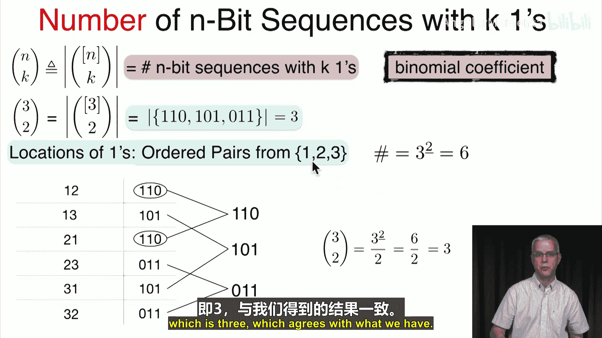

So what we would like to do is calculate the bion coefficients not just for sequences of length3 with a single bit that is one but for arbitrary sequences of length n with K1 so in other words we want to determine entries k which is the number of n bit sequences with K1s we want to see what this number is and just to remind ourselves this number here when we have a number n on top is in number is just a cardality whereas this quantity here is a collection of subsets so this here is the collection of all。

I is a collection of all， I'm sorry， it's a collection of all。Apologies， let me start this again。

 Sorry， okay， Yes， okay。Actuallyction。So what we would like to do now of course。

 is move from three bit sequences with a single one to general binary sequences so n bit sequences with k1s。

 so in other words we would like to determine the bi normal coefficient and choose k which corresponds to the number of n bit sequences with K1 we want to see how many such sequences there are and just to make sure we understand this number here on the left is a number is just an integer is the number and choose k's number of n bit sequences with K1s and this quantity here on the right is a set is the collection of all n bit sequences with K1s and we're interested in the coinality of this set。

So what we can do if we want to calculate the cardinality of the set。

 then what we could specify the location of the ones of the k1s in order and then write them1 by one so for example。

 if we say location 1 to 3 and then we write a one in location1 and then a one in location 2 and then a one location 3 or if we specified order 531 we write a one in location 5 and then a one in location 3 and a one in location1 and we want to count all of those so and notice so that the number of ones we' are writing is k in this case is3 and that each number here is a location and the location because we're looking at n bit strings then each number here is a number between  one and n corresponding to the location where to write the1 so if we want to calculate the number of ordered location we can do that for then this number as we know is as we've seen in the previous。

Lecture is n to the following K because what we are specifying here is is just a K permutation of1 up to n or in this case were specifying a three permutation。

 we specifying one number between 1 and n and then a different number between1 and n and then a third different number between number1 and n and in general there'll be n times n minus1 times n minus2 all the way up to n minus k plus1 different ways of specifying the locations of the ones in order。

Okay， and。But notice that every binary sequences with K1 will correspond to k factorial ordered locations。

 namely for every binary sequences of K1s we'll write it in k factorial different ways if we specify the order。

 for example， if we take the sequence 10101， then if we specify the order of writing one in the first location and then one in the third location。

 one the fifth location we'll get this sequence。But we'll get the same sequence if we specified the order 153 namely we wrote one location in the first location。

 then one in the fifth location， and then one the third location well get again the same sequence and likewise if we wrote this order for all the ones in this order and so on。

Okay， and so we got this the same binary sequence by writing。The ones in six different orders。

 as we see here and of course this this number six comes because we have three locations and we specify the order and as we know again from the previous lecture。

 there are going to be three factoral ways of specifying the order。 So in other words。

We have the number of these sequences is n choose k， but we write it each one。

 we can write each one in k factorial different orders， and when we multiply those。

 those two we take the number of sequences times the number of ways to write them。

 we get the total number of ways of writing three different elements from one up to n and that number is n to the k factorial。

Okay， so we get this relation that the number of Kbit sequences。嗯。sorry n bit sequences with k1s。

 there number times that's the number of sequences that we have here。

 and then each one we can write in k factorial different ways。And when we multiply these numbers。

 we'll get the number of ways of writing three locations。

 three different locations from1 up to n which is n k， so just rearranging the terms here。

 we get that n k is n to the K falling power divided by k factor and another way of saying the same thing is that when we write the locations of the ones in order。

 we have n to the K falling power ways of writing it。But every cave to of them。

A going to yield the same sequence like here everywhere writing 135，153。

 all3 factorial or in general O factorial with writing those locations of the ones in order will correspond to the same sequence。

 so if we want to count the number of sequences we divide n to the K factorial by k factorial and it's anxious。

Now once we do that we can write things a little more symmetrically and we remember that n to the k falling power is just n factorctoral divided by n minus k factor so this number is going to be n factor divided by k factor n minus k factor。

 and that's because this number is n times n minus1 all the way to n minus k plus1 which is just n factor divided by n minus k factor as again we've seen in the last lecture。

So in other words， we found the expression for the bi coefficient N2 k is just n factor divided by k factor and n minus k vector。

So what we want to do next is get a little bit of intuition for the biorural coefficient by looking at its value for small nN K and then for simple NNK。

😊。

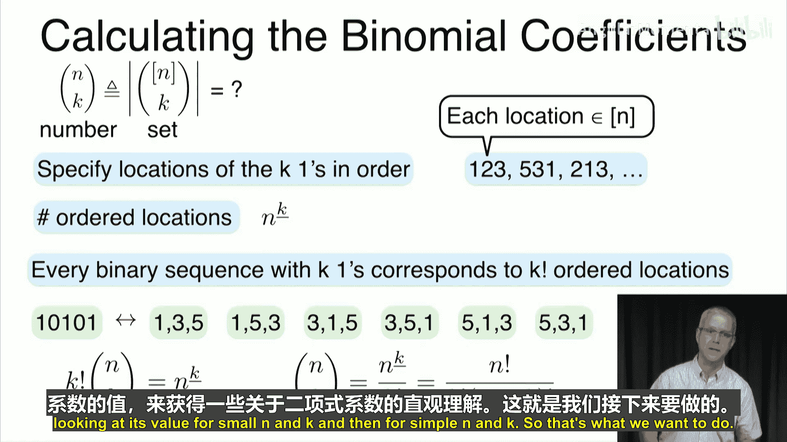

Alright， so that's what we want to do。 We want to see why the bin coefficient N k。

 which is the coinality of the。Set of all nmb sequences with K1。

 Y is it n factor divided by k factor n minus k factor and want to do it for small values of n and K？

So let's look at first looking at three bit sequences with a single one。

 that's a collection of all three bit sequences with single one。

 and we see that the cardinities is three choose one。

 which is three fctoral divided by one fctoral2 fctoral which is three which agrees with this just enumeration here of three and the reason we get three is because we're choosing the location of the one and we have here three possible location we need to choose the location of the ones and the three location we need to choose one。

 so there's just three ways of three ways of choosing one number out of three。

How about the set of all three bit sequences with two ones here we enumerate all such sequences。

 three bits， two one and what is that number according to this formulaite it's going to be equal to and we see there are three and according to our formalites three vector divided way two fctor 1 fctor three fctor is 62 fctoral is1 so again we get three which agrees with the number here and one way to see why this is the right number is to observe that here either we can say we're choosing two locations of the one or alternatively we can say we're just choosing the location of the zero and choosing one location for the zero is the same as choosing one location for the1 there are three ways of doing that。

So choose location of a zero， there are three ways to do that。

 and that's why this number should be  three and it is according to a formula。How about choosing。

A4b sequences with two ones， so here we enumerated all of them 0011 up to 1100 and how many such sequences other well according to a biomal formula the number should be 4 choose 2 which is4 fctoral divided by  two fctoral2 fctor。

4 fctoral is 24 divided by4 you is a 6 and again we can check that this is correct this number is really 6。

And why do we get this number because we need to choose the locations of the one to choose the first location we have four possibilities。

 the first one could be here in location one or in location two or in location three in location four。

 and then we once we chose the location of the first one。

 we have three ways to choose the location of the second one。

Okay so that gives us four times3 which is 12， but every pair if we choose one location。

 say location 2 and then location 4， it's the same as choosing location 4 and then location 2 so each sequence we shows twice so we need to divide 12 by 2 and gives us 6。

 so that's just another way of seeing y should be 6。

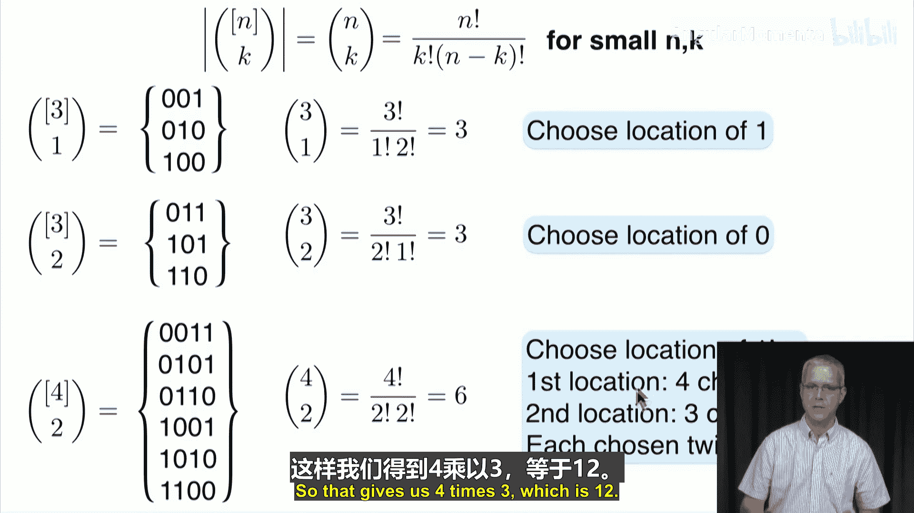

So what we did here we explain where n choose k comes from for small n and k in this case。

 n is 304 and k is 1 or2 and what we want to do next is look at n choose k and see explain it for values that are simple。

 not necessarily small so we're looking at simple n choose k where n and K could be very large one of them。

 but maybe there's something that makes it simple so for example， if you look at n choose0。

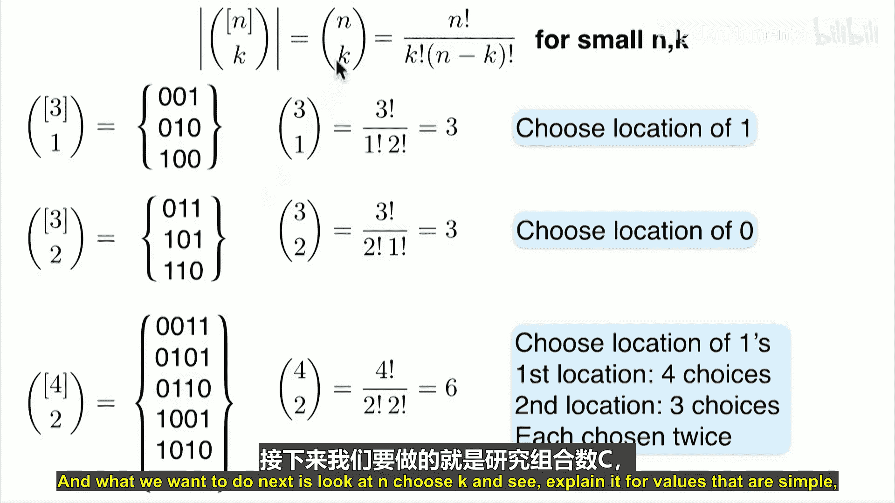

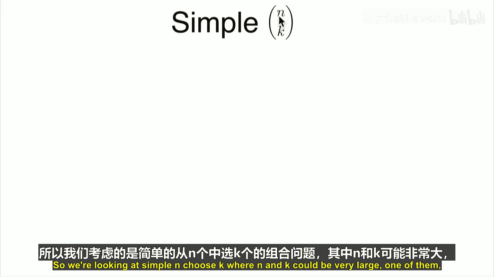

According to a formula it's n factctorol divide by 0 factor n factctoral but remember that0 factoral is 1。

 so this gives us1 and y is n01 well this corresponds to the number of n bit sequences with01s。

 namely the number of all n bit sequences that are all0 and there' is exactly one such sequence。

How about n choose n according to the binomial formula， it's n factctor divided by n fact0 vector。

 and again zero vectorctor is1， so this is again one。

And why n choose n should be one because it counts the number of n bit sequences with n1。

 in other words， it counts how many all one sequences are there and there's exactly one。

Or one sequence is single or one sequence， so this number should be one。

How about n choose 1 and again you see we're doing it this number is un simple in the sense that this is one。

 but they can be large n could be any number， so n choose 1 according to the binoal format is n vectoral divided by one vectoral and then n minus-1 vectoral and this number everything will cancel except n so this number is n and why should n n choose 1 be n because we're counting how many n sequences other with a single one and this corresponds to choosing the location of the single one and the n ways of choosing this location。

Choose location of S 1 and ways of doing it。How about entriess2？

N choose 2 corresponds to the number of n bit sequences with two1s。

 And according to the binommal format， it's going to be n factor divided by 2 f and then n minus2 factor。

And we'll see that a lot of cancellations will happen here and the numerator will just have n times n minus1。

rest will cancel here and then divide by2， so it's n times n 1 over 2 and the reason is because we can choose the first location of the one in n ways and then we can choose the second location in n minus-1 ways。

 but each sequence， each binary sequence we will to choose twice so we have n times n minus1 divide by 2 and that's this number here。

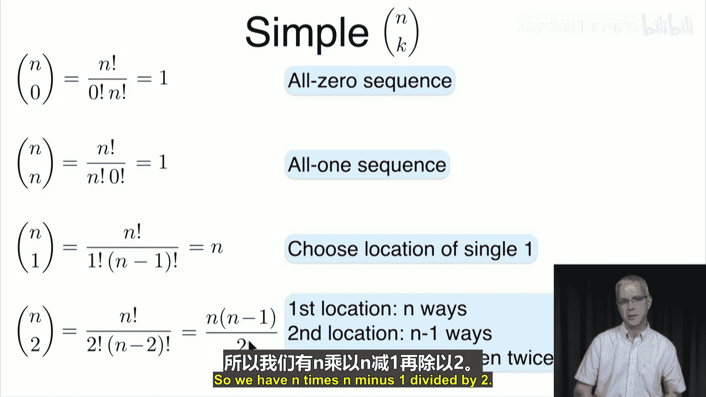

Okay， so because these numbers are so important， I would like to give another explanation of why N2 is n times n minus1 over2。

So remember that， as we just said， n choose2 is when we have the set here n choose 2 is the collection of all nB strings with two ones。

 so this is one up to n and we choose  two， so it's a collection of all nB strings with two ones。

And and choose to the coinality of the set is the number of such elements。

 Now we can define AI to be the collection of and strings such that the first one is that location I。

Okay， where I some number between1 and n minus-1。 so here is an example we have n bit strings and AI is the collection of all。

Sequences of n bits with two ones。Where the first one is at location。

 I namely the first I minus1 bits are0， and then we have one here。

 and then this could be anything except that they have to have a single one there。

So you have n minus I locations here that have exactly a single one。

So how many such sequences are there， name how many sequences are there where the first one is in location I。

 but we have to choose single one amongst the n minus i remaining locations， so the size of a sub I。

Is exactly n minus I corresponding to the n minus I possibilities of choosing the second I。

So first we observe that the size of a sub I， the number of n bit strings where the first i is in location I is n minus I。

 for example， if you choose ann minus1， how many sequence minus sequences are there off length n where the first location is in location。

 the first one is in location n minus1， you'll get n minus n minus-1。Which is one。

 that's because if the first one is in location n minus1 is only one sequence， 000，11。

Now observe also that these sets a subi are disjoint because if if you take AI。

 then you have the first I here is in location I， whereas if you take another set， say a I plus5。

 then the first one be location I plus y5 so these。

The binary strings in the two sets must be different therefore so the As are disjoined in other words n choose I the collection of all and strings with two ones is the disjoint union of a1 a2 up to A and minus1 where this notation is you remember just means regular union we're just remind reminding ourselves that these sets are disjoint and therefore by the summation rule we get that n choose 2。

 the coinality of the set of all and strings with two ones is this is going to be the summation of the size of the sets a sub I。

Because these sets are thisjoint， so the size of the union is just the sum of the sizes。

And this is going to be n minus1 for a1， the size of a1 plus n minus2 and so on up to 1。

 and as we know this horimetic sum1 up to n minus1 is n times n minus1 over 2。

 so it gives us another explanation for this set。For this， the bin coefficient I choose to。

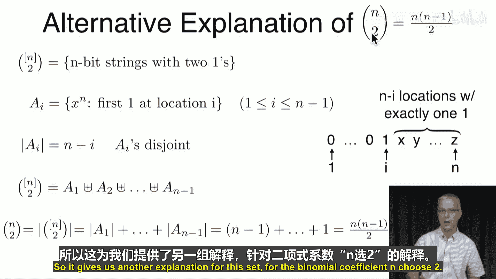

All right。So I also want to show that you can calculate the mineral coefficients by hand fairly easily for fairly large numbers。

So。We know that n choose k is n to the K falling power divided by k factorial。

And so we can therefore calculate， for example，7 choose2 is going to be7 times 6 divided。

 so that's7 to the second falling power divided by two fal， which is two times 1。

 we cancel the two with the6 and we get it 7 times 3 which is 21。

Also notice that n choose k is the same as n choose n minus k and because we'll talk about this a little more later。

 but the reason is because n choose ks n factorctoral divided by k factorctor and then divide by n minus k vectoral and this is the same it's n factoral divided by n minus k factorctor and k factoral will say that again in the next video and so if k is bigger than n over 2 then it might be easier instead of calculating n choose k to calculate n choose n minus k so for example if we want't calculate 7 choose 5。

 we can calculate 7 choose 2， both of them are 7 vectorctoral divided by5 vectorctor divided by2 vector this and that so we calculate 7 choose 2 and 7 choose 2 as we calculate it here was 21。

We can also cancel a lot of terms， so if we have， for example， 12 choose 9。

 that's the same as 12 choose 3， which is 12 to the third falling power 12 times 10 times times 11 times 10 divided by 3 times 2 times 1。

 and then we can cancel the6 here with the 12， so we get it's 220。And using this。

 we can calculate fairly large way coefficients by hand， as you can see， But if not。

 you can always Google or write a program that does it。 to summarize。

 we looked at two equivalent problems。 One is counting how many。

Substets of size K does a set of size N have。 And the other problem was how many。Sequences。

 binary sequence of length n have k1。 We showed that these two problems were the same and we count we call the number of such sequences or the number of such subsets。

 we call that the binomal coefficient n choose k and we give a formula for that which was n factorial divided by k factorial。

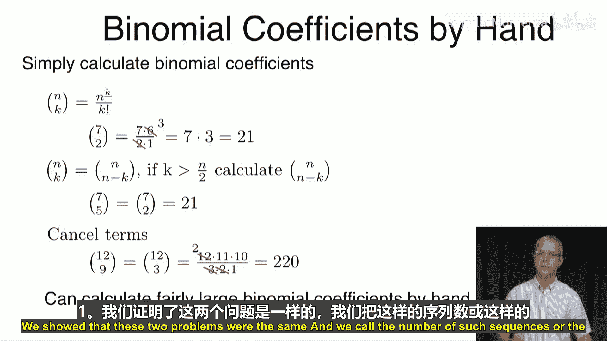

And divide again by n minus scctor and what we want to do next is give some examples of bi normalmal coefficients。

 see you then。