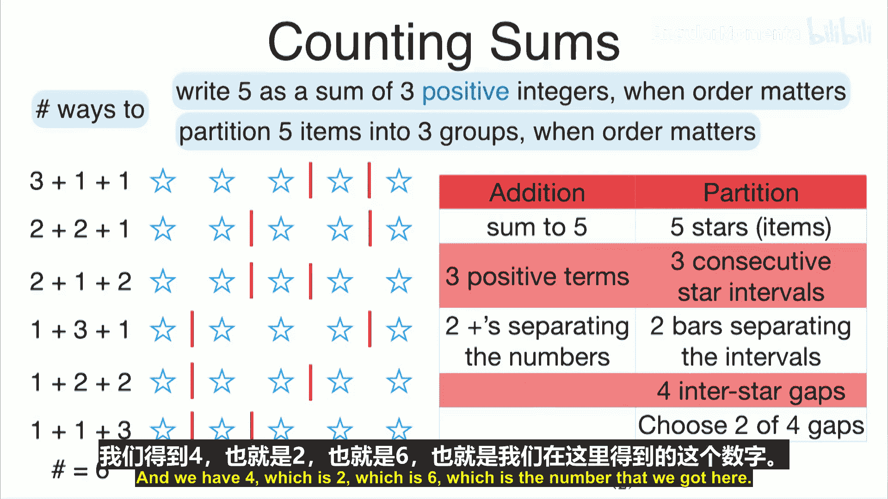
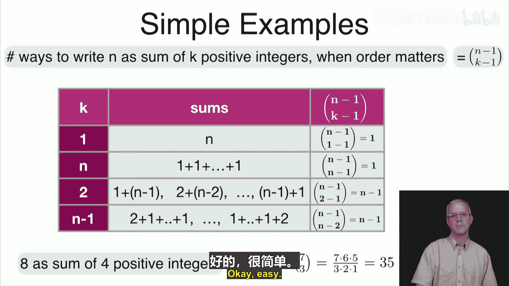
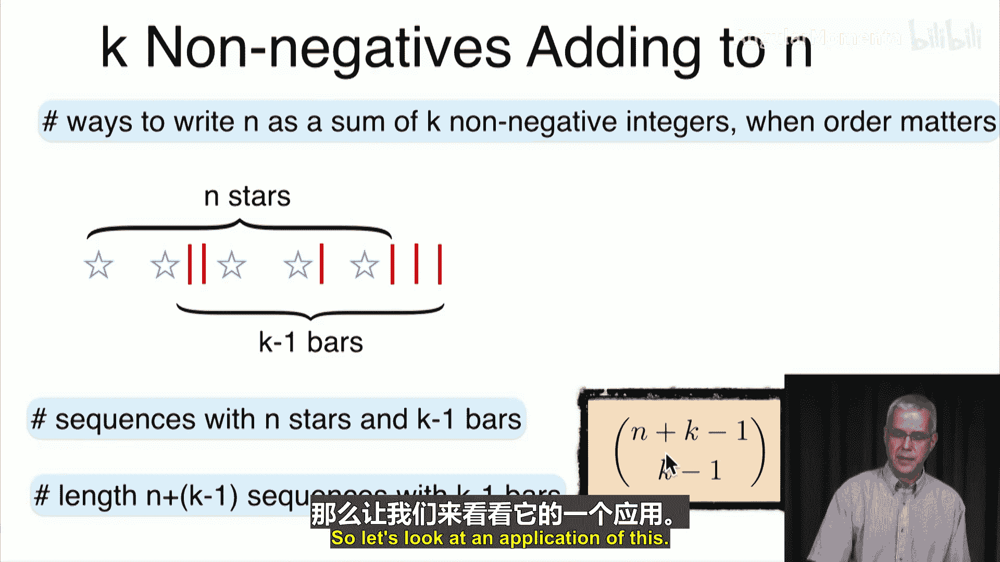
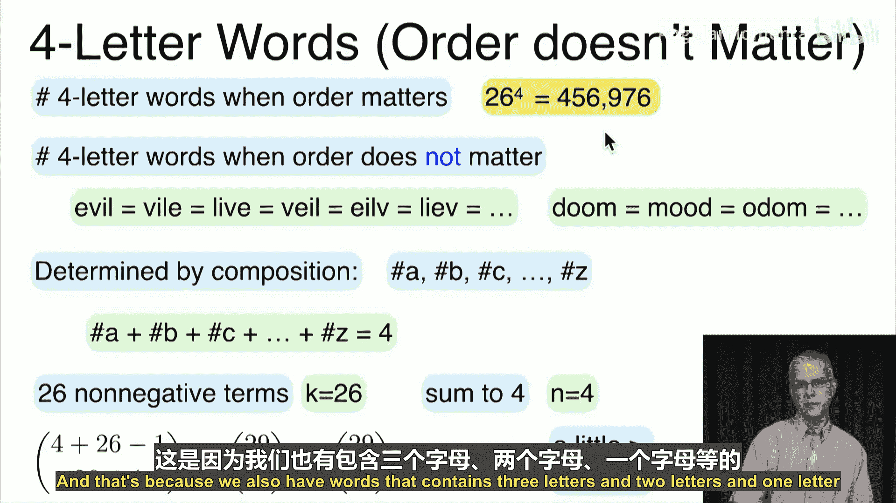
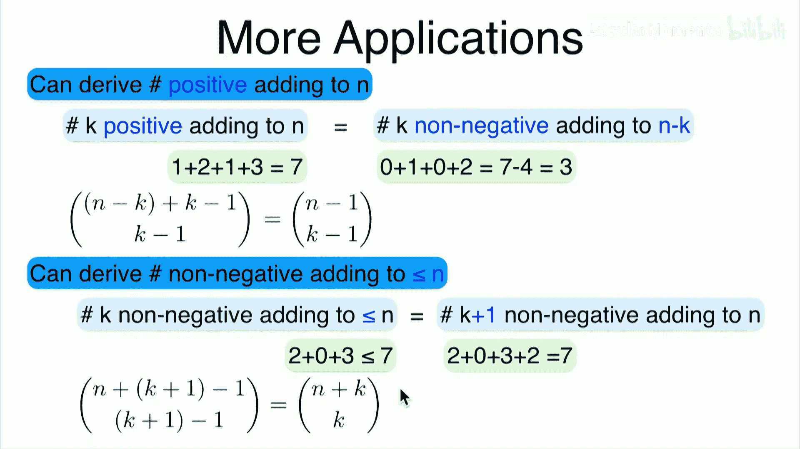

# 【加州大学圣地亚哥分校】使用Python进行数据科学中的概率与统计--Probability-and-Statistics-in-Data-Science-p22-05-09-03-星与条--BV1gJFDzkEPg_p22-

Welcome back。So far we've been talking about different applications of combinatorics。

 we've talked about permutations， about combinations， the biommal coefficients。

and counting different things using them and today we want to talk about the last application。

 which is going to be a little different， we're going to show that beyond commatorics。

 we can use what we have learned to get some results on algebra and specifically on ways to write a numbers a sum of integers。

And we're going and show that we can get a simple total derivation for what might otherwise be an unintuitive result。

So looking at counting sums and specifically we want to find a number of ways to write5， for example。

 is the sum of three positive integers when older matters。

 so let's see what we mean we can add5 is 3 plus1 plus1。

or a 2 plus2 plus1 or 2 plus1 plus2 or one plus with 3 plus1，1 plus2 plus2 and so on。

 and we can see that these are the only ways to write5 as sum of three positive integers because if we start with three we have to add one plus one if we start with two then we have to have three and these are the only way to write three as a sum of two positive integers and if we start with one then we need to get to four with two integers and these are the only ways to do that。

 so we can see that the total number of ways of writing five as a sum of three positive integers is6。

And we would like to derive this number six combinatorly。

So what we can do is we can show that this number of ways is the sames number of ways to put five items into three groups when the order matters。

OkaySo we'll let our five items be five stars and when we write 3 plus1 plus1。

 that will correspond to partition andninging these five stars into three and then plus one and then plus one and two plus one plus one will correspond to partition here which has two stars plus two stars plus one stars and two plus1 plus2。

 similarly we have two stars plus one stars plus two stars and so on。Okay。And。

We would like to use this analogy to find the number of ways to write five as a sum of three positive numbers。

So let's maybe reflect a little bit on the analogy。

 so let's look here at what are the similarities between the addition that we have here on the left and the partition on the right。

 so in the addition we look at things that sum to five and similarly for the partition we look at five stars or five items we partitioning five items just like here we're writing things that were sum to five。

For addition， we have three positive terms。And what we have here is we have three consecutive star intervals。

 so here we have an interval three stars， an interval one star， an interval one star。

 that have to have at least one star okay。And for addition。

 we have two pluses because we have three terms， so we have two pluses and that separate the three numbers。

And here we have， similarly we have two bars that separate the intervals。

 so these bars play the role of the process。Okay but there' is something that we have in the partition that we don't quite see in the addition and that is for the partition we see that we have four gaps。

 so we have five stars， five stars， we have four gaps between them，1，2， three。

4 where we can place the bars okay and this does not quite exist or we don't quite see it for。

The addition， so we have five gaps between the stars and in those five I'm sorry。

 four gaps between the stars and in those four gaps。

 we need to put the two bars that we have so we need to。

I chooseose two of the four gaps to put the bars in them。 And so the number of partitions。

 the number of ways to partition。 this is going to be just the number of ways to choose。2 location。

 two gaps out of the four that we have and that's going to be just4s 2 which as we know is6 so we see that we could get this number by just looking at the number of spaces or gaps that we have which was 5 minus-14 and the number of barss that we have which was3 minus1 or2 and your fours 2 which is 6 which is the number that we got here now this of course generalizes and if you want to have k terms that well add to n then we would like to find how many ways we can write n as a sum of k positive integers when order matters。

And so here we have n starss and therefore we have n minus1 gaps。

And we have we want to write them as of k terms， so we have k minus1 bars they will correspond to the k minus1 plus。

So what we want to do is we want to place k minus1 bars in n minus-1 gaps。

And the number to do that is just n minus1 choose k minus1。Okay。

 so this is the number of ways to write n as a sum of k positive integer n minus1 choose k minus1。

All right， so let's do a couple of simple examples just to make sure we agree with the formula that we had and just to remind us。

 it said that we if you want to write NSS sum of K positive integers。

When order matters then we can do it as n minus in n minus1 choose k minus1 ways so let's look at some simple values of k we'll look at the sums and this formula。

 so if k is1 then we can write n as in a single way as a sum of one term just n is equal to n so there's only one term and sure enough if we write n minus1 choose k minus1 which is 1 minus1 we get n minus1 to0 which is1。

If we want to write n as a sum of n different terms， positive n terms。

 we have to write 1 plus1 and so on plus 1， so there is just one way of doing it and indeed n minus1 choose n minus1 k here is m is n so n minus1 choose n minus1 is again1 agreeing with this。

If you want to write n as a sum of two terms， then we can write it as 1 plus n1 plus n minus1 or 2 plus n minus2 and so on up to n minus1 plus1。

 so we have12 n minus1 way of doing it and if we write n minus1 choose 2 minus1 it's n minus1 choose 1 which is n minus-1。

And last example， if we want to write n as sum of n minus-1 terms。

 then what we'll have is we'll have n minus-1 terms。

 one of them will be two and the remaining n minus2 will be1 so the two can be here at the beginning the second location or the last location and the n minus the n minus one way of doing it because we have n minus-1 terms so the n-1 plus2 plus the two and if we check n minus-1 choose n-1 minus-1 is n minus-1 choose n minus-2 which the same is n minus-1 choose1 which is n-1 again so we get that in all those cases this formula give us what we expected and in fact we can use this formula even when this summation is not easy to find for example if we ask you how many ways can write8 as the sum of four positive integers it might take you quite a bit of time to find all the summations but you can use the formula I's say it's n8 minus1 choose4 minus-1 which is7 choose3。

い？7 times6 times5 divided by6， which is 35， okay， easy。

And let's extend this result slightly， so suppose we want to write n as any sum。

 namely we want to find the number of ways we can write n as a sum of any number of positive integers。

 not a specific number K。Then for example， we can take n equal to3。

 we can write it as 3 itself or 1 plus2 or 2 plus1 or one plus1 plus one。

 and these are the only ways we can write three as a sum of positive。Integers。

 and we can draw an analogy again with barss and stars。

So and we can see that the number is therefore for four， and if you want to look at stars。

 then three will correspond to just three stars， not partitions， not partition。

 one plus two will correspond to this partition， one and then two。

And two plus one will correspond to this quo of the three stars and one1 plus one will correspond to the quoation of the three stars where each one is on its own and we can see that the number of ways of writing these bars is we have two spaces and we can either write no bars in the two spaces so we can write a bar have a bar in the left one and no bar in the right one or a bar in the right one right gap but not in the left gap or bars in both gaps and so what we have is just the number of ways to write any number of bars in those places。

 so its the number of really the number of if you want sequences of length two that we have this will correspond one maybe to00 this one correspond to1001 in11 and this number is just two to the two because we have the option of either putting a gap。

 a bar in the first gap or not and then the option of putting gap in the second a bar in the second gap or not。

And this obviously generalizes to anyN， so if we have n stars。

 then in each gap we can either put a bar or not put a bar and we have two options for each gap so the total number not total number of options we have is two to the number of gaps。

 you have n-1 gaps， so therefore the number is two to the n minus1。

And you could have gotten this number well like we did here or you could be a little bit more matureer if you wanted then you could say okay this is the number of ways to write n as a sum of any number of positive integers so I could add I could see how many ways I can write it as a sum of1 integer to integers and so on so we can write it n as a sum of k integers where k goes from1 up to n and we know from what we've from the previous slide that that number to write it as sum of k integers n minus1 choose k minus-1 so we can say that this number is going to be summation of k going from 1 up to n of n minus-1 choose k minus-1 but now you see that k minus-1 starts at0 and goes to n minus-1 so it's summation of I going from0 to n minus-1 of n minus1 choose I and then by the bi normalmal theorem the sum is just2 to the n -1 agreeing with what we got here。

Okay，Now we want to modify the question slightly instead of looking at positive terms。

 we want to look at non negative terms， so we want to ask how many ways we can write NSS sum of K non negative integers。

OkaySo for example let's see how many ways we can write2 as a sum of3 non negativeatives。

 so we can write 2 as 2 plus 0 plus 0 that's three non negativeative integers that's sum to 2。

 or a 0 plus 2 plus 0 or a 0 plus0 plus2， these are the only ways to write two as a sum of 3 non negativeatives where there is a single positive number or we can write it as 1 plus1 plus0 or 1 plus0 plus1 or 0 plus 1 plus 1。

Now we can again use the stars and bows analogy and we see that by the way。

 that this number is going to be6。Now using our analogy。

 we can write this as star star and then bar bar that means that we have two。

 you might remember that the bar plays the role of it plus so you have two and then plus0 and then plus0。

 that's this sum。And 0 plus 2 plus 0 we can represent like that， so we have again。

 0 plus 2 plus 0 or 0 plus 0 plus 2， we have here 0 plus 0 plus2 and here1 plus1 plus 1 and so on。

So what we see is that it's very similar to what we had before。

 just like before the number of stars we have is the total number that we are trying to add to is n and the number of bars we have is the number of plus which is not the number of terms minus1 it's K minus-1 so if K minus1 bars but unlike before before we put a single bar between in each gap and here we can put multiple barss in a gap like this we can also put bars to the right or to the left of all the stars so now we can have any arrangement of the stars and bars if you write any arrangement of two stars and two bars you can interpret it as sum of three terms that will add to two because you'll have the number to the left of the first bar plus the number in between plus the number to the right and then we' give you two because you have two bars sorry because you have two stars。

Okay， so therefore we see that every sum corresponds in a one to one way。

 There's a one to one mapping between a sum of。Between a sum here on the left and an arrangements of stars and bars。

So now， therefore the number of sums that we have is going to be the number of arrangement of stars and bars and more precisely the number of arrangement in this case of two stars and two bars。

So so its number of sum is the number of range of stars and bars and we're interested in number of ways to order to write two stars and two bars in this case and if we have two stars and two bars。

 what we have is a sequence of flank 4，and we need to choose the location of the two stars。

 so the number for us to do it is for2。Which is6。And more generally。

 if you want to write n as a sum of k non negative integers。

 so if we want to write find a number of ways to write n as a sum of k non negative integers when the order matters。

Then we have again n stars and we have key bars and we arrange them in any way we want。

 so we have a sequence with nstar and K minus-1 bars。Or in other words。

 we have a sequence of length n plus k minus1， and we need to choose the location of the k minus1 bars。

And that number is going to be n plus k minus1， the length of the sequence choose k minus1。

 the number of bars we want to choose， and that's the same as saying n plus k minus1。

 choose n if you want to choose location of the bars， that will be the same。Okay。

 so let's look at an application of this。😊。

So let's see how many four letter words are there， but now when the order does not matter。

 so if the order matters， then the number of four letter words is going to be just we have 26 ways to write the first letter and 26 ways to write the second letter and so on。

 we get 26 to the four， which is almost half a million。Now。

 if you want the number of four letter words when the order does not matter。Then so for example。

 if you want things like evil to be the same as vile to be the same as live and so on。

 and words can also have a petitionition， so doom will be the same as mood and so on。

So the the word or the number of words is is just determined by the composition。

 So if I tell you number of A's， number of B's， number of C's up to number of Cs。

 that will determine this this collection right because we don't care once I tell you the number of。

The number of times each letter appears， then all words are calledd because order doesn't matter。

 all words are going to be the same， so what we really want to see is how many such compositions we have。

 how many ways we can have for deciding a number of A's。

 number of b's and so on such that together they'll sum to4 because the length of the sequence we want is4。

Okay so the number of four letter words when the order does not matter is the number of ways to select the number of A's。

 the number of B's， the number of C's， and so on， so that they sum to four。And。

What we have here is just 26 non negative terms correspond to the letters。

So k is 26 in our terminology and a sum to 4 the length。

 so n is equal to 4 and that number is as we know is n plus k minus1 so 4 plus 26 minus1 choose k minus1 choose 25。

So it's 29 choose 25 or 29 choose 4， and that's not so difficult to calculate it's roughly 230700 it's exactly 23751 okay and one thing that you may wonder is whether this makes sense that this number is going to be that much smaller than。

The number of letters were words when when the order matters。 and you can see that。

Most of the words will have four different letters and if they have four different letters then if the order doesn't matter then we just look at the number of words and divide by four factorctorial so most of these 26 to the four words will have four different letters and and then we need to divide them by four factorctorial to get the number when the order does not matter four factorial is 24 and you can see that if you divide this by 24 if you divide 456。

000 by 24 you'll get a number which is I think around 19。

000 and what we get here is a little more than 19，000 and that's because we also have words that contains three letters and two letters and one letter and so on so this makes sense。

Okay and we can see a couple more applications， I want to finish with them。

 but talk about them a little more briefly， so first of all。

 youll notice that we derived the number of ways to write an S。As sum of k positive integers。

 we said it was n 1 choose k -1 and we can derive that number using the formula that we just had for non negative numbers and that's because if you have K positive integers that add to n the number of such。

The number of such sums of k positive integers that enter to n is the same as the number of k positive integers that add to n minus k and the reason is that if we have k integers that add to n for example to7 we can subtract one from each number here so instead of1 plus 2 plus1 plus3 we're going to have0 plus1 plus 0 plus2 and when we do that we subtracted one from each of the K terms they here for so they'll add not to7 but to7 minus4 which is3。

And you can map every sequence of k positive integers that add to n by subtracting one from each number。

 you'll get a sequence of K non negative integers that will add instead of n to n minus k。

This correspondence is the one to one correspondence。

 so therefore the number of ways to write k positive integers that add to n is the samest number of ways to write k non negative integers that add to n minus k。

And that number is， as we just saw， is n minus k plus k minus1 which k minus1。

 and this case will cancel will give us n minus1 plus k minus1。

 which will recover the formula that we got for initially。Also。

 if we can derive the number of non negative integers that add to instead of n that add n to at most n。

And the reason is because the number of k non negative sums that add to at most n is equal to the number of k plus 1 non negative sum that add to exactly n that's written here behind my picture and to exactly n。

To see that notice that for example， if we have here a sum of three terms that add to less than equal to 72 plus0 plus3 at adds to 5 which is less than7。

 then we can map it to a sum that will add to exactly7 by adding by adding a number here which is at least0 will be0 if the number added to7 initially and again this mapping is1 to1 I can map every sequence here to a sequence here in a unique way by just adding the number that's missing to make it7 and in general if we have k non negative integers that add at most n I can map it to to k plus1 non negative integers that add to exactly n and so the number are the same and therefore the number is going to be n plus instead of k we have K plus1 now term so it's n plus k plus1 minus1 choose k plus1 minus1 and that gives us the simple formula of n plus k choose k and you can verify it if you'd like for sum。

Simple values。Okay so with that， we're done talking about stars and bars and what I think is a fairly nice application of my normalmal coefficients and so we discuss our final application that shows that beyond commators we can apply to other fields like algebra and derive a simple derivation of what otherwise might seem like an unintuitive result。

And with this we are also done talking about the combinatorics and what we'll do next is we'll start talking about fability。

See you next time。