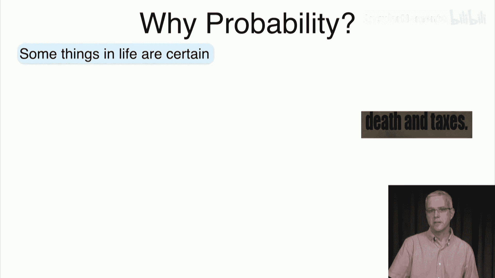
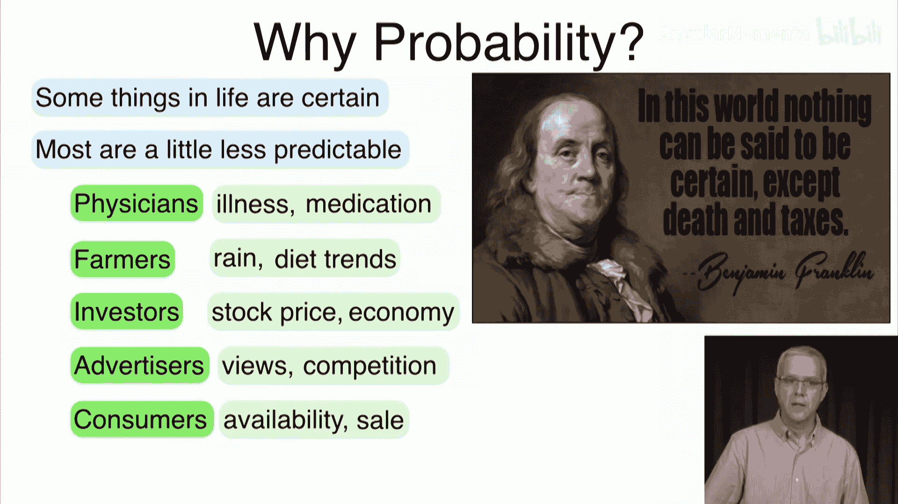
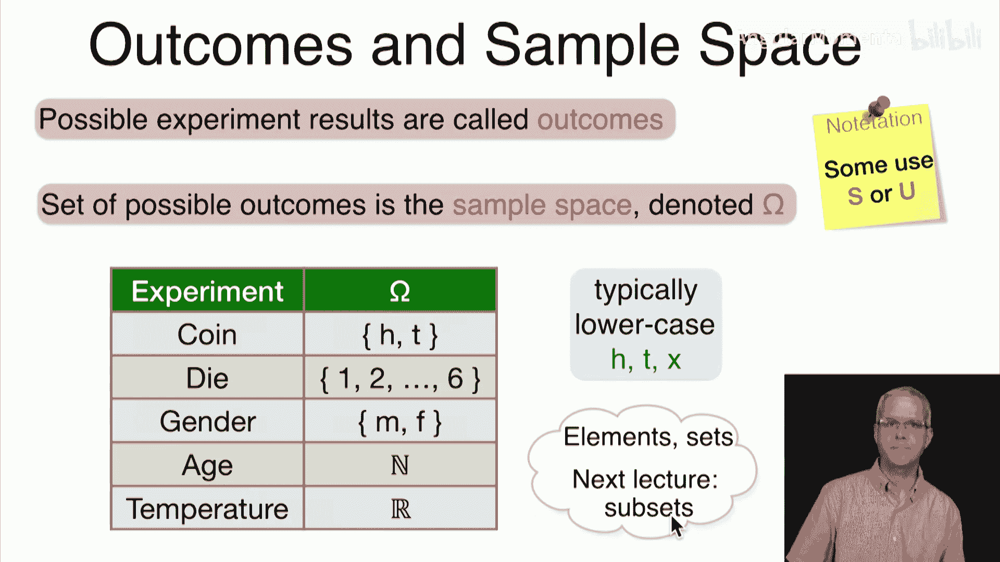
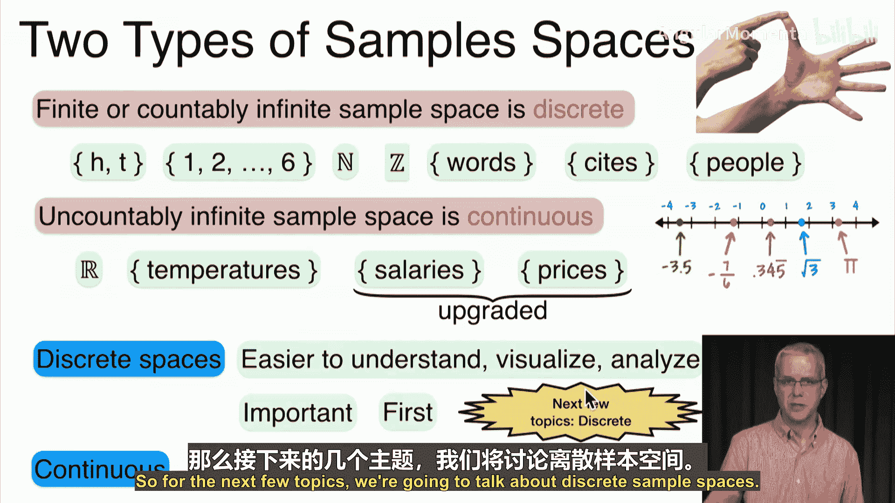
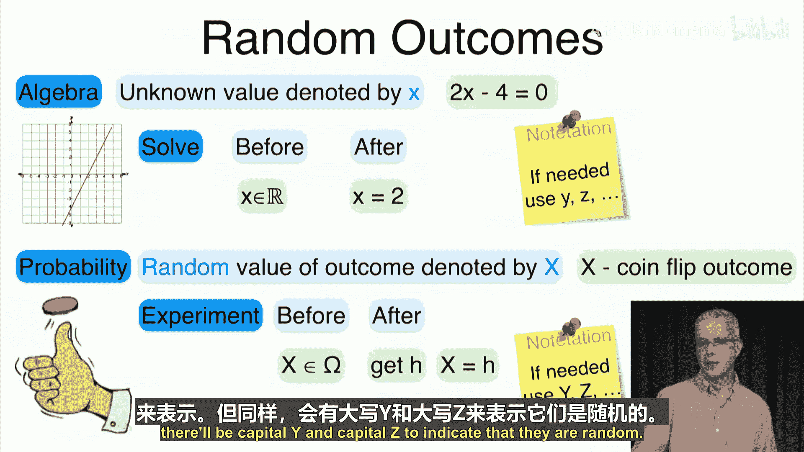
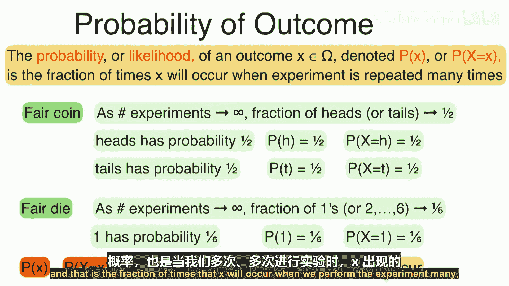
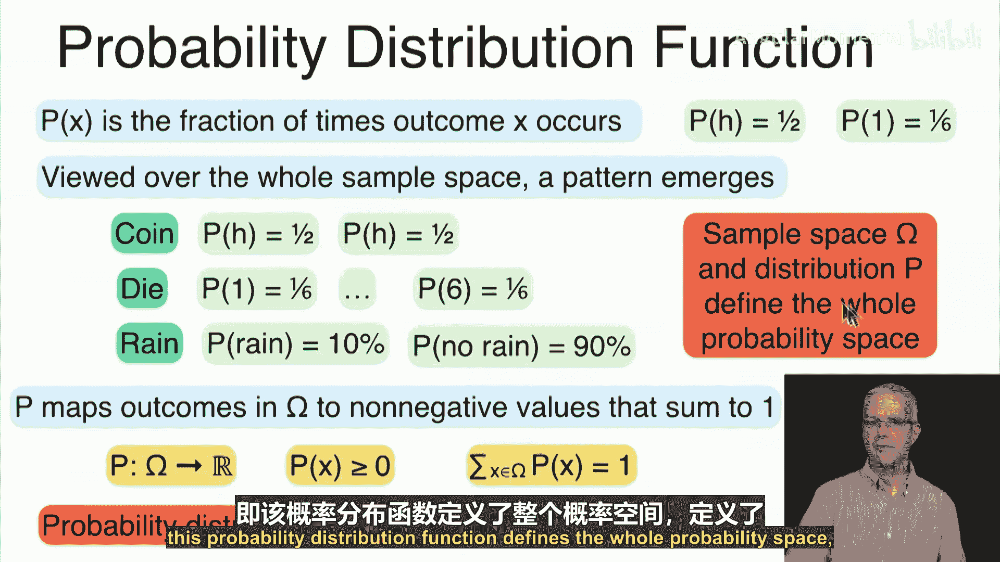

# 【加州大学圣地亚哥分校】使用Python进行数据科学中的概率与统计--Probability-and-Statistics-in-Data-Science-p23-06-01-03-概率论导论--BV1gJFDzkEPg_p23-

Hello and welcome back Today， we're going to start talking about probability。

we're going to first discuss randomness and see why it's important and then we'll motivate the discussion about probability and the meaning of probability then we'll talk about the possible outcomes that we get when you have a probabilistic outcome and the set of all outcomes which we call sample spaces and we'll then talk about distributions。

So first of all， why probability so some things in life are certain， for example， death and taxes。

 but some people actually say that these are the only things in life that are certain but whether you subscribe to Benjamin Franklin's philosophy or not surely you'll agree that most things in life a little less predictable For example。

 a physician may wonder about what illness a patient has or whether certain medicine is going to help a farmarer may have a short termm concern about whether it's going to rain the next day or longer term concern as to whether they're growing the right crops because diets may change Investor they definitely worry about whether a stock they own will end up higher or lower and they also have broader concerns about how the economy is going to do Advrs may wonder how many times an ad is going to be viewed online and they also worry about the unknown competition。

Consumers may wonder about whether product is going to be available if they go to the store and whether it's going to be on sale。

 and of course， the most worries is。

Behead by students， it starts from small things like how long the line of the cafeteria is going to be to bigger things。

 like what grade are going to get in this course and even bigger things to what their parents are going to think about the grade or the job that they'll get or the date that they're hoping to have and most importantly how well they'll do on a video game。

So even inevitables， when you think about it， they're not maybe as certain as we think because still the question as to when it will happen。

 what from and where， and for taxes， you might wonder if you will get audited and maybe whether this year we're going to get a 10% flat tax rate。

对。So we need to talk about to understand this， we need to talk about random phenomena and the question is。

Now that we're talking about things that are random， we cannot say things necessarily for certain。

 so should we completely give up or can we still say something which is intelligent and useful so what we're going to show is that actually you can learn certain things about random phenomena。

 for example you can try to learn the range that what you'll observe or how will' obtain or the average value of things that you'll see or how variable they are and other properties of the random data that you observe and you can try to infer many things including the structure of the data that you're looking at or whether it changes with time or not and if so in what direction and relationship between different kinds of data that might exist and how manifested randomly。

You can then also try to predict different values， they can try to predict the future value of data。

 or maybe you can try to predict the likelihood of certain outcomes and you can try to come up with guarantees to say that I can be that certain about the outcome。

And once you do all these， then you can hope to benefit from the random data by understanding more what's underlying the data and planning ahead to see how things could change or stay the same and what could happen and build things because you'll know the different possible different outcomes at the structure so you can take advantage of that to build algorithms or devices。

So we need to move from this very general introduction to something more specific I mean to come to terms with as we did with sets with a little bit of terminology and so we would like to discuss things we want these terminology so that we can discuss things concisely and precisely and we want to discuss several things。

 for example， the process of generating and observing data and the individual outcomes and the collection of all possible observations that we're going to see。

 and the meaning of probability， what it means and how we interpret， and we want to do all of these。

 as we said precisely， but still we're going to take an intuitive approach and we're not going to start with axioms and see what they imp for data but rather the other around。

 we're going to start with the data and see what the axioms should be to satisfy what we observed。

All right， so so we'll start with the process of collecting data。

 which is called experiments and the reason is because probability has been developed in part to add different scientific endeavors and so they looked at the process of generating random data and then observing the outcome and they call it an experiment。

 for example like in an biological or chemical experiment。But。

We mean it in a very generic way whenever you observe data， whether it's in biology or sociology。

 you observe people's behavior or trends or business。

 if you observe at stock prices or advertisement or engineering whenever you collect data and you observe different possibilities。

 we call it an experiment that you perform。In order to understand it。

 we obviously have to be a little more precise than say we have a vague biological experiment。

 so we're going to start with very simple examples， possibly the simplest possible ones。

 and as time goes by， we progress to more complex examples and experiments。

So if you have an experiment， then you're making some observations from this experiment and the possible outcomes。

 results， or observations that you have are called the outcomes of the experiment。

And the set of possible outcomes is called a sample space and is denoted by omega。

And we should note that some people instead of omega， they use s for sample set or u for universe。

 but we'll use omega。Now here are some examples， suppose you flip a coin and in some sense perform an experiment and the possible outcomes or heads and tails。

 which were developed by HMT。Or if you really die， the possible outcomes are one up to six。

And which again is our sample space omega and if you're looking at the gender of a person it's male or female so that's our sample space and if you look at age then maybe it's an integer or no negative integer or natural numbers or our sample space is the set of natural numbers and finally if you look at a temperature then maybe the possible temperatures are all possible real numbers of course we know that they cannot be you know too negative but let's imagine that for now okay so these are the this is the experiment and are the set of possible outcomes and the set is called again the sample space and typically as you can see here we'll denote the outcomes by low case letters like HT or x if it's a generic outcome and you'll of course notice the resemblance to elements it sets that we have studied before it's not coincidence of course。

We study so we can talk about elements and sets here and as you might imagine， very soon。

 in fact next lecture we're going to move from talking about sets to talking about subsets。

There are two types of sample spaces， one which is finite or countably infinite。

 and these sample spaces are called discrete and basically these are things you can count on your fingers。

 although it might take more than one hand to do that。AndThey include， for example。

 the set of heads and tails if your experiment is flipping a coin or the sample space consisting of the numbers one up to six if your experiment is rolling a die。

or the natural numbers for age or Z or the set of words。

 if you're analyzing a document or the set of cities。

 if you are doing experiment that involves locations。

or the sec of people the other type of sample space are continuous。

 those are the uncountably infinite which we're going to typically we'll look at continuous sample spaces and those are things that can be represented along the real number real line like here。

And they include R， for example， for temperature or salaries or prices now you note that salaries and prices may not be completely continuous because maybe they're denoted in sense but they're sufficiently close to con that we will upgrade them and just view them as continuous actually helpful to do that now we're going to look at discrete spaces because discrete spaces are easier to understand and to visualize and to un and yet they're also important and so we're going to look at them first continuous spaces are also very important but theyre conceptually harder so we'll do them later so for the next few topics we're going to talk about discrete sample spaces。

All right。So now once we perform a random experiment。

 the outcome is going to be random and we need to kind of give it a name。

 so we know that when we do algebra， we denote unknown values by lowercase x so for example。

 if we have this equation 2 x minus4 x represents some real number that we don't know yet。

 but it solves this equation。So once you solve it， you find out the value of x and now before you solve。

 then all you know is that x is a real number and after you solve you'll know that in this case2 x is equal to4 or x is equal to 2。

Similarly， when we do a probabilistic experiment then we get a random outcome which we want to give a name to and we'll denote the random outcome by capital x so here we have lowercase x and here we have uppercase x so the random outcome will be note by uppercase x and for example x could be the outcome of a coin flip which we don't know it so we perform the experiment we flip the coin and before we perform the experiment all we know is that x belongs to the sample space omega in this case we know that x is either heads or tails so after we perform the experiment if we get for example heads。

 then x will get the value h just like before little x got the value 2 and if the coin turns up tails then x the random variable capital x will get the value T for tails。

And notice that just like with algebra， we often need more than just variables。

 so if we need we instead of x we'll write y and z and so on， and just like here we'll start with x。

 but if we need more random variables we'll do noticeable y and z。

 but again there'll be capital Y and capital Z to indicate that they are random。

All right， now next we want to talk about the probability of an outcome。

 so intuitively the probability or likelihood of an outcome x in omega so omega is the sample space and we have some value x is we denote this probability by P of x or the probability that this random variable capital x gets the value small x is the fraction of time that this little x will occur when the experiment is repeated many times。

😊，So for example if a flip fair coin， then as the number of experiments goes to infinity。

 the fraction of heads， the fraction meaning the number of times the heads they will1 heads divided by the number of experiments will go to half。

 and similarly if the coin is fair， then also the fraction of tails。

 the number of times we observe tails divided by the total number of experiment will go to half。🤢。

And that means to us that heads has probability half because they happen half of the time and we'll say that probability of heads probability of H is1 half。

 or that the probability of x x is the random outcome of our experiment。

 probability that x is heads is going to be a half。

And likewise tellss is probability half and we' denote it by the probability of tails is a half。

 the probability that if we're repeat to expand many， many， many times。

 the fraction of tails will be half or the probability that x the random outcomes gets the value of tails is a half。

Okay， if we have a fair dye， then as the number of experiments go to infinity， the fraction of ones。

😊，or2，3，4 and so on is going to 10 to16 so if we flip this dice this die a million times we expect about 16 of those times to see the value 116 of this time to save the value of2 and so on and that will say that one has probability 1 over6 therefore and or the probability of1 is 16 or the probability of the x the random outcome of this die tos is1 that probability of that is 16 and。

So just to summarize P of x， probability of x。Wwhichch is also thenot by the probability that capital X that the experiment got the value little x。

 for example， probability that the experiment got the value heads。

 or probability that this random experiment end up with the value tails。

 that that is the probability of x and that is the fraction of times that x will occur when we perform the experiment many。

 many times。

Allright so just like we did with elements and sets we want to move from the individual elements or the outcomes to the whole sample space so px is the fraction of times that an outcome x occurs for example probability of heads is half it happens half the time probability of one is 16 one out of six coin flips on average will be one sorry not coin flips but dieros but when we view this probability over the whole sample space then a pattern emerges let's see for example if you flip a coin then the probability of heads is half and the probability of tails is also half or if you only die then the probability of one is 16 and so on up to the probability of6 is also16 and if you look at the probability of rain let's say on a given day maybe the probability of rain is 10% and therefore the probability of norine is 90% and when we look at these different experiments。

Commonality， and that is that。This probabilityability P actually maps elements of the sample space。

 so P maps outcomes in mega。Elements of omega like heads and tails。

 and here I apologize this should have been tails。This one here is probability text heads and tails to non negative numbers to all of them are non negative and they sum to one。

Okay。And that means for us that P is a function and mapping from the sample space takes outcomes elements of omega and maps them to the real numbers such that the probability of every element is bigger than equal to0 and when you sum the probabilities over all elements in the sample space you'll get one for example here16 plus1 and6 you add6 time you get1 and for rain 10% plus 90% is1 so we call this probability as viewed as the mapping from omega to well now we call it the probability distribution function it gives us the distribution or the probilities of each element in omega and sometimes we'll just abbreviated by saying distribution instead of probability distribution function。

And so。One thing to note is that when take the sample space omega， for example。

 we say we have heads and tails。Together with the distribution that says what is the probability heads。

 what is the probability tails， this combination of omega and the distribution。

 this probability distribution function defines the whole probability space。

 defines everything that we need to know about this experiment。

All right， so to summarize， we talked about randomness and why we care about it。

 we provided a little bit of motivation and explanation what we mean by probability。

 we describe what outcomes are， what sample spaces are， and talked about distributions。

And next time we're going to talk about distribution types， see you then。

