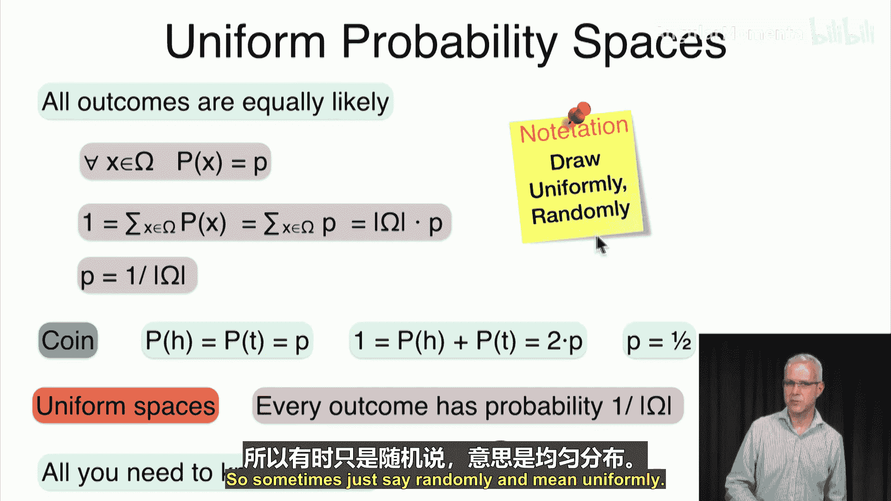
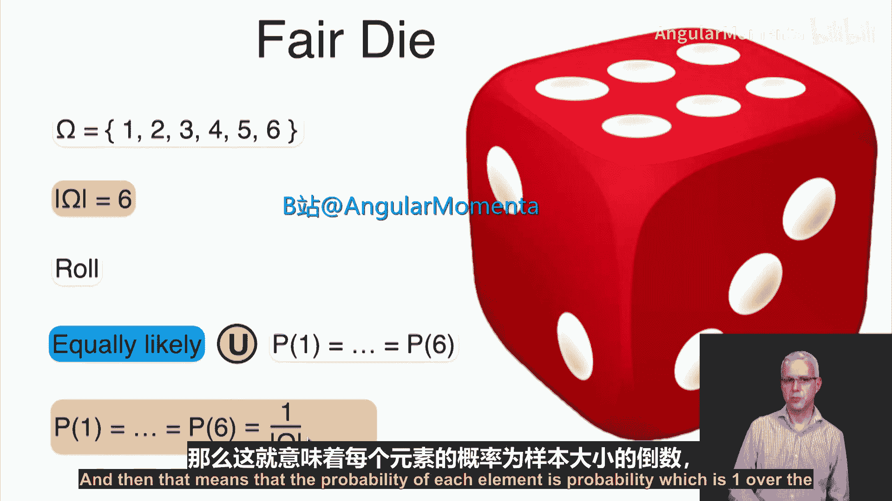
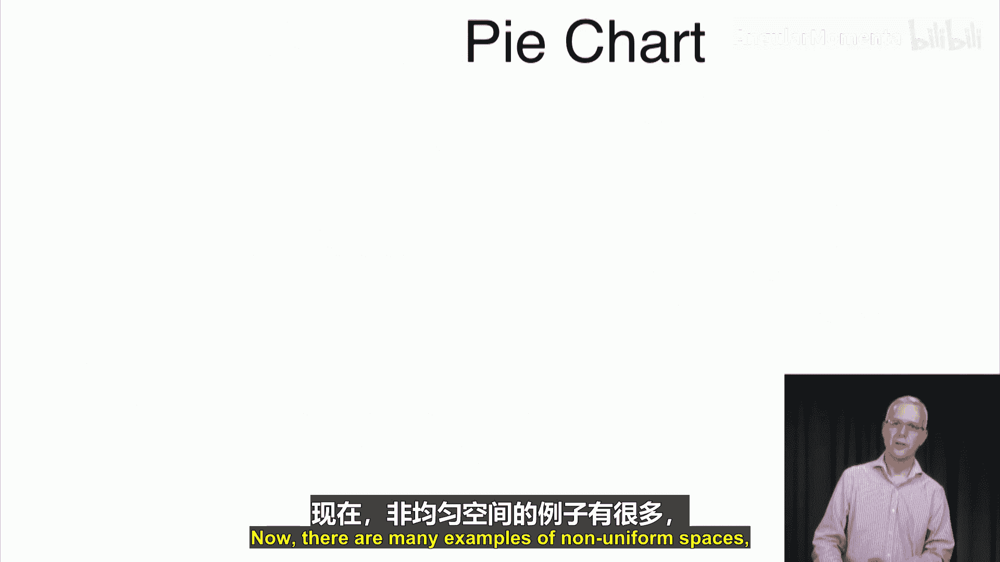
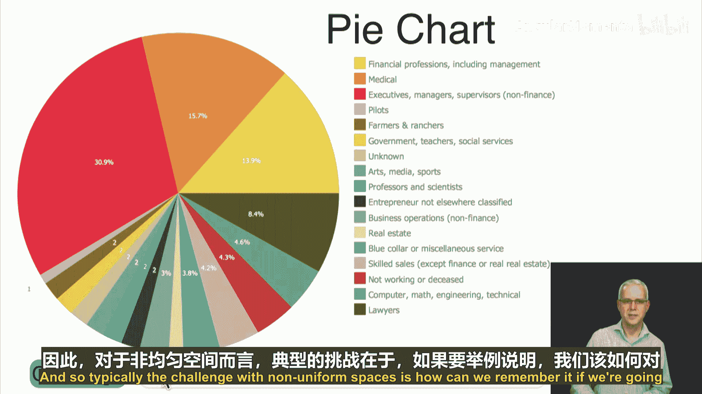
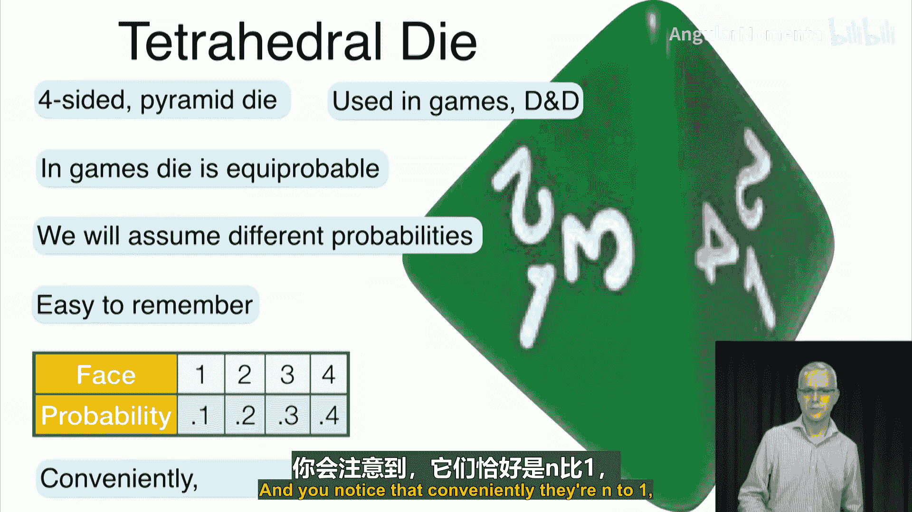
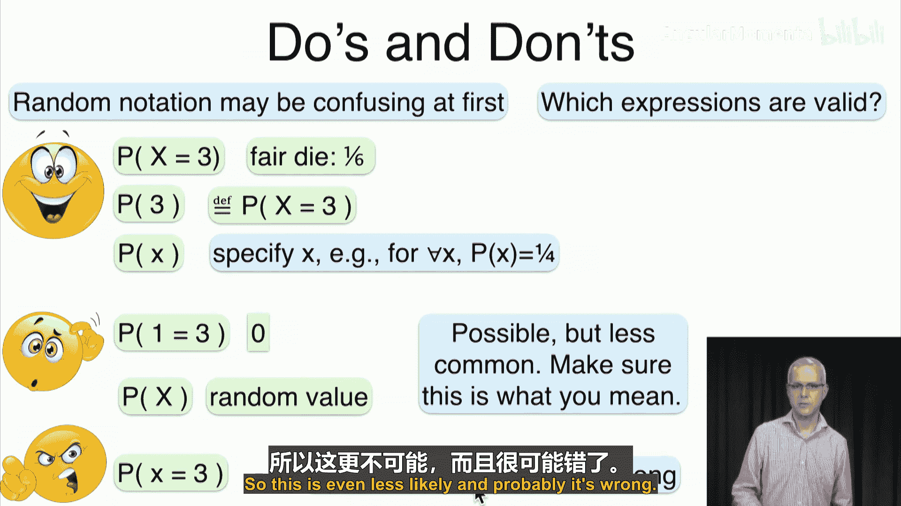

# 【加州大学圣地亚哥分校】使用Python进行数据科学中的概率与统计--Probability-and-Statistics-in-Data-Science-p24-06-02-03-分布类型--BV1gJFDzkEPg_p24-

Hello and welcome back so now that we have discussed randomness and distributions。

 let's talk about distribution types。We're going to discuss uniform sample spaces。

 give some examples of coins， dyes， and cardss， and then we'll talk about non newform spaces and give an example of E oil dye。

So we'll start with uniforms probability spaces， so generally outcomes may have different probabilities。

 for example， rain may have 10% probability of occurring on a given day and 90% probability that it doesn't happen。

But what we want to talk about now are uniform also called equi probable spaces where the distribution is uniform。

 everything has the same probability， so all outcomes are equally likely。

 for example if we flip a coin then if the coin is fair。

 then the probability of heads and the probability of tails are both one half。

And when you have a uniform space， then all probability specifications and calculations become a lot simpler as we'll see so as we said in uniform probability spaces all outcomes are equally likely in other words for all x in the sample space。

 the probability of any x is p is the same p and now we know that1 is going to be the probability of the whole sample space and as we know for probability distribution when you sum the probabilitybilities there has to be1 and therefore we get the summation over all x in the sample space of p is1 but this is just p times the size of the sample space and that tells us that p。

 the probability of every element is one over the sample size of the sample space or one over the size of omega so for example if we take a coin probability of heads and probability of t if we assume it's p。

we have that one is P of heads plus p of tails or 2p， and therefore P must be12。

 and in uniform spaces in gel， we see that every outcome has probability which is one over the size of the sample space like here1 over2。

And we call uniform spaces we'll denote them by the C for uniform and all you need to know for uniform distribution to know all the properties is just to know the samples。

 the size of the sample space and that makes them so simple for us。

And one note an notation is that when we have a uniform sample space will say that we draw uniformly from the space or we just draw randomly some randomly when we don't say anything else will signify that we're drawing uniformly so sometimes just say randomly and uniformly okay so let's see a couple of examples so fair coin the sample space consists of heads and tails which will denote by HMT and。

The size of the sample space is2 okay so we go inside the flipper coin or tosser coin and the results are equally likely in other words the space is uniform and so that means that probability of heads is equal to the probability of tails and as we saw in the previous slide。

 that means that each of them has probability which is one over the size of the sample space or one over two。

If we take a fair die， the possible outcomes are one up to6。

 the size of the sample space is6 therefore， if we roll die。

 the faces we assume because the die is fair， the phases are equal likely or in other words the space is uniform。

 it's noted by u， so the probability of one is equal to the probability of two and so on up to probability of6。

 and then that means that the probability of each element is probability which is one over the sample size or one over6。

And if we have a deck of cardss， then we'll let omegas the set of all cardss， in this case。

 maybe 52 in standard deck that， and so if we draw a card。

 everything is equal likely not by you and the probability of getting maybe three of clubs or a queen of cards。

 all of them equal likely， which is one over the size of the sample space， which is one of 52。

Now in many cases the space is nonuniform， so uniform spaces are coins and dyes and so on but and in those cases everything is pretty good。

 but in nature nonuniform cases abound， we give the example of rain。

 also grades that we get are not equally likely to be an A+ you know other grades。

 words words with some words are more likely than others， some illnesses are more likely than others。

 some web pagess of visitor more often and people that we see are not randomly distributed according among all seven billion people on the planet and so on。

 so we need to look at them now the many examples of nonun spaces and one typical example is a pie chart that we see here。

 so these reflect the different probabilities of possible outcomes as we see。

Okay so this whenever say pie chart， what you see is a non uniform or actually could be uniform。

 but typically a non uniform space and so。Typically the challenge with nonuniform spaces is how can we remember it if we're going to give example so we're going to select try to give a simple example of a tetrahedron die so this is a force cid or pyramid diist it's also called and it's used in different games board games for example dungeons and dragons but typically in those cases the die is equi probability namely each of the four faces is highest the same probability but we' are just going to give it some different values so we'll assume different probabilities I'll try to make them easy to remember so the faces are 1 to34 and we'll just give them probability is 0。

1。20。3 and 0。4 and you notice that conveniently the n to1 and therefore this is a probability distribution。

So now that we have these examples in mind let's go over a few things about distributions and see what we can say about them are Kent and notice that random notation may be a little confusing it as first so which expressions are valid than which are not。

 so for example we can say the probability that x is equal to3 that's a valued expression that's the probability that the random outcome is going to turn up 3。

 so for example if you have a fair I， this probability is 16 so that's an okay expression can also write p of 3。

 that's an abbreviation for the probability that x is3。Okay。

And this is just the same as writing the probability at x is 3 and you can also write p of x。

 but then we need to specify x， for example， we can say that for x p of x is a quarter if you have a fair tetrahedral die。

 for example。Okay， now things that are maybe not so clear whether you can do is if you write probability of one equal to three。

or probability of the random variable x and those could happen， but not so likely。

 for example here what you might mean is that you have a random variable which is always one in another and you ask what is the probability that' equal to3 then that probability is going to be 0。

And here maybe you mean you have random variable x and you ask what is the probability of the random outcome that you observe so these are possible but less common so make sure that this is what you mean so this typically would mean zero and this is a random value as we said but things that you should not do is for example write the probability that little x is equal to three because little x is a value so cannot write probability is's equal to3 so this is even less likely and probably it's wrong so so to summarize we talked about different distribution types。

 we talked about uniform sample spaces， coins， dies and cards as examples we talked about nonuniform spaces we give the example of  atrahedral die and what we're going to do next time we' discuss events。

See you then。