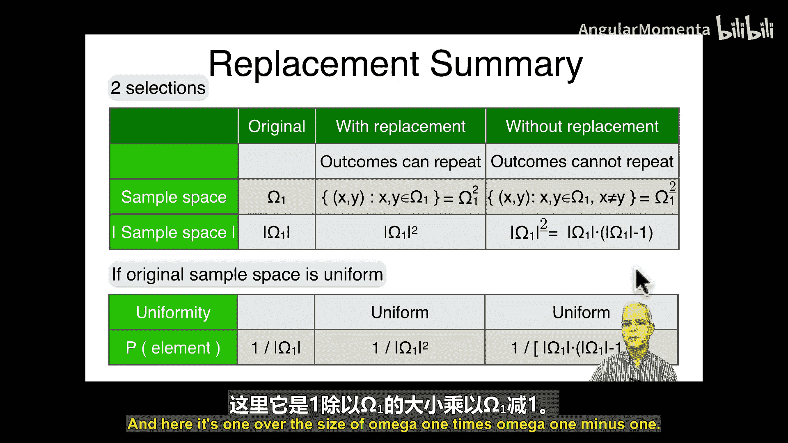

# 【加州大学圣地亚哥分校】使用Python进行数据科学中的概率与统计--Probability-and-Statistics-in-Data-Science-p25-06-04-04-重复实验_第二部分--BV1gJFDzkEPg_p25-

Welcome to the second part of repeated experiments so in the first part we talked about compound or composite experiments and we talked about what happens when you repeat things and we said you can repeat either width replacement where the same element can be selected twice and then we said that the new sample space size is just the square of the original size of the sample space。

And we also talked about and this， for example happens when you roll it dice。

 you can get the same in the same outcome headsets twice。

 and we also talked about selection without replacement， for example。

 when you draw a card and then you draw another card。

 you cannot get the same card twice and then the size of the new compound sample space is going to be the original size times the original size minus1 because you cannot get the same element twice。

And what we want to do now in the second part is talking about whether the order matters or doesn't matter the order in which you're selecting。

So。So so far we talked about what happens when the order matters for example when we talked about selecting cards you may recall we said select code number5 and then select code number3 and we calculated what was the probability we said this set probability16 and then the selection probably 15 and in many cases the order matters For example if you investing in the stock market then if your stock goes from 10 to 50 you'd be happy so that's 10 followed by 50 but if it went from 50 to 10 it'll be a little less。

But。In some other applications， the order does not matter， for example。

 suppose you run in elections and you want to see who will win。

 then it doesn't matter if the first person voted voted Democrats in the second person voted Republican or the other way because you're just going to count the total sum or if you go shopping it doesn't matter what order you're going to put things in the basket。

 youll still have the same， you just care about the collection of things。

 of course unless the banana ended up in the bottom it's a different story。So so。

When the order does not matter， then what we had before， which was a top。

 you remember we had the topple of like for example。

 the major followed by the year followed by the GPA， instead of a couple of possible outcomes。

 we just get a set of possible outcomes， for example， instead of having two followed by five。

Or five followed by two， both of them will get first they'll be the same。

 they'll be the set that we got two and5 because we don't care about the order so we don't care if we got this sequence of that sequence。

Okay， and therefore the set 2。5 actually corresponds to two possible original outcomes the set of two5 to two followed by five or five followed by two。

 so in other words correspond to the event of these two temples。Okay， and if we get4 followed by4。

 then that will correspond to the set 44 comma 4， which you could write as just 4。

 but that's let's no worry about that。 Okay， so what we're going to do is we're going to calculate the probability of of。

These outcomes， this sets and because so far we looked at what happens when the order matters。

 this was easier to calculate then what we're going to do is we're going to focus on what happens when the order does not matter and to be complete we'll do it both with replacement and without replacement so let's start about seeing what happens when you have replacement。

So suppose you have two cards。They from1 to six and you select them with replacement okay so this of course is equivalent to saying that you have two dice and you roll it twice so these are essentially the same experiments right and you can see that this is with replacement because we can get for example66。

6 twice cancer so doing same selecting two causes from one to6 with replacement。Okay， so now。

Let's look at the order， if the order matters， then we have what we had before is that the possibilities for the first die and this for the second eye and everything here has probability 1 over 36。

 so the probability of 11， 12 and so on each is probability 1 over 36。Okay。

 and this is again as SP did before， on the other hand， if the order does not matter。

Then we're looking at the probability of sets and we can ask what is the probability for example of one2 So what is the probability that we get1 and two that the sides will be one and two。

 that's the probability the first die turned up1 and the second one turned two or the first one was two and the first second one was one。

And these are two different outcomes， one followed by two and two followed by one。

 each of them is so it's the probability is just the sum of the probability。

 it has probability1 over 36， so the total probability。

 the probability that we will see1 and 2 doesn't matter which order is2 over 36。Now。

 on the other hand， if we calculate the probability that we get the set 11。

 namely that both dies are1， that is the probability that the first one has to be one and the second one has to be one。

Okay， and that's one over 36。So what we see is that now when the order does not matter。

 then the distribution was not uniform before it was uniform when the order mattered。

 I here everything was one over 36， but now when we order does not matter it's not uniform and the reason is because if we get a double 11。

 then we get it only from a single sequence and the probability is1 over 36。

 but if we get a non- doubleouble like 12， that could come from the first coin first die being one。

 the second being2 or vice versa， and that will give us twice the probability or2 over 36。

And just as a sanity check， we want to see that this probability is sum to one。And。

So we can see that the number of non doubles is the numbers of diagonal we need to select two elements like one。

2，1，3 and so on， and each is from one up to6， so we need to select two elements out of six that there are six choose two ways of doing that and each of them will have probably two over 36。

Now remember and then for the diagonal elements， the doubles there are six choose one。

 there are six of them1，1 to two up to 66 and each one is probably one over the 36 Now six choose2 is6 times5 over two the two will cancel the six will cancel so will be left with the six will cancel 36 so it will be left with5 over 6 here and here six will cancel get one over6 and it always one so it's good they sum to one with it。

Now without replacement。This was the width replacement now we do it without replacement so now we select two cards between one to six and we do it without replacement now it's no longer analogous to rolling two dice so we have to talk about the card so these are the possible outcomes right I mean the first one could be one and the other could be two up to six but we cannot have one one we cannot have two two and so on。

So now if the order matters， that's what we have done before， then for all I not equal to J。

 the probability that we get I followed by J is 16 for the first one and  one fifth for the second one which is one of the 30。

 which is what we see here。Now if the order does not matter。

 then if we calculate for example what's the probability of12 and that's again the probability we get one followed by two or two followed by one because we don't care which order we get and that's going to be the sum of these two probabilities which is going to be two over3 and notice that one。

1 and 22 cannot happen。So now we get what we get is uniform because everything that can happen has probability which is。

1 over 15。So all the off diagonal all the day like 12 and so on will have probability2 over 30 or1 over 50。

Okay， so again， we want to check that indeed this is a distribution。

 we want to set probably up to one， so the total number of outcomes we can have is six。

 choose two because we're choosing two numbers out of one up to six。

And each one is probably2 over 30， and we can see this is six times 5 over over 2。

6 times5 is 30 divided by two cancels。 we get one。 It's good。

Right now what we want to do is we calculated it here in one particular way which is we calculated the probability that we get12 and then multiplied it by two really and we want to do it in a slightly different way and of course we'll get the same answer so an alternative calculation so suppose we have two cards I apologize about this I'm sure it will come in handy so suppose we have two cards one up to six and we select two cards sequentially without replacement。

Okay， so what we did before is we said the probability of12 is of the set。

 one two is probably get one followed by two or two followed by one and together they give us two over 30 alternatively we can just say we are selecting the two cards simultaneously so select ones like that or we can just say we selected the two of them because we don't care about the order。

And then here， the sample space is just a collection of all possible。Pairs， so  one2， one。

3 up to five，6， okay which is the set one up to6 choose two number we have this notation and the number of the size of the sample space。

 the number of possible pairs is going to be6 choose two， which is 50。Okay。

 and because of the uniformity of the space， every pair has the same， you selected two cards。

 every pair has the same probability， so the probability of any 12 or any other set is going to be 1015。

And this is the same as what we got before， the same is  two over three。All right。

 so we can generalize， of course， to other card selection。 So let's look at poke hand probabilities。

 so a deck standard。Card deck consists of 52 cards and a hand in Por is five cardss so the sample space omega is the collection of all possible hence for example this one that one and so on and the size of the sample space the number of possible hands is therefore 52 choose5 we have 52 cards of which we choose five so that's the number of possible hands that we have selecting five cards out of 52 and this is 52 fctor divided by five fctoral and 47 ftoal 52 minus5 fal so let's calculate I think there are lots of cons here so we can cancel 47 fctoral。

 52 fctoral give us 52 times 51。Down to 48 divided by 5 x here。

And now what we can see is the 50 and the5 can cancel， we have 10 here。

Now you can see here four times 3 is 12 times 2 is 24 that will cancel the 48 will just give us two here。

And what we have here is roughly 50 times 50 times 10 times 100。 So it's 50 times 50 here。

 roughly times 10 times 10，49 times2。Okay， and when we multipied it， this is 2。5，000。

 and this is 100， so to roughly 2。6 million or more precisely is 2。598。And so on。2598，000 and so on。

Wwhich is roughly 2。6 million so now furthermore， all hands are equal likely this hand is as likely as any other one。

 so we have a equi proable or uniform distribution and therefore by the uniformity。

 the probability of this hand or any other hand is roughly1 over 2。

6 million this is probably of any hand。And we're going to do a lot more of that very soon。

So let's just recap so in the first part we discussed what happens when you have repetition and we said what happens when you have repetition with replacement。

In which case， that's when the same element can appear twice。In that case。

 the sample space was just the square of the original sample space and the distribution。

 if the original distribution was uniform then the new distribution was also uniform。

 if we have selection without replacement， the new sample space was the original one times same thing minus1 and again uniform and what we talked about this part is we consider what happens when the order does not matter and then when we had with selection with replacement we saw that we get a non-uniform sample space。

 I mean that's because the probability of for example observing one and2 was twice the probability of observing11。

But when we selected without a placement， it was uniform and that's because we could never get11。

 so there was no issue with that and everything else had the same probability。

So what are we going to do next time we're going to start applying what we have been learning to games of chance。

See you them。Hello and welcome back。So far weve talked about single experiments and now we want to move from one experiment to multiple experiments and we'll start by talking about composite experiments and then we'll converge on a special but in point case of repeated experiments and then we'll see what happens when you have replacement when you don't have it and because this presentation could otherwise be a little long we're going to split it into two parts this is going to be our first part and then we'll have a second part where will be shorter where we just see what happens when order matters and when it doesn't。

So first multiple experiments， so experiments often consist of several parts， for example。

 if you consider information about a student you may care about the major the year freshman sophomore and etc and GPA or if you're going to place an ad then surely you care what you advertising and what the audience is and what is the cost of the product so for example we can still view these composite experiments as a single one with with several components the outcome is just a little more complex for example。

 in these two cases we we'll have threeTs so for a student we say the major is for example computer science the student is a senior and the GP is 3。

8 so we get this 3T or for the ad we can say that you're selling a book it's meant for teenagers and the cost is 9。

99 of course so again we have a threeTple。And so what happens now is that our sample space instead of just consisting of a single element consists of a more complicated element。

 which is a threeTO okay so therefore the sample space is a collection of three tables and in this case is maybe a cartesion product。

 something like that where can see that maybe one axis or one coordinate corresponds to the major。

 maybe this is computer science， this is math and so on and another component corresponds to the year freshman sophomore and so on and the third direction is the GPA。

 so maybe this is a low GPA in high GPA so any point here corresponds to specific major year and GPA and our goal is to analyze these spaces。

 so what we want to do is want to combine simple spaces that we have looked at before and use them to analyze more complex structures like this one。

And as usual， we're going to start with baby steps。So first let's talk about independent repetitions。

 so what do we mean by repetition？The petition， we mean that all the experiments are of the same type。

 For example， you have daily stock price。 you have the stock price today and tomorrow and day after and so on and our daily temperature again you have considered temperatures and you have temperature day after day or after or you have coin flips you have coin and then another coin and so on So you get for petition of same type of experiment or you roll a die so you have the die repeating several times so it draw cards and so on and what do you mean by independence we mean that the different components of different aspects are unrelated So for example if we if we flip to coins and the first coin comes up heads that should not change the probability that the second one it will come out heads and tails So if the coin for example is fair then the first coin came out heads and the second coin flip another coin it will still be heads of tails with probability 50%。

And so this means this is independent， on the other hand， if the first coin comes up heads。

 that means that the second coin is more likely to also come up heads。

 then those will be not independent experiments， those will be dependent experiments。

So let's be a little more specific about the two coins so suppose we have two fair coins and we have two independent flips so we have let's say two separate coins flip one maybe we get heads flip second one maybe we get tails so what are the possible outcomes So for the first coin could be heads and tails and for the second coin could also be heads and tails and what are the probabilities so the first coin could be heads with probably since the coin is fair will be heads with probably half entails with probably half and now for the second coin it will be also half half independent of the outcome of the first coin so the first coin came up heads that means that 50% of the time I'm sorry since the probably is half half that means 50% of the time this coin will come up heads and then because the independent means that half of the time or another 25% half of that time or 25% of the total time this will also come up heads and 25% of the time。

The second coin will come up。Ts okay and likewise， if the first coin came up tails and that will happen 50% of the time between half of that。

 namely one quarter of the time， the second coin here will come up heads and with another quarter of the times。

 the second coin will come up tails。 Can you can see that these f to one as they should。Okay。

 so what is the sample space， the sample space here is the collection of all pairs of outcomes。

 which is heads heads， heads tails， tails， heads， tails， heads and tails tails。

 and we can see that it's just the quoessian power， heads and tail square。And what is the size of？

Of a new sample space of this compound sample space is two square because it's two times two the size of this rectangle。

 which is four。U。So now notice that if we have one coin it's a fill coin then it' uniform that would imply and it uniform and now what we get that we go when we have two coins like here。

 then it's also going to be uniform because we get half half here and each one will be multiply by half and half so get one quarter in each one it's also uniform and therefore the probability of heads heads and headsts and so on is going to be one over the sample space size as we saw which is one quarter okay。

Now if instead of two coins we have two dice and again third dice and during the print experiments。

 the first die could be one up to6， the second die could also be one up to6 and what you'll get is the de probability that you get any combination of first outcome and second outcome is one over 36 why again the first die could come out let's say one with probability16 of the time in one6 of that the second die will come out one and so on so all would be one over 36 and again the sample space here will be 1。

1，12 all the way all pairs up to 66 and other words it's the quoession power one up to6 could multiplied with itself and the size of the space is therefore going to be six square which is 36 and if we have one die because it's its uniform and that would imply here if we have two dice it's also going to be uniform as we see here and you can also calculate it by saying because。

thhing is equally likely then the probability of every pair of outcomes。

 for example 11 or12 is going to be one over this sample size which is one over 36 and you notice that we have first coin and second coin so the probability of do the first one will come out one and second one will come one is the one over 36 it's the same as the probability the first one will come out sorry it's the same as the probability that the first one will come out let's say one and the second one will come out two。

All right。So now that we talked about the probability of individual outcomes， for example， 11，1，2。

 and so on， we also want to talk about probability of events which are a collection of outcomes。Okay。

 so remember that again an event is a set of possible outcome and the probability of an event is the probability that the outcome is inside this set inside this event。

 and we saw that the probability is just the summation of the probability of the individual outcomes inside the event。

 summation of P ofX for all outcome X that are in this event E。And if this space is uniform。

 we said that this implies that the probability of an event E is just the size of the event divided by the size of the sample space。

 and we could say in a couple of ways and one of them is that every element is equally likely and there are so many elements and so we are interested in this many。

 the size of E and the probability we'll get it is this number divided by the total number of possibilities。

So if we have two coins， for example， here is heads and tails。

The number of possible outcomes as we saw is two square which is four and by uniformity outcome equal every pair of outcomes is equally likely and the probability of an event is the size of an event divided by four in this case so if we're looking at for example。

 the probability of different outcomes that's going to be the probability we get heads heads or tails heads。

Okay so this means two different outcomes， Xs and tails。

 you've got tails and heads also the different outcomes。

 so there are two possibilities out of the four total possibilities of the probability that will get two different outcomes is therefore two over four。

 which is one half。Okay， if we're looking at the probability that we get at least one heads。

 so that's probably get head tails or tails heads or head heads。

 but not tail tail tail tails will not have at least one heads。

 So the three possibilities out of four。P。Out four possibleha pairs。

 and therefore the probability is going to be three quarters。

If instead of two coins we're flipping three like here， we we can consider many events， for example。

 so here the sample size， the size of the sample space is two cube from headsheads heads to tail stats。

So it's2 cube， which is8 and again， uniformity， if you want to consider the probability of alternating。

 for example， heads， tails， heads， is probability get heads tails heads or tails， heads， tails。

So there are two possibilities out of eight， each of the eight is equally likely。

 the probability that will get one of these two is two over8， which is one quarter okay。

 and if we consider the probability of a odd of this event that we get an odd number of heads。Okay。

 so that means that he gets either a single head like this in one of these cases or three head。

And there's the total of four r triples that will give us an odd number of heads and this is four out of eight total possibilitiesibil that are all equally likely。

 so the probability of an odd number of heads is4 over 8， which is12。

So now that we've talked about coin flipping and。And rolling dice。

 I's talk about what happens a little more generally。

 so there are many sources of randomness and we have seen a couple like coin and a dye and many of course many more。

 but often what we do is be sample or select physical objects， for example。

 we can select patients for study or we can look at customers at a restaurants or the products that we select for quality control or the people who visit a website。

 those are all physical objects。And we can also look at physical objects that are a little more easy to analyze which we're going to do。

 which are， for example， selecting cards from a deck or selecting ball from an area。

So whenever we sample things without two types of samplings we can do it with or without replacement。

 so we're going to describe what they are so what do we mean by replacement so we sequentially select physical objects so when we do it with replacements。

 that means that we replace or in other words reuse the elements that we selected and therefore the outcomes can repeat because we reuse them and therefore the experiment can often be independent of each other the first and the second and so on。

And this is like coin or dice because if we get heads。

 the second one can also be heads and the third one can be heads and so on on the other hand when we do selection without replacement that means that we do not replace in other words we do not reuse elements that we select so the outcomes therefore because we do not replace them the outcomes cannot repeat and that means necessarily that the experiments are not independent in other words they are dependent because we cannot get the same outcome the second experiment that we did in the first one and so notice that this is not what happens when we have coins and dice because those because those are replaced and can be selected again。

 but if we select physically select elements and we cannot possibly replace them and now the difference between this two may not be that big if we're talking about sample size which is very large because the probability will select an element twice as small but。

If if our universe is small。Then there could be a big difference between selection with replacement and without replacement。

Okay， so let's see the differences between selection with and without replacement。

 so when we sample or select with replacement versus without replacement。

 okay then if we do it with replacement， then we repeat if from scratch right because we replace the element and we just repeat the experiment again on the other hand we do it without replacement。

 then we repeat but with a smaller set because we are not using the element that we pick before。

And when we do selection with replacement， therefore the same element can。Appeared again。

 but when you do it without replacement， the same element cannot be selected again。

And an example of selection with replacement is when we flip coins because we can get heads in the first experiment and heads in the second one because we can reuse this value so that's okay。

 or if we roll a I， we can get six in the first experiment and then six again。

 so again this can happen when we have selection with replacement。On the other hand。

 when we have selection without replacement such as cards。

 if we select a queen and we don't replace it， we don't re it。

 then the next card is not going to be a queen that cannot happen。

 or if select people for a committee and select one person。

 then we cannot select the same person twice or else we'll get into a big trouble。Okay。

 so this cannot happen。 All， Okay， so what we're going to do now is look at a few examples。 Okay。

 so let's first look at balls in a jar。 and our first thing is going to be with replacement。

 So imagine that we have two balls， a yellow ball and a blue ball a yellow and a blue ball in a jar like this。

 And we picked one ball。 Okay， so we picked here the blue ball。And。

Now we're going to replace it and replace just means we're going to return it to the jar。

 so now we have the same jar again and we're going to pick another ball。

 okay pick a ball again and in this case we picked the yellow one okay so what happens now is that we have we've picked the blue ball and then the yellow ball。

But when we picked here， when picked the yellow， we might get a repeat。

 so we could have picked the blue one here， okay in which case we would get the blue one and then the blue one。

 so we'll get the blue ball twice。Now this is selection with replacement because we replaced or returned the ball to the jar and what that means is that when you do the second selection here。

 we are doing exactly the same experiment as we did originally， it's exactly the same setup。

And if we want to calculate the probability of possible outcomes， so here we have two outcomes。

 then what are they for the first ball， it's going to be yellow with probably half and blue probably half。

And the second ball， again， because we have exactly the same replacement the same selection。

Then the second ball could be yellow with probability half and blue with probability half。

 and the probability that we get each combination is one quarter。just like we had with coins。

And so the sample space consists of yellow， yellow， yellow， blue， blue， yellow， and blue， blue。

The size of the sample space is four。And everything here is equal likely。

 and therefore the probability of every outcome， every sequence of yellow and blue is one quarter。

On the other hand， let's look at the same palm but selection without replacement。

 so again we have a jar with one yellow and one blue ball。And we pick one ball。

 that's the same as what we did before and pick the blue one， let's say， just like we did before。

But now we do not replace the blue ball mainly we do not return the ball back to the jar so we're left with this jar and we pick in second ball and now we necessarily have to pick the yellow one I'll get this so get the blue followed by the yellow so this is selection without a replacing because we do not replace we did not return the blue ball and here we see that the second selection is going to be from a subset because initially we picked the ball from the yellow or the blue but for the second ball it have to be just chosen from just that ball and what are the probabilitybabilities for the first ball it's just like before it's yellow probably half and blue probability half now for the second ball it's a little different because if we pick the first ball to be yellow then the second ball has to be blue and so the probability that we picked yellow by blue is half is just the probability that the first one is yellow and both of them yellow is zero。

If we picked the second ball， I'm sorry the first ball to be blue。

 then the second ball has to be yellow， so the probability of blue followed by yellow is half。

 just the probability of first one is blue。And the probably of the first ball blue and the second one also blue is zero because you cannot pick the same wall twice because you need to replace it Okay。

 so again you can check the probability is at2 one， which is good。So now the sample space is smaller。

 it either yellow， followed by blue or blue followed by yellow。

 and the size of the sample space is2 and by uniformity because everything has the same probability of these two outcomes。

 the probability is one half。Now let's look at another example。Of drawing without replacement。

 So imagine we have six cardss okay， and we draw one。Like and like this。

 And then we draw a second one without replacement。 Okay， so maybe we cannot draw five again。

 It's gone from the from the deck。 draw another one， maybe we draw three。

So what are the possible outcomes so the sample space omega is the collection of12 called  one followed by ch2。

1，3 and so on up to 65， but we not have for example 44 because we cannot draw four twice and this remember is what we denoted by the set one up to6 and with two permutation of the set of the set one up to 6 so it's the set to the second falling power and the size of the set is six to the second falling power which is six times 5 because we have six possibilities for the first ch and for each of those possibilities we have five possibilities for the second chord so it's3 so the 30 possibilities so here are the possible outcomes so it's one up to61 up to6 and what are the I comma J cannot happen we cannot have we get the same chd twice but if I not equal to J the probability the first。

What is I in the second card is J is going to be 1，6 times 1 fifth。

 right 16 for the first ch being I， and then j is is any of the other chors in the five left。

 sometimes one fifth。 So it's one over 30。 Okay， so these are the probabilities and it's0 here。Okay。

And the probability that we get Ij is therefore one over the total number of possibilities over 30。

Which is so it's one over three。Now， so to summarize what happens with replacing with and without I'm sorry selection width and replace it。

So let's assume we select just two element， we could select more three or four。

 so we'll see what happens with the original sample space and what happens with replacement and without replacement。

So with replacement， the outcomes can repeat。And without replacement。

 the outcomes cannot repeat Now let's assume let's call the original sample space omega 1。

 that's the original one。 what is going to be our new sample space when we select with replacement is going to be the set of all X Y such that x and y and omega 1 it can be the same。

 it could be different it could be any elements in omega 1 how about without and this is just the quotsion product of omega 1 with itself。

Okay and what is the sample space without replacement。

 it's a set of all possible outcomes x y such that again x and y should be in omega 1。

 but now x cannot be equal to y， the second outcome cannot be the same as the first one。

And that is just the collection of all two permutations ofga of omega 1。

Now what is the size of the sample space here it's the size of omega1 and it's going to be the square of that size because we get all possible combination of two。

 so it's it's just the square that we get。And here we going and get the size of omega 1 raised to the second falling power。

 which is the size of omega 1 times the size of omega 1 minus1 because we have that many possibilities for the first element and that number minus1 for the second。

Okay， so now if the original sample space is uniform。

Then what we can see is that uniformity will be retained。

 so the new sample space will have a uniform distribution over all pairs and here will have uniform distribution of all pairs of the diagonal。

And what is the probability of any element， well because of the uniformity and the sample size that we calculated。

 then here it's one over the size of omega 1 and for width replacement is one over the size of omega 1 square and here it's one over the size of omega 1 times omega 1 minus1。

Okay， all right， so let's see what we have done。We talked about compound or composite experiments。

 and then we talked about a special case， which is when we repeat similar experiments。

And we said that if you have uniform distribution on the original experiment。

 you will get uniform on the compound experiment， assuming that you do it independently。

 and we talk about selection with replacement where we said the side of the new sample space is going to be just the square of the original sample size。

 sample space size and we talked about what happens when you select without replacement and the size of the new sample space is going to be the original size times the same thing minus one because you cannot select the same element twice。

Okay， and this concludes part one and what we want to do next is talk about part two。

 which is what happens when the order matter is or does not matter。笑的。

