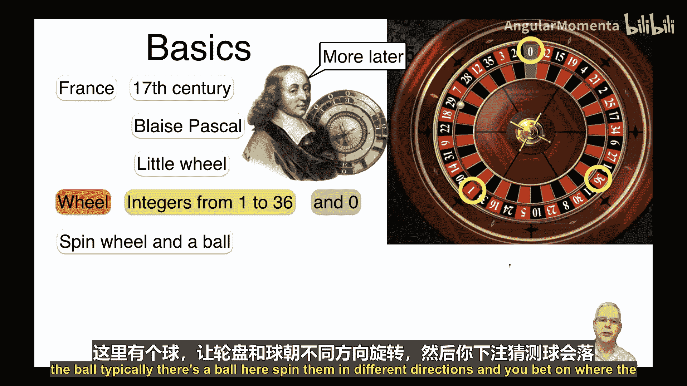
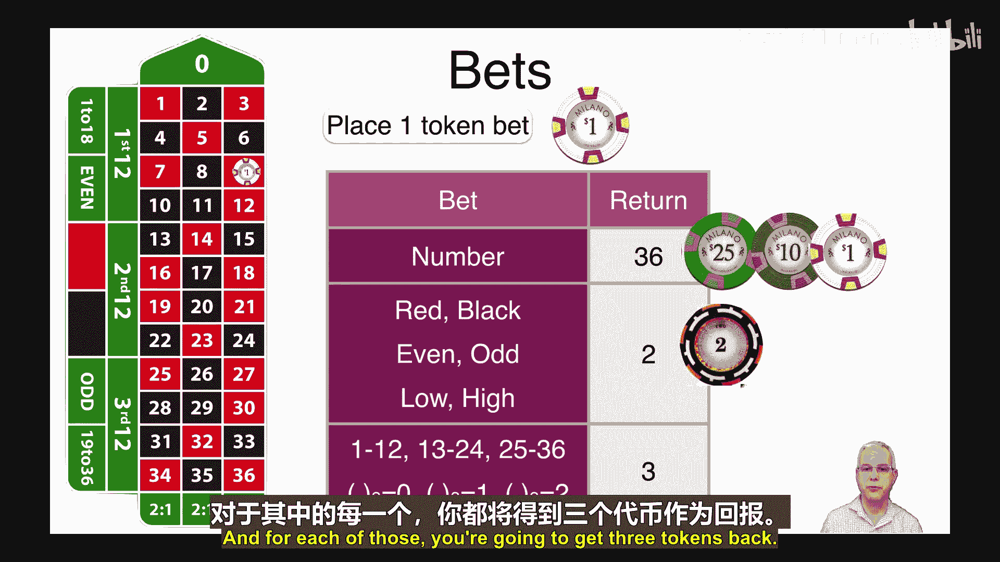
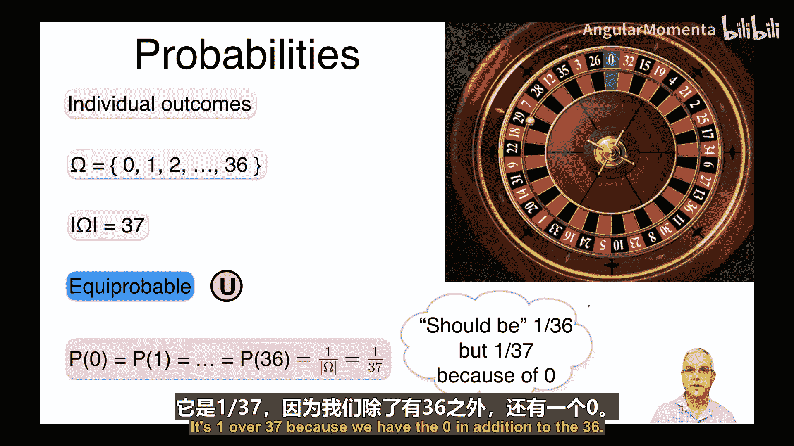
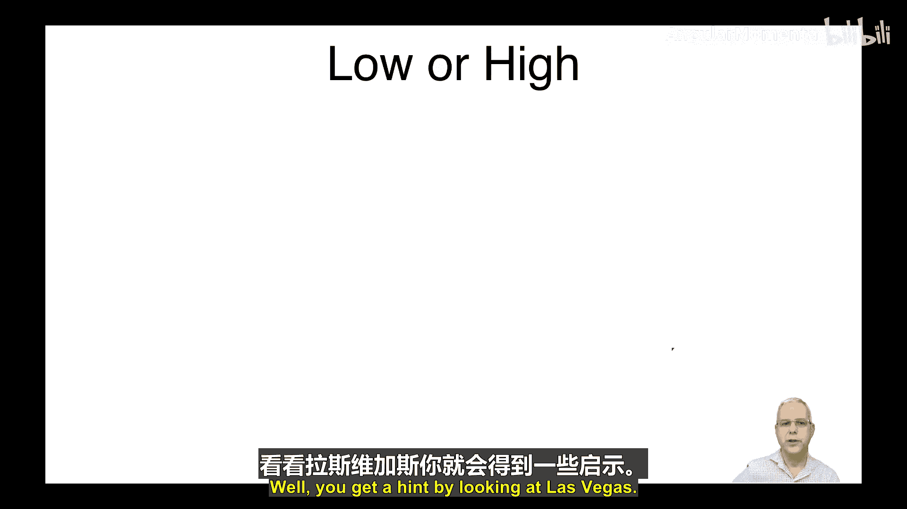
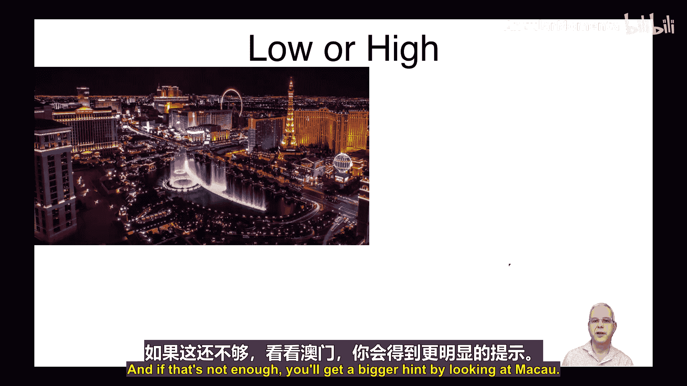

# 【加州大学圣地亚哥分校】使用Python进行数据科学中的概率与统计--Probability-and-Statistics-in-Data-Science-p26-06-05-03-概率博弈--BV1gJFDzkEPg_p26-

Hello and welcome back So far we talked about publicbilities of individual elements and events and selection width and replacement and now we want to start applying what we have learned to calculate publicities in several games and this will give us a chance to experiment and to better understand uniform probability spaces and the probability of different outcomes and events and we'll discuss several games and we'll start with the Roulette then we'll talk about dominoe's poker backga and that should be。

All right， so。Rect， we're going to discuss a little bit the game and the rules and then the probabilities。

 and then we'll see how much money we can make。Hos so for some basics。

 so the Roulette was invented in France in the 17th century。

 supposedly by Blaise Pascal and we're going to come back to Pascal later on in this course。

 he was trying to study perpetual movement and in this process he developed the Roulette。

The name comes from French for Little Will， Roulette， and the will， as you can see here。

consists of 36 integers from one here to 36 and the number0 which is typically shown in green and what you do is you spin the wheel and the ball typically there's a ball here。

 spin them in different directions and you bet on where the ball will land and so here for example it landed on 25。

And the are different kinds of re games， the one we're going to discuss here is the French or also called European reette。

 but there's also the American reette where instead of just zero you also have zero zero。

 and of course there's the Russian re， but let's not go there。So what are the bets that you can make。

 so here is the Roette board and you can bet on various things you can bet on the you place a token。

 for example you can place one token you can place more and you can place it on either a single number like here you bet on the outcome will be the number nine and if that happens then you put in one token。

 you're going to get back 36。And that and you can also bet that the outcome will be either red or black here。

 or that the number will be either even or odd， like24，6 and so on。

 or that'll be low1 to 18 or high 19 to 36 and in any of those cases you'll get you'll get two tokens back。

 so you'll lose the one that you have， but you'll get two in return， one more。

And you can also be on one to 12。Here on the second half。

 the middle one or the higher ones here 25 to 36 and you can also bet that the number mode three is going to be zero and number mode three will be one or two。

 and for each of those you're going to get three tokens back。

RightSo now let's calculate the probabilities of different outcomes so first we'll start with individual outcomes。

 so the possible outcomes or the sample space consists of the numbers from 0 to 36 and we can see that there are 37 of those and each of them is equally likely it's equally likely that we get any of those numbers and therefore the space is uniform and or equi probable and the probability of each of the elements from0 to 36 by this uniformity is one over the sample size which is one over 37 so every outcome has probability of one over 37。

And notice that we think there are 36 numbers， so should be one over 36。

 but it's actually a little smaller， it's one over 37 because we have the zero in addition to the 36。

Now let's discuss some events so well for example you could maybe bet on the event so the event that you got an even number is the event that you got24 and so on up to 36 now the size of this event the number of possible outcome that are even is 1836 over two noted zero does not count。

And。Therefore， the probability of even， again by the uniformity is the size of the event。

 which is divided by the sample size， which is 18 over 37。

 which makes sense right because we have 37 possible outcomes， including the zero。

 but only 18 of them will count toward even because zero doesn't count so the probability you get one of those 18 is 18 over 37。

And again， you'd think maybe it should be half because half the numbers is even。

 but it's slightly smaller than half， it's not 18 over 36。

 but 18 over 37 because we also have the zero。Similarly。

 if the size of the odd event and the size of the red event and the black and 1 to 18 and 19 to 36。

 all of those the same size， which is。Which is 18 and therefore the probability of each of them is 18 over 37。

And for one to 12 or andsonN， for example， 13 to 24 andson。

 or the numbers mod3 is one or two or0 here the size of the event is 12。

 there are 12 of each and therefore the probability of each of those events is 12 over 37。

Now let's see if we're going to win or lose。Okay， so the question is how much can you expect to make when you play the role Now。

 if you play a single game， there's a lot of randomness。 So we it's a little more difficult to say。

 So what we're going to assume right now is that you play many games。

 You go there for the casino for like a week。And we won't see what you expect to make or lose in the process。

And for simplicity， we're going to assume every time you bet $1 it wouldn' make a big difference if bet $2 and so on okay and we're going to consider two types of bets okay so first let's look at what happens when you bet on a single number so always bet on one single number。

 for example six as shown here， say put your you're talkingken on number six you're bettting on that。

So let the number of games let's dennot it by n and as we said we're assuming that the n is very large。

 so let's see how much money how many dollars you're going to make so you bet $1 each game and so the total that you bet is 1。

That's a certainty。 What you get is a little more random。

 but we know roughly that you'll be correct roughly N over 37 for。

Because the probability that you're correct each game is one over 37。

 we know from a definition that if you bet many times you'll be correct on roughly and over 37 of the games Okay so roughly correct that and each time you're correct you're getting $36 and therefore the amount。

 the total amount of money that you're going to get is going to be 36 times you'll get n over $37。

I'm sorry。And over 37 times， you'll get $36 each， so you'll get a total of 36 of the 37 times。

OkayAnd what did you gain gain is what you got minus1， what you bet。

 So it's n minus roughly 36 over 37 n， which is roughly minus1 over 37 n。

And so therefore that means that you lose， so see that you're losing some money and how much do you lose per game you're losing one over 37 of a dollar and that's roughly 2。

7 for every dollar you bet so in other words you're losing roughly 2。

7% of the amount that you pay that you put in each game and。

And this is also the amount of money that or the proportion of the money that the casino makes and it's called the house hedge or the house advantage。

So every time you place a bet on a single number， it a casino， on average， the house makes 2。

7% of that and you lose 2。7%， which is the one of the 37 that count on this zero。Now。

 you might ask what， okay， so what if I don't be it in single number。

 but maybe I bet on one to 18 or even and so on。 So let's consider that。

 So let's assume that you be always bet red。 So you always bet your money here on on the right。

 Okay like that。So and again number of gains we're assuming is n which is large and so how much money are you going to make。

 well you're betting again $1 each gain and so the total amount of money that you're going to put in is N always。

Exactly， and how much do you get again it's random。

 but roughly the probability of winning is we saw the probability of getting a red number was as we saw was 18。

 which is total number of red divided by 37 so you'll be correct roughly 18 over 37 n games and each time you're correct you'll get you'll get 2 so the total that you'll make is just 18 over 37 n times 2 which is 36 of 37。

Okay and how much do you gain again， we're subtracting the number that you put in。

 which is always exactly n minus the number that you get， which is roughly 36 over 37 n。

 and we get that you gain minus1 over 37 n。 In other words， you're losing n over 37 so once again。

 the how much you lose， you lose one over 37 n or the house mix one over 37 n， which is roughly。2。

7% of the amount of money that you be。So what we see is that again we get the same。

 the house hedge is the same and later in this course。

 we're going to see why these numbers are the same and we'll also see how they're different。

But now what we want to do is just evaluate whether this number is high or low and we'll start by comparing it to other games so let's see what's the house edge or the advantage for different games so here are the numbers for different casino games that peoples play and the one that we looked at was the re here or that's the 2。

7 here that we calculated and you can see that it's you know sometimes for some games lower and for some games it's higher。

 but it's you know roughly in the ballpark of what games are and it says here that the house edge or gain is 2。

7% to 5。26% and the 5。26% comes from the game where you have the doubles0 the American relate。

And we'll leave it up to you to calculate and see what the odds are for the American relating and there's also come here for Sigma that's the standard deviation and we'll talk about that later on as well。

So this is how the house edge racks for lead compared to other games and what we want to see now is whether these numbers are in general small or large。

 so these 2。7% small number or a large number， well you get a hint by looking at La Vegas。

And if that's not enough， you'll get a bigger hint by looking at Macau。

 but even if both of those are not sufficient to clarify whether these profits are low or high。

 then you can just do a simple check and you'll see that last year Americans lost almost 120 billion on gambling so that's how。

So this 2。7% is what went to build all these casinos and you can extrapolate from that how much people have that。

Right， so to summarize， we talked about the basics of Roulette。

 we calculated some simple probabilities， we saw how much you expect to win if you play a lot of times and what are we going to do next。

 we're going to talk about dominoes see then。