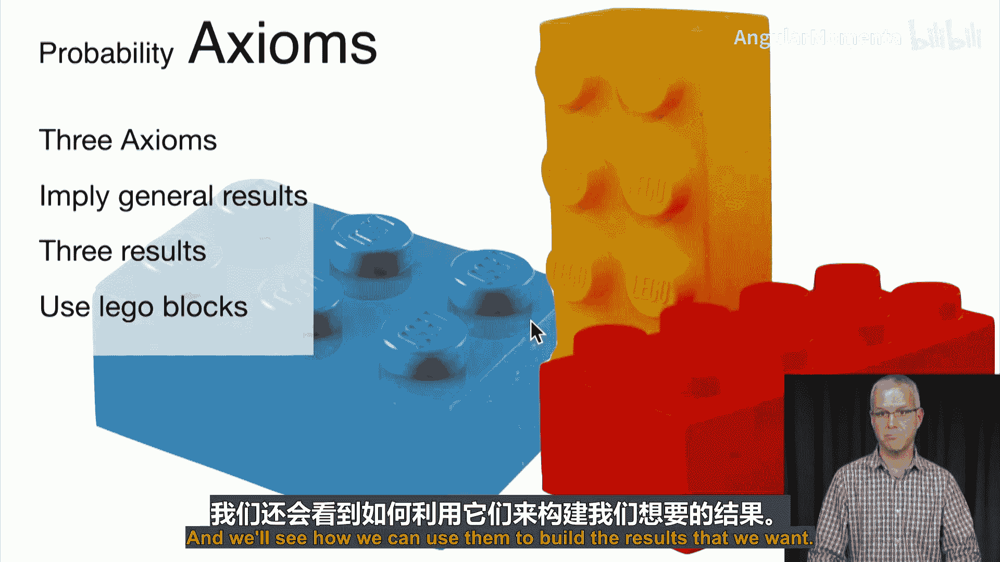
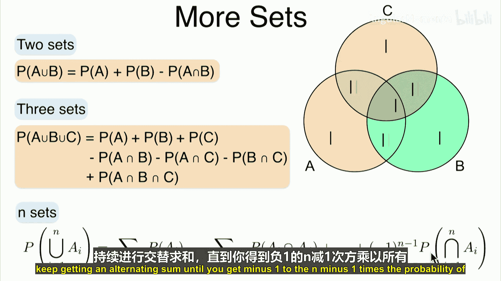
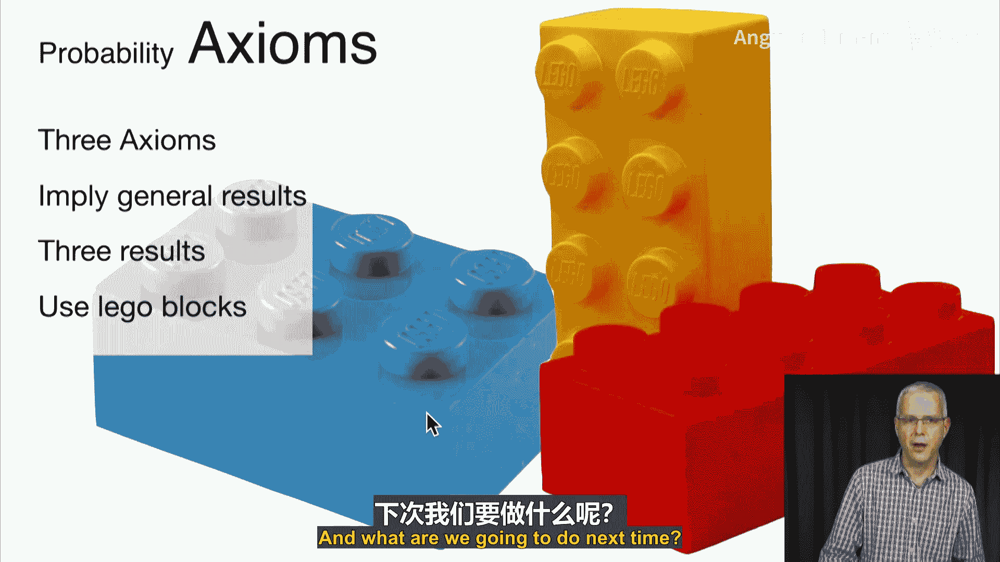

# 【加州大学圣地亚哥分校】使用Python进行数据科学中的概率与统计--Probability-and-Statistics-in-Data-Science-p27-06-06-03-公理--BV1gJFDzkEPg_p27-

Hello and welcome back so we have talked about different properties of probability and now we would like to start in some sense afresh by defining a set of axioms and showing that we can prove many of the results that we have observed before。

 so we'll have only three axioms and we'll show that they imply。

All the general results we have seen before and many more and we'll use them to approve three results and as you can see here we'll use the Lego approach that these are going to be our three axioms and we'll see how we can use them to build the results we want so what are the three axioms so the first one is called nonnegativity so here we have the sample space omega and an event here and it says that the probability of any event is at least zero and when I write this what I mean is that for every event the probability of a is big and equal to zero in other words I'm abbreviating I'm not writing the4A。

And notice that this is very natural because if you call our。

Our frequency interpretation of probability then the probability of an event is just a ratio of two numbers。

 the number of times the event occurred divided by the number of samples we took so it's always going to be a negative and that's what's implied by this axiom and we'll denote this by the sign bigger or equal to zero it means that probability of every event is bigger than equal to zero the second axiom is called unitarity and it says the probability of the whole space the whole sample space is one so if we take the whole sample space its probability is one and we'll denote this axiom by one。

And again， this axiom makes a lot of sense because if you ask what fraction did the whole space occur。

 then that's going to be the number of samples that you have because in all of those the sample occurred。

 the sample space occurred divided by number of samples you get one so any distribution you have the probability of the sample space is going to be1 and the last axiom is called the addition rule it says that if you have two disjoint event then which are depicted here and B are disjoint they don't have any elements in common then it implies that the probability of the union is the sum of the probabilities and again this makes sense because when we count how many times a or B occurred。

 it's going to be the sum of the times that air and the times b occurred so when you normalize by the number of samples it'll get the sum of the probabilities and this one has a more general form that says and will denote it by plus naturally it has a more general form that says if you have an countable number of event a1。

2 and so on， then the probability of the union is going to be the sum of the probability and this needs to hold only for accountable unions we'll see later what happens for uncountable unions so if you have either finite like here number of unions or accountable number of unions。

Then the probability of the union is just a sum of the probabilities and and as we said we'll see what happens for uncountable unions later all right so with that what we would like to do is we kind of like to build the results that we can get and using the Lego blocks。

 the three Lego blocks that we have and we'll construct three simple results'll start with the complement rule then make a slide generalization so and we'll show that this needs two Lego blocks。

 the addition rule and the and unity and then we'll talk about the subtraction rule which we' generalize this and we'll talk about for nested sets and for general sets and we'll show that this only needs the addition rule and finally we'll talk about inclusion exclusion and we'll show that even that is just the two Lego result。

Okay， so let's start with a complementary。😊，So嗯。Hopefully we will remember the complementary role for counting。

 it said that the size of a complement， if you have set a。

 then the size of its complement is the size of the whole universe minus the size of a。Okay。

 and we're going to show that the same holds for property。

So recall that a union a complement is the whole sample space always for any A。

And so here here is a picture， so this is the whole sample space， here is A and a complement。

 the union is the whole sample space。And because a union a complement is omega。

 the probability of a union a complement is the probability of omega now observe that A and a complement are disjoint。

 so A and a complement are disjoint which is did by these two disjoint mastercard spheres okay and because there are disjoint we have the addition rule that will tell us that the probability of the this disjoint union is the sum of the probability this probability of a plus the probability of a complement on the other hand we have here the probability of the whole sample space。

 which unity tells us that this is equal to1。So just moving things around。

 we see that the probability of a complement is going to be one minus the probability of a。Okay。

 so this is the complementary。Right， so as we saw， so it says。

 so this is the equivalent of the complement role for counting。

 it's a complementary role for probability and willll denote it by minus。Okay， and as we saw。

 it's just we just used two Lego pieces， we use the addition ones and we use Uni target ones。

All right， next let's talk about the subtraction rule which is going to generalize the complement room and we'll start with nested sets。

 so the complement tool tells us that if a is a subset of omega， which always is。

 then the probability of a complement is one minus the probability of omega。And。In other words。

 a complement is omega minus a so it says the probability of omega minus a is and one is the probability of omega is the probability of omega minus probability of a。

Alright， so that's the complement role right， the probability of a complement of a set is the probability of the whole space minus probability of a。

Now we want to generalize it to a subtraction rule， we'll say that if a is a subset of B。

 if you have two events， A， which is a subset of an event B。

Then that would imply that the probability of b minus a is the probability of v minus the probability of a。

So to see that， observe that if a is a subset of B， then you can write b as a union B minus a。

 so here we have a a subset of B and you can write B。S a union with B minus a。

And notice that what we want to prove is also very natural want to prove that the probability b minus a。

 the probability of this sec is just the probability of the whole thing minus the probability of a。

 so what we want to prove is quite natural we just want to show how to do it from the axioms so okay so we have that B is a union B minus a as we see here and therefore again the probability of B is going to be the probability of a union B minus a and just now we need to observe that a and B minus a are thisjoint。

Okay， and because that this joint， we can use the additional and we get the the probability of the union is the sum of the probabilitybabilities。

 So the probability of B is the probability of a plus the probability of B minus a that's what we got and therefore we get the the probability of a。

I'm sorry the probability of b minus a is going to be the probability of b minus the probability of a just moving a P of a to the left side。

 so you get this probability of B minus a is the probability of b minus probability of a。

 which is what we want to show。Right， okay and how many blocks did we use here So this is the subtraction rule for nested set because a is a subset of B and we still call it the denoted by the minus sign and we just used the additional rule onces Okay so this is in one piece result okay now we want to do the subtraction rule for general sets。

 So when sets are nested namely when a is a subset of B。

 the probability of B minus a we just saw is the probability of B minus the probability of a。

And what we want to do now is look at general sets A and B， so any A and B。

 and we want to show that the probability of B minus a is the probability of B so far the same。

 but instead of subtracting the probability of A we subtract probability of a into section B and we'll again continue to collect the subtraction rule and denot it by minus。

So let's look at the picture here。So we want to show that the probability of b minus a。

 this is b minus a here， this is a and B， and this is b minus a。

 we want to show that probability of b minus a is the probability of B minus the probability of a intersection B which of course makes a lot of sense。

 we just want to use the axiom to show that Allright so first observe that B minus a is the same as b minus a intersection B。

 So heres b minus a Okay so this is B and this is b minus a。

And this is a intersection B and this is B minus a。

 so observe that when you take B and you subtract the whole red thing you'll get b minus a and when you take B and you subtract just the intersection A of A and B。

 you again take get B minus a， so it can express b minus a， the set also as b minus a intersection B。

Okay， and this is essentially what we need because A intersection B。

Is a subset of B and intersection B is a subset of B。 So now we can apply the。

The subtraction rule for nested set because we're looking at B minus intersection B and intersection B is a subset of B。

Okay， so what do we get， that the probability of b minus a。

Because of this equality is the probability of b minus intersection B。

But a intersection B is a subset of B， and therefore we get it's the probability of B minus probability of intersection B。

 that's from the nested result。Okay， and。So this this is what we want， right。

 probability of B minus size is probability of b minus probability for intersection B， and again。

 this is a single Lego block result。So finally， we want to get to inclusion exclusion。

 kind of that's a more interesting result and let's see how many Lego blocks we need for that。

So the probability of a union B， the inclusion exclusion rule sayss the probability of a union B is the probability of a plus the probability of B minus probability of a intersection B。

 so this is what we call the principle of inclusion exclusion。So we want to prove it。

 so observe that you can write a union B as a union with b minus a， as you can see here again。

 so this is a and this is B， this is the whole thing is a union B。

 you can write it just as a union with B minus a。And therefore。

 the probability of a union B is going to be the probability of this union of a union B minus a。

Now observe that observe that A and b minus a are thisjoint A and B minus a thisjo。

 and so we can apply。The additional， and we get this probability of this union。

 this probability of a plus the probability of b minus a。

And now we going and record the subtraction rule for general set。

 which told us that the probability of B minus a is the probability B minus probability of a intersection B。

Okay， so I me just write it here， so it's the probability of a plus the probability B minus the probability of a into section B。

Okay so we got the inclusion exclusion principle which we remember we denoted by pi and one thing to note is that from this derivation maybe we don't see quite as clearly why we subtract but although we can we can trace the proof and we can see it but also remember that we had the reasoning before which is if you just take p of a plus p of B you'll be counting this area in the center twice and so you need to subtract it and that's how we're getting and and this of course we know is an interesting results so how many Lego blocks that we use well we used one here the additional and actually we used one additional if you remember to prove general subtraction so the total is just two Lego blocks so what we can see is that even getting interesting results means that you apply the axis of just one or twice and you already get some useful results so now that we have the principal。

inclusion exclusion for two sets I want to mention what it is for more sets we're not going to use the logogo blocks but just say what it is so for two sets。

 the probability of a union b is probability of a plus probability B minus probability of the intersection if you have three sets then the probability of a union B union C is going to be the sum of the individual probabilitybil minus the probability of the pairwise intersections plus the probability of the triple intersection and we went over this when we talked about the sizes of unions of sets but just in case you didn't watch that video or you don't remember let's just remind ourselves why this is true so here are the sets a B and C and we'll interested in the probability of all three sets the union so what we can do is we can start by taking the probability of a which will be so we count the probability here here in each of those four regions and then add the probability of B so we'll add the probability in these four regions and then add the probability。

So we add also these four regions what we see that we have done is we counted each one of these ones。

 but we counted every element here and here and here twice and here three times so what we're going to do is we're going to subtract the probability of a to section B like that so when we do that we'll subtract one count from each of those so this will become that。

And then we subtract the probability of a intersection C， this intersection here。

 so we subtract one from each of those two counts。That and then we subtract the probability of B intersection C。

 so we subtract D's okay and so now we're good in almost all the regions here here we counted each of them once。

 but the intersection of all three regions we counted three times and then we subtract it three times so we just need to edit once and we get what we want。

Okay so this is inclusion exclusion for three sets and for general sets。

 you can write it the probability of the union of NS sets is the summation of the probability of the individual sets minus the probability of the intersection and so on you keep getting an alternating sum until you get minus1 to the n minus1 times the probability of the intersection of all of them。

 so to summarize we talked about probability axiom。

 we said that are three of them and they imply essentially all general results about probability。

Basic public at least and we then used them to show three results including exclusion and exclusion。

 and we also showed that all these results could have done。

 we could get them with using just like one or two of those LeO blocks， so it's quite easy。

And what are we going to do next time we'll discuss。

A pretty hefty question。To see you then。