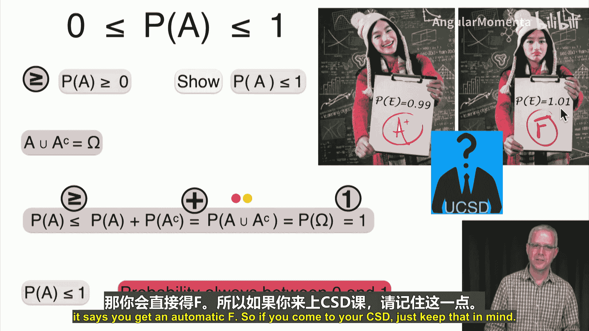
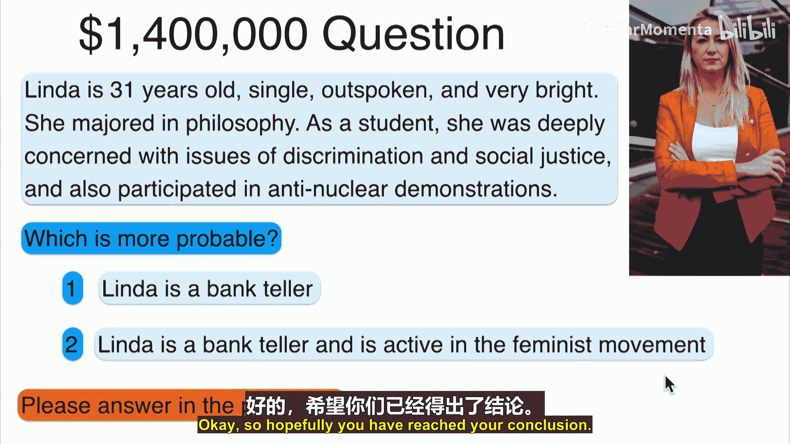
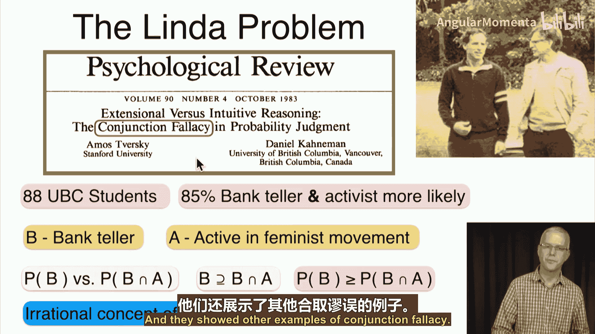
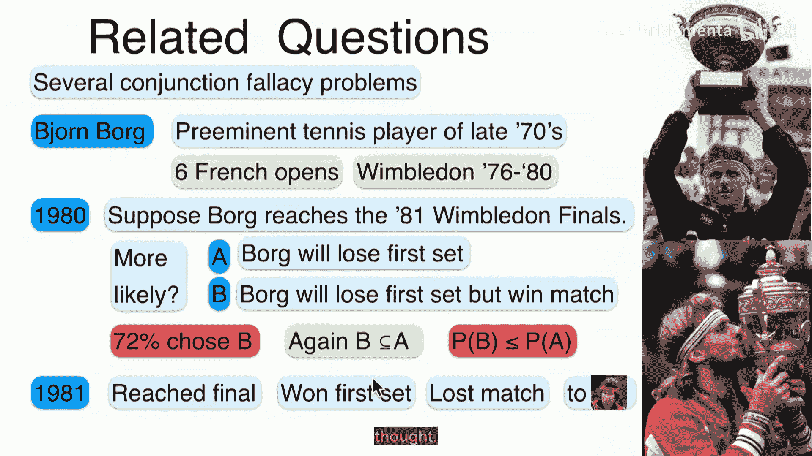
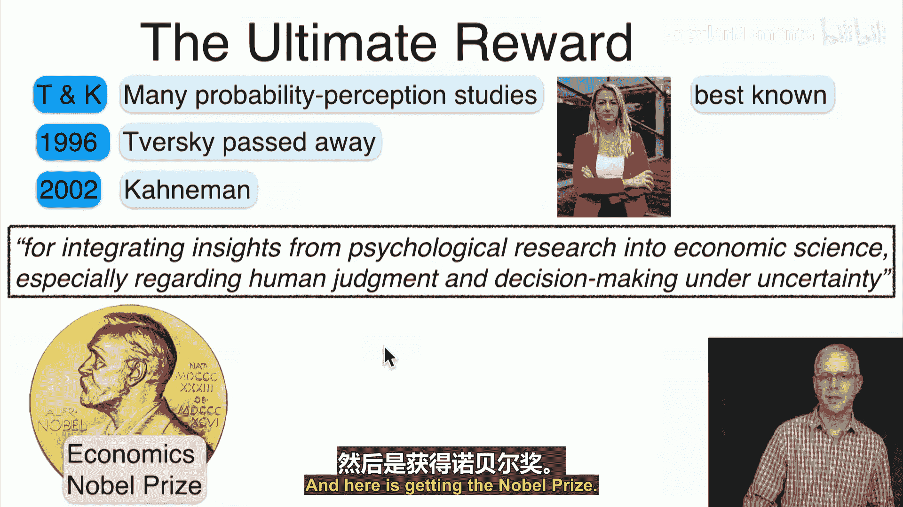
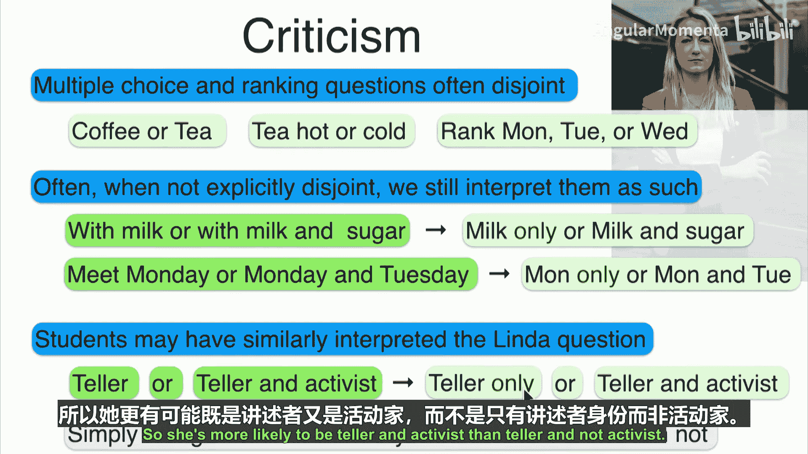
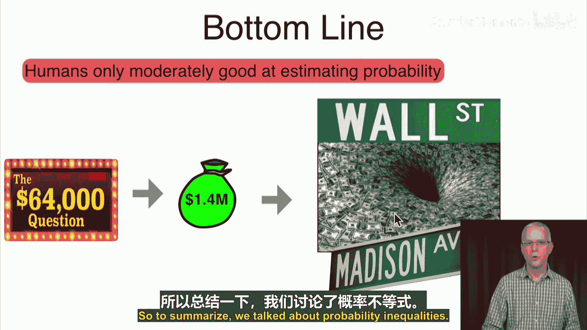

# 【加州大学圣地亚哥分校】使用Python进行数据科学中的概率与统计--Probability-and-Statistics-in-Data-Science-p28-06-07-03-不等式--BV1gJFDzkEPg_p28-

Hello and welcome back in the last lecture we used the probability axioms to prove some equalalities and now we would like to use them to prove a few inequalities and maybe along the way we'll see an interesting question so again we're going to use the three axioms we're going to prove some inequalities including the union bound and then we'll get to a problem that whose road is not $64000 but actually $1。

4 million dollars so let's start so remember the three axioms， there were the non-negtivities。

 the probability of any event is is at least  zero Uniity probability of the whole sample space is one and additional if you have to disjoin set the probability of the union is the sum of the probabilities and in the last lecture we use them to prove a couple of equalalities and now we want to prove to use them to prove some inequalities except that we want to start with zero and that could be view this。

ality is equality， but after that we'll move to inequalities。

 Okay so let's start with so said with essentially zero what is the probability of the nu event so remember that unity says that the probability of the whole sample space is one。

But what about the probability of the empty set？Did we just forget to mention it？No。

 we're going to show that the probability of the empty set can be proved to be0 so the proof is going to be simple。

Remember that the whole sample space omega is the union can be written as the union of the empty space and the whole sample space and therefore the probability of the omega。

 the whole sample space is the probability of the empty set union with omega。

 this union is thisjo and therefore this probability by the additional is the sum of the two probabilitybil。

 probability of the empty set plus probability of omega。

 probability of omega cancels on both sides and what we get we get that the probability of the empty set is zero。

Okay， so that was pretty easy again， it's a one Lego result。

And it says that the nullllyve has N probability where Nil is0。

Okay cool so next we want to start talking about a couple of inequalities so that we once said that the probability of any event is between0 and 1 so the left side the probability of any event is at least zero we know from an axiom that's just the nonnegativity axiom it says the probability of a is at least zero and so what we the only thing we need to show is is the right side。

 the probability of any event is less than equal to one this by the way a core universal bound that for any event a。

 the probability is at least zero and the most one right so so what we want to show is the right side。

 the probability of a is less than equal to one。we start as usual a union a complement is omega and therefore the probability of a union a complement is the probability of omega and now we observe that a and a complement are thisjoin。

 oh sorry going that way first， so the probability of omega by unity is 1。

And then we observe that in a complement are disjoin and so the probability of the union by the addition rule is the sum of the two probabilitybil probability of a plus the probability of a complement and then we use the non- negativegativity rule to set the probability of a complement。

 this is an event so its probability is bigger than equal to0 and therefore this is going to be bigger than equal than just p of a right because we take here P of a and we add something which is non negative so we get a result which is at least as large and what do we get we get the probability of a is less than an equal to1。

So you get the probability of a is less than equal to1 so it says the probability is always between0 and1 and as I said some people call it universal bounds now this is actually a fairly important result。

 the probability of a is less than equal to1 and it's particularly important if you come to UCSD I have a colleague here he teaches probability and it's pretty lenient if he ask you about probability of an event and you don't quite get it right maybe it's probability is 0。

01 and you said it probability of it's 0。99ll still you can still get an a plus from him。

But if you said the public is bigger than one。Any event is as you probably any event you say probably is bigger than one like 1。

01 it says you get an automatic F， so if you come to UCD， just keep that in mind。

Next， the next inequality we want to prove is about probability of subsets。So if a is a subset of B。

 then very naturally we expect the probability of a to be less than equal to probability of B and here's the proof simple proof a is a subset of B then heres the picture here's a here's B we know that the probability of a should be less than equal probability of B we just want to prove it and we can write b as a union b minus a so B as a union b minus a and therefore the probability of b is the probability of this union this union is the disjoint union and therefore it's going to be the sum of these two probabilitybabilities。

 the probability of a plus the probability of b minus a but the probability of b minus a is big and equal to0 and so by the non-negativity this is going to be big and equal to probability of a so we got that the probability of B is big and equal to the probability of a as we want so that's what we want why don't we want to show probability of b is big equal to probability of a Now at this point things get start getting a little boring I think just using those axom。

 those Les again and here we。Two of them so you might say oh this is so obvious you know like why are we're even bothering that doing that and so the only thing I say is we shall see and the last inequality that will that we'll discuss is actually a pair of inequalities that have to do with union of sets so if you have two sets A and B and you ask what can you say about the probability of the union So here are the two sets A and B and you're asking what we can say about the union probability so we'll have a low bound and an upper bound the low bound will say that the probability of a union B is at least the maximum of the probability of a and the probability of B very natural here。

 probability of the union is at least the probability of a and the probability of B its at least the maximum of them and the upper bound also natural says the probability of a union B is at most the probability of a plus the probability of B again very natural because we have your probability of A plus the probability B it should be at least the probability of the union so first let's prove the left side so we know that。

A is a subset of a union B and B is a subset of a union B。

 so both A and B are subsets of a union B and therefore by the subset result that we just proved。

 we see that the probability of a， the probability of b are both less than equal to the probability of a union B and if you have two numbers that are less than or equal to what's written on the right side then the maximum is also less than equal to this right and side so we get the maximum of both of them is also less than equal to probability of a union B Now how about the right side。

 the upper bound so well this we can use the principle of inclusion exclusion here is our pi it will tell us that the probability of a union B is the probability of a plus the probability of b minus the probability of the intersection but the probability of the intersection is a non negativeative number so we subtracting a negative number we'll get a number which is less than equal to the probability of a plus the probability of B so we get the probability of a union B is this number here which is smaller than or equal to the probability of a。

Plus， the problem can be。Alect， so and this last result， even though it is simple。

 look simple and it is simple and it is simple， probability of A and b is less than equal probability of a plus the probability of B is equal called the union bound and it's actually very useful and used to prove very interesting results。

Okay， so。So this leads us to the 1。4 million question。And here it is。

So I figured that now that we're all experts in probability we should be able to solve this very easily and get this reward so here's Linda she's 31 years old。

 she is single outspoken， very bright， she majored in philosophy and as a student she was deeply concerned with issues of discrimination and social justice and also participated in antinuclear demonstrations Okay so this is Linda right here okay and the question we have about her is simple which of those is more probable which has the higher probability。

Simple probability question one， Linda is a bank teller。And two。

 Linda is a bank teller and is active in the feminist movement， as you can see on the right。

So which of those is more likely that Linda is a bank teller or bank teller and active in the feminist movement okay and maybe you can think about it。

 pause if you want the video， think about it for a little bit and once you have the answer hopefully you can see a poll below and if so maybe make you a selection so here you don't see it behind my picture but we ask whether she's bank teller and active in the feminist movement。

All right， okay， so hopefully you have reached your conclusion and so let's see the solution so this question about Linda actually was part of a pretty well known paper。

By Tverky and Kaneman， and they did this experiment。

 there asked 88 University of British Columbia students and which is more likely she's a bank teller or bank teller and activist in the feminist movement and 85% of them。

 the vast majority said she's more likely to be a bank teller and an activist。

Now let's see what happens， let's let B stand for the event that Linda is a bank teller and let A stand for the event that she's active in the feminist movement。

 then what we're asking is about the probability of B。

 the probability that she's bank teller versus the probability of B intersection A that she's a bank teller and active in the in the feminist movement。

 now clearly B intersection A is a subset of B so if you remember the result that we said was so obvious that the probability of a subset is always less than equal to the probability of the super。

 then so B contains B intersection A， so therefore the probability of B therefore must be bigger than equal to the probability of B intersection A contrary to what 85% of the students thought。

Okay。So。So Traver and Canneman used this to suggest that maybe the way we think about probabilities is a little bit irrational。

 so the humans have irrational concept of probabilities and actually studied not just this problem they studied a whole bunch of problems。

 they called this phenomena they called it the conjunction fallacy。

 and they showed other examples of conjunction fallacy， for example， looked at Bjonberg。

 just for those who don't know， he was the preeminent tennis player in the late '70s， he won。

 for example， six French Opens， he won Wiimburndon for five consecutive years， 76 to 1980。

 all five of them he won， so by the end， he was the best known tennis player by far at that time。

So they conducted this rich search in 1980 Tversky and Kaneman and so just after he won the fifth one and so they asked suppose that Borg reaches the 1981 the next next year's following year windble don't finals suppose that that happens which one is more likely is it more likely that Borg will lose the first set or that he will lose the first set but win the match so again you can see here that given you where he was in 1980。

 it's very likely that he'll lose the first set and it's also very likely that he will win the match so perhaps not surprisingly 72% said that it's more likely that he will lose the first set but will win the whole match but again we can see that B is a subset of a because B is lose the first set and something else so it's a subset of a so therefore the probability of B must be less than equal to the probability of a so 72% for this。

Question two got the answer incorrectly okay now just in case you wonder what happened。

 1991 rolled in and Bog indeed reach the final， however he won the first set it did not lose the first set he did win it but he lost the match and he lost it to John McEnroe so just goes to show that maybe none of these things was actually as probable as the researchers thought。

And then in case you're further curious what happened after that， well 1983。

 just two years later or less， he actually retired at the age of 26。All right。

 so but going back from Bjorn Bogue to Traverky and Kaneman， they actually got the ultimate reward。

 so what they did was they looked at many probability perception studies。

 they study a whole bunch of them， but for all of them， the Linda problem is the best known。

And in 1996， unfortunately， Artversky passed away， and then in 2002， Kaneman won the Es Nobel Prize。

 and the citation set for integrating insights from psychological research into economic science。

 especially regarding human judgment and decision making under uncertainty。

 and here is getting the Nobel Prize and just in case you curious， no the award was not $64，000。

 but in fact the Nobelcom Prize comes with $1。4 million。

 although he did share it with another person。

Okay so I should be fair and to say that there's actually some criticism of the Linda problem and what the different types of criticisms。

 many of them I don't understand， but perhaps what seems to me like the most reasonable criticism is as follows that when we ask multiple choice and ranking questions then often the options that we give people are disjoint。

 for example we ask people do you want coffee or tea。

 coffee and tea to disjoint options or do you want you tea hot or cold to disjoint options or do you want to even if you want to do ranking like they asked here。

 they ask you to rank Monday， Tuesday on Wednesday for the time for a meeting。

 these are disjoint options， that's what people usually give you disjoint option。

Even when the options are not explicitly disjoint， then we still interpret them as thisjoint。

 for example， if someone asked if you want your coffee with milk or with milk and sugar typically will interpret to be with milk only or milk and sugar and if they ask you do you want to meet Monday or Monday and Tuesday。

 then most people interpret to mean do you want to meet Monday only or Monday and Tuesday？🤢。

So if you do that then it could be that the students had similar interpretation for the Linda question so when they were asked if Linda is a teller or a teller and an activist。

 it's quite possible they interpreted as is Linda teller only namely teller and not activist or teller an activist and if they did that then the answer could be reasonable because that means that they just said that Linda is more likely to be active in the movement and not active in the movement so she's more likely to be teller and activist than teller and not activist so maybe they were asking this question but regardless of whether this question was correctly phrased or not the bottom line is that humans are only moderately good at estimating probabilities and there are many things that we don't do well and so the problem is actually not not just the $64。

000 question it's not even just a $1。4 million dollar question if you look at Madison Avenue or。

Straight。They make much more out of being able to evaluate probabilities better than humans do and being able to see where humans don't judge probabilitybil is exactly right and take advantage of it so to summarize we talked about probability inequalities we again started with the three axions we talked about several inequalities should mention the union bound is quite important we also said the probability of a set is less than is big and equal to the probability of its subset but as we saw sometimes we don't quite grasp it that way。

And。What are we going to do next time， we'll discuss conditional probably， see you then。

