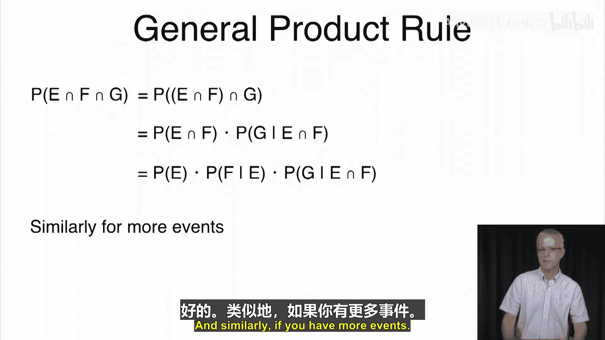

# 【加州大学圣地亚哥分校】使用Python进行数据科学中的概率与统计--Probability-and-Statistics-in-Data-Science-p29-07-01-03-条件概率--BV1gJFDzkEPg_p29-

Hello again everyone in the last few videos we talked about probability and today we want to look at a nuance version called conditional probability so first let's motivate it so often we have partial information about the world and we would like to use it to get better probability estimates and we would like to know how it modifies the probability of events for example if the unemployment numbers are down then it might affect the stock prices and we want to see how that would happen and similarly in San Diego if it's a sunny weekend everyone wonders how many people going to go to the beach and we might want to see what the probabilitybilities under this sunny condition how they different from not knowing the weather and this conditional probability is important in two ways first of all because knowing this information helps us improve our probability estimates and therefore helps us better。

The conditions that are in effect and also they help us often help us determine regular probabilities more easily as we're going to see。

😊，So let's start with an intuitive definition of what we mean by conditional probability。

 so let E and F be events and suppose the T happened， someone told us that some event E happened。

 for example it's sunny， we would like to know what is the probability of F given e the probability that F happens given that T has happened。

And as we know， we are defining to be the fraction of r times that e happens when we also know that F happens。

So let me repeat， we would like to be the fraction， we look at all the times that E has happened。

 and we're interested in the fraction of those times that F also happened。And for example。

 if we have a fair die and we ask what is the probability that we get the number two。

 given the number is even， namely someone told us that the number is even and we want to know in that case what is the probability or what is the fraction that of times that we'll see a2 then we would look at a very long sequence for example this one we see all the numbers that we got even values like here2。

64246 and so on and then we're interested in the fraction of those times that we'll get a2 so this is six and the fraction of lines we get two in this case it's2 over6 which is one third so we would like to determine what fraction of the times that we see a 6 or we see an even number the number is2。

So let's do a few examples again with a die， so remember that the probability of any number including the probability of the number4 is 16 and if you want to calculate the probability of observing a4 given that someone told us that the value is bigger than equal to3 then were looking at the probability of4 given the value is 3。

4，5 and 6 now because all these values are equal likely 3，4，5 and 6。

 the fraction of those times that we will say4 will be 1 fourth。Similarly。

 if we're looking at a probability of 4， given that the value is less than equal to 3。

 then we interest in the fraction of times that we' will see a 4 when someone told us that the value is 1。

2 or3， so clearly whenever we see 1203 we'll never see a 4 so it's going to be 0 divide by 3 or 0。

And we can also look at the probability of not just a single value like four but a more general event。

 what is the probability that the value is less than equal to2 so which is just the probability of 12 which is one thirdd and now let's see what happens when we are told something about the outcome when we're conditioning so what is the probability。

 the value is less than equal to two given that someone told us that it's less than equal to4。

 we're interested in the probability that it's one or two conditioned on the value being one to34 and since again all these value is  one to3。

4 equal likely and we're interested in probability of just two of them。

 the probability is going to be2 over4 which is one2。And finally。

 the probability that the value is going to be less than equal to2。

 given that it's bigger than equal to2， that's the probability that we see 1 or2。

 given that someone told us the values 23，4，506， so clearly we're interested only in the case that the value that we see is2 because one cannot happen given that the value we have told is bigger than equal to2。

 so I interested in probability that2 happened， given that the values were2 up to6 which is going to be15。

 notice that in some cases， like in the first case probability of less than equal to2 given less than equal to4。

 the probability of the event has increased。If were told that the value is less than equal to4。

 it will reduce the number of possibilities and kept the original two values and they probably went from 1 third to1 half whereas if someone told us that the number was big and equal to2。

 then we now have five possibilities but there's only one of them that is possible namely two and they probability went down from 1 third to 15 so it decreased。

Let's do。The more general case， but still staying with uniform spaces for now。

 so we're interested in the probability of a general event F given some other event has happened。

And as we know， that's the probability that our outcome is going to be in F in the event F。

 given that the outcome was in E。So here is a Ven diagram of E and F and were told that the outcome was in E and we're asking what is the probability that it's in f given that it's in E。

 but if it's in E we are told and we are interested in the event that it's in F。

 then it must be both in E， which we are told and in F that we are interested in。

 sore interested in this area in E intersection F and we're asking what's the probability of this lighter area。

 intersection F， given that it was in E。And that's the。

Because probability that's the probability that x is in the intersection of E and f that is the case where x is in e and x is an f given that x is in E and because we're looking at uniform spaces then all the elements in E are equal likely and the number of those elements is the size of E the cardinality of E and out of them we're interested in the number in the elements that are in intersection f and the cardinities is。

 the cardinality of intersection f so the probability is just the ratio of intersection f divided by the cardinality of E so let's do an example so if we have a fair I and we're asking what is the probability of observing a prime given that we observe an odd prime and odd number or I so we're looking at the probability of observing 23 or 5。

 those are the primes between y and6， given that we observe in odd outcome name 135 as we just saw it。

It's just going to be the codeinality of the intersection， 2。

35 intersection with 135 divided by the coinality of odd， which is the coality of 135。

 so it's theinality of3 and 5 divided by the coality of 135， which is 23。

And if we want the probability of observing4， given that we're told the prime has occurred。

 we're looking at the probability of4， given the 235 has occurred。

 we're looking therefore theorinality of four intersection with 235， divided theinality of prime。

 so we're looking at theorinality of the empty set divided by a number of elements in 235。

 which is just 0。Now。This was for the case of uniform spaces where was just the number of elements in the intersection divided by the number of elements in the events we are conditioning on in general we have almost the same result。

 so we we want to find the probability of F given E。

 which just like we have seen before is just the probability that x is in the intersection of E and F given that x is in E。

Except that now we can just cannot look at the coinality of those sets because the elements have different probabilities the number so this is going to be the number of times that will have an element in intersection F。

 number of times well have an element here。As a fraction of the number of times we'll have element from E so number of times we'll have an element from E is n times p of E when n is very large and the number of times we'll have an element in intersection F is n times P of intersection f and and cancel。

 so we get that the probability of f given E is the probability of the intersection of E and f divided by the probability of E so that's the basic formula for conditional probability if you want to find the probability of an event F given another event E we need to look first of all the intersection of the two events E E and f we'll need to look at that probability。

 So looking at this if you want to think of it this probability or this area here divided by the tall probability of the whole thing here。

 So it's the fraction of times。Of the times that will see an element from E。

 the fraction of time that will also see an element in the intersection。

Okay so let's look at an example， remember our four sided die。

 it has four sides one to 3 and 4 with probability 0。10。2。3 and 0。

4 and if we are interested in the probability that the outcome is bigger and equal to 2。

 given that it's less than equal to3， then it's，By what we have just said it's the probability that it's both bigger than equal to2 and less than equal to3 this just means that that we know that it's less than equal to 3 because we are told that and we want we' are looking at the cases where it's bigger than to equal to 2 so we are concerned with the sides that are between 2 and 3 and we divided by the probability it's less than equal to3 so this is going to be the probability of 234。

Intersection with 1，23 intersection of these two events and rev by the probability of 123 so it's the probability of 2 and 3 that's the intersection divided by the probability of 123。

 Now the probability of 2 and3 because the probabilities are the same as the values just normalized by 10。

 so that's going to be 0。5 divided by 0。6 which is 56。

And this conditional probability gives us an equivalent product rule。

 so the conditional probability says the probability of f given e is the probability of the intersection of E and F divided by the probability of E and we can rewrite it as the probability of the intersection is just the probability of E times the probability of f given E。

And this helps us calculate regular nonconditional bubble is in some cases， as we'll see right now。

 So here we have one red ball。So sorry one blue ball and two red balls and we're going to draw two balls and we're asking what is the probability that both of them are red so we have seen before how to do it just using permutations and combinations but we now see an easier way using conditional probabilities so let r1 be the event at the first ball is red and r2 be the event that the second ball is red so the probability that both are red is the probability of r1 intersection with r2 but both happen and that's going to be equal to the probability of r1 times the probability of r2 given r now what is the probability of r1 is two thirds because we have two red balls and one blue so if we take one at random the probability that will be right will be two thirds and once we do that then if r1 happened then we take out one red ball and will be left with one blue ball and one red ball and then the probability of R2 happening given。

One happening is1 half， so it's 23s times1 half， which is 13。

So this is an example of how conditional probability helps us calculate regular probability in a simpler way。

And the protocol can be generalized， so if we have three events。

 we can write the probability of E intersection F intersection G is the probability you can write it as probability of intersection F and G and by the。

Standard product rule the basic product or its probability of EF times probability of G given that EF happened。

 and then we can break probability of E and E and F happening and write its probability of E times probability of F given E times probability of G given ENF。

And。And similarly， if you have more events。

So in this video we talked about conditional probability and in the next one。

 we're going to talk about independence。See you next time。

